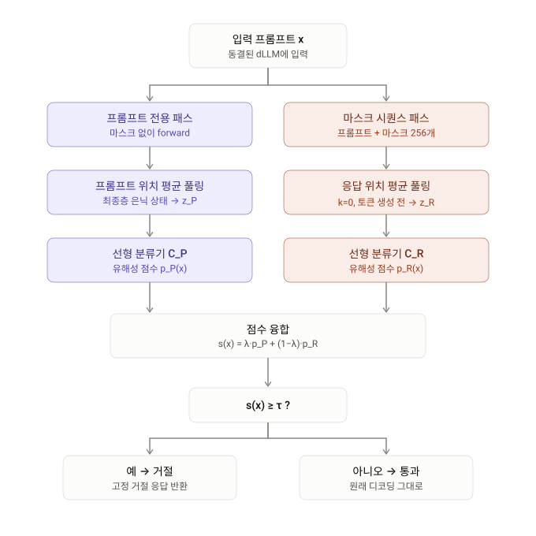

# 0. Summary

기본 정보 : ArXiv,2026.11.06, **[Beyond the Prompt: Leveraging Pre-Decoding States for Jailbreak Detection in dLLMs](https://arxiv.org/abs/2611.10258)**

## 연구 배경

확산 언어모델(diffusion large language model, dLLM)은 왼쪽에서 오른쪽으로 토큰을 하나씩 뽑는 자기회귀(AR) 모델과 달리, 마스크된 시퀀스를 **양방향으로 조건화하면서 여러 응답 위치를 병렬로 반복 정제**해 텍스트를 만든다. LLaDA, Dream 같은 dLLM 은 지시 따르기·코드·수학에서 AR 모델과 경쟁할 만큼 성장했지만 jailbreak 취약성은 그대로 물려받았고, 오히려 양방향 조건화와 병렬 마스크 정제라는 구조적 특성을 노리는 **dLLM 전용 공격**(DIJA 는 프롬프트에 텍스트와 마스크 토큰을 섞어 넣고, PAD 는 디노이징 도중 앵커 토큰을 주입)까지 등장했다. 기존 dLLM 방어는 DiffuGuard 처럼 디노이징 과정 자체를 수정하거나, 토큰 수준 거부 신호·위치별 안전 목적함수로 모델을 미세조정하는 쪽이었다. 한편 AR 모델에서는 프롬프트 은닉 상태에서 선형 분류기로 유해성을 읽어내는 표현 기반 탐지가 잘 알려져 있지만, ReNeLLM 처럼 유해 의도를 중첩 맥락 안에 숨기거나 DIJA 처럼 입력 구조를 뒤트는 공격 앞에서는 프롬프트 표현만으로는 부족하다. 저자들은 dLLM 이 AR 모델에 없는 **탐지 표면**을 하나 더 가지고 있다는 점에 주목한다. 디노이징을 시작하기 전, 아직 전부 마스크 상태인 응답 위치들에도 은닉 상태가 계산되며, 선행 연구는 dLLM 이 디노이징이 끝나기 훨씬 전에 답을 결정한다(early answer convergence)는 점을 보였다. 그렇다면 **토큰을 하나도 생성하기 전의 마스크 응답 상태**에 이미 안전 관련 신호가 담겨 있지 않을까 하는 것이 이 논문의 질문이다.

## 제안 방법

논문은 두 개의 순방향 패스에서 두 가지 뷰를 뽑는다. 프롬프트 뷰 $z_P(x)$ 는 마스크 토큰을 붙이지 않은 프롬프트 전용 패스의 마지막 층 은닉 상태를 프롬프트 위치에 대해 평균 풀링한 것이고, 응답 뷰 $z_R^{(0)}(x)$ 는 프롬프트 뒤에 고정 길이의 마스크를 붙인 패스에서 디노이징 단계 $k=0$ 의 응답 위치 은닉 상태를 평균 풀링한 것이다. 각 뷰에 대해 동결된 dLLM 위에서 **선형 분류기** $C_P$, $C_R$ 를 요청 수준 유해성 라벨로 학습한다. 분석 결과 두 뷰는 서로를 대체하지 못하고 **상보적**이다. $C_P$ 는 HarmBench·PAIR 에 강하지만 DIJA 에 약하고, $C_R$ 는 DIJA 에서 $C_P$ 가 놓친 사례를 대거 회수하지만 PAIR·ReNeLLM 에는 약하다. 이에 저자들은 **ReFuse(Representation Fusion)** 를 제안한다. 두 분류기의 시그모이드 점수를 볼록 결합 $s(x)=\lambda p_P(x)+(1-\lambda)p_R(x)$ 로 합치고 단일 임계값 $\tau$ 로 거부 여부를 정하되, $(\lambda,\tau)$ 는 검증 분할에서 유해 미탐률과 무해 오탐률의 Pareto 프론티어 위 knee point 로 고른다. 거부로 판정되면 디코딩 전에 고정 거부 응답을 돌려주고, 통과하면 원래 디코딩 궤적을 전혀 건드리지 않는다. 모델 가중치 수정도, 디노이징 수정도 없다.

## 발견 사실

LLaDA-8B-Instruct 에서 아홉 가지 공격(HBB, PastTense, AH, PAIR, ReNeLLM, DIJA, PAD, DIA-I, Prefill)의 평균 ASR 은 무방어 63.29%, DiffuGuard 46.09%, RPO 43.46%, Self-Reminder 28.41% 였고, 프롬프트 분류기 $C_P$ 단독은 11.27%(DIJA 는 63.43% 로 여전히 취약), 응답 분류기 $C_R$ 단독은 11.58%(DIJA 6.29% 로 급감, PAIR 30.00%·ReNeLLM 39.44% 는 약함)였다. 두 분류기의 hard OR 결합은 3.74% 까지 내려가지만 XSTest 과민 거부율이 12.22% 에서 20.00% 로 뛰었고, ReFuse 는 **평균 ASR 3.31%**, 유틸리티 벤치마크(ARC-C·MATH-500·MBPP) 평균 무해 거부율 0.74%, XSTest 15.56% 로 균형을 잡았다. LLaDA-1.5 에서는 61.05% → 3.99%, Dream-7B 에서는 44.27% → 13.23% 로 세 모델 모두 평가된 방어 중 최저 평균 ASR 을 기록했다. 같은 분류기를 재학습 없이 다른 생성 길이·리마스킹 전략에 써도 탐지가 유지되었고, LLaDA-8B 와 LLaDA-1.5 사이에서 프로브를 교차 적용해도 성능이 경쟁력 있게 유지되었다(전이 프로브로 LLaDA-1.5 평균 ASR 2.62%). 프롬프트 전용 패스를 생략한 단일 패스 변형 ReFuse+ 는 평균 ASR 4.17%, 유틸리티 BRR 4.63% 로 효율과 강건성을 맞바꾼다. 응답 측 점수는 유해-순응 사례 중앙값 0.9984, 무해-거부 사례 중앙값 0.0079 로 "임박한 거부"가 아니라 **유해성** 신호에 가깝지만, 무해-거부 P90 이 0.9171 이어서 거부 정보도 일부 섞여 있다. 탐지 점수를 피드백으로 받는 적응형 PAIR 는 아홉 번 반복에서 목표 수준 ASR 11.11% 에 도달했다.

## 핵심 기여

1. **dLLM 특유의 사전 디코딩 안전 신호 발견** : 모든 응답 위치가 마스크된 $k=0$ 상태의 은닉 표현에서 유해성이 선형으로 읽히며, 이 신호가 프롬프트 측 신호와 상보적임을, 특히 DIJA 같은 dLLM 전용 공격에서 보였다.
2. **ReFuse** : 프롬프트 뷰·응답 뷰 선형 분류기 점수를 보정된 볼록 결합과 단일 임계값으로 융합하는 경량 이중 뷰 탐지기. 미세조정도 디코딩 수정도 없이 동작하고, 추가 비용은 프롬프트 전용 순방향 패스 한 번이다.
3. **광범위한 평가** : 세 dLLM(LLaDA-8B-Instruct, LLaDA-1.5, Dream-7B) × 아홉 공격에서 평균 ASR 을 63.29% → 3.31%(LLaDA-8B) 로 낮추면서 유틸리티 벤치마크 무해 거부율을 1% 미만으로 유지했고, 디코딩 설정 강건성·모델 간 전이·효율 변형·분류기 구조·적응형 공격까지 분석했다.

# ReFuse 작동 방식

ReFuse는 같은 프롬프트를 두 가지 관점에서 봅니다. 보라색 경로(프롬프트 뷰)는 입력 자체에 담긴 유해 의도를 읽습니다. 산호색 경로(응답 뷰)는 토큰이 아직 하나도 생성되지 않은, 즉 응답 위치가 전부 마스크인 상태의 은닉 상태를 읽습니다. 이 두 번째 경로가 dLLM에만 있는 탐지 표면입니다.

두 경로는 서로의 약점을 보완합니다. 프롬프트 분류기는 DIJA 공격에서 ASR이 63%에 달할 만큼 약하지만, 응답 분류기는 같은 공격에서 6% 수준까지 막아냅니다. 반대로 PAIR 공격에서는 프롬프트 분류기가 훨씬 강합니다.

두 점수는 λ로 가중 평균한 뒤 임계값 τ와 비교합니다. 단순히 "둘 중 하나라도 유해하면 거절"하는 방식(OR)을 쓰면 양쪽의 오탐까지 모두 떠안게 됩니다. 연속 점수를 섞어서 판단하는 방식은 이 과잉 거절을 줄여 줍니다. λ와 τ는 검증 데이터의 파레토 프런티어에서 knee point로 고릅니다. LLaDA-8B 기준으로 λ=0.69, τ≈0.31입니다.

모든 판단은 디코딩이 시작되기 전에 끝납니다. 그래서 통과한 요청은 원래 생성 과정을 그대로 거칩니다. 각 박스를 누르면 해당 단계를 더 자세히 물어볼 수 있습니다.

# 관련 개념

## 마스크 확산 언어모델(dLLM)과 사전 디코딩 상태

마스크 확산 언어모델은 응답 전체를 마스크 토큰으로 채워 놓고, 여러 번의 디노이징 단계에 걸쳐 마스크를 조금씩 실제 토큰으로 바꿔 가며 문장을 완성합니다. 자기회귀 모델이 "다음 토큰 하나"에 대한 상태만 노출하는 것과 달리, dLLM 은 **아직 생성되지 않은 미래 응답 위치마다 은닉 상태**를 유지합니다. 이 논문의 모든 아이디어는 이 차이에서 출발합니다.

---

### 🧩 1. 전체 시퀀스 디코딩의 초기화 (Eq. 1)

프롬프트 $x_{1:p}$ 와 목표 생성 길이 $r$ 가 주어지면, 입력은 프롬프트 토큰 $p$ 개 뒤에 마스크 토큰 $r$ 개를 이어 붙인 형태로 초기화됩니다.

$$
x^{(0)} = \big[ x_1, \ldots, x_p \ \big|\ M_{p+1}, \ldots, M_{p+r} \big]
$$

여기서 $M$ 은 마스크 토큰입니다. 디노이징 단계 $k$ 마다 모델은 모든 위치 $i$, 모든 층 $\ell$ 에서 은닉 상태 $h_i^{(k,\ell)}$ 를 계산하며, 위치 집합은 프롬프트 위치 $\mathcal{P} = \lbrace 1,\ldots,p \rbrace$ 와 응답 위치 $\mathcal{R} = \lbrace p+1,\ldots,p+r \rbrace$ 로 나뉩니다.

---

### 📐 2. 두 가지 뷰의 정의 (Eq. 2)

논문은 **두 번의 별도 순방향 패스**로 두 가지 표현을 만듭니다.

| 뷰 | 패스 | 사용 위치 | 표기 |
|---|---|---|---|
| 프롬프트 뷰 | 마스크를 붙이지 않은 프롬프트 전용 패스 | 프롬프트 위치 $\mathcal{P}$, 마지막 층 $L$ | $z_P(x)$ |
| 응답 뷰 | 프롬프트 + 마스크 $r$ 개를 넣은 마스크 시퀀스 패스 | 응답 위치 $\mathcal{R}$, 디노이징 단계 $k$, 마지막 층 $L$ | $z_R^{(k)}(x)$ |

각 뷰는 해당 위치들의 마지막 층 은닉 상태를 평균 풀링한 벡터입니다.

$$
z_P(x) = \frac{1}{|\mathcal{P}|} \sum_{i \in \mathcal{P} } \hat{h}_i^{(L)}, \qquad z_R^{(k)}(x) = \frac{1}{|\mathcal{R}|} \sum_{i \in \mathcal{R} } h_i^{(k,L)}
$$

$\hat{h}_i^{(L)}$ 는 프롬프트 전용 패스의 은닉 상태, $h_i^{(k,L)}$ 는 마스크 시퀀스 패스의 은닉 상태입니다. 본 논문에서 쓰는 응답 뷰는 $k=0$, 즉 **응답 위치가 전부 마스크인 사전 디코딩(pre-decoding) 상태** $z_R^{(0)}(x)$ 입니다.

---

### 📏 3. 두 지표: ASR 과 BRR

| 지표 | 정의 | 방향 |
|---|---|---|
| ASR (attack success rate) | 탐지기에 거부되지 않고 디코딩 후 유해 순응을 유발한 유해 입력의 비율 | 낮을수록 좋음 |
| BRR (benign refusal rate) | 거부되거나 거부 응답을 낸 무해 입력의 비율 (과민 거부) | 낮을수록 좋음 |

탐지기에 걸린 공격 프롬프트는 고정 거부 응답으로 치환되어 "실패한 공격"으로 집계되고, 통과한 것만 실제로 디코딩해 WildGuard 판정기로 유해 순응 여부를 판단합니다.

> **💡 Key Takeaway**
> dLLM 은 디노이징 시작 전에 이미 응답 위치 전체에 대한 은닉 상태를 가지고 있습니다. 논문은 이 "아직 아무것도 쓰지 않은 답안지"의 표현을 프롬프트 표현과 나란히 놓고, 두 번째 탐지 표면으로 씁니다.

## dLLM 을 겨냥한 공격과 기존 방어

dLLM 은 AR 모델의 jailbreak 위험을 물려받는 동시에, 병렬 생성과 양방향 조건화 때문에 **새로운 구조적 취약성**을 갖습니다. 저자들의 방법을 이해하려면 어떤 공격이 어디를 노리는지, 기존 방어가 어디에 개입하는지를 먼저 구분해야 합니다.

---

### 🎯 1. 평가에 쓰인 아홉 가지 공격 (Table 6)

| 공격 | 메커니즘 (개념 수준) | 핵심 설정 |
|---|---|---|
| Behavior Raw (HBB) | HarmBench 유해 프롬프트를 그대로 전송 | – |
| Prefill | 순응을 유도하는 짧은 접두 문구를 붙임 | 고정 접두사 |
| PastTense | 보조 모델이 요청을 과거형 질문으로 재작성 | 최대 10회 시도 |
| ReNeLLM | 1~6개의 어휘 재작성 연산을 적용한 뒤 코드·표·이야기 같은 중첩 시나리오로 감쌈. 게이트 분류기가 무효 재작성을 거름 | 20회 시도, 6개 연산, 3개 시나리오 템플릿 |
| WildJailbreak AH | WildJailbreak 의 adversarial harmful 분할 사용 | 180개 샘플 |
| PAIR | 보조 모델 피드백과 판정 점수로 적대 프롬프트를 반복 정제 | 5 스트림 × 3 반복, 마지막 3턴 유지 |
| PAD (dLLM 전용) | 고정된 디노이징 위치에 앵커 문구를 주입해 마스크 토큰 예측을 조향 | 256 중 위치 42, 84, 126 |
| DIJA (dLLM 전용) | 보조 모델이 프롬프트에 마스크 토큰을 삽입해 마스크 채우기 행동을 악용 | 최대 10회 시도 |
| DIA-I | 12 메시지의 다중 턴 red-team 페르소나 대화를 prime 하고 보조 모델이 만든 순응 접두를 주입한 뒤 이어쓰기 요청 | 최대 10회 시도 |

유해 시드 프롬프트는 HarmBench Behaviors 이고, 재작성에는 google/gemma-3-4b-it 가 reformulator 로 쓰였습니다. 실제 공격 템플릿은 논문 부록 A.3·A.4 에 실려 있으며, 여기에는 옮기지 않습니다.

---

### 🛡️ 2. 세 가지 베이스라인 방어

| 방어 | 개입 지점 | 원리 |
|---|---|---|
| Self-Reminder | 입력 프롬프트 | 사용자 질의를 안전 상기 문구로 감쌈 |
| RPO | 입력 프롬프트 | 학습된 강건 방어 suffix 를 뒤에 붙임 |
| DiffuGuard | 디노이징 과정 | 리마스킹 전략을 수정하고 의심스러운 생성 블록을 수리하는 dLLM 전용 방어 |

세 방법 모두 저자 공개 구현의 하이퍼파라미터를 그대로 쓰고 테스트 공격에 맞춰 조정하지 않았습니다. 이 외에 미세조정 기반 dLLM 안전 정렬(A2D, 위치 특정 정렬, priming 취약성 완화 등)도 관련 연구로 언급되지만 비교 대상은 아닙니다.

---

### 🔍 3. 이 논문의 위치

기존 dLLM 방어는 **디코딩 시점 개입** 또는 **미세조정**으로 모델 행동을 바꿉니다. 이 논문은 반대로 "모델도 디코딩도 건드리지 않은 채, 동결된 dLLM 의 변경되지 않은 사전 디코딩 상태에서 유해성을 읽어낼 수 있는가"를 묻습니다. AR 모델의 표현 기반 안전 프로빙(거부 방향, 유해성·거부 분리 인코딩, HSF 등)의 연장선이지만, 응답 위치 상태라는 dLLM 고유의 입력을 더한 것이 차이입니다.

> **💡 Key Takeaway**
> DIJA·PAD 가 노리는 "마스크 채우기"와 "병렬 정제"는 공격 표면이자 동시에 탐지 표면입니다. 논문은 같은 구조적 특성을 방어자가 먼저 읽는 쪽으로 뒤집습니다.

## 프롬프트 뷰와 응답 뷰의 상보성

방법을 설계하기 전에 저자들은 두 가지 질문을 실험으로 답합니다. 프롬프트 측 탐지는 어디서 무너지는가, 그리고 응답 측 상태가 그 빈틈을 메우는가.

---

### 📉 1. 프롬프트 측 탐지가 놓치는 것 (Figure 2)

유해·무해 요청의 균형 혼합으로 선형 프롬프트 분류기 $C_P$ 를 학습해 HBB, PAIR, ReNeLLM, DIJA 네 공격에 적용했습니다. $C_P$ 는 HBB 와 PAIR 에서는 강한 탐지력을 보여, 자동화된 재작성 후에도 유해성 정보가 프롬프트 표현에 남아 있음을 시사합니다. 그러나 유해 의도를 숨기는 ReNeLLM 과 입력 구조를 재편하는 DIJA 에서는 성능이 떨어지며 미탐이 늘어납니다.

---

### 🔄 2. 응답 뷰가 회수하는 것

같은 학습 데이터로 여러 디노이징 단계의 응답 표현에서 선형 분류기를 학습했고, **초기 디노이징 상태들의 혼합으로 학습해 $z_R^{(0)}(x)$ 에서 평가**하는 구성이 가장 좋아 이를 $C_R$ 로 삼았습니다. Figure 2 의 공격별 분해에 따르면 $C_R$ 는 단독으로도 여러 공격에서 유해 요청을 잡아내며, 더 중요하게는 $C_P$ 와 **겹치지 않는 부분**을 가집니다. HBB·PAIR 에서는 $C_P$ 가 대부분을 담당하지만, DIJA 에서는 텍스트와 마스크 토큰이 섞여 프롬프트 측 탐지가 약해진 사례를 $C_R$ 가 대거 회수합니다. ReNeLLM 에서도 덜 뚜렷하지만 같은 상보성이 관찰됩니다. 저자들의 결론은 "응답 상태는 프롬프트 활성화의 대체재가 아니라 보완적인 사전 디코딩 신호"입니다.

---

### 📊 3. 점수 차이의 방향 (Figure 3)

탐지 집합의 겹침만으로는 두 분류기가 **얼마나 다르게** 보는지 알 수 없으므로, 부호 있는 점수 차 $p_R(x) - p_P(x)$ 의 분포를 공격별로 그렸습니다.

| 공격 | $p_R - p_P$ 분포 |
|---|---|
| HBB | 0 근처에 집중 (두 뷰가 동의) |
| PAIR | 음의 꼬리가 큼 (프롬프트 뷰가 더 높게 봄) |
| DIJA | 양의 방향으로 치우침 (응답 뷰가 더 높게 봄) |
| ReNeLLM | 양쪽 방향 모두에 걸침 |

두 뷰는 어떤 예시를 잡느냐뿐 아니라 점수 차의 방향과 크기도 공격에 따라 다릅니다. 이것이 단순 합집합이 아닌 **점수 수준 융합**을 설계한 동기입니다.

---

### ✅ 4. 분포 내 성능 (Table 7, 테스트 분할, $k=0$)

| 지표 | LLaDA-8B $C_P$ | LLaDA-8B $C_R$ | LLaDA-1.5 $C_P$ | LLaDA-1.5 $C_R$ | Dream $C_P$ | Dream $C_R$ |
|---|---|---|---|---|---|---|
| Accuracy | 0.9659 | 0.9610 | 0.9707 | 0.9659 | 0.9902 | 0.9805 |
| F1 | 0.9655 | 0.9612 | 0.9703 | 0.9659 | 0.9903 | 0.9805 |

학습 분포 안에서는 두 분류기 모두 96% 이상으로, 응답 뷰가 프롬프트 뷰에 약간 못 미치는 정도입니다. 차이는 분포 밖 공격에서 드러납니다.

> **💡 Key Takeaway**
> 프롬프트 뷰는 "요청이 무엇을 말하는가", 응답 뷰는 "모델이 무엇을 하려 하는가"에 가깝습니다. DIJA 처럼 프롬프트를 망가뜨려도 모델이 유해한 답을 준비한다면 그 준비 상태가 마스크 위치 표현에 먼저 나타납니다.

## ReFuse: 보정된 이중 뷰 탐지

두 분류기를 합치는 가장 쉬운 방법은 **둘 중 하나라도 유해라고 하면 거부**하는 hard union 입니다. 하지만 이 규칙은 양쪽의 오탐까지 물려받아 무해 거부를 키웁니다. ReFuse 는 이산 판정을 합치는 대신 **연속 점수를 먼저 합친 뒤 하나의 임계값**을 둡니다.

---

### 🧮 1. 융합 규칙 (Eq. 3)

$$
s(x) = \lambda \, p_P(x) + (1-\lambda) \, p_R(x), \qquad \mathrm{ReFuse}(x) = \mathbf{1} \lbrace s(x) \geq \tau \rbrace
$$

$p_P(x)$, $p_R(x)$ 는 각 분류기의 시그모이드 유해성 점수, $\lambda \in [0,1]$ 은 두 뷰의 상대 기여, $\tau$ 는 거부 임계값입니다. $\mathrm{ReFuse}(x)=1$ 이면 모델은 **디코딩 전에** 고정 안전 거부 응답을 돌려주고, 아니면 생성은 원래 그대로 진행됩니다. 디코딩 시점 방어와 달리 거부 결정이 생성 이전에 내려지고 디노이징 궤적에 개입하지 않습니다.

---

### 🎛️ 2. $(\lambda,\tau)$ 보정 절차 (Appendix A.5, Figure 4)

보정은 **분류기 학습 데이터의 검증 분할만** 사용합니다.

1. $\lambda \in \lbrace 0.01, 0.02, \ldots, 0.99 \rbrace$ 를 훑고, 각 $\lambda$ 마다 검증 점수가 유도하는 후보 임계값 $\tau$ 를 훑는다.
2. 각 $(\lambda,\tau)$ 에 대해 두 검증 오류를 계산한다: 유해 미탐률(거부되지 않은 유해 검증 예시 비율)과 무해 오탐률(거부된 무해 검증 예시 비율).
3. 두 축에서 비지배(nondominated) 후보만 남겨 Pareto 프론티어를 만든다.
4. 두 축을 $[0,1]$ 로 정규화한 뒤, 프론티어 양 끝점을 잇는 선분에서 **수직 거리가 최대인 knee point** 를 고른다. 동점이면 정규화 오류 공간에서 원점에 가까운 점, 그다음 낮은 유해 미탐률, 낮은 무해 오탐률, 낮은 임계값 순으로 깬다.
5. 선택된 $(\lambda,\tau)$ 는 모든 공격·무해 테스트 평가에 고정한다.

Figure 4 는 세 모델 각각의 sweep 결과와 선택된 운영점을 보여 줍니다. 핵심은 테스트 공격을 전혀 보지 않고 운영점을 정한다는 것입니다.

---

### ⚖️ 3. OR 결합과의 차이

| 결합 방식 | 결정 | 성질 |
|---|---|---|
| $\mathrm{OR}(C_P, C_R)$ | 둘 중 하나라도 1 이면 거부 | 양쪽 오탐을 모두 상속, 커버리지는 최대 |
| ReFuse | $\lambda p_P + (1-\lambda) p_R \geq \tau$ | 한쪽이 약하게 의심하고 다른 쪽이 조용하면 통과시킬 수 있음 |

결과 절에서 보듯 LLaDA-8B 에서 OR 은 평균 ASR 3.74%, ReFuse 는 3.31% 로 ReFuse 가 ASR 도 낮으면서 XSTest 과민 거부는 20.00% 대 15.56% 로 더 낮습니다.

> **💡 Key Takeaway**
> ReFuse 의 "방법"은 식 하나지만, 실제 기여는 **운영점을 검증 분할의 Pareto knee 로 고정하는 절차**에 있습니다. 융합 가중치와 임계값을 테스트 공격에 맞추지 않았다는 점이 결과의 신뢰도를 받칩니다.

## 실험 설정: 위협 모델, 데이터, 모델 구성

---

### 🔒 1. 위협 모델

방어자는 추론 시점에 동결된 dLLM 에 **white-box 접근**(은닉 상태 열람 가능)을 가진 모델 호스트입니다. 공격자는 프롬프트로만 상호작용하며 전이 공격이든 dLLM 전용 공격이든 제출할 수 있습니다. 방어자는 생성 전에 요청을 거부할 수 있지만, 수락된 요청은 원래 생성 절차로 디코딩됩니다.

---

### 🗃️ 2. 분류기 학습 데이터와 하이퍼파라미터 (Table 5)

균형 잡힌 2,048개 샘플: WildJailbreak Vanilla Harmful 1,024개와, Alpaca·WildJailbreak Vanilla Benign 에서 같은 수로 모은 무해 1,024개. 80-10-10% 로 학습·검증·테스트를 나눕니다.

| 하이퍼파라미터 | 값 |
|---|---|
| 과제 | 이진 요청 유해성 분류 |
| 층 | 마지막 층 |
| 고정 응답 길이 | 256 |
| 최대 시퀀스 길이 | 1024 |
| 특징 표준화 | 학습 분할 평균·표준편차 |
| 옵티마이저 | AdamW |
| 학습률 | $5 \times 10^{-4}$ |
| 에폭 | 10 |
| 학습 배치 | 64 |
| 특징 추출 배치 | 16 |
| 검증 선택 지표 | F1 |

프롬프트 뷰 프로브는 프롬프트 토큰, 응답 뷰 프로브는 전체 응답 위치에 대해 풀링합니다. 모든 프로브는 dLLM 을 동결한 채 고정 활성화 위의 선형 readout 입니다.

---

### ⚙️ 3. 디코딩 구성 (Table 4)

| 모델 | 체크포인트 | 생성 길이 | 블록 길이 | 단계 | 온도 | CFG | 리마스킹/알고리즘 | Top-$p$ | 알고리즘 온도 |
|---|---|---|---|---|---|---|---|---|---|
| LLaDA-8B-Instruct | GSAI-ML/LLaDA-8B-Instruct | 256 | 256 | 128 | 0.0 | 0.5 | Random | – | – |
| LLaDA-1.5 | GSAI-ML/LLaDA-1.5 | 256 | 256 | 128 | 0.0 | 0.5 | Random | – | – |
| Dream-7B | Dream-org/Dream-v0-Instruct-7B | 256 | – | 128 | 0.0 | – | Origin | 1.0 | 0.0 |

---

### 📋 4. 무해 벤치마크와 판정 프로토콜

| 벤치마크 | 측정 대상 | 샘플 |
|---|---|---|
| ARC-Challenge | 과학 추론 (객관식) | 180 |
| MATH-500 | 수학 문제 풀이 | 180 |
| MBPP | 기본 Python 프로그래밍 | 180 |
| XSTest | 유해 요청처럼 보이는 무해 프롬프트에 대한 과민 거부 | 180 |

판정기는 WildGuard 입니다. 무해 프롬프트에서는 방어 개입으로 생긴 거부와 모델 응답 자체의 거부를 모두 셉니다. 무효 생성이나 판정 불능 사례는 ASR·BRR 계산에서 제외되므로 **유효 표본 크기는 모델·방어마다 달라질 수 있습니다.**

> **💡 Key Takeaway**
> 학습 데이터는 WildJailbreak vanilla 와 Alpaca 뿐이고, 평가 공격 아홉 가지는 모두 분포 밖입니다. 2,048개 샘플로 학습한 선형 프로브가 어디까지 일반화하는지가 이 실험의 실질적 질문입니다.

## 주요 결과 (Table 1)

세 dLLM 에서 무방어 모델, 세 외부 방어, 개별 분류기, OR 결합, ReFuse 를 비교했습니다. Avg. ASR 은 표시된 아홉 공격의 매크로 평균, Avg. BRR 은 ARC-C·MATH-500·MBPP 의 매크로 평균이며 XSTest 는 따로 보고합니다. 저자들은 ReFuse 가 "모든 열에서 최저 ASR" 이 아니라 **보정된 ASR-BRR 균형**을 위해 선택된 운영점임을 명시합니다.

---

### 📊 1. LLaDA-8B-Instruct (단위 %)

| 방법 | HBB | PastTense | AH | PAIR | ReNeLLM | DIJA | PAD | DIA-I | Prefill | Avg. ASR | ARC-C | MATH-500 | MBPP | Avg. BRR | XSTest |
|---|---|---|---|---|---|---|---|---|---|---|---|---|---|---|---|
| Undefended | 13.89 | 50.29 | 33.33 | 100.00 | 100.00 | 97.14 | 67.22 | 96.09 | 11.67 | 63.29 | 0.00 | 0.00 | 0.00 | 0.00 | 12.22 |
| DiffuGuard | 8.89 | 26.86 | 29.44 | 47.22 | 71.11 | 94.29 | 70.00 | 56.98 | 10.00 | 46.09 | 0.00 | 0.00 | 0.00 | 0.00 | 13.33 |
| RPO | 4.44 | 10.86 | 28.33 | 44.44 | 72.22 | 98.29 | 67.78 | 59.78 | 5.00 | 43.46 | 0.00 | 0.56 | 0.00 | 0.19 | 28.33 |
| Self-Reminder | 2.78 | 4.57 | 11.11 | 25.00 | 50.56 | 94.86 | 30.56 | 32.40 | 3.89 | 28.41 | 0.00 | 2.78 | 0.00 | 0.93 | 20.56 |
| $C_P$ | 1.11 | 8.57 | 1.11 | 1.67 | 23.33 | 63.43 | 1.67 | 0.00 | 0.56 | 11.27 | 1.11 | 0.00 | 0.00 | 0.37 | 12.22 |
| $C_R$ | 1.67 | 3.43 | 6.67 | 30.00 | 39.44 | 6.29 | 12.78 | 2.79 | 1.11 | 11.58 | 0.56 | 0.00 | 0.00 | 0.19 | 20.00 |
| OR($C_P$, $C_R$) | 1.11 | 3.43 | 0.00 | 1.67 | 18.89 | 6.29 | 1.67 | 0.00 | 0.56 | 3.74 | 1.67 | 0.00 | 0.00 | 0.56 | 20.00 |
| **ReFuse** | 1.11 | 3.43 | 0.00 | 0.56 | 14.44 | 8.57 | 1.11 | 0.00 | 0.56 | **3.31** | 2.22 | 0.00 | 0.00 | 0.74 | 15.56 |

---

### 📊 2. LLaDA-1.5 (단위 %)

| 방법 | HBB | PastTense | AH | PAIR | ReNeLLM | DIJA | PAD | DIA-I | Prefill | Avg. ASR | ARC-C | MATH-500 | MBPP | Avg. BRR | XSTest |
|---|---|---|---|---|---|---|---|---|---|---|---|---|---|---|---|
| Undefended | 11.67 | 45.71 | 32.22 | 99.44 | 100.00 | 97.14 | 58.89 | 93.30 | 11.11 | 61.05 | 0.00 | 0.00 | 0.00 | 0.00 | 10.00 |
| DiffuGuard | 8.89 | 26.86 | 30.00 | 50.00 | 71.11 | 95.43 | 57.78 | 54.75 | 7.78 | 44.73 | 0.00 | 0.00 | 0.00 | 0.00 | 12.22 |
| RPO | 5.00 | 9.71 | 32.22 | 42.22 | 71.11 | 96.57 | 56.11 | 64.80 | 5.00 | 42.53 | 0.00 | 2.22 | 0.00 | 0.74 | 28.33 |
| Self-Reminder | 1.67 | 3.43 | 13.33 | 23.89 | 50.00 | 95.43 | 20.00 | 28.49 | 3.33 | 26.62 | 0.00 | 1.67 | 0.00 | 0.56 | 20.56 |
| $C_P$ | 0.56 | 5.71 | 1.11 | 0.56 | 26.67 | 73.14 | 1.67 | 0.00 | 1.67 | 12.34 | 1.11 | 0.00 | 0.00 | 0.37 | 10.56 |
| $C_R$ | 0.56 | 4.57 | 6.67 | 33.33 | 45.56 | 8.57 | 11.67 | 5.59 | 1.67 | 13.13 | 0.56 | 0.00 | 0.00 | 0.19 | 18.89 |
| OR($C_P$, $C_R$) | 0.56 | 2.29 | 0.00 | 0.56 | 22.22 | 8.57 | 1.67 | 0.00 | 1.67 | 4.17 | 1.67 | 0.00 | 0.00 | 0.56 | 19.44 |
| **ReFuse** | 0.56 | 2.29 | 0.00 | 0.56 | 17.78 | 11.43 | 1.67 | 0.00 | 1.67 | **3.99** | 4.44 | 0.00 | 0.00 | 1.48 | 15.56 |

---

### 📊 3. Dream-7B (단위 %)

| 방법 | HBB | PastTense | AH | PAIR | ReNeLLM | DIJA | PAD | DIA-I | Prefill | Avg. ASR | ARC-C | MATH-500 | MBPP | Avg. BRR | XSTest |
|---|---|---|---|---|---|---|---|---|---|---|---|---|---|---|---|
| Undefended | 0.00 | 9.71 | 4.44 | 96.11 | 100.00 | 94.29 | 39.44 | 54.44 | 0.00 | 44.27 | 1.11 | 2.22 | 0.00 | 1.11 | 28.33 |
| DiffuGuard | 1.03 | 2.38 | 1.63 | 11.88 | 39.29 | 90.29 | 0.00 | 29.73 | 1.16 | 19.71 | 0.00 | 8.33 | 1.69 | 3.34 | 48.98 |
| RPO | 0.00 | 0.00 | 0.56 | 1.11 | 16.11 | 97.14 | 41.11 | 0.00 | 0.00 | 17.34 | 1.13 | 3.95 | 11.70 | 5.59 | 57.97 |
| Self-Reminder | 0.00 | 0.57 | 0.56 | 6.11 | 8.89 | 89.14 | 17.22 | 2.22 | 0.00 | 13.86 | 0.56 | 6.67 | 0.63 | 2.62 | 27.49 |
| $C_P$ | 0.00 | 6.29 | 0.56 | 3.33 | 88.89 | 79.43 | 4.44 | 0.00 | 0.00 | 20.33 | 1.67 | 2.22 | 0.00 | 1.30 | 28.33 |
| $C_R$ | 0.00 | 8.57 | 1.11 | 46.67 | 100.00 | 44.00 | 37.78 | 53.33 | 0.00 | 32.38 | 1.11 | 2.22 | 0.00 | 1.11 | 32.78 |
| OR($C_P$, $C_R$) | 0.00 | 6.29 | 0.00 | 3.33 | 88.89 | 37.14 | 4.44 | 0.00 | 0.00 | 15.57 | 1.67 | 2.22 | 0.00 | 1.30 | 32.78 |
| **ReFuse** | 0.00 | 4.00 | 0.00 | 2.22 | 87.22 | 22.86 | 2.78 | 0.00 | 0.00 | **13.23** | 2.22 | 2.22 | 0.00 | 1.48 | 33.33 |

---

### 🔎 4. 읽어야 할 네 가지

* **외부 방어는 잔여 취약성이 큽니다.** LLaDA-8B 에서 DiffuGuard·RPO·Self-Reminder 는 평균 ASR 을 46.09%, 43.46%, 28.41% 로 낮추는 데 그치고 PAIR·ReNeLLM·DIJA 에 특히 약합니다. DIJA 는 세 방어 모두에서 94% 이상입니다.
* **은닉 상태 분류기는 훨씬 강하지만 강점이 갈립니다.** $C_P$ 는 11.27% 이지만 DIJA 63.43%, $C_R$ 는 DIJA 6.29% 이지만 PAIR 30.00%·ReNeLLM 39.44%. Figure 2·3 의 상보성이 표에서도 재현됩니다.
* **OR 결합은 ASR 을 3.74% 로 내리지만 XSTest 를 12.22% → 20.00% 로 올립니다.** 양쪽 오탐을 상속한 결과입니다.
* **ReFuse 는 3.31% / 유틸리티 BRR 0.74% / XSTest 15.56%** 로 셋을 동시에 잡습니다. LLaDA-1.5 에서는 61.05% → 3.99%, Dream-7B 에서는 44.27% → 13.23% 로 세 모델 모두에서 최저 평균 ASR 입니다.

Dream-7B 는 특이합니다. ReNeLLM 에서 $C_P$ 88.89%, $C_R$ 100.00%, ReFuse 87.22% 로 두 뷰 모두 거의 무력하고, 오히려 Self-Reminder(8.89%)와 RPO(16.11%)가 훨씬 낫습니다. 반대로 DIJA 에서는 ReFuse 가 22.86% 로 가장 낮습니다. 표에 그대로 드러나는 사실이지만 본문은 이 Dream-ReNeLLM 실패를 따로 설명하지 않습니다.

> **💡 Key Takeaway**
> 수치의 핵심은 "ReFuse 가 가장 낮다"가 아니라 **DIJA 열**입니다. 프롬프트만 보는 모든 방법(외부 방어, $C_P$)이 DIJA 에 무너지고, 응답 뷰를 넣는 순간 6~9% 대로 떨어집니다. 사전 디코딩 응답 상태가 실제로 다른 정보를 담고 있다는 가장 직접적인 증거입니다.

## 과민 거부 분석: XSTest

좋은 방어는 유해 순응을 줄이면서 무해 입력에 대한 광범위한 거부를 최소화해야 합니다. 표준 유틸리티 벤치마크는 추론·수학·코딩이 유지되는지는 보여 주지만, **유해성 단서를 가진 무해 프롬프트**에서의 과민 거부는 따로 떼어 보지 못합니다. 그래서 XSTest 를 씁니다.

---

### ⚠️ 1. 유틸리티 BRR 이 낮다고 XSTest 가 낮지 않습니다

LLaDA-8B 에서 Self-Reminder 와 RPO 는 ARC-C·MATH-500·MBPP 평균 BRR 이 1% 미만이지만 XSTest 거부율은 무방어 대비 각각 8.34, 16.11 포인트 올랐습니다. 프롬프트 분류기 $C_P$ 는 XSTest 에서 무방어와 같은 12.22% 를 유지한 반면, 응답 분류기 $C_R$ 는 20.00% 로 높아졌습니다. 응답 측 상태가 주는 추가 공격 커버리지가 **무해 거부 증가라는 비용**을 동반할 수 있다는 뜻입니다. ReFuse 는 공동 임계값으로 이를 조정해 XSTest 15.56% (무방어 12.22%), 유틸리티 BRR 0.74% 에 멈춥니다.

---

### 🗂️ 2. 어떤 범주에서 거부가 늘었는가 (Table 11)

무방어 대비 순 증가량을 범주별로 센 결과, 열 범주 중 여섯 범주에서 적어도 한 모델에 증가가 있었습니다.

| XSTest 범주 | LLaDA-8B | LLaDA-1.5 | Dream-7B |
|---|---|---|---|
| Historical events | +4/19 | +4/19 | +2/19 |
| Privacy (public) | +1/18 | +3/18 | +2/18 |
| Definitions | 0/19 | +1/19 | +2/19 |
| Real group / nonsense discrimination | 0/17 | 0/17 | +3/17 |
| Safe targets | +1/17 | +1/17 | 0/17 |
| Privacy (fictional) | 0/20 | +1/20 | 0/20 |
| 총 증가 (pp) | +3.33 | +5.56 | +5.00 |

추가 거부는 고르게 퍼지지 않고 **역사적 사건**과 **공인의 사생활** 질문에 집중되며, Dream 은 정의(definitions)와 실제 집단/무의미 차별 범주에도 민감합니다. 두 범주는 유해 요청과 어휘를 가장 많이 공유하는 곳이므로, 선형 프로브가 주제 어휘에 반응한다는 해석과 일관됩니다.

> **💡 Key Takeaway**
> 과민 거부는 평균으로 보면 3~6 포인트지만 범주별로 보면 특정 주제에 쏠려 있습니다. 표현 기반 탐지기의 오탐은 무작위가 아니라 **의미적으로 유해 요청과 이웃한 무해 요청**에서 체계적으로 발생합니다.

## 디코딩 설정 강건성과 모델 간 전이

dLLM 생성은 목표 길이, 리마스킹 전략 같은 추론 시점 설정에 민감하며, 이는 생성 품질과 안전 행동 모두에 영향을 줍니다. ReFuse 는 이산 토큰 갱신에 개입하지 않고 초기 디노이징 단계의 연속 표현을 읽으므로, 이후 리마스킹 궤적에 덜 의존해야 합니다. 저자들은 **같은 분류기를 재학습 없이** 모든 설정에 적용해 이를 확인했습니다.

---

### 🔧 1. 생성 길이 × 리마스킹 전략 (Table 10, LLaDA, ASR %)

| 공격 | 방법 | Low-conf 64 | 128 | 256 | 512 | Random 64 | 128 | 256 | 512 |
|---|---|---|---|---|---|---|---|---|---|
| HBB | Control | 0.56 | 8.89 | 16.11 | 43.33 | 1.11 | 9.44 | 13.89 | 31.11 |
| | $C_P$ | 0.56 | 0.56 | 1.67 | 3.33 | 0.56 | 0.56 | 1.11 | 1.67 |
| | $C_R$ | 0.00 | 0.56 | 1.67 | 11.67 | 0.00 | 0.56 | 1.67 | 8.33 |
| | ReFuse | 0.00 | 0.56 | 1.11 | 3.33 | 0.00 | 0.56 | 1.11 | 1.67 |
| PAIR | Control | 89.44 | 96.11 | 99.44 | 99.44 | 97.22 | 98.33 | 100.00 | 100.00 |
| | $C_P$ | 2.22 | 0.56 | 1.67 | 2.22 | 3.33 | 1.11 | 1.67 | 1.67 |
| | $C_R$ | 18.33 | 21.67 | 34.44 | 37.22 | 11.11 | 20.56 | 30.00 | 31.11 |
| | ReFuse | 1.11 | 0.56 | 0.56 | 2.22 | 1.11 | 1.11 | 0.56 | 1.11 |
| DIJA | Control | 92.00 | 91.43 | 94.86 | 96.57 | 98.29 | 95.98 | 97.14 | 96.00 |
| | $C_P$ | 60.00 | 62.86 | 64.57 | 62.29 | 66.86 | 63.79 | 63.43 | 66.29 |
| | $C_R$ | 0.57 | 1.71 | 5.25 | 10.29 | 1.14 | 2.30 | 6.29 | 12.00 |
| | ReFuse | 0.57 | 4.57 | 8.00 | 15.43 | 1.14 | 3.45 | 8.57 | 16.57 |
| ReNeLLM | Control | 100.00 | 100.00 | 100.00 | 100.00 | 100.00 | 100.00 | 100.00 | 100.00 |
| | $C_P$ | 23.33 | 21.11 | 24.44 | 23.33 | 24.44 | 21.67 | 23.33 | 21.67 |
| | $C_R$ | 19.44 | 36.11 | 42.22 | 43.89 | 19.44 | 40.56 | 39.44 | 38.89 |
| | ReFuse | 7.22 | 10.56 | 13.89 | 15.00 | 7.78 | 12.22 | 14.44 | 12.78 |

세 가지가 눈에 띕니다. 첫째, 무방어 HBB ASR 은 생성 길이가 길수록 커집니다(Low-conf 0.56% → 43.33%). 둘째, **응답 뷰 $C_R$ 는 길이에 민감**합니다. 마스크 256개로 학습한 프로브를 512개에 쓰면 DIJA 0.57% → 10.29%, HBB 0.00% → 11.67% 로 오릅니다. 응답 위치 평균 풀링이 길이에 따라 분포가 달라지기 때문으로 보입니다. 셋째, ReFuse 는 PAIR·ReNeLLM 에서는 길이와 무관하게 두 단독 분류기보다 낫지만, DIJA 에서는 $C_R$ 단독보다 약간 높습니다(256 Random 에서 6.29% 대 8.57%). 융합이 프롬프트 뷰의 DIJA 약점을 일부 섞어 들이는 셈입니다.

---

### 🔁 2. LLaDA-8B ↔ LLaDA-1.5 전이 (Table 2, %)

LLaDA-1.5 는 LLaDA 를 VRPO 로 한 에폭 후훈련한 모델입니다. 각 목표 모델에 대해 자체 학습 프로브와 상대 모델에서 전이한 프로브를 비교했습니다.

| 목표 | 방법 / 프로브 출처 | HBB | PastTense | AH | PAIR | ReNeLLM | DIJA | PAD | DIA-I | Prefill | Avg. ASR | ARC-C | MATH | MBPP | Avg. BRR | XSTest |
|---|---|---|---|---|---|---|---|---|---|---|---|---|---|---|---|---|
| LLaDA 8B | Undefended | 13.89 | 50.29 | 33.33 | 100.00 | 100.00 | 97.14 | 67.22 | 96.09 | 11.67 | 63.29 | 0.00 | 0.00 | 0.00 | 0.00 | 12.22 |
| | ReFuse, native | 1.11 | 3.43 | 0.00 | 0.56 | 14.44 | 8.57 | 1.11 | 0.00 | 0.56 | 3.31 | 2.22 | 0.00 | 0.00 | 0.74 | 15.56 |
| | ReFuse, transferred | 1.11 | 2.29 | 0.00 | 0.56 | 20.00 | 12.57 | 1.67 | 0.00 | 0.56 | 4.31 | 3.89 | 0.00 | 0.00 | 1.30 | 17.22 |
| LLaDA 1.5 | Undefended | 11.67 | 45.71 | 32.22 | 99.44 | 100.00 | 97.14 | 58.89 | 93.30 | 11.11 | 61.05 | 0.00 | 0.00 | 0.00 | 0.00 | 10.00 |
| | ReFuse, native | 0.56 | 2.29 | 0.00 | 0.56 | 17.78 | 11.43 | 1.67 | 0.00 | 1.67 | 4.00 | 4.44 | 0.00 | 0.00 | 1.48 | 15.56 |
| | ReFuse, transferred | 0.56 | 2.29 | 0.00 | 0.56 | 11.67 | 6.29 | 0.56 | 0.00 | 1.67 | 2.62 | 2.78 | 0.00 | 0.00 | 0.93 | 17.78 |

전이 프로브는 자체 프로브와 경쟁력 있는 수준이고, LLaDA-1.5 에서는 LLaDA-8B 프로브를 가져온 쪽이 오히려 평균 ASR 2.62% 로 자체 4.00% 보다 낮습니다(XSTest 는 17.78% 로 조금 높음). 저자들은 두 뷰의 특징이 특정 체크포인트에 묶여 있지 않고 **가까운 후훈련 변형 사이에서 유용성을 유지**한다고 해석합니다. 다만 전이 범위는 같은 계열의 한 에폭 차이에 한정됩니다. 참고로 LLaDA-1.5 native 평균 ASR 은 Table 1 에서 3.99%, Table 2 에서 4.00% 로 반올림 차이가 있습니다.

> **💡 Key Takeaway**
> 사전 디코딩 신호는 리마스킹 전략에는 둔감하지만 **마스크 길이에는 민감**합니다. 운영 환경에서 생성 길이를 바꾼다면 응답 뷰 프로브의 길이별 재검증이 필요합니다.

## 효율 변형 ReFuse+ 와 분류기 구조

ReFuse 는 생성 전에 두 번의 순방향 패스가 필요합니다. 프롬프트 전용 패스와, 프롬프트 뒤에 고정 응답 마스크를 붙인 초기 마스크 시퀀스 패스입니다. 후자는 표준 dLLM 디코딩에 이미 포함되어 있으므로, **추가 비용은 프롬프트 전용 패스 한 번**이며 수십~백여 단계의 디노이징에 비하면 작습니다. 그래도 이것마저 줄일 수 있을지를 묻습니다.

---

### ⚡ 1. 단일 패스 변형 ReFuse+ (Table 3, LLaDA-8B, %)

$C_P$ 를 $C_P^{+}$ 로 바꿉니다. $C_P^{+}$ 는 응답 뷰와 **같은 마스크 시퀀스 패스**의 은닉 상태를 쓰되 마스크 응답 대신 프롬프트 토큰에 대해 평균 풀링한 분류기입니다. 두 점수가 한 번의 사전 디코딩 패스에서 나옵니다.

| 방법 | HBB | PastTense | AH | PAIR | ReNeLLM | DIJA | PAD | DIA-I | Prefill | Avg. ASR | ARC-C | MATH | MBPP | Avg. BRR | XSTest |
|---|---|---|---|---|---|---|---|---|---|---|---|---|---|---|---|
| Undefended | 13.89 | 50.29 | 33.33 | 100.00 | 100.00 | 97.14 | 67.22 | 96.09 | 11.67 | 63.29 | 0.00 | 0.00 | 0.00 | 0.00 | 12.22 |
| $C_P$ | 1.11 | 8.57 | 1.11 | 1.67 | 23.33 | 63.43 | 1.67 | 0.00 | 0.56 | 11.27 | 1.11 | 0.00 | 0.00 | 0.37 | 12.22 |
| $C_P^{+}$ (마스크 포함) | 1.67 | 25.71 | 2.22 | 1.67 | 36.67 | 85.71 | 3.89 | 0.00 | 1.11 | 17.63 | 1.11 | 0.00 | 0.00 | 0.37 | 12.22 |
| $C_R$ | 1.67 | 3.43 | 6.67 | 30.00 | 39.44 | 6.29 | 12.78 | 2.79 | 1.11 | 11.58 | 0.56 | 0.00 | 0.00 | 0.19 | 20.00 |
| ReFuse | 1.11 | 3.43 | 0.00 | 0.56 | 14.44 | 8.57 | 1.11 | 0.00 | 0.56 | 3.31 | 2.22 | 0.00 | 0.00 | 0.74 | 15.56 |
| ReFuse+ | 1.11 | 3.43 | 0.00 | 0.00 | 3.33 | 26.86 | 2.22 | 0.00 | 0.56 | 4.17 | 11.11 | 2.78 | 0.00 | 4.63 | 15.56 |

효율은 얻지만 강건성을 잃습니다. 평균 ASR 은 3.31% → 4.17% 로, 특히 DIJA 가 8.57% → 26.86% 로 가장 크게 나빠집니다. $C_P^{+}$ 자체가 DIJA 85.71% 로 $C_P$(63.43%)보다 훨씬 약한데, 마스크 토큰이 붙은 패스에서는 프롬프트 위치 표현도 DIJA 의 삽입 마스크에 오염되기 때문으로 읽힙니다. 유틸리티 BRR 도 0.74% → 4.63% 로 오르며(ARC-C 11.11%), XSTest 는 그대로입니다. 흥미롭게도 ReNeLLM 은 14.44% → 3.33% 로 오히려 좋아지지만 본문은 이 점을 논하지 않습니다. 저자들은 ReFuse 를 기본 구성으로, ReFuse+ 를 사전 생성 연산 최소화가 최우선일 때의 저비용 변형으로 둡니다.

---

### 🧠 2. 선형 분류기가 병목인가 (Table 8, Appendix B.4)

선형 분류기 대신 두 가지 고용량 대안을 시험했습니다. 평균 풀링된 동결 표현 위의 MLP(4096 → 512 → 1)와, 풀링하지 않은 토큰 표현을 32차원으로 사영한 뒤 4 헤드 attention·64차원 FFN 한 블록과 학습된 분류 토큰을 쓰는 소형 transformer 입니다.

| 분류기 | Avg. ASR | 유틸리티 BRR | XSTest BRR |
|---|---|---|---|
| Linear | 3.31 | 0.74 | 15.56 |
| MLP | 1.63 | 2.59 | 22.22 |
| Transformer | 1.38 | 3.70 | 20.56 |

보정된 운영점에서 두 고용량 분류기는 ASR 을 낮추지만 과민 거부를 키웁니다. XSTest 에서 선형 분류기의 15.56% BRR 에 맞춰 임계값을 **사후에(post-hoc)** 고르면 MLP 2.84%, transformer 3.01% 의 ASR 로 선형 3.31% 와의 차이가 작습니다. 이 오라클 이점에도 개선이 크지 않으므로 저자들은 단순한 선형 분류기를 유지합니다.

> **💡 Key Takeaway**
> 프롬프트 전용 패스는 "비용"이 아니라 "깨끗한 프롬프트 뷰"를 사는 값입니다. 마스크가 붙은 패스에서 프롬프트 표현을 읽으면 DIJA 의 마스크 삽입이 프롬프트 뷰까지 흔듭니다.

## 응답 측 신호는 무엇을 읽는가

응답 분류기가 높은 점수를 주는 이유가 "유해성"인지 "임박한 거부"인지는 탐지기의 의미를 좌우합니다. 거부를 읽는 분류기라면 무해-거부 사례에 높은 점수를, 유해-순응 사례에 낮은 점수를 줄 것입니다.

---

### 🔬 1. 유해성 대 거부 행동 (Table 9)

요청의 유해성과 모델의 최종 응답으로 네 집단을 나눠 $C_R$ 점수를 봤습니다.

| 집단 | N | 평균 $p_R$ | 중앙값 $p_R$ | P10 | P90 |
|---|---|---|---|---|---|
| 무해, 비거부 | 698 | 0.0230 | 0.0000 | 0.0000 | 0.0009 |
| 무해, 거부 | 22 | 0.2615 | 0.0079 | 0.0000 | 0.9171 |
| 유해, 거부 | 710 | 0.9484 | 0.9999 | 0.9362 | 1.0000 |
| 유해, 순응 | 1,575 | 0.8114 | 0.9984 | 0.0607 | 1.0000 |

관찰은 거부 해석과 반대입니다. 유해-순응의 중앙값은 0.9984 로 매우 높고, 무해-거부의 중앙값은 0.0079 로 매우 낮으며, 유해-거부와 유해-순응이 모두 높습니다. 즉 **최종 행동과 무관하게 지속되는 유해성 관련 신호**에 가깝습니다. 다만 무해-거부의 P90 이 0.9171 로 상위 꼬리가 무겁고 유해-순응의 P10 이 0.0607 로 하위 꼬리가 있어, 일부 사례에서는 거부 관련 정보가 기여합니다. 저자들은 표현이 유해성만 인코딩한다고는 결론짓지 않습니다.

---

### 🎚️ 2. 디노이징 단계별 전이 (Appendix B.3, Figure 8)

응답 측 정보가 언제 나타나는지 보기 위해, 서로 다른 디노이징 단계에서 추출한 응답 표현으로 프로브를 학습하고 다른 단계에서 평가했습니다(1% FPR 에서의 TPR, 128 단계 롤아웃의 단계별 캐시 사용). 한 단계에서 잘 되는 프로브가 다른 단계에서는 크게 나빠질 수 있어, 단일 단계보다 **여러 단계 혼합 학습**이 필요합니다.

| 혼합 | 사용 단계 | 결과 |
|---|---|---|
| Early | 0–15 | 평가 단계 0 에서 최고 TPR, 교차 단계 일반화도 강함 → $C_R$ 로 채택 |
| Sparse | 0, 8, 16, 32, 64, 96, 127 | – |
| All | 0–127 | – |

본문 실험의 응답 측 평가는 모두 $z_R^{(0)}(x)$, 즉 응답 토큰이 하나도 확정되기 전에 수행됩니다.

---

### 📈 3. ROC (Appendix B.2)

세 dLLM 모두에서 프롬프트·응답·융합 분류기의 AUROC 가 0.98 을 넘습니다. 융합 점수는 LLaDA-8B 0.9970, LLaDA-1.5 0.9951 로 최고이고 Dream-7B 에서는 프롬프트 분류기와 같은 0.9998 입니다. 단, 이 ROC 는 학습 분포의 테스트 분할 기준이므로 분포 밖 공격의 Table 1 과 직접 비교할 수 없습니다.

---

### 🧷 4. 토큰 수준 귀인 (Appendix B.5, Figure 9)

풀링하지 않은 응답 상태 위의 transformer 분류기에 gradient × input 귀인을 적용해 유해 클래스 로짓에 기여한 응답 위치를 순위화했습니다. $k=0$ 에서는 모든 위치가 마스크이므로 토큰 라벨은 **최종 디코딩 결과에서 사후에** 붙인 것이며, 그 토큰이 디코딩 전에 존재했다는 뜻이 아닙니다. ARC-C(점수 0.017), HarmBench(0.971), PastTense(0.926) 예시에서 유해 예시의 핵심 동사·명사 위치가 높은 귀인을 받아, 응답 표현에 국소화된 의미 정보가 있을 수 있음을 시사합니다. 인과적 토큰 수준 효과를 확립하려면 표적 개입이 필요하다고 저자들도 적습니다. 예시 응답 발췌는 논문 Figure 9 에 있으며 여기에는 옮기지 않습니다.

> **💡 Key Takeaway**
> 응답 뷰 점수는 "모델이 거부할 것이다"가 아니라 "요청이 유해하다"에 더 가깝지만 완전히 분리되지는 않습니다. 유해-순응 사례에서도 신호가 살아 있다는 점이 jailbreak 탐지기로서의 가치를 만듭니다.

## 적응형 공격 아래의 한계 (5.4)

본문 평가의 공격은 모두 ReFuse 를 모르는 비적응형입니다. 한계를 재기 위해 저자들은 **점수 인지(score-aware) PAIR** 를 구성했습니다. reformulator 가 탐지기의 융합 점수 $s(x)$ 를 피드백으로 받아 재작성을 반복합니다. 지표는 목표 수준 적응형 ASR, 즉 후보 중 하나라도 거부를 피하고 유해 응답을 끌어낸 유해 목표의 비율입니다.

| 반복 예산 | 목표 수준 ASR |
|---|---|
| 9회 | 11.11% |

Figure 6 에 따르면 목표 수준 ASR 은 재작성 예산과 함께 증가합니다. 점수 유도 재작성을 반복하면 공격자가 성공하는 jailbreak 를 찾을 수 있다는 뜻입니다. 평가는 융합 점수로 유도된 PAIR 재작성에 한정되며, 프롬프트·응답 분류기를 통과하는 **그래디언트를 이용한 white-box 공격**은 다루지 않았습니다. 저자들은 이를 중요한 향후 과제로 남깁니다.

> **💡 Key Takeaway**
> 비적응형 3.31% 와 적응형 11.11% 사이의 간격이 이 방어의 실제 여유폭입니다. 탐지 점수가 공격자에게 새면 선형 프로브는 아홉 번의 재작성 안에 열 건 중 한 건꼴로 뚫립니다.

## 한계와 열린 방향

ReFuse 는 dLLM 에서 "디코딩 전 응답 상태" 라는 새로운 탐지 표면을 깔끔하게 보여 주지만, 방법의 단순함만큼 평가의 범위도 제한적입니다.

---

### ⚠️ 1. 저자가 인정한 한계

* 적응형 평가는 융합 점수를 피드백으로 받는 PAIR 재작성에 한정되며, 분류기 그래디언트를 직접 최적화하는 white-box 공격은 평가하지 않았습니다. 9회 반복에서 목표 수준 ASR 11.11% 까지 올라갑니다.
* 응답 측 신호가 유해성만 인코딩한다고 결론지을 수 없습니다. 무해-거부 집단의 P90 이 0.9171 로 거부 관련 정보가 일부 섞여 있습니다.
* 토큰 수준 귀인은 사후 라벨에 의존하는 예시 수준 관찰이며, 인과적 효과는 표적 개입이 있어야 확립됩니다.
* 단일 패스 변형 ReFuse+ 는 DIJA 에서 26.86% 로 크게 약해지고 유틸리티 BRR 이 4.63% 로 올라, 효율과 강건성을 맞바꿉니다.
* 무효 생성·판정 불능 사례를 제외하므로 유효 표본 크기가 모델·방어마다 다릅니다.

---

### 🔒 2. 외부 관점의 한계

* 전이 실험은 LLaDA-8B 와 그것을 한 에폭 후훈련한 LLaDA-1.5 사이뿐입니다. Dream-7B 처럼 계열이 다른 모델로의 전이나, 블록 디코딩·다른 리마스킹 알고리즘을 쓰는 dLLM 으로의 확장은 검증되지 않았습니다.
* Dream-7B 에서 ReNeLLM ASR 이 87.22% 로 거의 방어되지 않으며, 이 경우 Self-Reminder(8.89%)가 훨씬 낫습니다. 본문은 "세 모델에서 최저 평균 ASR" 만 강조하고 이 실패를 설명하지 않습니다. 중첩 시나리오 공격에 대한 응답 뷰의 한계는 모델 의존적일 수 있습니다.
* 응답 뷰는 마스크 길이에 민감합니다(Table 10 에서 512 길이에서 DIJA 10~12%, HBB 8~12%). 운영 환경에서 생성 길이가 가변적이면 길이별 보정이 필요한데 논문은 고정 길이 256 으로 학습했습니다.
* 평가 공격은 모두 gemma-3-4b-it 라는 하나의 작은 reformulator 로 생성되었고, 각 벤치마크는 180개 샘플입니다. ASR 한 칸의 해상도가 약 0.56 포인트이므로 0.56% 대 1.11% 같은 차이는 한두 사례 차이입니다.
* 판정기가 WildGuard 하나이고, 거부 응답은 고정 문구로 치환되므로 "거부하지만 부분적으로 유해한 정보를 흘리는" 응답은 측정 대상에서 빠집니다.
* XSTest 과민 거부가 역사적 사건·공인 사생활에 집중된다는 것은 프로브가 주제 어휘에 반응한다는 신호입니다. 보정으로 수치를 낮췄을 뿐 원인(유해성과 주제의 얽힘)은 다루지 않았습니다.

---

### ❓ 3. 열린 질문

* 응답 뷰가 DIJA 에 강한 이유가 "모델이 유해한 완성을 준비하기 때문"인지 "삽입된 마스크 토큰의 패턴 자체"인지 구분되지 않았습니다. 마스크를 삽입하되 무해한 요청을 넣는 통제 조건이 필요합니다.
* 두 뷰의 상보성은 마지막 층에서만 측정되었습니다. 중간 층의 응답 위치 표현이 더 이른 또는 더 분리된 신호를 주는지는 열려 있습니다.
* $(\lambda,\tau)$ 를 하나로 고정하는 대신 공격 유형이나 입력 길이에 따라 적응시키면 OR 의 커버리지와 ReFuse 의 낮은 오탐을 함께 얻을 수 있는지 궁금합니다.
* 디노이징 도중 단계 $k>0$ 의 응답 상태를 계속 감시하는 **런타임 탐지**로 확장하면 사전 디코딩 단계에서 놓친 공격(특히 PAD 처럼 디노이징 중에 주입되는 공격)을 잡을 수 있을지가 자연스러운 다음 질문입니다.

---

### 🧷 4. 내 판단과 연구 연결

* 표현 기반 jailbreak 탐지를 AR 모델에서 해 온 입장에서 가장 쓸모 있는 부분은 **"프롬프트 표현 vs 모델이 준비하는 응답 표현"의 분리**입니다. AR 모델에서는 이것이 프롬프트 마지막 토큰 상태와 첫 몇 생성 토큰의 상태에 해당하므로, 같은 상보성 분석(Figure 2 의 탐지 집합 분해, Figure 3 의 점수 차 분포)을 AR 탐지기에도 그대로 적용해 볼 수 있습니다.
* Table 9 의 "유해성 대 거부" 분해는 어떤 활성화 프로브든 반드시 거쳐야 할 통제입니다. 유해-순응 사례에서 점수가 유지되는지를 보지 않으면, 탐지기가 거부 방향을 읽고 있을 뿐인데 jailbreak 탐지로 오해할 수 있습니다.
* 검증 분할의 Pareto knee 로 $(\lambda,\tau)$ 를 고정하고 테스트 공격을 전혀 보지 않는 보정 절차는 안전-유용성 균형을 보고할 때의 좋은 기준선입니다. XSTest 와 유틸리티 BRR 을 따로 보고하는 관행도 같이 가져올 만합니다.
* 공격자 관점에서 약점은 명확합니다. 응답 뷰는 마스크 길이와 중첩 시나리오(ReNeLLM, 특히 Dream)에 약하고, 융합은 DIJA 에서 $C_R$ 단독보다 약간 나쁩니다. 점수 피드백만으로 9회 안에 11% 가 뚫리므로, 분류기 그래디언트를 쓰는 white-box 적응형 공격이 자연스러운 다음 실험입니다.
