# 0. Summary

기본 정보 : ArXiv,2026.11.09, **[AnyBreak: Towards Jailbreaking Any T2I Model for Any Concept](https://arxiv.org/abs/2611.11980)**

## 연구 배경

텍스트-이미지(T2I) 모델은 대규모 웹 데이터로 사전학습되는 과정에서 부적절하거나 불법적인 콘텐츠까지 함께 내재화하고, 공격자는 이 잠재 지식을 적대 입력으로 끌어내 NSFW(Not-Safe-For-Work) 이미지를 생성시킬 수 있다. 기존 방어는 민감 키워드 블랙리스트 기반 **프롬프트 필터링**과 모델 파라미터에서 악성 개념을 지우는 **개념 소거(concept erasure)** 에 집중되어 있고, 기존 공격(QF, SneakyPrompt, Ring-A-Bell, MMA 등)은 대부분 토큰 치환으로 악성 의미를 유지하면서 필터를 피하는 **텍스트 측 공격**이다. 저자들은 이런 텍스트 중심 공격이 공통의 약점을 가진다고 지적한다. 공격 벡터가 프롬프트이기 때문에 perplexity 기반 같은 가벼운 사전(pre-hoc) 텍스트 필터만으로도 공격 성공률(ASR)이 20% 아래로 떨어진다(Fig. 2). 이미지 측 공격인 AdvI2I 는 깨끗한 텍스트와 적대 이미지로 공격하지만, 대상 모델에 대한 white-box 접근을 가정하고 악성 개념마다 노이즈 생성기를 새로 훈련해야 해 비용이 크다(Table I 기준 20.27h). 그래서 논문은 질문을 "필터를 통과하는 악성 프롬프트를 어떻게 만들까"에서 **"깨끗한 프롬프트만으로, 어떤 T2I 모델이든, 어떤 악성 개념이든 jailbreak 할 수 있는가"** 로 바꾼다.

## 제안 방법

**AnyBreak** 는 추론 시점에 깨끗한 텍스트 프롬프트와 적대 이미지만 사용하는 **블랙박스 범용 jailbreak 프레임워크**다. 두 축으로 구성된다. 첫째, **교차 모달 악성 개념 전이(cross-modal malicious concept transfer)** 는 생성기로 악성 개념 $c_m$ 을 타깃 이미지 $x_t$ 로 바꾼 뒤, 여러 이미지 인코더 $f_1,\dots,f_n$ 의 특징 공간에서 깨끗한 이미지 $x_c$ 와 $x_t$ 를 픽셀 수준으로 의미 정렬(semantic alignment)한다. 저자들은 섭동된 분포와 타깃 분포의 KL 발산이 작을수록 생성 샘플이 악성 매니폴드의 근방으로 떨어질 확률의 하한이 올라간다는 부등식(Eq. 4)으로 이 설계를 뒷받침한다. 둘째, **범용 적대 노이즈 최적화**는 전역 유사도만 최대화하면 국소 구조를 놓쳐 의미가 붕괴한다는 관찰(Table II)에 따라, 매 반복마다 깨끗한 이미지와 타깃 이미지 각각에서 임의의 국소 윈도우를 잘라 코사인 유사도를 FGSM 으로 $K$ 라운드 올리는 **다중 스케일 점진 정렬**을 쓴다(Eq. 5–6). 생성된 적대 이미지를 무해한 프롬프트와 함께 어떤 T2I 모델에 넣으면, 주입된 노이즈가 잠재 벡터를 정상 데이터 매니폴드 밖 악성 개념 영역으로 밀어낸다. 변형인 **AnyBreak-V** 는 사후(post-hoc) 안전 검사기가 생성 이미지와 사전 정의된 NSFW 개념 임베딩의 유사도로 차단한다는 점을 이용해, 생성 이미지를 그 임베딩 공간에서 멀어지게 하는 보상(compensation) 항(Eq. 7)을 목적 함수에 더한다.

## 발견 사실

SD-V1.5-Inpainting, SD-V2-Inpainting, InstructPix2Pix 세 모델에서 방어가 없을 때 AnyBreak 의 ASR 은 각각 84.51%, 85.39%, 61.78% 로 평균 약 77% 였고, CLIP-score 는 약 0.25(프롬프트-생성 이미지 간 직접 측정값 약 0.28 대비), LPIPS 는 평균 0.05 수준으로 시각적 충실도를 유지했다. 가우시안 노이즈 주입과 Negative Prompt 아래에서도 ASR 은 SD-1.5 기준 81.25%, 74.53% 로 크게 떨어지지 않았지만, 사후 안전 검사기(Safety Checker)는 AnyBreak 를 2.78%(SD-1.5), 6.01%(SD-2), 3.29%(P2P)까지 막았다. 이 구멍을 AnyBreak-V 가 메운다. 보상 항 때문에 무방어 ASR 은 53.54%, 52.12%, 29.49% 로 낮아지지만 안전 검사기 아래에서도 46.61%, 49.29%, 29.19% 를 유지해 무방어 대비 평균 5 포인트 미만 하락에 그쳤다. SD-1.5 에서의 비교(Table IV)에서 MMA(42.21%), MMA-Mask(22.21%), AdvI2I(62.82%)를 모두 넘었고 LPIPS 도 0.0708 로 AdvI2I 의 0.1436, MMA 의 0.3937 보다 훨씬 낮았다. 다섯 악성 개념 범주(Adult, Bloody, Violence, Horror, Racism)에서 SD-1.5 ASR 은 71.0~87.5% 로 개념 범용성을 보였다(Table V). 공격 한 건을 만드는 시간은 0.017h 로, 비교 대상 중 가장 빠른 QF(0.43h)의 약 1/25 이다.

## 핵심 기여

1. **블랙박스 범용 T2I jailbreak 프레임워크 AnyBreak** : 깨끗한 프롬프트와 적대 이미지만으로 임의의 T2I 모델을 임의의 악성 개념으로 jailbreak 할 수 있는 새로운 교차 모달 공격 표면을 드러냈다.
2. **범용 적대 노이즈 구성 전략과 이론 분석** : 픽셀 수준 의미 정렬이 데이터 매니폴드를 NSFW 영역으로 밀 수 있음을 KL 발산 기반 하한(Eq. 4)으로 설명하고, 국소 윈도우 다중 스케일 정렬로 전역 유사도 최적화의 의미 붕괴를 피했다.
3. **광범위한 실험** : 세 모델, 다섯 악성 개념, 세 종류 방어(입력 노이즈·안전 검사기·Negative Prompt)에서 AnyBreak 와 AnyBreak-V 의 효과를 검증하고, 기존 T2I 방어가 교차 모달 공격 표면을 충분히 다루지 못함을 보였다.

# AnyBreak 과정 시각화

AnyBreak은 크게 두 단계로 나뉩니다. 먼저 오프라인에서 공격용 이미지를 만들고, 추론 시에는 그 이미지를 무해한 프롬프트와 함께 넣기만 합니다.

AnyBreak은 크게 두 단계로 나뉩니다. 먼저 오프라인에서 공격용 이미지를 만들고, 추론 시에는 그 이미지를 무해한 프롬프트와 함께 넣기만 합니다.

핵심 아이디어는 두 가지입니다.

첫째는 **개념의 모달리티 전환**입니다. 유해 개념을 텍스트가 아니라 이미지 픽셀에 숨깁니다. 프롬프트에는 문제 될 단어가 없으므로 텍스트 필터나 퍼플렉서티 필터로는 걸러지지 않습니다. 저자들은 Fig. 4 실험으로 이를 뒷받침합니다. 유해 이미지만 넣어도 유해 텍스트를 넣은 것처럼 생성 결과가 불안전 영역에 가까워진다는 것입니다.

둘째는 **로컬 윈도우 정렬**입니다. 이미지 전체의 CLIP 유사도만 높이면 유사도가 0.85까지 올라가도 ASR이 58% 근처에서 멈춘다고 합니다(Table II). 그래서 매 반복마다 두 이미지에서 크기와 위치가 다른 크롭을 무작위로 뽑아, 그 부분끼리 임베딩이 맞도록 섭동을 갱신합니다. 이렇게 하면 전역 의미와 국소 구조가 함께 맞춰집니다. 여러 인코더의 평균을 쓰는 것은 특정 모델에 덜 의존하도록, 즉 전이성을 높이려는 목적입니다.

다만 앞서 말씀드렸듯 실험 대상은 이미지를 입력받는 편집 및 인페인팅 모델뿐입니다. 그림의 2단계도 "임의의 T2I 모델"이 아니라 이 범위로 이해하시는 게 정확합니다.

# Abstract 쉬운 설명(Gemini)

# 관련 개념

## T2I Jailbreak 의 위협 지형과 기존 공격의 한계

T2I 모델에 대한 jailbreak 는 "모델이 학습 데이터에서 내재화한 악성 개념을 어떤 입력으로 끌어내는가"의 문제입니다. 논문은 기존 연구를 공격 모달리티, 위협 모델, 비용, 범용성의 네 축으로 정리하면서, 거의 모든 선행 연구가 **텍스트 측**과 **white-box** 에 몰려 있다는 점을 출발점으로 삼습니다.

---

### 🗺️ 1. 기존 방법 비교 (Table I)

| 방법 | 학회 | 공격 모달리티 | 위협 모델 | 공격 1건 생성 시간 | 범용성 |
|---|---|---|---|---|---|
| QF | CVPR'23 | Text | White-box | 0.43h | 없음 |
| MMA | CVPR'24 | Text + Image | White-box | 5.18h | 없음 |
| Ring (Ring-A-Bell) | ICLR'24 | Text | Black-box | 1.19h | 없음 |
| SneakyPrompt | S&P'24 | Text | White-box | 8.29h | 없음 |
| AdvI2I | ICML'25 | Image | White-box | 20.27h | 없음 |
| **AnyBreak (Ours)** | – | Image | **Black-box** | **0.017h** | **있음** |

QF 와 SneakyPrompt 는 토큰 치환, Ring 은 텍스트 인코더를 이용한 악성 개념 주입, MMA 는 이미지 모달리티까지 공격하지만 추론 시점에 여전히 악성 텍스트 프롬프트가 필요합니다. AdvI2I 만이 적대 이미지와 깨끗한 텍스트를 쓰지만, 악성 개념마다 노이즈 생성기를 처음부터 다시 훈련해야 하고 대상 모델의 white-box 접근을 가정합니다.

---

### 🧱 2. 텍스트 측 공격이 사전 필터에 약한 이유 (Fig. 2)

논문은 세 종류 사전 필터를 기존 방법에 적용한 결과를 Fig. 2 로 제시합니다.

| 필터 종류 | 원리 |
|---|---|
| Filter-based | 민감 키워드 블랙리스트 |
| Perplexity-based | 높은 perplexity 의 프롬프트를 거부 |
| Concept-based (Latent Guard) | 임베딩 유사도로 악성 개념 탐지 |

본문에 따르면 가벼운 perplexity 기반 필터만으로도 기존 프롬프트 기반 방법의 ASR 이 **20% 아래**로 떨어집니다. 공격이 프롬프트 안에만 존재하는 한, 프롬프트만 검사하는 방어가 효과적인 것은 당연한 결과입니다.

---

### 🛡️ 3. T2I 방어의 분류 (§II-B)

| 범주 | 방식 | 예 |
|---|---|---|
| 능동(active) | 노이즈 예측을 수정하거나 미세조정해 유해 개념 억제 | 개념 소거(SLD 등) |
| 수동(passive), 사전 | 프롬프트 정화 | 프롬프트 필터링 |
| 수동(passive), 사후 | 생성 이미지에서 NSFW 탐지·차단 | Safety Checker |

저자들은 기존 공격이 사전 필터는 자주 우회하지만 **사후 검사기에는 대개 잡힌다**고 보고, 이 점이 AnyBreak-V 를 따로 만든 동기입니다.

> **💡 Key Takeaway**
> 기존 T2I jailbreak 의 약점은 공격이 "프롬프트"라는 한 채널에 묶여 있다는 점입니다. 논문은 악성 개념을 **이미지 채널**로 옮기면 프롬프트 필터가 볼 수 없는 공격 표면이 열린다고 주장합니다.

## 문제 정식화: 잠재 확산 모델과 블랙박스 위협 모델

AnyBreak 는 인페인팅(inpainting)이나 이미지 편집처럼 **이미지를 입력으로 받는** T2I 모델을 대상으로 합니다. 공격자는 모델 내부에 접근하지 않고, 공개 이미지 인코더 묶음만으로 적대 섭동을 만듭니다.

---

### 📐 1. 잠재 확산 모델 (Eq. 1)

입력 이미지 $x\in\mathbb{R}^{H\times W\times C}$ 는 사전학습된 VAE 를 거쳐 저차원 잠재 $z\in\mathbb{R}^{H'\times W'\times C'}$ 로 매핑됩니다. 인페인팅에서는 이진 마스크 $M\in\{0,1\}^{H\times W}$ (1 = 채울 영역, 0 = 보존 영역)로 조건화합니다. 연속 시간 극한에서 잠재 디노이징은 역방향 SDE 를 따릅니다.

$$
\mathrm{d}z=\big[f(z,t)-g(t)^{2}\nabla_{z}\log p_{t}(z,M)\big]\mathrm{d}t+g(t)\,\mathrm{d}\bar{w}_{t}
$$

---

### 🔒 2. 블랙박스 jailbreak 공격 (Eq. 2–3)

깨끗한 입력 이미지 $x_c$ 와 악성 개념 $c_m$ 에 대응하는 타깃 이미지 $x_t$ 가 주어지면, 공격자는 이미지 인코더 집합 $\{f_i\}_{i=1}^{n}$ 위에서 섭동 $\delta$ 를 최적화합니다.

$$
\max_{\delta}\ \frac{1}{n}\sum_{i=1}^{n}\mathrm{Sim}\big(f_i(x_c+\delta),\,f_i(x_t)\big)\quad \text{s.t.}\ \lVert\delta\rVert_{\infty}\leq\Delta
$$

$\mathrm{Sim}$ 은 코사인 유사도 같은 유사도 지표, $\Delta$ 는 섭동 예산입니다. 공격자의 목표는 임의의 블랙박스 T2I 모델 $F_\theta$ 에 대해

$$
x_{\mathrm{nsfw} }=F_\theta(x_c+\delta,\,p,\,M)
$$

이 되게 하는 것입니다. 여기서 $p$ 는 **깨끗한** 텍스트 프롬프트입니다. 즉 $F_\theta$ 의 파라미터·그래디언트에는 접근하지 않고, 섭동은 대리 인코더에서만 만든 뒤 전이시킵니다.

| 요소 | 공격자가 쓰는 것 | 공격자가 쓰지 않는 것 |
|---|---|---|
| 입력 | $x_c+\delta$, 깨끗한 $p$, 마스크 $M$ | 악성 텍스트 |
| 모델 접근 | 공개 이미지 인코더 $f_i$ | $F_\theta$ 의 내부 |
| 제약 | $\ell_\infty$ 예산 $\Delta$ | – |

> **💡 Key Takeaway**
> 위협 모델의 핵심은 "텍스트는 깨끗하고, 모델은 블랙박스"입니다. 공격 신호 전체가 이미지 안에 들어 있으므로, 프롬프트만 검사하는 방어 계층은 설계상 이 공격을 볼 수 없습니다.

## 관찰 I: 악성 개념은 모달리티와 무관하게 작동한다

AnyBreak 의 첫 번째 통찰은 "NSFW 생성은 악성 **개념**에서 비롯되며, 그 개념이 텍스트로 들어오든 이미지로 들어오든 디노이징 동역학에 비슷한 영향을 준다"는 것입니다.

---

### 🧪 1. 네 가지 설정 실험 (Fig. 4)

저자들은 악성 텍스트 개념과 악성 이미지 개념을 SLD 의 방식으로 얻고, 악성 개념 벡터 집합으로 **불안전 도메인** $D_m$ 을 미리 정의합니다. 그다음 네 조합마다 100개의 이미지-텍스트 쌍을 뽑아 Eq. 3 으로 이미지를 생성하고, 생성 이미지와 $D_m$ 사이 평균 거리 $d$ ($0<d<1$)를 잽니다.

| 설정 | 이미지 | 텍스트 | $D_m$ 까지 거리 |
|---|---|---|---|
| A | 깨끗함 | 깨끗함 | 약 0.8 |
| B | 깨끗함 | 악성 | 0.3 미만 |
| C | 악성 | 깨끗함 | 0.3 미만 |
| D | 악성 | 악성 | 0.3 미만 |

B, C, D 는 모두 $D_m$ 가까이 몰리고 A 만 멀리 떨어집니다. **악성 이미지 하나만으로도(C)** 악성 텍스트(B)와 같은 정도로 예측 노이즈 분포가 불안전 도메인 쪽으로 쏠린다는 뜻입니다.

---

### 💡 2. Insight I

> 어느 모달리티의 악성 개념이든 NSFW 생성을 유도할 수 있다. 따라서 **텍스트 악성 개념을 이미지 모달리티로 옮겨** NSFW 를 유도하자.

이 관찰이 "프롬프트는 깨끗하게 두고 이미지에 개념을 싣는다"는 설계의 근거입니다.

> **💡 Key Takeaway**
> 생성 모델의 안전 문제는 입력 채널의 문제가 아니라 **개념 공간**의 문제입니다. 한 채널을 막아도 같은 개념을 다른 채널로 넣을 수 있다면 방어는 완성되지 않습니다.

## 관찰 II: 전역 유사도 정렬의 한계

두 번째 통찰은 "적대 노이즈를 만드는 흔한 방법인 전역 특징 유사도 최대화만으로는 의미 정렬이 되지 않는다"는 것입니다.

---

### 📊 1. 섭동 예산과 ASR 의 괴리 (Table II)

Eq. 2 의 전역 정렬 방식으로 섭동 예산 $\Delta$ 를 $2/255$ 에서 $32/255$ 까지 늘리며 CLIP 유사도와 ASR 을 측정했습니다.

| $\Delta$ | 2/255 | 4/255 | 8/255 | 16/255 | 32/255 |
|---|---|---|---|---|---|
| Similarity | 0.66 | 0.67 | 0.70 | 0.76 | 0.85 |
| ASR (%) | 46.43 | 50.21 | 56.49 | 59.96 | 57.19 |

예산이 커질수록 특징 유사도는 꾸준히 올라가지만(0.66 → 0.85) ASR 은 60% 근처에서 정체하고, $32/255$ 에서는 오히려 $16/255$ 보다 낮아집니다. 본문은 "$32/255$ 에서도 ASR 이 약 58% 로 수렴한다"고 서술하는데, 표의 값은 57.19% 입니다.

---

### 🧩 2. 왜 전역 유사도가 실패하는가

저자들의 해석은 **국소 구조의 이방성(local structural anisotropy)** 입니다. 전체 이미지 특징을 균일하게 밀어붙이는 최적화는 국소 의미 단서를 무시하고, 결과적으로 **의미 붕괴(semantic collapse)** 를 일으킵니다. 특징 공간에서는 가까워졌지만 디노이징 과정이 읽어내는 개념은 제대로 옮겨지지 않은 상태입니다.

---

### 💡 3. Insight II

> 전역 유사도 최적화는 국소 의미 단서를 놓친다. **위치를 의식한(position-aware) 노이즈 최적화**로 점진적 의미 정렬을 하자.

> **💡 Key Takeaway**
> 특징 유사도가 높다고 공격이 성공하는 것은 아닙니다. Table II 는 "유사도 0.85, ASR 57%" 라는 숫자로 전이 공격에서 **대리 지표와 실제 목표의 괴리**를 보여 줍니다.

## AnyBreak 1: 교차 모달 악성 개념 전이와 매니폴드 하한

AnyBreak 의 첫 번째 핵심 모듈(Module A)은 악성 개념을 텍스트에서 이미지로 옮기고, 그 이미지에 깨끗한 이미지를 정렬시키는 단계입니다.

---

### 🔁 1. 전이 절차

1. 공격자는 생성기(논문은 Z-Image 를 예로 듭니다)로 악성 개념 $c_m$ 을 **타깃 이미지 $x_t$** 로 편집·생성합니다.
2. 인코더 집합 $\{f_i\}_{i=1}^{n}$ 을 이용해 Eq. 2 와 유사한 방식으로 $x_c$ 와 $x_t$ 를 **픽셀 공간에서** 의미 정렬합니다.
3. 정렬된 $x_c+\delta$ 를 깨끗한 프롬프트와 함께 T2I 모델에 넣습니다.

악성 개념마다 생성기를 새로 훈련하는 AdvI2I 와 달리, 개념이 바뀌면 타깃 이미지만 바꾸면 되므로 "어떤 개념이든"이 가능해집니다.

---

### 📐 2. 불안전 매니폴드 근방으로의 확률 하한 (Eq. 4)

$p_c(x)$ 를 섭동된 깨끗한 이미지의 분포, $\mathcal{M}\subset\mathbb{R}^{D}$ 를 악성 이미지가 Eq. 1 의 역방향 SDE 를 거쳐 유도하는 데이터 매니폴드라 합시다. 섭동 분포 $p_c$ 와 타깃 노이즈 분포 $p_t$ 가 $\mathrm{KL}(p_c \mid p_t)\leq\varkappa$ 를 만족하면, $\delta\to 0$ 일 때 생성 샘플이 불안전 매니폴드의 관형 근방 $\mathcal{T}_r(\mathcal{M})$ 에 떨어질 확률은 다음 하한을 가집니다.

$$
\mathbb{P}_{X\sim\rho_0}\big[X\in\mathcal{T}_r(\mathcal{M}_m)\big]\geq(1-\delta)-\sqrt{\frac{\varkappa}{2} }
$$

의미 정렬을 잘할수록 $\varkappa$ 가 작아지고, 하한은 올라갑니다. 즉 "정렬 품질 → KL 감소 → 디노이징 중 불안전 영역으로 흘러갈 확률 증가"라는 연결고리가 Fig. 4 의 경험적 관찰과 일치한다는 것이 저자들의 주장입니다. 엄밀한 증명은 부록에 있다고 적혀 있으며, 이 부등식은 확산 모델의 관형 근방 기하를 다룬 Sakamoto 등의 결과를 인용합니다.

| 기호 | 의미 |
|---|---|
| $\varkappa$ | 섭동 분포와 타깃 분포 사이 KL 상한 |
| $\mathcal{T}_r(\mathcal{M}_m)$ | 반경 $r$ 의 불안전 매니폴드 근방 |
| $\rho_0$ | 생성 샘플의 분포 |

> **💡 Key Takeaway**
> AnyBreak 는 "이미지 특징을 타깃에 가깝게 만들면 디노이징이 그쪽 매니폴드로 끌려간다"는 직관을 KL-하한 형태로 적어 둡니다. 증명의 엄밀성보다, **정렬 품질이 곧 공격 성공 확률**이라는 설계 원칙을 명시한 점이 핵심입니다.

## AnyBreak 2: 다중 스케일 점진적 정렬

두 번째 핵심 모듈(Module B)은 Insight II 에 따라 전역 정렬을 **임의 국소 윈도우 정렬의 $K$ 라운드**로 바꾼 것입니다.

---

### 🪟 1. 슬라이딩 윈도우 후보 집합 (Eq. 5)

윈도우 크기 $(h,w)$ 와 보폭 $v$ 가 주어지면, 유효한 윈도우는 좌상단 좌표로 색인됩니다.

$$
\mathcal{G}=\{(i,j)\in[0,H-h]\times[0,W-w]\mid i,j\equiv 0 \pmod{v}\}
$$

인코더가 정사각 입력을 받으므로 실제로는 $h=w$ 로 두고, 자르기 비율을 $r=h/H$ 로 정의합니다. 매 반복마다 깨끗한 이미지 $x_c$ 와 타깃 이미지 $x_t$ 에 대해 **서로 독립적으로** 윈도우를 뽑아 자릅니다. 자르기 연산자를 $\mathcal{C}_{r_c}$, $\mathcal{C}_{r_t}$ 로 쓰고, $0<r_c,r_t<1$ 입니다.

---

### 🧮 2. 국소 정렬 목적 함수 (Eq. 6)

$$
\max_{\delta}\ \frac{1}{n}\sum_{i=1}^{n}\mathrm{Cos}\Big(f_i\big(\mathcal{C}_{r_c}(x_c+\delta)\big),\ f_i\big(\mathcal{C}_{r_t}(x_t)\big)\Big),\qquad \lVert\delta\rVert_\infty\leq\Delta
$$

최적화는 FGSM 으로 수행합니다. 깨끗한 쪽과 타깃 쪽의 자르기 비율이 다를 수 있으므로, 같은 반복에서 서로 다른 스케일의 패치가 정렬됩니다. 반복이 쌓이면서 섭동은 전역 의미와 국소 불일치를 함께 담게 된다는 것이 설계 의도입니다.

| 설계 요소 | 전역 정렬 (Eq. 2) | 다중 스케일 정렬 (Eq. 6) |
|---|---|---|
| 정렬 단위 | 이미지 전체 | 임의 국소 윈도우 |
| 스케일 | 단일 | $r_c, r_t$ 가 매 반복 바뀜 |
| 실패 양상 | 의미 붕괴 | 전역 일관성 유지하며 점진 정렬 |

---

### ⚙️ 3. 실험에 쓰인 값

| 항목 | 값 |
|---|---|
| $r_c, r_t$ 범위 | $[0.5, 1.0]$ |
| 반복 횟수 $K$ | 300 |
| 섭동 예산 $\Delta$ | $16/255$ |

> **💡 Key Takeaway**
> 다중 스케일 정렬은 "같은 섭동 예산으로 더 많은 의미를 옮기는" 장치입니다. Table II 에서 예산을 두 배로 늘려도 얻지 못한 ASR 향상을, 정렬 **단위**를 바꿔 얻는다는 것이 이 모듈의 주장입니다.

## AnyBreak-V: 사후 안전 검사기 회피

실제 배포 환경의 T2I 모델은 생성 단계 뒤에 **사후 안전 검사기**를 둡니다. 검사기는 생성 이미지를 사전 정의된 NSFW 개념 임베딩 집합과 유사도로 비교하고, 임계값을 넘으면 출력을 차단합니다.

---

### 🧷 1. 보상 항 (Eq. 7)

저자들은 검사기의 작동 원리를 흉내 내기 위해 SLD 의 방식대로 악성 개념을 담은 이미지 $M$ 장을 고르고 임베딩 $\{c_i\}_{i=1}^{M}$ 을 추출합니다. 그다음 생성 이미지를 이 임베딩 공간에서 **멀어지게** 하는 항을 추가합니다.

$$
\max_{\delta}\ -\frac{1}{M}\sum_{i=1}^{M}\mathrm{Cos}\Big(f_i(x_c+\delta),\ c_i\Big)
$$

AnyBreak-V 는 적대 노이즈 최적화 단계에서 Eq. 7 을 Eq. 6 의 목적 함수에 그대로 더한 것입니다. 본문 표기에서 Eq. 7 의 인코더 $f_i$ 가 Eq. 6 의 $n$ 개 인코더가 아니라 $M$ 개 임베딩과 같은 첨자로 묶여 있는데, 인코더와 임베딩의 대응은 본문에 명시되어 있지 않습니다.

---

### ⚖️ 2. 두 목표의 긴장

| 항 | 방향 | 효과 |
|---|---|---|
| Eq. 6 (정렬) | 타깃 이미지 특징에 **가깝게** | NSFW 유도 |
| Eq. 7 (보상) | NSFW 개념 임베딩에서 **멀게** | 검사기 회피 |

두 항은 서로 반대 방향으로 당깁니다. 그래서 AnyBreak-V 는 무방어 ASR 이 AnyBreak 보다 낮은 대신, 검사기가 있을 때의 ASR 하락폭이 작습니다. 본문은 이를 "일부 악성 개념에서 멀어지며 적대 의미의 효과가 줄어드는 대가로 검사기 우회 능력을 얻는다"고 설명합니다.

> **💡 Key Takeaway**
> 임베딩 유사도 임계값으로 작동하는 검사기는, 공격자가 그 임베딩 공간을 근사할 수 있으면 **목적 함수에 한 항을 더하는 것만으로** 회피 대상이 됩니다. 검사기 자체가 미분 가능한 유사도 함수라는 점이 약점입니다.

## 실험 설정

---

### 🗃️ 1. 데이터·모델·지표

| 항목 | 내용 |
|---|---|
| 데이터셋 | NSFW Data Scraper 의 "sexy" 범주 |
| 대상 모델 | SD-V1.5-Inpainting (SD-1.5), SD-V2-Inpainting (SD-2), InstructPix2Pix (P2P) |
| ASR | NSFW 출력으로 jailbreak 에 성공한 $x_{\mathrm{nsfw} }$ 의 수 (비율로 보고) |
| CLIP-score (C-s) | $x_{\mathrm{nsfw} }$ 와 원래 악성 텍스트 개념 $c_m$ 의 일관성, ViT-B/32 |
| LPIPS | 지각 품질 (낮을수록 좋음) |

---

### 🛡️ 2. 평가한 방어

| 방어 | 위치 | 설정 |
|---|---|---|
| Gaussian Noise | 입력 수준 | 적대 이미지에 표준편차 0.05 의 랜덤 가우시안 노이즈 주입 |
| Safety Checker | 출력 측 수동 방어 | Stable Diffusion 사후 안전 검사기 |
| Negative Prompt | 디노이징 중 개념 소거 | 악성 개념을 negative prompt 로 지정 |

---

### 🥊 3. 비교 베이스라인

이미지 측 공격의 대표로 **AdvI2I** 와 **MMA** 를 골랐습니다. 공정한 비교를 위해 MMA 에서 텍스트 수준 민감 키워드를 제거한 **MMA-Mask** 도 함께 평가합니다. 즉 "텍스트에 악성 신호가 없을 때" MMA 가 얼마나 남는지를 보는 통제 조건입니다.

> **💡 Key Takeaway**
> 데이터셋은 한 범주("sexy")로 기술되어 있지만 Table V 는 다섯 개념 범주를 보고합니다. 다른 범주의 데이터 출처는 본문에 명시되어 있지 않고 "부록 참조"로 처리되어 있습니다.

## 결과 1: 모델·방어별 성능 (Table III, Table V)

---

### 📊 1. 전체 표 (Table III)

| 모델 | 방법 | 방어 없음 ASR / C-s / LPIPS | Gaussian Noise | Safety Checker | Negative Prompt |
|---|---|---|---|---|---|
| SD-1.5 | AnyBreak | 84.51 / 0.26 / 0.0708 | 81.25 / 0.26 / 0.0723 | 2.78 / 0.25 / 0.0892 | 74.53 / 0.25 / 0.0723 |
| SD-1.5 | AnyBreak-V | 53.54 / 0.25 / 0.0723 | 52.84 / 0.25 / 0.0736 | 46.61 / 0.25 / 0.0723 | 49.87 / 0.24 / 0.0736 |
| SD-2 | AnyBreak | 85.39 / 0.26 / 0.0700 | 77.17 / 0.26 / 0.0729 | 6.01 / 0.25 / 0.0713 | 82.17 / 0.26 / 0.0702 |
| SD-2 | AnyBreak-V | 52.12 / 0.25 / 0.0724 | 49.72 / 0.25 / 0.0743 | 49.29 / 0.24 / 0.0726 | 48.97 / 0.25 / 0.0720 |
| P2P | AnyBreak | 61.78 / 0.25 / 0.0170 | 43.04 / 0.25 / 0.0250 | 3.29 / 0.25 / 0.0185 | 57.11 / 0.25 / 0.0170 |
| P2P | AnyBreak-V | 29.49 / 0.24 / 0.0183 | 25.70 / 0.25 / 0.0257 | 29.19 / 0.24 / 0.0172 | 26.07 / 0.24 / 0.0183 |

(ASR 단위 %, C-s 와 LPIPS 는 원 수치)

---

### 📝 2. 읽기

* **무방어**: AnyBreak 세 모델 평균 약 77%. SD 계열 인페인팅 모델이 85% 안팎, 지시 기반 편집 모델 P2P 가 61.78% 로 가장 낮습니다.
* **입력 노이즈·Negative Prompt**: 본문은 두 방어 아래 평균 ASR 하락이 10% 미만이라고 서술합니다. 표로 계산하면 Negative Prompt 평균은 약 71.3% 로 6 포인트 하락이지만, Gaussian Noise 평균은 약 67.2% 로 약 10 포인트 하락이며 P2P 에서는 18.7 포인트 떨어집니다. "10% 미만"은 P2P 를 포함하면 경계선에 있습니다.
* **Safety Checker**: AnyBreak 는 2.78%, 6.01%, 3.29% 로 사실상 차단됩니다. 반면 AnyBreak-V 는 무방어 평균 약 45.1% 에서 검사기 아래 약 41.7% 로 **3.4 포인트** 만 떨어집니다. 본문의 "5% 미만 하락"과 일치합니다.
* **품질**: C-s 는 0.24~0.26 으로 "입력 프롬프트와 생성 이미지 사이를 직접 잰 약 0.28"에 근접하고, LPIPS 는 무방어 평균 약 0.053 입니다.

---

### 🧭 3. 악성 개념별 범용성 (Table V)

| 모델 | Adult | Bloody | Violence | Horror | Racism |
|---|---|---|---|---|---|
| SD-1.5 | 84.5 | 83.5 | 82.5 | 71.0 | 87.5 |
| SD-2.0 | 86.5 | 79.5 | 80.5 | 66.0 | 78.5 |

(ASR, %)

Horror 가 두 모델 모두에서 가장 낮습니다(71.0%, 66.0%). SD-1.5 의 Adult 84.5% 는 Table III 의 84.51% 와 맞지만, SD-2.0 의 Adult 86.5% 는 Table III 의 SD-2 무방어 85.39% 와 **약 1.1 포인트 어긋납니다.** 두 표의 설정 차이는 본문에 설명되어 있지 않습니다.

> **💡 Key Takeaway**
> AnyBreak 의 실험 결과는 "사전 방어는 거의 무력, 사후 검사기만 유효" 로 요약됩니다. 그리고 그 유일한 유효 방어를 AnyBreak-V 가 목적 함수 한 항으로 절반 이상 무력화합니다.

## 결과 2: 베이스라인 비교 (Table IV)

---

### 📊 1. SD-1.5 에서의 비교

| 방법 | 방어 없음 ASR / C-s / LPIPS | Gaussian Noise | Safety Checker | Negative Prompt |
|---|---|---|---|---|
| MMA | 42.21 / 0.24 / 0.3937 | 26.48 / 0.24 / 0.4143 | 39.95 / 0.24 / 0.3894 | 46.30 / 0.23 / 0.3874 |
| MMA-Mask | 22.21 / 0.24 / 0.3937 | 15.29 / 0.24 / 0.4143 | 19.64 / 0.24 / 0.3894 | 44.77 / 0.23 / 0.3874 |
| AdvI2I | 62.82 / 0.22 / 0.1436 | 50.07 / 0.22 / 0.2421 | 10.27 / 0.22 / 0.1450 | 59.14 / 0.22 / 0.1410 |
| **AnyBreak** | **84.51** / **0.26** / **0.0708** | **81.25** / **0.26** / **0.0723** | 2.78 / 0.25 / 0.0892 | **74.53** / 0.25 / 0.0723 |
| AnyBreak-V | 53.54 / 0.25 / 0.0723 | 52.84 / 0.25 / 0.0736 | **46.61** / 0.25 / 0.0723 | 49.87 / 0.24 / 0.0736 |

---

### 📝 2. 읽기

* **ASR**: 무방어에서 AnyBreak 84.51% 는 AdvI2I 62.82% 보다 21.7 포인트, MMA 42.21% 보다 42.3 포인트 높습니다. MMA 에서 텍스트 민감 키워드를 지운 MMA-Mask 는 22.21% 로 반토막이 나서, MMA 의 성능 상당 부분이 **텍스트 측 신호**에 의존함을 보여 줍니다.
* **품질**: LPIPS 는 AnyBreak 0.0708, AdvI2I 0.1436, MMA 0.3937 로 AnyBreak 의 섭동이 지각적으로 가장 작습니다. C-s 도 0.26 으로 가장 높습니다.
* **Safety Checker**: 모든 베이스라인이 검사기에 막히는 가운데(MMA 39.95% 는 예외적으로 높지만 무방어와 큰 차이가 없음) AnyBreak-V 만 46.61% 를 유지합니다. 흥미롭게도 MMA 와 MMA-Mask 는 Negative Prompt 아래에서 ASR 이 무방어보다 **오히려 높아지는데**(42.21 → 46.30, 22.21 → 44.77), 본문은 이 현상을 설명하지 않습니다.
* Fig. 6 에 방법별 생성 결과의 시각 비교가 실려 있습니다.

> **💡 Key Takeaway**
> MMA-Mask 통제 조건은 이 비교에서 가장 유익한 행입니다. 텍스트 신호를 빼면 기존 "멀티모달" 공격이 얼마나 남는지를 보여 주고, 이미지 단독 채널에서 AnyBreak 의 우위를 분리해 줍니다.

## Ablation (Fig. 5)

Ablation 은 모두 Fig. 5 의 그래프로만 제시되고 본문에는 수치가 없습니다. 아래는 본문 서술만 옮긴 것입니다.

---

### 🧩 1. 모듈 (Fig. 5a)

| 제거한 모듈 | 결과 |
|---|---|
| Module A (개념 전이) 제거 | 모든 모델에서 ASR 이 크게 하락 |
| Module B (다중 스케일 노이즈 최적화) 제거 | Observation II 와 일치하게 ASR 이 눈에 띄게 하락 |

---

### 🪟 2. 윈도우 비율 $r$ (Fig. 5b)

전체 변동 폭을 고정한 채 $r$ 의 범위를 바꿔도 결과가 거의 변하지 않아, 다중 스케일 전략이 윈도우 크기 선택에 **둔감**하다고 보고합니다.

---

### 🔁 3. 반복 횟수 $K$ (Fig. 5c)

적대 최적화는 비교적 적은 반복에서 수렴하고, $K$ 를 늘려도 최종 성능에 미치는 영향이 제한적입니다.

---

### 📏 4. 섭동 예산 $\Delta$ (Fig. 5d)

예산이 커질수록 ASR 은 올라가지만 과도한 섭동은 생성 품질을 떨어뜨립니다. 본문은 이를 "LPIPS 감소로 반영된다"고 적었는데, LPIPS 는 낮을수록 품질이 좋은 지표이므로 품질 저하라면 **증가**가 맞습니다. 표기 오류로 보이며 Fig. 5d 의 실제 방향은 그래프로만 확인할 수 있습니다.

> **💡 Key Takeaway**
> 두 모듈 모두 제거 시 ASR 이 크게 떨어진다는 점에서, "개념을 이미지로 옮기기"와 "국소 윈도우로 정렬하기"는 각각 독립적인 기여를 합니다. 하이퍼파라미터에는 둔감하다는 보고가 재현 가능성 면에서는 긍정적입니다.

## 한계와 열린 방향

AnyBreak 는 T2I 안전 방어가 놓친 교차 모달 공격 표면을 드러내지만, 적용 범위와 평가의 투명성에는 분명한 제약이 있습니다.

---

### ⚠️ 1. 저자가 인정한 한계

* AnyBreak-V 는 보상 항 때문에 **적대 의미의 효과가 줄어** 무방어 ASR 이 AnyBreak 보다 크게 낮습니다(SD-1.5 기준 84.51% → 53.54%). 검사기 회피와 공격 강도 사이의 trade-off 를 저자들도 인정합니다.
* 섭동 예산을 키우면 ASR 은 오르지만 생성 품질이 떨어집니다(Fig. 5d).
* 사후 안전 검사기는 원형 AnyBreak 에 대해서는 **효과적인 방어**임을 본문이 명시합니다.

---

### 🔒 2. 외부 관점의 한계

* 대상 모델이 SD-1.5/SD-2 인페인팅과 InstructPix2Pix 세 개, 모두 **이미지 입력을 받는** 오픈 모델입니다. 제목의 "Any T2I Model" 과 달리 순수 텍스트 입력 T2I(이미지 조건 없음)나 상용 API(Midjourney, DALL·E)에 대한 결과는 없습니다.
* 평가 데이터가 "sexy" 범주 하나로 기술되어 있으면서 Table V 는 다섯 개념을 보고하고, SD-2 Adult 의 수치가 두 표 사이에서 어긋납니다. 각 개념 범주의 샘플 수와 ASR 판정 기준(어떤 분류기·사람 평가인지)도 본문에 없습니다.
* Ablation 은 그래프만 있고 수치가 없어 "크게 하락"의 정도를 알 수 없습니다. Eq. 4 의 증명과 실험 세부는 모두 부록으로 넘겼지만 HTML 본문에는 부록이 포함되어 있지 않습니다.
* 검사기 회피 평가는 Stable Diffusion 의 공개 safety checker 하나에 대해서만 이루어졌습니다. 다른 임베딩 공간을 쓰는 검사기나, 임베딩 유사도가 아닌 분류기 기반 검사기에 대한 전이는 검증되지 않았습니다.
* 공격자가 보상 항을 만들려면 검사기가 쓰는 개념 임베딩 공간을 근사해야 합니다. SD 의 공개 검사기에서는 쉽지만, 비공개 검사기에서는 이 가정 자체가 블랙박스 설정을 약화시킵니다.

---

### ❓ 3. 열린 질문

* 가우시안 노이즈 주입이 P2P 에서는 18.7 포인트를 떨어뜨렸습니다. 입력 전처리(재압축, 리사이즈, 확산 기반 정화) 강도를 올리면 어디까지 막히는지, 그리고 그때 정상 입력의 편집 품질은 얼마나 손상되는지가 방어 측의 핵심 질문입니다.
* 텍스트와 이미지 양쪽을 **함께** 보는 사전 필터, 예를 들어 입력 이미지 임베딩을 불안전 도메인 $D_m$ 과 비교하는 방식은 Fig. 4 의 관찰을 그대로 방어로 뒤집는 것입니다. 저자들이 공격에 쓴 거리 지표가 탐지에도 쓰일 수 있는지는 다루지 않았습니다.
* MMA 계열이 Negative Prompt 아래에서 ASR 이 오르는 현상은 개념 소거가 특정 공격에서 역효과를 낼 수 있음을 시사하지만 설명이 없습니다.
* 생성기(Z-Image)로 타깃 이미지를 만드는 단계 자체가 또 다른 T2I 모델의 안전 장치에 걸리지 않는지, 즉 공격 파이프라인의 첫 단계가 어떤 가정을 요구하는지는 논의되지 않았습니다.

---

### 🧷 4. 내 판단과 연구 연결

* 이 논문의 가장 쓸모 있는 부분은 Fig. 4 의 네 설정 실험입니다. "악성 개념이 어느 채널로 들어오든 디노이징 동역학은 같은 방향으로 쏠린다"는 관찰은, 안전성을 **입력 필터**가 아니라 **표현 공간의 궤적**에서 감시해야 한다는 주장으로 바로 이어집니다. LLM 의 활성 기반 jailbreak 탐지와 같은 틀을 확산 모델의 잠재 궤적에 적용하는 실험 설계의 근거로 쓸 수 있습니다.
* Table II 의 "유사도는 오르는데 ASR 은 정체" 패턴은 전이 공격 일반의 교훈입니다. 대리 지표(특징 유사도, 탐지기 점수)를 최적화하는 어떤 평가든 실제 목표(생성 결과, 사람 판정)와의 괴리를 함께 보고해야 하며, 방어 평가에서 "탐지 점수가 떨어졌다"만으로 안전을 주장하면 같은 함정에 빠집니다.
* AnyBreak-V 는 "검사기가 미분 가능한 유사도 함수면 목적 함수에 한 항을 더해 회피된다"는 사실의 또 하나의 사례입니다. 표현 기반 탐지기를 설계할 때는 공격자가 탐지 방향에 직교하도록 최적화하는 **적응형 공격**을 기본 평가 조건에 넣어야 하고, 이 논문의 보상 항은 그런 적응형 공격의 가장 단순한 형태입니다.
* 방어 측에서 보면 유일하게 효과적이었던 사후 검사기가 임베딩 유사도 하나에 의존한다는 점이 약점입니다. 검사기의 임베딩 공간을 비공개로 두거나 여러 공간을 앙상블하는 것, 그리고 입력 이미지 단계에서 $D_m$ 거리를 재는 사전 검사를 추가하는 것이 자연스러운 다음 방어 실험입니다.
