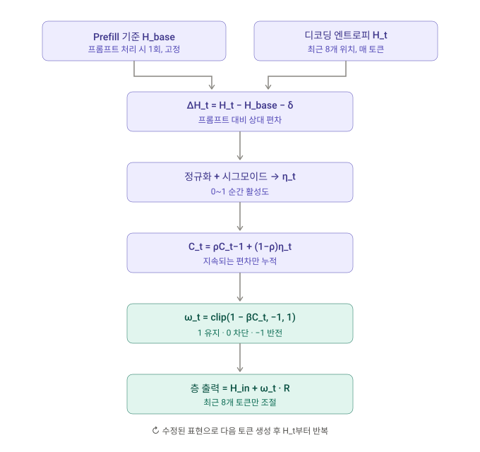

# 0. Summary

기본 정보 : ArXiv,2026.11.10, **[TERM: Target-Free Jailbreak Defense via Entropy-Guided Residual Modulation](https://arxiv.org/abs/2611.13577)**

## 연구 배경

Jailbreak 공격은 역할극(role-playing), 시나리오 중첩, 다국어 재구성, 암호(cipher) 기반 통신, 탐색 기반 최적화, 다중 턴 유도 등 매우 다양한 형태로 정렬(alignment) 안전장치를 우회한다. 기존 방어는 개입 시점에 따라 모델 인터페이스 수준(탐지기, 안전 지시문, 보조 분류기), 학습 시점(SFT·선호 최적화·RL), 추론 시점(안전 디코딩, 백트래킹, KV 캐시 조작, 활성 개입)으로 나뉘는데, 추론 시점 표현 기반 방어 중 상당수는 **미리 계산된 steering 벡터**나 **참조 거부 영역(reference refusal region)** 같은 사전 정의된 표현 목표(representational target)에 의존한다. 저자들은 LLaMA-3.1-8B 의 프롬프트 수준 은닉 표현을 3D PCA 로 투영했을 때 7개 jailbreak 계열이 서로 다른 위치와 퍼짐을 가지며 일부는 XSTest 를 포함한 무해 입력과 겹친다는 점을 관찰했다. 이 시각화만으로 공유 안전 방향의 존재 여부를 단정할 수는 없지만, 모든 공격을 하나의 고정 방향으로 밀어내는 설계가 공격 계열 간 변동과 무해 입력 보존을 동시에 만족하기 어렵다는 문제의식을 준다. 핵심 질문은 **사전 정의된 표현 목표 없이, 각 입력의 생성 동역학에 따라 개입 강도를 조절하면서 과민 거부(over-refusal)를 억제할 수 있는가**이다.

## 제안 방법

**TERM(Target-free Entropy-guided Residual Modulation)** 은 추론 시점에 모델 자신의 신호만으로 온라인 모니터링과 적응적 개입을 수행하는 프레임워크다. 관측 신호는 감시 층 $\ell$ 의 **정규화 어텐션 엔트로피** $\mathcal{E}_{\ell}(\mathcal{Q})$ 로, 유계 인과 키 윈도 위에서 헤드·쿼리 평균을 취한 스칼라다. 절대 엔트로피는 프롬프트의 문체·언어·길이에 따라 달라지므로, 프리필(prefill) 마지막 $W_b$ 개 쿼리로 계산한 **프롬프트 고유 기준값** $H_{\mathrm{base} }$ 에 대해 디코딩 중 슬라이딩 윈도 엔트로피 $H_t$ 의 편차 $\Delta H_t = H_t - H_{\mathrm{base} } - \delta$ 를 취한다. 이 편차를 지수 이동 2차 모멘트 $v_t$ 로 **적응 스케일 정규화**하고 시그모이드로 순간 활성 $\eta_t \in (0,1)$ 을 만든 뒤, 보존 계수 $\rho$ 로 **시간 누적**한 제어 상태 $C_t \in [0,1)$ 을 얻는다. 개입은 층 $\ell$ 의 잔차 전이 $\mathbf{R}_{\ell,t} = \mathbf{H}^{\mathrm{out} }_{\ell,t} - \mathbf{H}^{\mathrm{in} }_{\ell,t}$ 중 최근 $S$ 개 위치의 행만 골라 유계 계수 $\omega_t = \mathrm{clip}(1 - \beta C_t, -1, 1)$ 로 재스케일하는 **적응적 잔차 감쇠(adaptive residual damping)** 다. 외부 안전 방향을 더하지 않고 모델 자신의 전이를 감쇠하거나($0 \le \omega_t < 1$) 반전($\omega_t < 0$)시키므로, 결과적인 표현 변화의 방향은 입력별 잔차 전이에 따라 달라진다.

## 발견 사실

LLaMA-3.1-8B, Qwen2.5-7B-Instruct, Gemma-2-9B-it 세 백본에서 AIM, AutoDAN, Cipher, GCG, Jailbroken, Multilingual, ReNeLLM 일곱 공격의 평균 방어 성공률(DSR)은 각각 97.00%, 98.43%, 89.29% 로 가장 강한 비교 베이스라인(AdaSteer)보다 3.43~6.72 포인트 높았고, XSTest·OKTest 평균 과민 거부율(ORR)은 1.43%, 0.60%, 6.77% 로 일곱 베이스라인 중 가장 낮았다. AlpacaEval 승률은 무방어 모델 대비 50.50%, 51.93%, 48.76% 로 동률 근처였고, 디코딩 처리량은 45.03 tokens/s 로 무방어 모델의 94.3% 를 유지했다. Llama3.2-3B, Gemma3-4B, Qwen3.5-9B 와 Qwen3 0.6B~32B 에서도 결합 점수(DSR − ORR)가 모두 올랐지만, Gemma3-4B 는 DSR 이 42.71% 에서 63.29% 로 오르면서 ORR 도 8.67% 에서 11.74% 로 함께 올랐고, Qwen3 계열의 이득은 1.7B 에서 42.87 포인트, 8B 에서 2.49 포인트로 크기에 단조롭지 않았다. 구성요소 ablation 에서 신호 누적이나 프리필 기준값을 빼면 DSR 은 93% 이상 유지되지만 ORR 이 83.40%, 77.83% 로 폭발하고, 적응 정규화나 음수 잔차 스케일링을 빼면 ORR 은 낮지만 DSR 이 40.86%, 41.71% 로 떨어져 두 축이 **서로 다른 실패 양식**을 담당함을 보였다. 샘플 수준 분석에서는 Qwen3-14B 에서 공격 프롬프트의 15.85% 가 성공→차단으로 바뀌는 동안 8.62% 는 차단→성공으로 바뀌었고, 무해 프롬프트의 6.00% 가 비거부→거부로 바뀌어 집계 이득이 비용 없는 교정이 아님을 드러냈다.

## 핵심 기여

1. **표적 없는(target-free) 추론 시점 방어 프레임워크** : 사전 정의된 steering 방향·안전 부분공간·학습된 경계 없이, 온라인 모니터링 신호와 모델 자신의 잔차 전이에 대한 유계 재스케일링을 연결한 TERM 을 제안했다.
2. **프롬프트 보정 엔트로피 기반 시간 제어 신호** : 프리필 기준값 대비 편차 → 적응 스케일 정규화 → 시그모이드 활성 → 지수 누적으로 이어지는 제어 상태 $C_t$ 를 유도하고, 오프셋 소거·유계성·스케일 불변성·임계 도달 시간·변분 해석·비확장성·다음 토큰 분포 섭동 상한을 부록에서 형식화했다.
3. **통제된 비교 실험** : 일곱 jailbreak 계열과 두 과민 거부 벤치마크에서 세 주요 백본 모두 최고 평균 DSR 과 최저 ORR 을 기록했고, 추가 백본·규모 일반화, 구성요소 ablation, 하이퍼파라미터 민감도, 층별 분리도, 은닉 상태 궤적, 모니터링 신호 비교, 샘플 수준 비용 분석을 함께 제시했다.

# TERM 작동 방식

보라색은 신호를 만드는 경로, 청록색은 실제 개입입니다.

계수 ω가 핵심입니다. β=9 기준으로 C_t가 0.11을 넘으면 ω가 음수가 되어 해당 층의 기여가 뒤집히고, 0.22 이상이면 −1로 완전히 반전됩니다.

# 관련 개념

## 사전 정의된 표현 목표와 그 한계

추론 시점 표현 기반 방어의 대부분은 "어디로 밀 것인가"를 미리 정해 둡니다. 정렬된 참조 모델에서 뽑은 안전 steering 벡터, 거부/순응 방향에 대한 투영, PCA 로 만든 희소 안전 개입, 학습된 안전 영역·경계가 그것입니다. 이 논문은 이런 설계를 **표적 의존(target-dependent)** 개입으로 묶고, 각 입력의 생성 동역학에만 반응하는 **표적 없는(target-free)** 개입을 대안으로 제시합니다.

---

### 🧭 1. 개입 시점·위치에 따른 방어 분류

| 분류 | 대표 방법 | 논문이 지적하는 제약 |
|---|---|---|
| 모델 인터페이스 | 응답·그래디언트 기반 탐지(Gradient Cuff 등), 안전 지시문·자기 상기(Self-Reminder), 보조 분류기(Llama Guard) | 프롬프트 설계 의존, 맥락 오버헤드, 공격 형태가 다양해질수록 강건성 저하 |
| 학습 시점 | SFT, 선호 최적화, RL, 추론형 안전 정렬 | 추가 학습과 파라미터 갱신 필요 |
| 추론 시점(디코딩) | 안전 디코딩(ROSE, Self-CD), 백트래킹, 추측 디코딩, KV 캐시 축출(RobustKV) | 원래 디코딩 과정을 바꾸거나 추가 추론 비용 발생 |
| 추론 시점(표현) | InferAligner, CAST, AdaSteer, Jailbreak Antidote, Surgical, 안전 영역/경계 학습 | **사전 계산된 steering 벡터나 참조 거부 영역에 의존** |

TERM 은 마지막 범주에 속하면서도 사전 계산된 방향을 쓰지 않는다는 점에서 구별됩니다. 추가 학습, 보조 모델, 안전 미세조정도 요구하지 않습니다.

---

### 🗺️ 2. Figure 1 의 동기: 공격 계열은 한 곳에 모이지 않는다

저자들은 무방어 LLaMA-3.1-8B-Instruct 의 12번째 디코더 블록(0-based 인덱스 11)에서 **잔차 갱신(블록 출력 − 입력)** 을 최초 최대 8개 생성 단계에 걸쳐 평균하고 L2 정규화한 뒤, 7개 jailbreak 계열과 네 종류의 무해 참조 집합(Harmless Instructions, GSM8K, AlpacaEval, 혼합)을 3D PCA(Figure 1)와 t-SNE(Figure 7)로 투영했습니다. 관찰은 세 가지입니다.

* 공격 계열은 임베딩 공간의 **여러 영역**에 흩어지고, 어떤 계열은 뚜렷한 군집을 이루지만 다른 계열은 서로 겹치거나 무해 입력(XSTest 포함)에 가까이 놓입니다.
* 표시된 기하는 무해 참조 집합에 따라 달라지며, 모든 계열을 깨끗하게 담는 단일 전역 영역은 보이지 않습니다.
* 저자들은 이 시각화를 "원 표현 공간의 분리 가능성에 대한 정량 증거"가 아니라 **정성적 동기**로만 쓴다고 명시합니다.

---

### 🔁 3. 고정 방향 steering 과 잔차 재스케일링의 차이 (Figure 2)

| | 고정 방향 steering | TERM |
|---|---|---|
| 개입 형태 | $\mathbf{h} \leftarrow \mathbf{h} + \lambda \mathbf{v}$ (외부 벡터 가산) | $\mathbf{R} \leftarrow \omega_t \mathbf{R}$ (자기 전이 재스케일) |
| 방향의 출처 | 사전 계산(대조 데이터, PCA, 참조 모델) | 입력별 잔차 전이 자체 |
| 강도 결정 | 고정 계수 또는 입력 투영값 | 프롬프트 보정 엔트로피의 시간 누적 $C_t$ |
| 공격 계열 간 변동 | 공유 궤적을 가정 | 공유 궤적·유해 방향을 가정하지 않음 |

> **💡 Key Takeaway**
> TERM 의 출발점은 "jailbreak 는 한 방향으로 모이지 않는다"는 관찰이고, 대안은 **어디로 밀지 정하지 않고 얼마나 누를지만 정하는** 개입입니다. 방향은 모델이 그 순간 만들고 있던 잔차 전이에서 나옵니다.

## 문제 설정: 어텐션 엔트로피 관측과 잔차 전이

정렬된 자기회귀 모델 $\mathcal{M}$ 이 $N$ 개 Transformer 층을 갖고, 프롬프트 $X=(x_1,\ldots,x_n)$ 으로부터 응답 $Y=(y_1,\ldots,y_T)$ 를 생성한다고 합시다. 디코딩 단계 $t$ 의 활성 접두사는 $Z_t=(X,y_{<t})$, 길이는 $L_t=|Z_t|$ 입니다. 목표는 외부 안전 분류기나 사전 정의 steering 방향 없이 $\mathcal{M}$ 의 신호와 전이만으로 생성을 조절하는 것이며, 그러려면 **관측용 스칼라**와 **조절 가능한 국소 전이** 두 가지 내부량이 필요합니다. 기본 설정에서는 두 연산이 같은 모델별 층 $\ell$ 을 씁니다.

---

### 📐 1. 정규화 어텐션 엔트로피 (Eq. 1–2)

감시 층 $\ell$ 에서 헤드 $h$, 쿼리 위치 $q$ 의 어텐션 분포 $\mathbf{p}_{h,q}$ 를 유계 인과 키 윈도 $\mathcal{K}$ 위에서 재정규화한 뒤,

$$
H(\mathbf{p}) = -\frac{1}{\log|\mathcal{K}|}\sum_{i\in\mathcal{K} } p_i \log p_i
$$

로 정규화 엔트로피를 정의합니다. 0 근처면 집중된 어텐션, 1 근처면 보존된 키 위에 퍼진 어텐션이며, 키가 하나뿐이면 $H=0$ 으로 둡니다. 쿼리 집합 $\mathcal{Q}$ 와 층의 모든 헤드 $\mathcal{A}_\ell$ 에 대해 평균하면 층 수준 관측값이 됩니다.

$$
\mathcal{E}_\ell(\mathcal{Q}) = \frac{1}{|\mathcal{Q}|\,|\mathcal{A}_\ell|}\sum_{q\in\mathcal{Q} }\sum_{h\in\mathcal{A}_\ell} H(\mathbf{p}_{h,q})
$$

부록 A.2 는 $K=|\mathcal{K}|\ge 2$ 일 때 $H(\mathbf{p}) = 1 - D_{\mathrm{KL} }(\mathbf{p}\,\|\,\mathbf{u}_K)/\log K$ 임을 보여, 정규화 엔트로피가 **균등 어텐션으로부터의 KL 거리**를 $[0,1]$ 로 눌러 놓은 양임을 밝힙니다.

---

### 🧱 2. 잔차 전이 (Eq. 3)

층 $\ell$ 에 들어가고 나가는 잔차 스트림을 $\mathbf{H}^{\mathrm{in} }_{\ell,t}, \mathbf{H}^{\mathrm{out} }_{\ell,t}\in\mathbb{R}^{L_t\times d}$ 라 하면 잔차 전이는

$$
\mathbf{R}_{\ell,t} = \mathbf{H}^{\mathrm{out} }_{\ell,t} - \mathbf{H}^{\mathrm{in} }_{\ell,t}
$$

이며, 층 $\ell$ 이 기여한 갱신만 분리한 것입니다. 조절 대상은 최근 $S_t=\min\{S, L_t\}$ 개 위치 $\mathcal{S}_t=\{L_t-S_t+1,\ldots,L_t\}$ 의 행이고, 행 선택 행렬 $\mathbf{P}_t\in\{0,1\}^{S_t\times L_t}$ 로 $\mathbf{P}_t\mathbf{R}_{\ell,t}$ 를 고릅니다. 앞선 위치의 잔차 스트림은 건드리지 않습니다.

> **💡 Key Takeaway**
> 관측은 "어텐션이 얼마나 퍼졌는가"라는 스칼라 하나, 개입은 "이 층이 방금 더한 것"의 최근 몇 행뿐입니다. 둘 다 모델 안에서 나오므로 외부 데이터로 방향을 학습할 필요가 없습니다.

## 프롬프트 보정 엔트로피 편차(Prompt-Calibrated Entropy Deviation)

절대 어텐션 엔트로피는 위험 신호로 쓰기 어렵습니다. 무해 프롬프트도 자연스럽게 넓은 어텐션을 유발할 수 있고, 짧은 템플릿이나 인코딩된 지시로 표현된 악의적 프롬프트는 오히려 집중된 어텐션을 보일 수 있기 때문입니다. TERM 은 **각 프롬프트 자신의 프리필 기준값**에 대한 상대 편차만 봅니다.

---

### 🪟 1. 고정 기준 윈도와 슬라이딩 온라인 윈도 (Eq. 4)

| 윈도 | 정의 | 역할 |
|---|---|---|
| 기준 윈도 $\mathcal{B}$ | 프리필의 마지막 $\min\{W_b, n\}$ 개 쿼리 위치 | 생성 내내 고정, $H_{\mathrm{base} }=\mathcal{E}_\ell(\mathcal{B})$ |
| 온라인 윈도 $\mathcal{W}_t$ | 활성 접두사의 최근 $\min\{W_h, L_t\}$ 개 쿼리 위치 | 토큰마다 한 칸 전진, $H_t=\mathcal{E}_\ell(\mathcal{W}_t)$ |
| 키 윈도 | 각 쿼리에 대해 최근 $\min\{W_k, q\}$ 개 인과 키 | 엔트로피 계산 범위 |

$H_{\mathrm{base} }$ 는 모델이 프롬프트를 처리할 때의 어텐션 분산을, $H_t$ 는 디코딩 중 최근 쿼리에서의 분산을 나타냅니다.

---

### ➖ 2. 편차와 무해 마진 (Eq. 5)

$$
\Delta H_t = \underbrace{H_t - H_{\mathrm{base} } }_{\text{prompt-relative deviation} } - \underbrace{\delta}_{\text{benign margin} }
$$

$\delta\ge 0$ 은 작은 엔트로피 증가를 흡수하는 마진입니다. $\Delta H_t>0$ 이면 어텐션이 프롬프트 기준보다 마진 이상으로 퍼졌다는 뜻이지만, 저자들은 이 부호 있는 편차를 **유해성 라벨이 아니라 시간 누적의 제어 입력**으로만 쓴다고 강조합니다. $H_t, H_{\mathrm{base} }\in[0,1]$ 이므로 편차는 $-1-\delta \le \Delta H_t \le 1-\delta$ 로 유계입니다(Eq. 14).

---

### 🧮 3. 오프셋 소거의 형식화 (Eq. 15–16)

쿼리 $q$ 에서 헤드 평균 엔트로피 $e_q$ 가 가법 모형 $e_q = b_X + r_q + \xi_q$ 를 따른다고 가정합시다. $b_X$ 는 문체·언어·길이 같은 **프롬프트 고유 오프셋**, $r_q$ 는 위치·디코딩 체제에 따른 변동, $\xi_q$ 는 국소 요동입니다. 이를 Eq. 4–5 에 대입하면

$$
\Delta H_t = (\bar r_{\mathcal{W}_t} - \bar r_{\mathcal{B} }) + (\bar\xi_{\mathcal{W}_t} - \bar\xi_{\mathcal{B} }) - \delta
$$

가 되어 공유 오프셋 $b_X$ 가 **정확히 소거**됩니다. 이것이 이질적인 프롬프트들에 대해 절대 엔트로피를 보편적 위험 점수로 해석하지 않고 프롬프트 조건부 기준값을 쓰는 이유입니다.

> **💡 Key Takeaway**
> "엔트로피가 높다"가 아니라 "**이 프롬프트를 읽을 때보다** 엔트로피가 높아졌다"가 신호입니다. 프리필 기준값이 프롬프트별 오프셋을 빼 주므로, 언어나 템플릿 형태가 달라도 같은 척도로 비교됩니다.

## 적응적 시간 제어 신호(Adaptive Temporal Control Signal)

프롬프트 보정은 입력별 기준을 주지만 $\Delta H_t$ 의 크기는 모델과 디코딩 단계마다 다릅니다. 적응 온라인 평균을 빼면 지속적인 수준 이동까지 흡수해 버리므로, TERM 은 **재중심화 없이 스케일만 정규화**하고, 그 결과를 시그모이드로 활성화한 뒤 시간 누적합니다.

---

### 📏 1. 2차 모멘트 정규화와 순간 활성 (Eq. 6–7)

갱신률 $0<\alpha\le 1$ 로 지수 이동 2차 모멘트를 $v_t=(1-\alpha)v_{t-1}+\alpha(\Delta H_t)^2$, $v_0=0$ 으로 유지하고, 수치 바닥 $\epsilon>0$ 과 함께

$$
\eta_t = \sigma\!\left(\kappa\left(\frac{\Delta H_t}{\sqrt{\max(\epsilon, v_t)} } - \tau\right)\right)
$$

로 순간 활성 $\eta_t\in(0,1)$ 을 만듭니다. $\tau$ 는 활성 임계, $\kappa>0$ 은 시그모이드 이득입니다. 정규화는 편차의 부호를 보존합니다. 부록은 세 가지 성질을 증명합니다.

| 성질 | 내용 |
|---|---|
| 유계성 (Eq. 19) | $v_t\ge\alpha(\Delta H_t)^2$ 이므로 정규화 편차 $s_t$ 는 $\min\{(1+\delta)/\sqrt{\epsilon},\ 1/\sqrt{\alpha}\}$ 를 넘지 않음 |
| 스케일 불변성 (Eq. 20) | 편차를 $c>0$ 배, $v_0$ 를 $c^2$ 배 하면 $s_t$ 는 불변 → 모델·단계 간 수치 스케일 차이에 강건 |
| 지속 편차의 극한 (Eq. 21–23) | 일정한 $d\ne 0$ 에 대해 $v_t=d^2(1-(1-\alpha)^t)$, $s_t\to\mathrm{sgn}(d)$, 따라서 $\eta_t\to\sigma(\kappa(1-\tau))$ 또는 $\sigma(\kappa(-1-\tau))$ |

단, $0<\vert d\vert<\sqrt{\epsilon}$ 이면 극한은 $d/\sqrt{\epsilon}$ 이지 $\mathrm{sgn}(d)$ 가 아니며, 저자들은 이 극한이 "엔트로피 편차에 대한 반응"이지 의미론적 유해성이 아님을 재차 강조합니다.

---

### ⏳ 2. 지수 누적 제어 상태 (Eq. 8–9)

$$
C_t = \rho C_{t-1} + (1-\rho)\eta_t,\qquad C_0=0,\qquad C_t=(1-\rho)\sum_{k=1}^{t}\rho^{t-k}\eta_k
$$

$0\le\rho<1$ 은 시간 보존 계수입니다. $j$ 단계 전 활성은 $(1-\rho)\rho^j$ 의 가중치를 받으며, $\eta_t\in(0,1)$ 이므로 $C_t\in[0,1)$ 입니다. 두 재귀의 반감기는 $T^{(v)}_{1/2}=\log(1/2)/\log(1-\alpha)$, $T^{(C)}_{1/2}=\log(1/2)/\log\rho$ 로(Eq. 24), $\alpha$ 는 스케일 추정이 과거 크기를 잊는 속도를, $\rho$ 는 활성이 누적 상태에 남는 기간을 결정합니다.

---

### ⏱️ 3. 임계 도달 시간 (Eq. 25–27)

현재 상태 $C_t$ 에서 이후 $m$ 단계 동안 활성이 $\underline{\eta}$ 이상으로 유지되면 $C_{t+m}\ge\underline{\eta}-\rho^m(\underline{\eta}-C_t)$ 이고, 목표 수준 $c\in(C_t,\underline{\eta})$ 에 도달하기 위한 충분 단계 수는

$$
m \ge \left\lceil \frac{\log\big((\underline{\eta}-c)/(\underline{\eta}-C_t)\big)}{\log\rho} \right\rceil
$$

입니다. 아래 잔차 스케일링 규칙에서 계수가 0 을 지나는 지점은 $C_t=1/\beta$, 하한 클리핑에 닿는 지점은 $C_t\ge 2/\beta$ 이므로, $c$ 에 이 값을 넣으면 **지속적 증거가 몇 토큰 이어져야 방향 반전이나 포화가 일어나는지** 추정할 수 있습니다.

저자들은 두 가지 주의점을 덧붙입니다. 첫째, $C_{t-1}=0$ 일 때 즉각 반응은 $C_t=(1-\rho)\eta_t$ 이고 $\omega_t=\mathrm{clip}(1-\beta(1-\rho)\eta_t,-1,1)$ 이므로 시간 평활화는 과거 기여를 감쇠시킬 뿐 **약한 즉각 개입을 보장하지 않습니다**. 둘째, $\Delta H_t=0$ 이어도 $\eta_t=\sigma(-\kappa\tau)>0$ 이므로 편차가 0 일 때 개입을 완전히 끄는 하드 규칙은 없습니다.

> **💡 Key Takeaway**
> 정규화는 "얼마나 큰 편차인가"를 모델·단계에 무관한 단위로 바꾸고, 누적은 "얼마나 오래 이어졌는가"를 더합니다. $C_t$ 는 거부 결정이 아니라 **지속적 이탈 증거의 양**을 재는 다이얼입니다.

## 적응적 잔차 감쇠(Adaptive Residual Damping)

제어 상태 $C_t$ 는 개입 **강도**만 정합니다. TERM 은 이를 유계 스케일링 계수로 바꿔 모델 자신의 잔차 전이에 곱합니다.

---

### 🎚️ 1. 스케일링 계수와 층 출력 갱신 (Eq. 10–12)

$$
\omega_t = \mathrm{clip}\left(1-\beta C_t,\ \omega_{\min},\ 1\right),\qquad \omega_{\min}=-1
$$

$\beta>0$ 은 누적 신호에 대한 민감도입니다. $\beta C_t\ll 1$ 이면 $\omega_t\approx 1$ 로 원래 전이가 거의 보존되고, $C_t$ 가 커질수록 계수가 줄어 $0\le\omega_t<1$ 에서는 **감쇠**, $\omega_t<0$ 에서는 **방향 반전**이 일어납니다. 선택된 행만 $\omega_t\mathbf{P}_t\mathbf{R}_{\ell,t}$ 로 바꾸므로 층 출력은

$$
\widetilde{\mathbf{H} }^{\mathrm{out} }_{\ell,t} = \mathbf{H}^{\mathrm{out} }_{\ell,t} + \mathbf{P}_t^{\top}\left[(\omega_t-1)\mathbf{P}_t\mathbf{R}_{\ell,t}\right]
$$

가 되고, 나머지 위치는 그대로입니다. 수정된 표현은 이후 동결 층들과 원래 LM 헤드를 거쳐 원래 디코딩 규칙으로 토큰을 냅니다. $\vert\omega_t\vert\le 1$ 이므로 선택된 잔차 갱신의 Frobenius 노름은 커지지 않습니다(Eq. 11).

---

### 🧮 2. 변분 해석 (Eq. 28)

클리핑된 아핀 규칙은 다음 강볼록 문제의 유일한 해입니다.

$$
\omega_t = \underset{a\in[-1,1]}{\operatorname{argmin} }\left\{\frac{1}{2}(a-1)^2 + \beta C_t a\right\}
$$

2차 항은 원래 계수 $a=1$ 에서 벗어나는 것을 벌하고(증거가 약하면 보존), 1차 항은 $C_t$ 가 클수록 현재 전이 방향으로 계속 움직이는 것을 벌합니다(지속 증거가 충분하면 음수 계수 선호). 비제약 최소해 $1-\beta C_t$ 를 $[-1,1]$ 에 사영하면 정확히 클리핑 규칙이 되므로, 저자들은 이 규칙이 임의의 선형 스케줄이 아니라 **갱신 충실도와 증거 의존 개입 비용의 균형**이라고 해석합니다.

---

### 🔒 3. 비확장성과 그 한계 (Eq. 29–34)

행 공간 사영자 $\mathbf{D}_t=\mathbf{P}_t^{\top}\mathbf{P}_t$ 로 전체 수정 전이를 $\widetilde{\mathbf{R} }_{\ell,t}=(\mathbf{I}-\mathbf{D}_t)\mathbf{R}_{\ell,t}+\omega_t\mathbf{D}_t\mathbf{R}_{\ell,t}$ 로 쓰면, 선택·비선택 성분이 직교하므로 전체 잔차 갱신의 제곱 노름도 커지지 않습니다(Eq. 30). 에너지 감소량은 $(1-\omega_t^2)\Vert\mathbf{D}_t\mathbf{R}_{\ell,t}\Vert_F^2$, 변위는 $\vert 1-\omega_t\vert\,\Vert\mathbf{D}_t\mathbf{R}_{\ell,t}\Vert_F$ 입니다(Eq. 31–32). 중요한 단서가 붙습니다. $\omega_t=-1$ 에서 변위는 $2\Vert\mathbf{D}_t\mathbf{R}_{\ell,t}\Vert_F$ 로, **노름이 늘지 않는다는 것이 출력 섭동이 작다거나 토큰 예측이 유지된다거나 의미적으로 안전하다는 뜻은 아닙니다.** 선택 행의 에너지 비율 $\gamma_t$ 를 쓰면 원래 전이와 수정 전이의 Frobenius 코사인은

$$
\cos_F\left(\mathbf{R}_{\ell,t},\widetilde{\mathbf{R} }_{\ell,t}\right)=\frac{1-(1-\omega_t)\gamma_t}{\sqrt{1-(1-\omega_t^2)\gamma_t} }
$$

로, 선택 행이 전체 에너지의 작은 비율만 차지하면 국소적으로 큰 변위를 내면서도 전역 방향 일관성을 유지할 수 있음을 보입니다.

---

### 📉 4. 다음 토큰 분포 섭동 상한 (Eq. 35–40)

개입 층 출력에서 로짓까지의 동결 계산 $\mathcal{F}_t$ 의 국소 야코비안 작용소 노름이 보간 경로 위에서 $\Lambda_t$ 이하라고 가정하면, 소프트맥스 야코비안의 스펙트럼 노름 $\le 1/2$ 과 log-sum-exp 의 평활성으로부터

$$
D_{\mathrm{KL} }\left(\boldsymbol{\pi}_t\,\|\,\widetilde{\boldsymbol{\pi} }_t\right)\le\frac{\Lambda_t^2}{4}(1-\omega_t)^2\left\Vert\mathbf{D}_t\mathbf{R}_{\ell,t}\right\Vert_F^2
$$

을 얻습니다. 조건부 상한이지만, $C_t$ 가 작아 $\omega_t\approx 1$ 인 약신호 체제에서 다음 토큰 분포 변화가 **2차로 억제**된다는 의도된 거동을 형식화합니다.

> **💡 Key Takeaway**
> 가산 steering 이 "외부 벡터를 더하는" 것이라면 TERM 은 "모델이 방금 더한 것을 되돌리거나 뒤집는" 것입니다. 수학적 보장은 노름·KL 상한까지이고, 그 이상(안전성, 과민 거부)은 생성 평가로만 확인됩니다.

## 실험 설정: 공격, 벤치마크, 베이스라인, 지표

모든 Base-Ours 비교는 동일한 프롬프트, 디코딩 설정, 생성 예산, 판정 절차를 공유하며, 모든 백본은 동결 상태입니다. 구현은 PyTorch, 단일 NVIDIA Tesla A100 입니다.

---

### 🧠 1. 백본

| 구분 | 모델 |
|---|---|
| 주요 백본 | LLaMA-3.1-8B, Qwen2.5-7B-Instruct, Gemma-2-9B-it |
| 계열 일반화 | Llama3.2-3B, Gemma3-4B-it, Qwen3.5-9B |
| 규모 일반화 | Qwen3-0.6B, 1.7B, 4B, 8B, 14B, 32B |

---

### ⚔️ 2. 일곱 jailbreak 계열 (B.2)

| 공격 | 원리 |
|---|---|
| AIM | 필터 없는 비도덕적 조수를 연기하게 하는 in-the-wild 페르소나 jailbreak |
| AutoDAN | 읽을 수 있는 적대 프롬프트의 자동 최적화 |
| Cipher | 인코딩된 통신으로 유해 의도를 숨기고 해독·응답을 요구 |
| GCG | 토큰 수준 좌표 갱신으로 적대 접미사를 최적화(화이트박스) |
| Jailbroken | 역할극·지시 충돌·인코딩·권한 상승 시뮬레이션 등 해석 가능한 실패 양식 모음 |
| Multilingual | 언어 간 안전 정렬의 불균형을 노린 다국어 표현 |
| ReNeLLM | 요청을 재작성해 중첩 시나리오에 삽입 |

같은 백본에서는 모든 방어가 동일한 공격 인스턴스를 받습니다. 이 포스트는 각 공격의 템플릿·예시 문구는 옮기지 않습니다.

---

### 📚 3. 무해·유용성 벤치마크 (B.3)

| 벤치마크 | 규모 | 용도 |
|---|---|---|
| XSTest | 250개 | 민감 단어·모호한 표면형을 가진 무해 프롬프트, 과장 거부 측정 |
| OKTest | 테스트 300개 (+ held-out 50개) | 피상적 안전 지름길을 유발할 수 있는 무해 요청 |
| AlpacaEval | – | 무방어 모델 대비 쌍별 승률 |
| GSM8K | 테스트 1,319문제 | zero-shot 생성, 정확 일치 정확도 |
| MMLU | 테스트 14,042문항, 57과목 | zero-shot 생성, 선택지 일치 |
| AdvBench, HarmBench, JailbreakBench, Harmless Instructions | – | 층별 분리도 분석용(학습·튜닝에 쓰지 않음) |

---

### 🥊 4. 일곱 베이스라인 (B.4)

| 유형 | 방법 | 원리 |
|---|---|---|
| 디코딩 | ROSE | 역 안전 프롬프트로 바람직하지 않은 분포를 얻어 대조 디코딩으로 억제 |
| 디코딩 | Self-CD | 안전 강조 유무의 출력 분포를 대조해 과민 거부 완화 |
| Steering | Jailbreak Antidote | PCA + 희소화로 은닉 상태에 희소 안전 개입 |
| Steering | Surgical | 거짓 거부 방향에서 진짜 거부와 공유된 성분을 제거한 뒤 활성 절제 |
| Steering | InferAligner | 정렬된 참조 모델에서 안전 steering 벡터 추출, 안내 게이트로 적용 |
| Steering | CAST | 조건 벡터가 만족될 때 steering 벡터 활성화 |
| Steering | AdaSteer | 거부·유해성 방향 투영으로 거부/순응 steering 강도 결정 |

부록 C.10 에서는 AlphaSteer 와의 추가 비교도 제시합니다.

---

### 📏 5. 지표와 집계 (B.5)

* **DSR(Defense Success Rate)** : 유해 목표가 차단된 것으로 판정된 적대 프롬프트의 비율.
* **ORR(Over-Refusal Rate)** : 무해한 안전 민감 프롬프트에 실질적 답을 주지 못한 비율.
* **Score** : 표시된 평균 DSR − 평균 ORR. Defense 는 일곱 공격 DSR 의 비가중 평균, 집계 ORR 은 XSTest·OKTest 의 비가중 평균.
* 판정자는 DSR·ORR 모두 **GPT-4o** 입니다.

> **💡 Key Takeaway**
> 비교는 "같은 공격 인스턴스, 같은 디코딩, 같은 판정자"로 통제되어 있고, 유용성은 과민 거부(XSTest·OKTest)와 일반 능력(AlpacaEval·GSM8K·MMLU) 두 층위로 따로 잽니다.

## 주요 결과: 일곱 공격 × 세 백본 (Table 1)

### 📊 1. 전체 표 (DSR·ORR %, Score = Defense − ORR)

**LLaMA-3.1-8B**

| 방어 | AIM | AutoDAN | Cipher | GCG | Jailbroken | Multilingual | ReNeLLM | XSTest | OKTest | Defense | ORR | Score |
|---|---|---|---|---|---|---|---|---|---|---|---|---|
| No Defense | 57 | 30 | 0 | 60 | 61 | 22 | 37 | 7.20 | 4.00 | 38.14 | 5.60 | 32.54 |
| ROSE | 100 | 83 | 51 | 94 | 85 | 61 | 85 | 10.40 | 8.67 | 79.86 | 9.53 | 70.33 |
| Self-CD | 94 | 67 | 5 | 66 | 67 | 43 | 43 | 7.20 | 5.33 | 55.00 | 6.27 | 48.73 |
| Jailbreak Antidote | 92 | 100 | 61 | 94 | 79 | 44 | 66 | 12.80 | 4.33 | 76.57 | 8.57 | 68.00 |
| Surgical | 100 | 75 | 10 | 88 | 84 | 82 | 91 | 25.60 | 9.67 | 75.71 | 17.63 | 58.08 |
| InferAligner | 85 | 90 | 0 | 92 | 77 | 82 | 77 | 24.40 | 14.67 | 71.86 | 19.53 | 52.33 |
| CAST | 100 | 100 | 0 | 66 | 76 | 46 | 56 | 6.00 | 4.00 | 63.43 | 5.00 | 58.43 |
| AdaSteer | 100 | 100 | 82 | 90 | 85 | 100 | 86 | 1.60 | 2.67 | 91.86 | 2.13 | 89.73 |
| **TERM** | 89 | 99 | 99 | 100 | 98 | 97 | 97 | 1.20 | 1.67 | **97.00** | **1.43** | **95.57** |

**Qwen2.5-7B-Instruct**

| 방어 | AIM | AutoDAN | Cipher | GCG | Jailbroken | Multilingual | ReNeLLM | XSTest | OKTest | Defense | ORR | Score |
|---|---|---|---|---|---|---|---|---|---|---|---|---|
| No Defense | 92 | 47 | 0 | 88 | 46 | 14 | 3 | 4.00 | 6.00 | 41.43 | 5.00 | 36.43 |
| ROSE | 99 | 52 | 8 | 86 | 58 | 12 | 0 | 4.00 | 2.00 | 45.00 | 3.00 | 42.00 |
| Self-CD | 69 | 50 | 2 | 82 | 54 | 6 | 0 | 4.00 | 4.00 | 37.57 | 4.00 | 33.57 |
| Jailbreak Antidote | 88 | 86 | 72 | 100 | 60 | 78 | 3 | 8.00 | 5.67 | 69.57 | 6.83 | 62.74 |
| Surgical | 94 | 41 | 0 | 82 | 47 | 13 | 3 | 3.20 | 6.33 | 40.00 | 4.77 | 35.23 |
| InferAligner | 100 | 98 | 0 | 98 | 60 | 94 | 11 | 7.20 | 6.00 | 65.86 | 6.60 | 59.26 |
| CAST | 80 | 73 | 0 | 68 | 63 | 9 | 1 | 4.80 | 4.00 | 42.00 | 4.40 | 37.60 |
| AdaSteer | 100 | 98 | 88 | 92 | 78 | 90 | 96 | 4.80 | 13.00 | 91.71 | 8.90 | 82.81 |
| **TERM** | 100 | 99 | 97 | 100 | 96 | 99 | 98 | 1.20 | 0.00 | **98.43** | **0.60** | **97.83** |

**Gemma-2-9B-it**

| 방어 | AIM | AutoDAN | Cipher | GCG | Jailbroken | Multilingual | ReNeLLM | XSTest | OKTest | Defense | ORR | Score |
|---|---|---|---|---|---|---|---|---|---|---|---|---|
| No Defense | 6 | 31 | 0 | 90 | 57 | 1 | 27 | 16.80 | 10.67 | 30.29 | 13.73 | 16.56 |
| ROSE | 7 | 50 | 25 | 100 | 67 | 20 | 87 | 17.20 | 19.33 | 50.86 | 18.27 | 32.59 |
| Self-CD | 4 | 25 | 0 | 90 | 56 | 0 | 46 | 17.20 | 12.33 | 31.57 | 14.77 | 16.80 |
| Jailbreak Antidote | 6 | 47 | 0 | 98 | 61 | 1 | 78 | 22.00 | 11.33 | 41.57 | 16.67 | 24.90 |
| Surgical | 99 | 100 | 14 | 98 | 68 | 96 | 78 | 9.20 | 9.67 | 79.00 | 9.43 | 69.57 |
| InferAligner | 31 | 100 | 24 | 100 | 85 | 93 | 62 | 34.80 | 16.33 | 70.71 | 25.57 | 45.14 |
| CAST | 8 | 35 | 0 | 94 | 65 | 4 | 33 | 16.80 | 19.33 | 34.14 | 18.07 | 16.07 |
| AdaSteer | 91 | 95 | 75 | 86 | 86 | 86 | 82 | 6.40 | 8.00 | 85.86 | 7.20 | 78.66 |
| **TERM** | 83 | 84 | 100 | 92 | 87 | 90 | 89 | 5.20 | 8.33 | **89.29** | **6.77** | **82.52** |

---

### 📝 2. 읽는 법

* 세 백본 모두에서 TERM 이 **최고 평균 DSR 과 최저 ORR** 을 동시에 가집니다. 가장 강한 베이스라인 AdaSteer 대비 DSR 이득은 LLaMA 5.14, Qwen 6.72, Gemma 3.43 포인트입니다.
* 그러나 공격별로는 TERM 이 최고가 아닌 칸이 여럿입니다. LLaMA 의 AIM(89 vs 베이스라인 다수 100), Gemma 의 AIM(83 vs Surgical 99)·AutoDAN(84 vs Surgical 100)·GCG(92 vs 여러 100) 등입니다. TERM 의 강점은 **Cipher·Multilingual·ReNeLLM 처럼 베이스라인이 무너지는 계열에서 무너지지 않는 균일성**에 있습니다.
* 무방어 Cipher DSR 이 세 백본 모두 0 인데, 이 계열은 steering 베이스라인도 0~25 에 머무는 경우가 많습니다. TERM 은 97~100 입니다.
* AlpacaEval 승률(부록 C.4) 은 50.50 / 51.93 / 48.76 으로, LLaMA·Qwen 에서는 일곱 베이스라인 모두를 앞서고 Gemma 에서는 2위입니다. 방어 성능이 거부 성향의 무차별 증가로 얻어진 것이 아니라는 근거로 제시됩니다.

> **💡 Key Takeaway**
> Table 1 의 메시지는 "모든 칸에서 1등"이 아니라 "**어떤 계열에서도 크게 지지 않으면서 과민 거부는 가장 낮다**"입니다. 공격별 최고치를 보면 고정 방향 steering 이 특정 계열에 더 잘 맞는 경우가 분명히 존재합니다.

## 모델 계열·규모 일반화 (Table 2)

같은 벤치마크 스위트를 추가 백본과 Qwen3 규모 전체에 적용한 결과입니다. Score = DSR − ORR.

---

### 🧬 1. 계열 간 일반화

| 모델 | 방법 | AIM | AutoDAN | Cipher | GCG | Jailbroken | Multilingual | ReNeLLM | XSTest | OKTest | Defense | ORR | Score |
|---|---|---|---|---|---|---|---|---|---|---|---|---|---|
| Llama3.2-3B | Base | 100 | 100 | 99 | 98 | 96 | 100 | 72 | 6.40 | 5.00 | 95.00 | 5.70 | 89.30 |
| | TERM | 100 | 100 | 100 | 98 | 96 | 100 | 75 | 6.40 | 4.33 | 95.57 | 5.37 | 90.20 |
| Gemma3-4B | Base | 0 | 12 | 91 | 96 | 75 | 6 | 19 | 10.00 | 7.33 | 42.71 | 8.67 | 34.04 |
| | TERM | 59 | 18 | 98 | 98 | 87 | 54 | 29 | 12.80 | 10.67 | 63.29 | 11.74 | 51.55 |
| Qwen3.5-9B | Base | 100 | 100 | 96 | 100 | 98 | 99 | 69 | 8.00 | 7.67 | 94.57 | 7.83 | 86.74 |
| | TERM | 100 | 100 | 98 | 100 | 99 | 100 | 72 | 8.00 | 7.33 | 95.57 | 7.67 | 87.90 |

Llama3.2-3B 와 Qwen3.5-9B 는 무방어 상태에서 이미 DSR 95% 근처라 이득이 1 포인트 안팎입니다. Gemma3-4B 는 DSR 이 20 포인트 넘게 오르지만 **ORR 도 3 포인트 오릅니다**. 저자들은 이를 "결합 점수 상승이 두 지표의 동시 개선을 뜻하지 않는다"는 예로 듭니다.

---

### 📐 2. Qwen3 규모 스케일링

| 모델 | 방법 | AIM | AutoDAN | Cipher | GCG | Jailbroken | Multilingual | ReNeLLM | XSTest | OKTest | Defense | ORR | Score |
|---|---|---|---|---|---|---|---|---|---|---|---|---|---|
| Qwen3-0.6B | Base | 45 | 13 | 95 | 56 | 67 | 60 | 32 | 25.60 | 17.67 | 52.57 | 21.64 | 30.93 |
| | TERM | 77 | 56 | 95 | 62 | 85 | 85 | 52 | 26.00 | 19.00 | 73.14 | 22.50 | 50.64 |
| Qwen3-1.7B | Base | 16 | 17 | 97 | 90 | 67 | 15 | 10 | 14.80 | 10.33 | 44.57 | 12.57 | 32.00 |
| | TERM | 77 | 74 | 100 | 100 | 91 | 83 | 84 | 13.60 | 10.67 | 87.00 | 12.13 | 74.87 |
| Qwen3-4B | Base | 12 | 66 | 97 | 100 | 77 | 20 | 19 | 5.60 | 7.00 | 55.86 | 6.30 | 49.56 |
| | TERM | 61 | 72 | 99 | 98 | 83 | 79 | 53 | 6.00 | 6.33 | 77.86 | 6.17 | 71.69 |
| Qwen3-8B | Base | 42 | 95 | 93 | 98 | 87 | 42 | 10 | 4.80 | 4.67 | 66.71 | 4.74 | 61.97 |
| | TERM | 45 | 91 | 96 | 98 | 87 | 48 | 14 | 3.60 | 4.33 | 68.43 | 3.97 | 64.46 |
| Qwen3-14B | Base | 55 | 97 | 94 | 98 | 87 | 54 | 24 | 2.40 | 3.33 | 72.71 | 2.87 | 69.84 |
| | TERM | 87 | 91 | 97 | 94 | 95 | 69 | 21 | 8.80 | 6.00 | 79.14 | 7.40 | 71.74 |
| Qwen3-32B | Base | 99 | 81 | 92 | 100 | 87 | 71 | 30 | 1.60 | 2.33 | 80.00 | 1.97 | 78.03 |
| | TERM | 100 | 89 | 96 | 100 | 84 | 89 | 34 | 2.00 | 3.00 | 84.57 | 2.50 | 82.07 |

Score 이득은 1.7B 에서 42.87 포인트로 가장 크고 8B 에서 2.49 포인트로 가장 작으며, 14B 에서는 1.90 포인트에 그치면서 ORR 이 2.87 에서 7.40 으로 **두 배 이상** 오릅니다. ReNeLLM 은 8B 이상에서 TERM 을 적용해도 14~34% 에 머물러, 규모가 큰 Qwen3 에서는 이 계열이 사실상 방어되지 않습니다.

> **💡 Key Takeaway**
> 이득은 파라미터 수에 단조롭지 않습니다. 작은 모델일수록 결합 점수는 크게 오르지만, 중간 크기(8B·14B)에서는 이득이 작거나 ORR 상승을 동반하며, ReNeLLM 처럼 특정 계열은 규모와 무관하게 남습니다.

## 구성요소 Ablation 과 하이퍼파라미터 민감도

### 🔬 1. 네 가지 변형 (Table 3·4, LLaMA-3.1-8B)

| 변형 | AIM | AutoDAN | Cipher | GCG | Jailbroken | Multilingual | ReNeLLM | DSR | ORR | Score |
|---|---|---|---|---|---|---|---|---|---|---|
| Full Method | 89 | 99 | 99 | 100 | 98 | 97 | 97 | 97.00 | 1.43 | 95.57 |
| w/o Adaptive RMS normalization | 0 | 20 | 99 | 72 | 70 | 3 | 22 | 40.86 | 4.63 | 36.23 |
| w/o Negative Residual Scaling | 0 | 20 | 99 | 78 | 61 | 5 | 29 | 41.71 | 3.30 | 38.41 |
| w/o Prefill Baseline | 84 | 95 | 100 | 96 | 94 | 96 | 91 | 93.71 | 77.83 | 15.88 |
| w/o Signal Accumulation | 83 | 97 | 100 | 98 | 95 | 96 | 89 | 94.00 | 83.40 | 10.60 |

두 종류의 실패가 대칭적으로 나타납니다.

* **정규화·음수 스케일링 제거** → ORR 은 낮지만 DSR 이 40% 대로 추락. AIM 0%, Multilingual 3~5% 로 사실상 무방어 수준입니다. 즉 **개입 강도**를 담당합니다.
* **프리필 기준값·신호 누적 제거** → DSR 은 93% 이상 유지되지만 ORR 이 77~83% 로 폭발. 무해 요청 대부분을 거부합니다. 즉 **선택성**을 담당합니다.

흥미롭게도 Cipher 는 어떤 변형에서도 99~100% 로 유지되어, 이 계열에는 네 구성요소 중 어느 것도 결정적이지 않습니다.

---

### 🎛️ 2. 하이퍼파라미터 기준값과 스윕 (Table 9–11)

모든 민감도 실험은 LLaMA-3.1-8B-Instruct, 감시·개입 모두 12번째 디코더 블록(0-based 11)이며, 기준값은 $\beta=9$, $\rho=0.5$, $\alpha=0.08$, $\tau=0.3$, $\kappa=20$ 입니다. 이 절의 DSR 은 "등가중 DSR", ORR 은 XSTest 만을 씁니다.

| 스윕 | 범위 | DSR 범위 | XSTest ORR 범위 | 비고 |
|---|---|---|---|---|
| $(\beta,\rho)$ | $\beta\in\{6,9,12,15\}$, $\rho\in\{0.3,0.5,0.7\}$ | 94.5–100.0 | 1.2–6.0 | 최고 DSR 은 $(12,0.3)$, 최저 ORR 은 $(9,0.5)$; 대부분 ORR ≤ 4.4 |
| $(\alpha,\tau)$ | $\alpha\in\{0.06,0.08,0.10,0.12\}$, $\tau\in\{0.1,0.3,0.5\}$ | 94.5–99.5 | 1.2–4.4 | 최고 DSR 은 $(0.06,0.1)$, $(0.10,0.1)$; 최저 ORR 은 $(0.08,0.3)$ |
| $\kappa$ | 5–40 | 97.5–99.0 | 1.2–2.8 | 최고 DSR 은 $\kappa=20, 25$; ORR 최고는 $\kappa=5$ |

본문은 "DSR 94.5~100.0%, XSTest ORR 1.2~6.0%" 의 넓은 안정 영역이 있다고 요약하지만, 표를 보면 **DSR 을 최대화하는 설정과 ORR 을 최소화하는 설정이 일치하지 않습니다**.

---

### 🪟 3. 윈도 크기 (Table 7)

| 윈도 | 2 | 4 | 8 | 16 | 32 | 64 | 128 | 256 |
|---|---|---|---|---|---|---|---|---|
| 프리필 기준 윈도 – DSR / ORR | 99.0 / 1.2 | 99.0 / 1.2 | 99.0 / 1.2 | 99.0 / 1.2 | 99.0 / 1.2 | 99.0 / 1.2 | 99.0 / 1.2 | 99.0 / 1.2 |
| 온라인 관측 윈도 – DSR / ORR | 97.5 / 3.6 | 99.0 / 1.2 | 99.0 / 1.2 | 99.5 / 2.4 | 95.0 / 4.0 | 95.0 / 4.8 | 95.0 / 5.2 | 97.5 / 5.2 |
| 개입 토큰 윈도(ITW) – DSR / ORR | 99.0 / 2.4 | 100.0 / 3.6 | 99.0 / 1.2 | 99.0 / 5.2 | 98.0 / 10.0 | 97.5 / 10.8 | 98.0 / 15.6 | 97.5 / 15.6 |

* 프리필 기준 윈도는 2~256 어디서나 결과가 **완전히 동일**합니다. 기준값이 마지막 몇 쿼리의 평균에 둔감하다는 뜻입니다.
* 온라인 관측 윈도는 4·8 이 최적(Score 97.8), 16 은 DSR 최고(99.5)지만 ORR 이 두 배입니다.
* 개입 윈도는 8 이 최적이고, **32 이상이면 DSR 은 거의 그대로인데 ORR 이 10~15.6% 로 치솟습니다**. 개입 범위를 넓히는 것은 방어에 거의 도움이 되지 않고 무해 보존만 해칩니다.

---

### 🧅 4. 탐지 층과 개입 층의 분리 (Table 8)

LLaMA-3.1-8B 에서 $\ell_{\mathrm{int} }\ge\ell_{\mathrm{det} }$ 제약 아래 층 8, 12, 16, 24, 32 조합을 평가했습니다. 각 칸은 등가중 DSR(GCG·Jailbroken 평균) / XSTest ORR 입니다.

| 탐지 \ 개입 | 8 | 12 | 16 | 24 | 32 |
|---|---|---|---|---|---|
| 8 | 96.50 / 6.00 | 99.00 / 4.00 | 97.50 / 11.20 | 96.00 / 5.60 | 98.00 / 98.80 |
| 12 | – | **99.00 / 1.20** | 99.00 / 11.20 | 98.00 / 7.60 | 99.00 / 98.80 |
| 16 | – | – | 99.00 / 10.80 | 94.00 / 6.40 | 97.50 / 98.80 |
| 24 | – | – | – | 95.00 / 6.80 | 100.00 / 96.80 |
| 32 | – | – | – | – | 96.00 / 96.40 |

개입을 마지막 층(32)으로 옮기면 DSR 은 96~100 으로 유지되지만 **ORR 이 96.4~98.8% 로 거의 모든 무해 요청을 거부**합니다. 탐지 층은 결과에 상대적으로 둔감하고, 개입 층이 과민 거부를 결정합니다. 저자들은 개입 층 선택을 방어 성능만이 아니라 무해 보존으로 평가해야 한다고 결론짓습니다.

> **💡 Key Takeaway**
> Ablation 은 두 축이 분업한다는 것을, 민감도 분석은 "DSR 최적 ≠ ORR 최적"임을 보여 줍니다. 특히 개입 범위(토큰 윈도·층)를 키우면 방어는 그대로인데 과민 거부만 폭발하므로, TERM 의 선택성은 **개입을 좁게 유지하는 것**에 크게 의존합니다.

## 일반 능력, 추론 효율, AlphaSteer 비교

### 🧪 1. AlpacaEval 승률 (Table 5, 무방어 모델 대비, 50 = 동률)

| 모델 | No Defense | ROSE | Self-CD | Jailbreak Antidote | Surgical | InferAligner | CAST | AdaSteer | TERM |
|---|---|---|---|---|---|---|---|---|---|
| LLaMA-3.1 | 50.00 | 2.81 | 2.27 | 45.93 | 47.29 | 47.19 | 37.76 | 50.01 | 50.50 |
| Qwen2.5 | 50.00 | 1.03 | 0.96 | 42.86 | 48.85 | 48.43 | 47.90 | 48.36 | 51.93 |
| Gemma-2 | 50.00 | 1.98 | 1.75 | 47.33 | 38.98 | 48.48 | 50.32 | 48.28 | 48.76 |

디코딩 기반 방어 ROSE·Self-CD 는 승률이 1~3% 로 일반 지시 추종을 거의 파괴합니다. TERM 은 LLaMA·Qwen 에서 동률을 약간 넘고 Gemma 에서는 CAST(50.32)에 이어 2위입니다.

---

### 📚 2. GSM8K·MMLU (Table 6)

| 모델 | 방법 | GSM8K | MMLU |
|---|---|---|---|
| LLaMA-3.1-8B | Base | 86.88 | 70.82 |
| | TERM | 84.15 | 70.09 |
| Qwen2.5-7B | Base | 91.13 | 73.84 |
| | TERM | 87.34 | 73.70 |
| Gemma-2-9B | Base | 88.25 | 73.76 |
| | TERM | 88.17 | 73.80 |

GSM8K 는 2.73 / 3.79 / 0.08 포인트 하락, MMLU 는 0.73 / 0.14 하락과 0.04 상승입니다. 수학 추론에서 LLaMA·Qwen 의 3~4 포인트 손실은 "비교 가능한 일반 능력"이라는 요약보다 눈에 띄는 비용입니다.

---

### ⚡ 3. 처리량 (Figure 4a, C.9)

LLaMA-3.1-8B, 9개 데이터셋에서 10개씩 뽑은 90개 고정 프롬프트, KV 캐시 활성화 조건에서 TERM 은 **45.03 tokens/s** 로 무방어 모델의 94.3% 입니다. CAST·InferAligner 와 비슷하고 Surgical·Self-CD·ROSE 보다 높습니다. 프롬프트 기준값은 프리필에서 한 번만 계산되고, 디코딩에서는 새 토큰의 어텐션 엔트로피 집계·스칼라 상태 갱신·선택 행 재스케일만 추가됩니다. 과거 위치는 재계산되거나 소급 수정되지 않습니다.

---

### 🆚 4. AlphaSteer 와의 직접 비교 (Table 12, 공유 6개 공격 + XSTest)

| 모델 | 방법 | AIM | AutoDAN | Cipher | GCG | Jailbroken | ReNeLLM | XSTest ORR | DSR 평균 | Score |
|---|---|---|---|---|---|---|---|---|---|---|
| Llama-3.1-8B | AlphaSteer | 100 | 99 | 63 | 97 | 92 | 100 | 8.8 | 91.83 | 83.03 |
| | TERM | 89 | 99 | 99 | 100 | 98 | 97 | 1.2 | 97.00 | 95.80 |
| Qwen2.5-7B | AlphaSteer | 100 | 100 | 100 | 100 | 95 | 98 | 4.4 | 98.83 | 94.43 |
| | TERM | 100 | 99 | 97 | 100 | 96 | 98 | 1.2 | 98.33 | 97.13 |
| Gemma-2-9B | AlphaSteer | 100 | 98 | 100 | 100 | 99 | 99 | 20.8 | 99.33 | 78.53 |
| | TERM | 83 | 84 | 100 | 92 | 87 | 89 | 5.2 | 89.17 | 83.97 |

Qwen 과 Gemma 에서는 AlphaSteer 의 DSR 평균이 TERM 보다 높습니다(98.83 vs 98.33, 99.33 vs 89.17). TERM 이 Score 에서 앞서는 것은 전적으로 **ORR 차이**(8.8→1.2, 4.4→1.2, 20.8→5.2) 때문입니다. 특히 Gemma 에서 AlphaSteer 는 거의 완벽한 방어를 ORR 20.8% 로 사고, TERM 은 DSR 10 포인트를 내주고 ORR 을 5.2% 로 낮춥니다.

> **💡 Key Takeaway**
> TERM 의 비교 우위는 "방어가 더 강하다"보다 "**같은 수준의 방어를 훨씬 적은 과민 거부로 산다**"에 가깝습니다. AlphaSteer 비교와 GSM8K 손실은 이 거래가 공짜가 아님도 함께 보여 줍니다.

## 분석: 층별 분리도, 은닉 상태 궤적, 모니터링 신호, 샘플 수준 비용

### 🧭 1. 층별 jailbreak 분리도 (Figure 5, C.12)

감시 층 선택을 위해 아홉(부록에서는 열) 개 Llama·Qwen·Gemma 백본의 각 층에서 어텐션 엔트로피 점수로 AdvBench vs GSM8K, HarmBench vs GSM8K 의 AUROC 를 계산해 평균했습니다.

* 높은 분리도는 **연속된 층 범위**에 걸쳐 나타나지만, 피크 위치와 플래토는 백본마다 다릅니다. 상대 깊이로 정렬해도 하나의 공유 깊이에 정렬되지 않으며, 대체로 초기~중간 층에 놓입니다.
* 피크 AUROC 는 1.0 에 가깝고, 같은 계열의 모델은 비슷한 상대 깊이에서 최고 분리도를 보입니다.
* 그러나 무해 참조를 GSM8K 에서 **Harmless Instructions 로 바꾸면 분리도가 크게 약해집니다**. AdvBench·HarmBench·JailbreakBench 모두에서 많은 층이 AUROC 0.5 근처이거나 그 아래로 떨어지고(LLaMA-3.1-8B 중간 층, Qwen3-14B 후반 층), Gemma 는 국소적인 급락을 보입니다. 저자들은 이것이 "절대 어텐션 엔트로피를 보편적 유해성 판별자로 취급하지 말라"는 경고라고 씁니다.

---

### 🧲 2. 은닉 상태 궤적과 거부 방향 (Figure 3, 6, 11)

* **Figure 3** 은 $C_t$ 를 무방어 모델의 토큰 수준 거부 마진에 대해 그린 것입니다. 비슷한 $C_t$ 값을 가진 단계들이 사후 거부 축으로의 투영 변화에서 **서로 다른 부호**를 보여, 누적 신호가 고정된 표현 방향을 결정하지 않고 강도만 조절함을 시사합니다.
* **Figure 6·11** 은 LLaMA-3.1-8B 에서 GCG(유해)·XSTest(무해) 프롬프트의 층 12~16·32 은닉 상태 평균을 2D PCA 극좌표로 그린 것입니다. 개입 후 유해 프롬프트의 평균 방향은 사후 분석용 거부 방향(AdaSteer 방향을 같은 PCA 기저에 투영)쪽으로, 무해 프롬프트는 **반대 방향**으로 움직이며, 이 경향은 마지막 층까지 남습니다. Base 접두사를 재사용하는 쌍 평가(paired evaluation)라 자기회귀 경로 분기 효과는 배제됩니다. 극각은 PCA 투영 방향일 뿐 거부 방향과의 코사인 유사도가 아니고, 반지름은 생성 단계 인덱스일 뿐 노름이나 거부 강도가 아닙니다.

---

### 📡 3. 개입 없는 모니터링 신호 비교 (C.13, Table 13·14)

세 백본(층 14, 28, 10, 1-based)의 수정되지 않은 생성 궤적 1,200개씩(공격 650 + 무해 550), 최대 32 토큰에서 여섯 신호를 비교했습니다. 임계값은 학습 폴드의 무해 최대값으로 FPR ≤ 5% 에 맞춰 고정합니다. 양성 라벨은 "jailbreak 프롬프트 데이터셋 소속"이지 "생성된 답이 유해함"이 아닙니다.

| 신호 | Step 1 | Step 2 | Step 4 | Step 8 | Step 16 | Step 32 |
|---|---|---|---|---|---|---|
| 방향 정렬 $C_t$ (Ours) | 41.76 | 48.29 | 64.86 | 68.86 | 73.14 | 77.29 |
| 어텐션 엔트로피 $H_t$ | 36.00 | 39.24 | 45.52 | 60.90 | 68.14 | 75.10 |
| 중심화 Z 점수 | 0.00 | 32.00 | 39.86 | 42.86 | 43.38 | 43.57 |
| 다음 토큰 예측 엔트로피 | 4.90 | 7.24 | 8.19 | 9.29 | 10.81 | 16.00 |
| 1 − MSP | 2.67 | 3.81 | 4.90 | 6.76 | 9.19 | 14.76 |
| 절대 편차 | 0.00 | 0.00 | 0.00 | 0.48 | 1.52 | 2.38 |

(누적 매크로 TPR %, 21개 모델-공격 쌍 평균)

* 방향 정렬 변형은 모든 지평에서 최고이며 이점은 **조기 탐지**(Step 4 에서 64.86 vs 45.52)에 있고, Step 32 에서는 어텐션 엔트로피(75.10)와 거의 같습니다.
* 주의할 점으로, Figure 27 의 **고정 방향 $C_t$ 변형은 전 구간에서 재현율이 0 근처**입니다. Table 13 의 결과는 방향 정렬 변형이라는 별도 설정입니다.
* 출력 수준 신호(예측 엔트로피, 1−MSP)는 15% 안팎으로 내부 어텐션 신호보다 훨씬 약합니다.

무해 측 비용(Table 14, %) :

| 신호 | FPR@32 | 활성 비율 | 거짓 경보 지속성 |
|---|---|---|---|
| 방향 정렬 $C_t$ | 4.36 | 1.23 | 56.18 |
| 어텐션 엔트로피 | 5.09 | 0.57 | 46.34 |
| EMA 편차 | 3.88 | 0.72 | 43.75 |
| RMS 편차 | 4.30 | 0.70 | 33.04 |
| 부호 편차 | 4.30 | 0.72 | 35.77 |

방향 정렬 변형은 무해 궤적을 어텐션 엔트로피보다 덜 플래그하지만, 한번 울린 거짓 경보는 **더 많은 단계를 점유하고 더 오래 지속**됩니다. 저자들은 이것이 생성 수준 과민 거부율이 아니라 모니터링 거동일 뿐임을 명시합니다.

---

### ⚖️ 4. 샘플 수준 이득과 비용 (Figure 10, C.7)

Qwen3 0.6B~14B 에서 무해 550개(XSTest+OKTest)와 공격 650개의 결과 전이를 셌습니다. Qwen3-14B 의 예:

| 전이 | 비율 |
|---|---|
| 공격: 성공 → 차단 | 15.85% |
| 공격: 차단 → 성공 | 8.62% |
| 무해: 거부 → 비거부 | 1.64% |
| 무해: 비거부 → 거부 | 6.00% |

두 종류의 역방향 전이가 다섯 모델 모두에서 발생합니다. 집계 이득은 유리한 전이와 불리한 전이의 **차이**이지, Base 실패의 비용 없는 교정이 아닙니다.

> **💡 Key Takeaway**
> 분석 섹션의 가장 중요한 숫자는 Qwen3-14B 의 8.62% 와 6.00% 입니다. TERM 은 평균적으로 이기지만 **이전에 막던 공격을 열어 주고 이전에 답하던 무해 요청을 거부하는** 경우가 무시할 수 없는 비율로 존재합니다.

## 한계와 열린 방향

TERM 은 표현 기반 방어에서 "방향을 미리 정하지 않는다"는 드문 설계 선택을 했고, 수학적 성질과 부정적 결과까지 비교적 솔직하게 적었습니다. 그만큼 한계도 명확합니다.

---

### ⚠️ 1. 저자가 인정한 한계

* 수학적 성질(유계성, 비확장성, KL 상한)은 **엔트로피 편차에 대한 반응**을 기술할 뿐 의미론적 유해성이나 안전성을 보장하지 않으며, 안전성과 무해 반응성은 생성 평가로 따로 확립해야 합니다.
* 비확장성은 출력 섭동이 작다는 뜻이 아닙니다. $\omega_t=-1$ 에서 변위는 선택 잔차 노름의 2배입니다.
* 시간 평활화는 약한 즉각 개입을 보장하지 않고, 편차 0 에서도 $\eta_t>0$ 이므로 개입이 완전히 꺼지지 않습니다.
* 무해 입력도 지속적 편차를 만들 수 있으므로 $C_t$ 는 유해성 라벨이 아닙니다.
* 샘플 수준에서 차단→성공, 비거부→거부 전이가 모든 평가 모델에서 발생합니다.
* 모니터링 실험의 FPR 제약은 학습 폴드에만 적용되며, 조기 탐지 곡선은 "유해 내용 출현 전 경고 시간"이 아니라 공격 출처의 조기 식별을 잰 것입니다.
* 결론에서 **적응형·다중 턴 공격을 포함한 더 강한 위협 모델**과 실제 배포 시나리오는 향후 과제로 남겨 두었습니다.

---

### 🔒 2. 외부 관점의 한계

* 감시·개입 층은 **모델별로 분리도 분석을 거쳐 선택**됩니다. "사전 정의된 표현 목표가 없다"는 주장은 맞지만, 층 선택 자체가 AdvBench/HarmBench vs GSM8K 라는 유해·무해 데이터에 의존하는 모델별 튜닝 단계입니다. 더구나 같은 분리도가 Harmless Instructions 참조에서는 크게 약해지므로, 층 선택의 근거가 참조 집합 선택에 민감합니다.
* 하이퍼파라미터 6개($\delta,\alpha,\tau,\kappa,\rho,\beta$)와 윈도 4개($W_b,W_h,W_k,S$)가 있고, 민감도 분석은 LLaMA-3.1-8B 한 모델에서만 수행되었습니다. 다른 백본에서 같은 기준값이 안정 영역에 있는지는 보고되지 않았습니다.
* 모든 공격은 사전 생성된 인스턴스의 재생(replay)입니다. 어텐션 엔트로피가 프롬프트 기준 대비 퍼지지 않도록 설계된 **적응형 공격**, 예컨대 생성 중 어텐션 집중을 유지하는 긴 구조화 프롬프트는 평가되지 않았습니다.
* 판정자가 GPT-4o 하나이며, DSR 판정의 사람 검증이나 판정자 간 일치도는 보고되지 않았습니다.
* 공격 벤치마크의 샘플 수는 계열당 100개(GCG 는 50개)로, Table 1 의 1~2 포인트 차이는 통계적 잡음 범위일 수 있습니다. 신뢰 구간은 제시되지 않았습니다.
* GSM8K 에서 LLaMA·Qwen 이 2.7~3.8 포인트 떨어지는 것은 "비교 가능한 일반 능력"으로 요약하기에는 큰 비용입니다. 추론이 긴 과제일수록 온라인 윈도 엔트로피가 프리필 기준에서 멀어지기 쉬운 구조적 이유가 있을 수 있습니다.
* Table 7–11 의 "등가중 DSR" 이 어느 공격 집합의 평균인지는 Table 8(GCG·Jailbroken)에서만 명시되어 있어, 윈도·하이퍼파라미터 표의 DSR 이 Table 1 의 7개 공격 평균과 직접 비교되지 않습니다.
* 내부 수치는 서로 일관되지만(Table 1·12 의 공격별 값과 평균, 본문의 3.43~6.72 포인트 이득 모두 재계산과 일치), §3.1 이 "Sec. 5 에서 식별한 고분리도 영역"을 언급하는데 실제 분리도 분석은 §4 에 있고 §5 는 결론입니다.

---

### ❓ 3. 열린 질문

* 어텐션 엔트로피의 **상승**만 신호로 쓰는데(양의 편차가 활성을 올림), 집중된 어텐션으로 나타나는 공격(짧은 템플릿·인코딩 지시)은 저자들도 언급하는 경우입니다. Cipher 가 100% 방어되는 이유가 엔트로피 상승 때문인지, 아니면 잔차 감쇠가 해독 자체를 방해하기 때문인지는 분리되지 않았습니다.
* 잔차 반전($\omega_t<0$)이 실제로 얼마나 자주 일어나는가? Figure 3 은 부호 변화가 다양함을 보이지만, 반전 체제에 들어간 단계의 비율과 그때의 출력 품질은 보고되지 않았습니다.
* 방향 정렬 $C_t$ 모니터링 변형과 방어에 쓰인 고정 방향 변형의 관계가 불명확합니다. 고정 방향 변형은 탐지 재현율이 0 근처인데도 방어는 잘 작동한다면, 방어 효과는 "탐지"라기보다 **"지속적 이탈 시 자동 감쇠"** 라는 다른 메커니즘으로 설명되어야 합니다.
* 다중 턴 대화에서 프리필 기준값을 어느 턴으로 잡아야 하는가? 긴 대화 이력이 프롬프트에 포함되면 마지막 $W_b$ 쿼리가 공격자의 마지막 발화만 반영하게 됩니다.

---

### 🧷 4. 내 판단과 연구 연결

* 이 논문의 가장 쓸모 있는 부분은 방법보다 **부록 C.12·C.13 의 부정적 결과**입니다. 같은 내부 신호가 무해 참조를 GSM8K 에서 Harmless Instructions 로 바꾸는 것만으로 AUROC 0.5 근처로 떨어진다는 것은, 표현 기반 jailbreak 탐지 실험에서 "무해 대조군을 무엇으로 잡았는가"를 결과와 함께 반드시 보고해야 한다는 뜻입니다. 탐지기의 AUROC 가 높게 나올 때 그것이 유해성 분리인지 과제 분포 분리(수학 문제 vs 지시문)인지 구분하는 통제가 필요합니다.
* "탐지 층 ≠ 개입 층" 분리 실험(Table 8)은 steering 류 방어를 평가할 때 바로 가져다 쓸 수 있는 프로토콜입니다. 어떤 층에서 신호를 읽든 **마지막 층 개입은 과민 거부를 폭발시킨다**는 결과는, 출력에 가까운 층의 개입이 거부 토큰 분포를 직접 밀어 버리기 때문으로 보이며, 표현 수준 방어의 개입 깊이를 고를 때의 기준선이 됩니다.
* 샘플 수준 전이 분석(C.7)은 방어 논문의 집계 DSR/ORR 이 숨기는 비용을 드러내는 가장 저렴한 방법입니다. 어떤 방어든 "Base 가 막던 것을 몇 % 열어 주는가"를 함께 보고하게 만드는 평가 관행으로 삼을 만합니다.
* 공격자 입장에서 TERM 의 약점은 **신호가 어텐션 분산의 증가 방향 하나**라는 점입니다. 디코딩 중 어텐션이 프롬프트의 특정 구간에 계속 집중되도록 유도하는 구조(긴 참조 문서, 반복 지시)는 $\Delta H_t$ 를 음수로 유지해 개입을 끌 가능성이 있고, 이것이 적응형 공격 실험의 자연스러운 첫 후보입니다.
