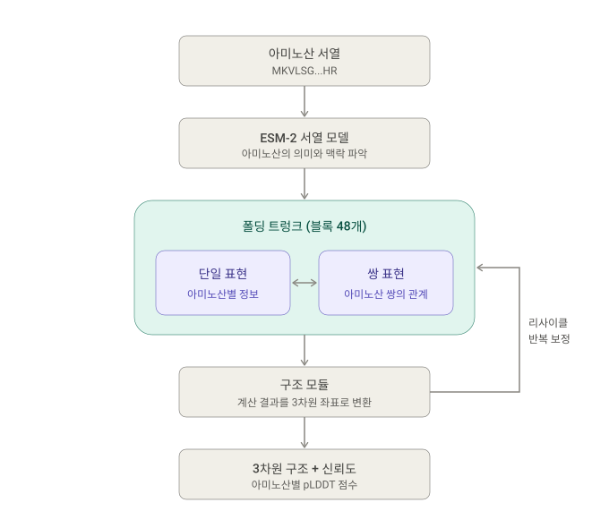

# 0. Summary

- 기본 정보 : ArXiv,2026.10.26, **[Structure, Not Sequence: Tracking and Validating Folding Mechanisms in ESMFold's Trunk with Sparse Autoencoders](https://arxiv.org/abs/2610.36226)**
- 연구 배경 : ESMFold 같은 구조 예측기는 아미노산(AA) 서열을 수 초 만에 3D 구조로 접지만, 서열에서 구조로 가는 내부 계산은 블랙박스로 남아 있다. 희소 오토인코더(SAE)는 지금까지 ESM-2 같은 **서열 언어 모델**의 임베딩에만 적용되어 왔고(InterPLM, InterProt), 서열 임베딩을 실제 기하로 바꾸는 **폴딩 트렁크(folding trunk)** 와 서열 모델에는 없는 **쌍 표현(pair representation)** 은 사전(dictionary) 수준의 해석이 없었다. 저자들은 "잔기 수준 의미는 서열 모델에서 물려받고, 기하는 트렁크 안에서 계산된다"는 분업 가설을 세운다.
- 제안 방법 : ESMFold 트렁크 48개 블록 중 균등 간격의 5개($b_{00},b_{12},b_{24},b_{36},b_{47}$)에서 단일 표현 $s_{s}\in\mathbb{R}^{L\times 1024}$ 와 쌍 표현 $s_{z}\in\mathbb{R}^{L\times L\times 128}$ 각각에 TopK SAE($k=16$)를 학습하고, 추론 LLM으로 모든 살아 있는 피처(단일 5,595개, 쌍 2,972개)에 라벨을 붙인다. 피처가 서열 모델 위에 무엇을 더하는지는 ESM-2-3B $L_{36}$ 프로브에 트렁크 코드를 이어 붙였을 때의 auroc 증분으로, 잔기 유형 편향은 잔기 유형을 고정한 within-AA auroc로 분리한다. 블록 간 피처 합성은 통합 기울기(integrated gradients)로 네 방향($s_{s}\to s_{s}$, $s_{z}\to s_{z}$, $s_{s}\to s_{z}$, $s_{z}\to s_{s}$)의 유향 회로로 추적하고, 실제 ESMFold 순전파에서 상류 피처 절제(ablation)로 간선을 인과적으로 검증한다. 마지막으로 해석된 코드로 pLDDT와 lDDT를 예측해 접힘 품질과 연결한다.
- 발견 사실 : (1) 트렁크 코드는 **잔기 간 관계** 예측을 크게 올린다. 잔기 접촉 $+0.318$, 사다리 연속 $+0.209$, 가닥 방향 $+0.086$ auroc로, 셔플 대조군($\pm 0.010$)을 훨씬 넘는다. 반면 활성 부위($+0.006$), 리간드 결합($+0.001$), 매몰($-0.000$) 같은 **잔기별 속성**은 서열 모델이 이미 제공해 증분이 대조군 안에 머문다. (2) 쌍 표현 어휘는 91%가 기하 개념이고 단일 표현 어휘는 57% 기하·43% 서열로 섞여 있으며, 단일 표현의 기하 비중은 $b_{00}$ 0.75에서 $b_{47}$ 0.43으로 깊이에 따라 줄어든다. 프롬프트를 바꿔도 이 분할은 유지된다. (3) 통합 기울기 회로의 간선은 표현 내부에서 79%, 순방향($s_{s}\to s_{z}$) 75%, 역방향($s_{z}\to s_{s}$) 63%가 알려진 생화학과 일치하고, 실제 순전파 절제는 매칭 대조군보다 단일 트랙 $1.42\times$, 쌍 트랙 $1.64\times$ 큰 하류 변화를 일으킨다. 쌍 코드 귀속의 약 1/3은 $s_{s}$ 에서 오지만 기하가 단일 코드로 되돌아가는 비중은 약 6%에 그친다. (4) 해석된 코드에 대한 ridge 프로브는 pLDDT·lDDT를 첫 블록 $R^{2}=0.61/0.48$ 에서 읽기 블록 $0.84/0.60$ 까지 예측하며, 매몰·패킹 개념은 정확한 잔기를, 노출·유연·말단 개념은 부정확한 잔기를 표시한다.
- 핵심 기여 :
    1. **폴딩 트렁크의 대규모 희소 사전** : 서열 모델이 아닌 폴딩 트렁크의 단일·쌍 표현 모두에 깊이 전체에 걸쳐 TopK 사전을 처음 학습하고, 추론 LLM으로 모든 피처를 해석한 뒤 프롬프트에 주지 않은 정량 정보(AA 순도, 주석 밀도)로 라벨을 검증했다.
    2. **서열 모델이 빠뜨리는 계산의 위치 측정** : 기존 사전이 분해하던 언어 모델 상태 위에 트렁크 코드를 더했을 때의 증분을 측정해, 관계 속성에서 최대 $+0.32$ auroc, 잔기별 속성에서는 증분 없음이라는 분업 패턴을 드러냈다.
    3. **인과 폴딩 회로와 출력 읽기** : 통합 기울기로 개념을 깊이 방향 유향 회로로 합성하고 실제 ESMFold 순전파에서 간선을 인과적으로 확인했으며, 단일·쌍 표현 사이의 상호작용을 추적하고 해석을 접힘 품질 예측기로 바꾸었다.

# Abstract 쉬운 설명(Claude)

단백질은 아미노산이 구슬처럼 한 줄로 꿰어진 사슬인데, 이 사슬이 특정한 3차원 모양으로 접혀야 제 기능을 합니다. **ESMFold는 아미노산 서열만 보고 그 모양을 예측하는 AI**입니다. 매우 빠르고 유용하지만, 내부 계산이 수많은 숫자로만 이루어져 있어 왜 그런 답을 냈는지 사람이 알기 어렵습니다. 이 논문은 그 **블랙박스를 열어 AI가 단백질을 접는 과정을 사람이 이해할 수 있는 말로 풀어낸 연구**입니다.

ESMFold가 일하는 과정은 크게 두 단계로 볼 수 있습니다.

- **서열 모델:** 글을 읽고 단어의 뜻을 파악하듯, 각 아미노산의 성질과 맥락을 파악합니다.
- **폴딩 트렁크:** 그 정보를 바탕으로 3차원 구조를 계산합니다. 이 논문이 들여다본 부분입니다.

트렁크는 정보를 두 가지 형태로 관리합니다. 비유하자면 **단일 표현**은 ‘아미노산별 인물 카드’이고, **쌍 표현**은 ‘아미노산끼리의 관계도’입니다. 연구진은 이 정보를 다음 순서로 분석했습니다.

1. **숫자 뭉치를 개념으로 분해:** 희소 오토인코더라는 도구로, 뒤섞인 숫자를 “두 잔기가 가깝다” 같은 비교적 단순한 개념 단위로 나눴습니다. 뒤섞인 합창에서 목소리를 하나씩 분리해 내는 것과 비슷합니다.
2. **AI로 이름 붙이기:** 약 8,500개의 개념이 각각 무엇을 뜻하는지 언어 모델이 이름을 붙였습니다.
3. **개념의 연결 추적:** 어떤 개념이 다음 개념에 영향을 주는지 따라가, 전자회로도 같은 지도를 만들었습니다.

그 결과 크게 네 가지를 확인했습니다.

- **역할 분담이 뚜렷합니다.** 인물 카드는 서열 모델에서 넘겨받은 아미노산의 성질을 주로 담고, 관계도는 잔기 간 거리와 접촉 같은 3차원 관계를 계산합니다.
- **트렁크는 ‘관계’ 정보를 새로 만들어 냅니다.** 어떤 아미노산끼리 맞닿는지 맞히는 성능이 크게 올랐습니다(AUROC 약 0.64 → 0.95). 반면 개별 아미노산의 성질은 서열 모델만으로도 이미 잘 알고 있었습니다.
- **AI의 판단 과정은 상당 부분 과학 지식과 일치합니다.** 개념 사이 연결의 약 73%가 기존 생화학 지식으로 뒷받침됐습니다. 예를 들어 “류신은 단백질 안쪽에 묻히는 경향이 있고, 그래서 다른 잔기와 맞닿는다” 같은 연결입니다. 설명되지 않는 연결도 있었는데, 일부는 검증 규칙의 한계 때문일 수 있어 추가 확인이 필요합니다.
- **예측의 정확도도 어느 정도 가늠할 수 있습니다.** 개념들의 활성화 패턴을 보면 ESMFold가 어느 부위를 얼마나 정확히 예측했는지 추정할 수 있습니다.

신약 개발이나 질병 연구에서는 AI의 예측을 믿어도 되는지, 왜 그런 결과가 나왔는지 아는 것이 중요합니다. 이 연구는 그 판단 근거를 사람이 직접 확인할 수 있게 하는 첫걸음입니다.

# 아미노산 모양 예측 모델 - ESMFold

# 폴딩 트렁크 세 단계 해석 방법

# 관련 개념

## ESMFold 폴딩 트렁크의 구조

**ESMFold**(Lin et al., 2023)는 MSA 파이프라인 없이 단일 서열에서 바로 구조를 예측합니다. 서열을 먼저 **ESM-2-3B** 마스크 언어 모델로 임베딩하고, 그 임베딩을 **48개 구조 블록**으로 이루어진 폴딩 트렁크에 통과시킨 뒤, 구조 모듈이 3D 좌표와 잔기별 신뢰도(pLDDT)를 냅니다.

---

### 🧱 1. 두 가지 상태

| 표현 | 차원 | 단위 | 서열 모델에 대응물이 있는가 |
|---|---|---|---|
| 단일 표현 $s_{s}$ | $\mathbb{R}^{L\times 1024}$ | 잔기당 벡터 하나 | 있음 (서열 임베딩에서 시드됨) |
| 쌍 표현 $s_{z}$ | $\mathbb{R}^{L\times L\times 128}$ | 잔기 쌍당 벡터 하나 | **없음** (폴딩 전용) |

각 블록은 이 두 상태를 함께 유지합니다. 이 논문의 핵심 주장 중 하나는 쌍 표현이 기하를 담는 "폴딩 전용" 객체라서, 서열 기반 사전은 원리적으로 닿을 수 없다는 것입니다.

---

### 🔁 2. 리사이클과 분석 지점

트렁크는 반복 적용됩니다. 정해진 횟수의 리사이클(recycle)마다 구조 모듈이 $s_{s}, s_{z}$ 를 읽어 구조를 예측하고, 다음 반복은 두 표현을 이어받으면서 예측 구조를 **구간화된 거리 분포(binned distogram)** 로 되돌려 받습니다. 마지막 리사이클의 좌표가 출력입니다.

저자들은 트렁크의 첫 블록 $b_{00}$ 부터 구조 모듈로 들어가는 $b_{47}$ 까지 균등 간격의 다섯 블록 $b_{00}, b_{12}, b_{24}, b_{36}, b_{47}$ 을 분석합니다. 48개 중 5개만 봐도 되는 근거는 뒤에서 설명할 블록 간 높은 CKA 유사도(중간 블록 0.96)입니다.

---

### 🎯 3. 학습 신호의 차이

| 모델 | 학습 목표 | 계산하는 것 |
|---|---|---|
| ESM-2 서열 모델 | 마스크 언어 모델링(MLM) 손실 | 밀집 서열 임베딩. 3D 구조를 학습하라는 명시적 지시 없음 |
| 폴딩 트렁크 + 구조 헤드 | FAPE(frame-aligned point error) + 트렁크 상태에 대한 보조 읽기 손실 | 서열 임베딩 → 3D 구조의 명시적 회귀 |

이 차이가 "트렁크는 서열 모델이 암묵적으로 남겨 둔 기하를 **실체화(materialize)** 한다"는 저자들의 관점을 뒷받침합니다.

---

> **💡 Key Takeaway**
> ESMFold 트렁크는 잔기당 벡터($s_{s}$)와 잔기 쌍당 벡터($s_{z}$)를 48개 블록에 걸쳐 갱신합니다. 쌍 표현은 서열 모델에 없는 폴딩 전용 객체이며, 이 논문은 다섯 블록에서 두 표현 모두를 해석 대상으로 삼습니다.

## 파일럿 분석: 프로토콜을 정하는 세 관찰

본격적인 사전 학습 전에 저자들은 트렁크가 서열 모델과 어떻게 다른지 세 가지 측정으로 확인합니다. 이 세 관찰이 "왜 서열 사전을 재사용하지 않고, 왜 쌍 표현도 읽어야 하며, 왜 깊이별로 봐야 하는가"를 정당화합니다.

---

### 📏 1. 표현의 간극 (Linear CKA)

ESM-2 레이어와 트렁크 블록 사이의 **선형 CKA**(Kornblith et al., 2019)를 4,155개 단백질에서 뽑은 9,000개 잔기(60개 샤드, 다섯 번 부표본 평균, 최대 표준편차 0.012)로 계산했습니다.

$$
\mathrm{CKA}(X,Y)=\frac{\lVert Y^{\top}X\rVert_{F}^{2} }{\lVert X^{\top}X\rVert_{F}\,\lVert Y^{\top}Y\rVert_{F} }
$$

| 비교 쌍 | CKA |
|---|---|
| ESM-2 레이어 ↔ 트렁크 블록 (평균) | 0.14 |
| ESM-2 마지막 레이어 ↔ $b_{00}$ | 0.23 |
| 트렁크 블록 ↔ 트렁크 블록 (평균) | 0.65 |
| 중간 블록 사이 (최대) | 0.96 |

트렁크는 잔기들을 **자기만의 유사도 구조**로 재조직합니다. 선형 CKA는 직교 변환과 등방 스케일에는 불변이지만 일반 선형 사상에는 불변이 아니므로, 이 값은 "내용이 다르다"기보다 "유사도 구조가 재편됐다"를 뜻합니다. 그래서 서열 사전(Simon & Zou 2025; Adams et al. 2025)을 그대로 쓰지 않고 트렁크 구조 위에서 새로 학습해야 합니다.

---

### 📐 2. 기하는 쌍 표현에 있다 (Table 6)

500개 단백질의 60,000개 잔기 쌍에서 C$\alpha$–C$\alpha$ 거리를 각 표현으로 회귀(ridge, 단백질 층화 분할)했습니다. 잔기별 표현에는 쌍 $(i,j)$ 를 볼 수 있도록 상호작용 피처 $[\,s_{i};\,s_{j};\,s_{i}\odot s_{j}\,]$ 를 줍니다.

| 예측 변수 | 거리 $R^{2}$ ($b_{47}$) | 거리 $R^{2}$ ($b_{24}$) |
|---|---|---|
| $s_{z}$ 사전 코드 (pair SAE, TopK) | 0.69 | 0.64 |
| $s_{z}$ 원본 (128차원 쌍 벡터) | 0.67 | 0.62 |
| ESM-2-3B $L_{36}$, 쌍 프로브 | $-0.11$ | $-0.11$ |
| ESM-2-3B $L_{24}$, 쌍 프로브 | $-0.20$ | $-0.20$ |
| ESM-2-650M $L_{24}$, 쌍 프로브 | $-0.00$ | $-0.00$ |
| 서열 간격 $\lvert i-j\rvert$ (자명한 기준) | 0.03 | 0.03 |

쌍 표현만이 거리를 복원하고, 트렁크 자신의 ESM-2-3B 백본을 포함한 어떤 잔기별 표현도 복원하지 못합니다(음수 $R^{2}$ 는 평균 예측보다 못함). 읽기 헤드가 읽지 않는 중간 블록 $b_{24}$ 에서도 쌍 우위가 유지됩니다.

---

### ⏳ 3. 물려받은 의미, 계산되는 기하

깊이별 프로브(Figure 2C)에서 **기능 부위(catalytic) 신호는 ESM-2 $L_{36}$ 에서 최대**이고 트렁크 깊이에 따라 **침식**되는 반면, **매몰(burial) 같은 기하 신호는 깊이에 따라 쌓입니다**. 이 조기 결정(early-commitment) 패턴이 "잔기별 의미는 서열 모델에서 물려받고, 기하는 트렁크 안에서 계산된다"는 분업 가설의 첫 증거입니다.

---

### 🔄 4. 리사이클 불변성 (Appendix H)

단일 표현 사전은 리사이클 $N=1$ 에서, 쌍 표현·인과 개입·기본 추론은 $N=3$ 에서 캡처했습니다. 같은 단백질을 두 설정으로 다시 접어 비교하면:

| 블록 | 코사인 | 상대 $L_{2}$ |
|---|---|---|
| $b_{00}$ | 1.0000 | 0.15% |
| $b_{24}$ | 0.99997 | 0.87% |
| $b_{47}$ | 0.99979 | 2.0% |

사전을 통과시키면 잔기의 87–98%에서 같은 활성 피처를 고르고(TopK Jaccard 0.87–0.98), 활성 상관은 0.98–0.99입니다. 리사이클 0–4를 추적하면 첫 리사이클에서 이미 최종값의 코사인 $\geq 0.9998$ 에 도달하고 나머지는 1% 미만의 정제만 기여합니다. 따라서 한 설정에서 학습한 사전을 다른 설정에서 조정 없이 읽을 수 있습니다.

---

> **💡 Key Takeaway**
> 트렁크는 서열 모델과 유사도 구조가 다르고(CKA 0.14), 잔기 간 거리는 쌍 표현에서만 복원되며($R^{2}$ 0.69 vs 음수), 기능 신호는 얕은 곳에서 기하 신호는 깊은 곳에서 최대가 됩니다. 이 셋이 "트렁크 전용 사전, 쌍 표현 포함, 깊이별 분석"이라는 프로토콜을 결정합니다.

## TopK 희소 사전의 학습

각 블록의 표현을 학습 코퍼스에 대해 평균 중심화한 뒤 **TopK SAE**(Gao et al., 2025; Bricken et al., 2023)를 학습합니다.

---

### 🧮 1. 인코딩과 재구성 (Eq. 1)

잔기(또는 쌍) 활성 $x$ 에 대해

$$
z=\mathrm{TopK}_{k}\big(\mathrm{ReLU}(xW_{\mathrm{enc} }+b_{\mathrm{enc} })\big),\qquad \hat{x}=zW_{\mathrm{dec} }+b_{\mathrm{dec} }
$$

$\mathrm{TopK}_{k}$ 는 ReLU 로짓 중 가장 큰 $k$ 개만 남기고 나머지를 0으로 만듭니다. 학습은 재구성 오차 $\lVert x-\hat{x}\rVert_{2}^{2}$ 를 최소화하며, 디코더 행은 단위 노름으로 고정하고 죽은 피처는 주기적으로 잔차가 큰 예시 방향으로 재초기화합니다. 보고 지표는 held-out 설명 분산(ev)입니다.

---

### ⚙️ 2. 학습 설정

| 항목 | 단일 표현 / ESM-2 레이어 사전 | 쌍 표현 사전 |
|---|---|---|
| 코퍼스 | UniRef50 서열 50만 개를 접어 얻은 **9,500만** 잔기 활성 | 967개 단백질에서 뽑은 **480만** 쌍 활성 |
| 입력 차원 | 1024 | 128 |
| 사전 폭 $d_{\mathrm{sae} }$ | 8,192 | 4,096 |
| 희소도 $k$ | 16 | 16 |
| 배치 크기 | 2,048 | 8,192 |
| 에폭 | 10 | 25 |
| 학습률 | $4\times 10^{-4}$, 첫 5% 스텝 선형 워밍업 | — |

쌍 샘플 수는 $L^{2}$ 로 늘어나기 때문에 별도 레시피를 씁니다. 공정한 트렁크 대 서열 비교를 위해 모든 단일 표현 사전과 ESM-2 레이어 사전은 **같은 데이터 예산과 같은 프로토콜**로 학습합니다.

---

### 📊 3. 재구성 품질과 희소도 스윕 (Table 3)

본문의 모든 사전은 가장 희소한 $k=16$ 을 씁니다. 그때 단일 표현의 held-out 설명 분산은 블록 0, 12, 24, 36, 47에서 각각 0.87, 0.90, 0.89, 0.86, 0.89입니다.

| 블록 | $k=16$ | $k=32$ | $k=64$ | $k=128$ |
|---|---|---|---|---|
| $b_{00}$ | 0.872 | 0.920 | 0.962 | 0.988 |
| $b_{12}$ | 0.900 | 0.934 | 0.963 | 0.984 |
| $b_{24}$ | 0.893 | 0.928 | 0.959 | 0.981 |
| $b_{36}$ | 0.863 | 0.908 | 0.945 | 0.973 |
| $b_{47}$ | 0.893 | 0.929 | 0.957 | 0.977 |

재구성은 모든 블록에서 활성 피처 예산에 따라 단조 증가합니다. 저자들은 몇 포인트의 재구성을 포기하고 **최대한 해석 가능한 코드**를 택했습니다.

---

> **💡 Key Takeaway**
> 다섯 블록 × 두 표현에 $k=16$ TopK 사전을 학습합니다(단일 8,192폭, 쌍 4,096폭). $k=16$ 에서 설명 분산 0.86–0.90이며, $k$ 를 늘리면 0.99까지 오르지만 해석 가능성을 위해 희소한 쪽을 택했습니다.

## 자동 해석 파이프라인과 어휘의 분할

두 표현은 서로 다른 객체(잔기 vs 잔기 쌍)를 다루므로 **두 개의 프롬프트**로 해석합니다.

---

### 🏷️ 1. 단일 표현 프롬프트

InterPLM(Simon & Zou, 2025)의 파이프라인을 출발점으로 삼습니다. 추론 LLM은 피처가 여러 단백질에서 가장 강하게 활성화되는 잔기들의 문맥을 읽습니다. 문맥에는 다음이 들어갑니다.

| 문맥 항목 | 출처 |
|---|---|
| 2차 구조, 용매 접근 면적(ASA) | AlphaFold 모델 (DSSP, Tien et al. 2013 정규화) |
| C$\alpha$ 접촉 수, 장거리 3차 이웃 수 | 좌표 |
| 이황화 결합 참여 여부 | 좌표 |
| 해당 위치의 기능 주석 | UniProt |

LLM은 2–5 단어의 자유 라벨과 **7개 범주**(secondary structure, burial, contact, functional site, disulfide, chemical, positional) 중 하나를 돌려주고, 그 피처가 **아미노산 유형**을 반영하는지 **실제 생물학적 개념**을 반영하는지도 판정합니다. 각 라벨 옆에는 피처의 AA 순도(purity)와 지배 잔기를 정량 검증용으로 기록합니다(프롬프트에는 주지 않음).

---

### 🔗 2. 쌍 표현 프롬프트

기존 해석은 쌍이라는 객체를 놓쳤으므로 새 프롬프트를 설계했습니다. 피처가 발화하는 쌍 집단의 요약 통계(쌍·단백질 수, 중앙값 C$\beta$–C$\beta$ 거리와 서열 간격, 장거리·국소 비율, 양 끝 매몰 비율, 주석 비율, 지배 2차 구조 쌍)와 예시 쌍의 양 끝 잔기 문맥을 주고, **"이 쌍이 어떤 관계를 인코딩하는가"를 열린 질문으로** 묻습니다. 프롬프트는 "기하라고 가정하지 말라"고 명시하고, 공간 관계·AA 유형·서열 오프셋·기능 쌍·끝점 단독 속성·일관성 없음 중에서 고르게 합니다.

---

### 🧪 3. 교차 프롬프트 제어 (Appendix L)

두 표현에 다른 질문을 하므로 분할이 증거가 아니라 질문을 따라갈 수 있습니다. 그래서 문맥은 고정한 채 **질문만 서로 바꿔** 다시 라벨링했습니다.

| 표현 | 자기 질문에서 기하 비중 | 상대 질문에서 기하 비중 |
|---|---|---|
| 쌍 $s_{z}$ | 91% | **99%** (정체성 질문을 해도 기하로 읽힘) |
| 단일 $s_{s}$ | 57% | **32%** (공간 관계를 물어도 기하 쪽으로 가지 않음) |

질문을 바꿔도 쌍 표현은 기하에 머물고, 단일 표현은 오히려 기하에서 멀어집니다. 분할은 프롬프트의 귀납 편향이 아니라 표현의 차이에서 옵니다.

---

### 🗂️ 4. 어휘를 서열과 기하로 나누는 규칙 (Appendix P)

| 분류 | 범주 | 근거 |
|---|---|---|
| 서열 결정 | 측쇄 화학(chemical), 서열 위치(positional) | 잔기 정체성이나 서열 오프셋을 명명 |
| 기하 | 잔기 접촉(contact), 매몰(burial) | 잔기 간 관계나 3D 환경을 명명 |
| **제외** | 2차 구조, 기능 부위, 이황화 | 서열 모델이 이미 잘 예측하거나, 잔기별 주석이지만 공간 배열이거나, 서열 조건과 공간 결합이 모두 필요 |

제외된 피처는 단일 5,595개 중 2,097개, 쌍 2,972개 중 350개입니다. Figure 7A의 비율은 원래 질문에서 3,498개(단일)·2,622개(쌍), 바꾼 질문에서 662개·906개 피처 위에서 계산됐습니다.

---

> **💡 Key Takeaway**
> 단일 표현은 InterPLM식 "정체성 vs 구조" 질문으로, 쌍 표현은 관계를 열린 질문으로 해석합니다. 질문을 서로 바꿔도 쌍 어휘는 99% 기하로, 단일 어휘는 32%로 더 멀어지므로 분업은 프롬프트의 산물이 아닙니다.

## 피처 평가 전략

해석된 피처가 "실제로 무엇을 담는가"를 네 가지 측정으로 평가합니다.

---

### 🗺️ 1. 단백질 위의 활성 부위 (Eq. 2)

피처 $f$ 의 위치는 활성 맵

$$
a_{i}=z_{i,f}
$$

를 접힌 구조 위에 칠해서 봅니다. 인코더는 잔기별로 적용되므로 이 활성이 피처가 각 잔기에서 읽어내는 **완전한 읽기값**입니다. 기울기 $\partial\big(\sum_{j}z_{j,f}\big)/\partial s_{s,i}$ 는 피처 지지 집합 위에서는 인코더 행이고 밖에서는 0입니다.

---

### ➕ 2. 서열 모델 위의 증분

트렁크가 **더하는** 계산을 분리하기 위해, 각 타깃에 대해 (a) ESM-2-3B $L_{36}$ 만으로 프로브를 맞추고, (b) 같은 상태에 트렁크 코드를 이어 붙여 다시 맞춘 뒤, held-out auroc 차이를 읽습니다. $L_{36}$ 을 쓰는 이유는 트렁크가 학습한 ESM-2 표현 혼합 가중치가 이 레이어에 0.90을 주기 때문입니다.

| 타깃 유형 | 예 | 프로브 입력 |
|---|---|---|
| 잔기별 속성 | 주석 부위, 매몰, 가닥 | 잔기 상태 |
| 잔기 간 관계 | 잔기 접촉, $\beta$-사다리 연속, 평행/역평행 가닥 방향 | $[\,s_{i};\,s_{j};\,s_{i}\odot s_{j}\,]$ (모든 표현에 동일하게) |

가닥 방향은 공통 거리 껍질 안에서 채점해 **근접성이 위상을 대신하지 못하게** 합니다. 프로브는 단백질 층화 분할의 로지스틱 회귀이며, 단백질당 잔기별 타깃 70개, 관계 타깃 220쌍을 고정 시드로 비복원 추출합니다. 증분은 트렁크 피처 블록을 예시 간에 **순열**해 잔기와의 정렬만 제거한 대조군($\pm 0.010$)과 비교합니다.

---

### 🧬 3. 아미노산 유형 편향의 분리 (Eq. 5, Appendix C)

AA 유형은 코드에서 auroc 1.0으로 복호되므로, 검출기가 잔기 유형을 다시 읽는 것만으로 구조적으로 보일 수 있습니다. 그래서 (단백질, 잔기 유형) 셀 집합 $\mathcal{C}$ 위에서 잔기 유형을 고정한 **within-AA auroc** 를 계산합니다.

$$
\mathrm{AUROC}_{\mathrm{wAA} }(f)=\frac{1}{\lvert\mathcal{C}\rvert}\sum_{(p,r)\in\mathcal{C} }\mathrm{AUROC}_{p,r}(z_{f})
$$

셀 안에서는 AA 유형이 상쇄됩니다. Hewitt & Liang(2019)의 제어 과제 진단을 따라 합격/불합격이 아니라 **귀속(attribution)** 으로 읽습니다. 상동성 필터(5-mer Jaccard $\geq 0.30$), 단백질 층화 분할, 한 분할에서 선택하고 다른 분할에서 채점(및 그 반대)을 적용합니다.

---

### 📈 4. 접힘 출력과의 관계

블록 코드에서 ESMFold 자체 신뢰도(pLDDT)와 참 구조 대비 정확도(lDDT)로 ridge 프로브를 맞추고 미지 단백질에서 held-out $R^{2}$ 를 보고합니다. 개별 개념은 정확도와의 Spearman 상관으로 순위를 매깁니다.

---

### 📦 5. 신뢰 구간 (Appendix B)

모든 구간은 비모수 백분위 부트스트랩(2.5–97.5 백분위, 95%)입니다. 검출·within-AA 구간은 평가 단백질을 클러스터로 1,000회 재표집하고, 인과 배율 구간은 귀속 타깃을 2,000회 재표집해 "실제 간선 평균 효과 / 매칭 대조군 평균 효과" 비율 위에 구간을 둡니다.

---

> **💡 Key Takeaway**
> 트렁크의 기여는 ESM-2 $L_{36}$ 프로브에 코드를 이어 붙인 auroc **증분**으로, 잔기 유형 편향은 유형을 고정한 **within-AA auroc** 로 분리합니다. 두 장치가 "서열 모델이 이미 아는 것"과 "잔기 유형만으로 되는 것"을 트렁크의 몫에서 걷어냅니다.

## 통합 기울기로 회로 만들기

해석된 개념이 깊이 방향으로 어떻게 합성되는지는 실제 ESMFold 순전파를 통과하는 **통합 기울기(integrated gradients)**(Sundararajan et al., 2017)로 귀속합니다.

---

### 🧮 1. 코드 간선의 정의 (Eq. 3, Eq. 6)

원천 블록에서 선택한 표현의 사전을 이어 붙이고(splice), 목적 블록에서 선택한 표현을 캡처해 그 표현의 사전으로 인코딩합니다. 상류 피처 $i$ 에서 하류 피처 $j$ 로의 간선은

$$
E_{ij}=z_{i}\int_{0}^{1}\frac{\partial z^{\mathrm{dst} }_{j}(\alpha z)}{\partial z_{i} }\,\mathrm{d}\alpha
$$

입니다. 이는 일반 통합 기울기

$$
\mathrm{IG}_{i}(x)=(x_{i}-x^{\prime}_{i})\int_{0}^{1}\frac{\partial F\big(x^{\prime}+\alpha(x-x^{\prime})\big)}{\partial x_{i} }\,\mathrm{d}\alpha
$$

에서 입력을 상류 코드 $z$, 기준선을 영 코드 $x^{\prime}=0$ (평균 재구성으로 복호됨), 스칼라 출력을 $F=z^{\mathrm{dst} }_{j}$ 로 둔 것입니다. $\mathrm{decode}(\alpha z)$ 를 원천 블록의 표현에 삽입하고 목적 블록까지 순전파하면 하류 코드 $z^{\mathrm{dst} }(\alpha z)$ 를 얻습니다. 적분은 $N$-스텝 중점 리만 합으로 계산하며, 기울기×입력을 단계마다 온라인으로 누적해 최대 메모리를 서열 길이에 무관하게 유지하고, 삽입 구간은 gradient checkpointing 합니다. 리사이클 간 변화가 작으므로 각 귀속은 단일 리사이클에서 실행합니다.

---

### 🧭 2. 네 방향의 조합

| 방향 | 의미 | 이름 |
|---|---|---|
| $s_{s}\to s_{s}$ | 단일 표현 트랙 내부의 정보 흐름 | 트랙 내 |
| $s_{z}\to s_{z}$ | 쌍 표현 트랙 내부의 정보 흐름 | 트랙 내 |
| $s_{s}\to s_{z}$ | 단일 표현이 쌍에 쓰기 (서열 → 구조) | **순방향(forward)** |
| $s_{z}\to s_{s}$ | 쌍 표현이 단일에 되쓰기 | **역방향(backward)** |

단일 표현은 서열 임베딩에서 시드되고 쌍 표현은 접힘이 만들어지는 기하를 담으므로, 서열에서 구조로 가는 $s_{s}\to s_{z}$ 를 순방향이라 부릅니다. 하나의 구성(원천 블록, 목적 블록, 양 끝 표현 선택)이 논문의 모든 귀속을 포괄합니다.

---

### 🎨 3. 회로 그림의 인코딩 (Appendix A)

Figure 3의 노드는 주석 범주, 간선은 블록 간 통합 기울기입니다. 크기가 수 자릿수에 걸치므로 각 채널은 로그 압축

$$
\tilde{\phi}(w;w_{\max})=\mathrm{clip}\left(\frac{\ln w-\ln(0.002\,w_{\max})}{\ln w_{\max}-\ln(0.002\,w_{\max})},\;0,\;1\right)
$$

을 거칩니다. 노드 면적은 $18+430\,\tilde{\phi}(m;m_{\max})$, 트랙 내 간선 폭은 $0.5+4.5\,\tilde{\phi}$, 순방향 교차 간선 폭은 $0.6+4.4\,\tilde{\phi}$, 역방향은 $0.25+0.66\,\tilde{\phi}$ 입니다. 역방향 상한은 하류 트랙 유입 귀속에서의 점유율 비로 순방향 상한을 줄인 것이라, **두 교차 다발의 두께 차이 자체가 비대칭을 인코딩**합니다. 그림은 피처 수 기준 단일 28개·쌍 18개 개념을 모으고, 트랙 내 간선은 $0.002\,w_{\max}$, 교차 간선은 $0.008\,w_{\max}$ 미만을 생략합니다.

---

> **💡 Key Takeaway**
> 간선 $E_{ij}$ 는 영 코드에서 실제 상류 코드까지의 직선 경로를 따라 하류 코드를 적분한 통합 기울기입니다. 같은 구성으로 트랙 내 두 방향과 교차 두 방향을 모두 계산하며, 순방향은 서열에서 구조로, 역방향은 구조에서 서열로의 쓰기입니다.

## 결과 1: 트렁크가 더하는 관계 정보 (Table 1)

ESM-2-3B $L_{36}$ 프로브에 트렁크 코드를 더했을 때의 auroc 증분입니다. 기준선이 이미 서열 의미를 담고 있으므로 증분은 **의미 너머에 트렁크가 더하는 것**을 분리합니다.

---

### 📊 1. 전체 표

| 타깃 | 유형 | ESM-2-3B | $+$ trunk | $\Delta$ |
|---|---|---|---|---|
| 잔기 접촉 (Residue contact) | 관계 | 0.636 | 0.954 | **+0.318** |
| 사다리 연속 (Ladder continuation) | 관계 | 0.644 | 0.853 | **+0.209** |
| 가닥 방향 (Strand orientation) | 관계 | 0.873 | 0.959 | **+0.086** |
| 금속 결합 (Metal binding) | 잔기별 | 0.978 | 0.992 | +0.014 |
| 가닥 (Strand) | 잔기별 | 0.961 | 0.969 | +0.008 |
| 활성 부위 (Active site) | 잔기별 | 0.978 | 0.984 | +0.006 |
| 리간드 결합 (Ligand binding) | 잔기별 | 0.923 | 0.924 | +0.001 |
| 매몰 (Burial) | 잔기별 | 0.827 | 0.827 | $-0.000$ |

셔플 대조군은 모든 행에서 $\pm 0.010$ 입니다. 세 관계 타깃은 대조군 밖에 멀리 있고, 잔기별 타깃은 금속 결합(+0.014)이 간신히 넘을 뿐 모두 대조군 안입니다.

---

### 🧭 2. 가장 깨끗한 사례: 가닥 방향

이미 짝지어진 잔기 쌍에서 두 가닥이 평행인지 역평행인지는 **위상만으로** 결정됩니다. 두 클래스의 평균 간격 차이는 0.05 Å에 불과하고 거리만으로는 auroc 0.511입니다. 같은 쌍 프로브로 ESM-2-3B는 0.862, 트렁크 쌍 코드는 **0.965** 에 도달합니다. 거리가 위상을 대신할 수 없게 만든 설계에서, 트렁크가 위상을 계산한다는 것이 드러납니다.

---

### 🚧 3. 잔기별 속성은 왜 늘지 않는가

패턴은 **타깃의 난이도가 아니라 형태**를 따릅니다. 매몰은 0.827로 여유(headroom)가 많은데도 아무것도 얻지 못합니다. 잔기별 읽기가 쓸 수 있는 것은 언어 모델이 이미 공급한다는 뜻입니다.

---

### 🧩 4. 단백질 수준에서도 같은 경계 (Appendix J)

각 단백질의 코드를 풀링해 EC(효소 클래스), CATH(접힘), SCOP(초과)를 leave-one-out 코사인 kNN으로 검색하고, 동일하게 학습한 ESM-2-3B 사전과 비교했습니다.

| 풀링 방식 | 효소 클래스 | 세 접힘 수준 |
|---|---|---|
| 평균+최대 연결 | +0.026 | $-0.008$ ~ $-0.034$ |
| 피처별 표준화 후 풀링 | $-0.024$ ~ $-0.084$ (모든 과제) | |
| 발화 여부만 기록한 이진 서술자 | +0.047 ~ +0.082 (모든 과제) | |

서술자 선택에 따라 부호가 바뀌므로 저자들은 **아무 주장도 하지 않습니다**. 이유는 둘입니다. 가족 라벨은 서열 상동성으로 전파되므로(CATH 질의 2,378개 중 2,243개가 50% 이상 동일성의 친척 보유) 진화적 문맥에 학습된 모델이 유리하고, 풀링이 트렁크를 구별 짓는 쌍 구조를 잔기별 주변 분포로 붕괴시킵니다. Section 4.2가 바로 그 쌍 구조를 직접 측정합니다.

---

> **💡 Key Takeaway**
> 트렁크 코드는 잔기 접촉 +0.318, 사다리 연속 +0.209, 가닥 방향 +0.086 auroc를 더하지만 잔기별 속성에는 거의 아무것도 더하지 않습니다. 분업의 경계는 "관계인가 잔기별인가"라는 타깃의 형태를 따릅니다.

## 결과 2: 자동 해석의 충실도

파이프라인은 다섯 블록에 걸쳐 살아 있는 **8,567개** 피처(단일 5,595, 쌍 2,972)에 자유 라벨, 개념 범주, 잔기 유형 지표 여부를 부여합니다.

---

### ✅ 1. 프롬프트에 주지 않은 양으로 라벨 검증

| 검증 | auroc | 비교 |
|---|---|---|
| AA 순도 → 정체성 판정 | 0.85 | 정체성 라벨 피처 평균 순도 0.85 vs 구조 라벨 0.45 |
| 상위 문맥의 주석 밀도 → 기능 부위 판정 | 0.89 | 0.59 vs 0.14 |

공간 개념을 가진 단일 피처 3,502개 중 **1,270개**는 문맥 어디에도 주석이 없는데 패킹·매몰·3차 접촉을 명명합니다. 어휘가 주석을 되풀이하는 것이 아니라 트렁크가 계산하는 기하를 기술한다는 뜻입니다.

---

### 📊 2. 두 트랙의 어휘 구성

| 표현 | 기하 | 서열 |
|---|---|---|
| 쌍 $s_{z}$ | 91% | 9% |
| 단일 $s_{s}$ | 57% | 43% |

단일 표현은 쌍 트랙의 **다섯 배**에 달하는 서열 개념 비중을 기하 정보와 함께 지닙니다. 단일 표현 안에서 기하 비중은 $b_{00}$ 의 0.75에서 $b_{47}$ 의 0.43으로 깊이에 따라 **떨어져**, 서열 의미가 읽기 지점에 집중됩니다.

---

### 🔬 3. 쌍 라벨의 이중 해리 (Table 7, Appendix K)

쌍 피처를 라벨이 명명한 개념으로(과제와 무관하게) 묶고, 각 그룹만으로 좌표에서 정의한 두 관계를 예측했습니다. 라벨은 어떤 타깃보다도 먼저, 독립적으로 부여됐으므로 누출된 상관에 기댈 수 없습니다.

| 라벨 그룹 | $b_{24}$ $\beta$-쌍 | $b_{24}$ 나선 $i,i{+}4$ | $b_{47}$ $\beta$-쌍 | $b_{47}$ 나선 $i,i{+}4$ |
|---|---|---|---|---|
| $\beta$-시트 / 가닥 | **0.938** | 0.839 | **0.932** | 0.900 |
| $\alpha$-나선 | 0.737 | **0.989** | 0.834 | **0.993** |
| 일반 접촉 | 0.829 | 0.943 | 0.803 | 0.901 |
| 같은 크기 무작위 집합 | 0.675 | 0.665 | 0.683 | 0.742 |
| 전체 사전 | 0.965 | 0.992 | 0.960 | 0.993 |

각 그룹은 자기 관계를 상대 관계보다, 그리고 무작위 집합보다 잘 예측합니다. 두 블록 모두에서 성립하는 **이중 해리**입니다. 일반 접촉 그룹은 두 관계가 공유하는 접촉 신호를 담아 둘 사이에 놓입니다.

---

### 🧩 4. 분류체계 없이 되찾은 어휘

자유 라벨을 TF-IDF와 $k$-means로 분류체계에 눈먼 채 군집화하면 데이터 주도 어휘가 나옵니다.

| 표현 | 개념 수 | 성격 |
|---|---|---|
| 쌍 | 18 | 전부 기하 관계(잔기 접촉, $\beta$-가닥 짝짓기, 나선 주기성, 소수성 패킹), 잔기 정체성 개념 없음 |
| 단일 | 28 | 그중 13개가 아미노산 하나씩의 거의 완전한 단일 잔기 어휘, 읽기 지점에 집중 |

개념은 라벨 텍스트와 독립인 측정으로 접지됩니다. 정체성 개념은 13개 군집 중 12개에서 측정된 지배 잔기를 명명하고 순도 0.84(구조 개념 기준선 0.40)이며, 기하 개념은 측정된 서열 간격과 맞습니다(나선 주기성 약 6잔기 vs 장거리·3차 접촉 약 36잔기).

---

> **💡 Key Takeaway**
> 라벨은 프롬프트에 없던 AA 순도(0.85)와 주석 밀도(0.89)로 검증되고, 쌍 어휘는 91% 기하, 단일 어휘는 57/43 혼합입니다. $\beta$ 라벨 피처는 가닥 짝짓기를, 나선 라벨 피처는 나선 접촉을 더 잘 예측하는 이중 해리가 라벨의 특이성을 보여 줍니다.

## 결과 3: 활성 부위와 검출기의 응용

정량 분석의 토대는 피처 하나하나를 직접 들여다볼 수 있는 사전입니다. 검출 스캔으로 고른 검출기의 활성 부위(Eq. 2)는 접힌 구조 위에서 그 피처가 읽는 잔기를 보여 줍니다.

---

### 🎯 1. 점형 검출기와 분산형 검출기 (Table 5)

| 개념 | 피처 | auroc | IoU | 유의 단백질 비율 |
|---|---|---|---|---|
| 이황화 (Disulfide) | 5934 | 0.98 | 0.79 | 91% |
| 탄수화물 (Carbohydrate) | 8061 | 0.95 | 0.13 | 52% |
| 활성 부위 (Active site) | 2819 | 0.80 | 0.03 | 9% |
| 신호 펩타이드 (Signal peptide) | 6323 | 0.79 | 0.35 | 73% |
| 막관통 (Transmembrane) | 5591 | 0.77 | 0.46 | 68% |
| 금속 결합 (Metal binding) | 1314 | 0.76 | 0.48 | 76% |
| 리간드 결합 (Ligand binding) | 2819 | 0.74 | 0.11 | 38% |

IoU는 피처 상위 활성 잔기와 주석 잔기의 평균 겹침, 마지막 열은 그 겹침이 잔기 순열 기준선을 이기는 단백질 비율입니다. 이황화·금속 결합·막관통 피처는 주석 잔기에 **집중**해 68–91%의 단백질에서 유의하고, 활성 부위와 리간드 결합이 공유하는 일반 기능 피처(2819)는 1–3잔기 점이 아니라 **포켓 전체에 퍼집니다**.

---

### 🧬 2. 아미노산 유형이 선택과 평가 모두를 왜곡한다 (Table 4)

| 속성 | $n$ | AA 사전 auroc | 지배 잔기 | raw naive | raw ctrl | within-AA naive | within-AA ctrl |
|---|---|---|---|---|---|---|---|
| 이황화 | 771 | 0.995 | C† | 0.956 | 0.892 | 0.768 | **0.908** |
| 글리코실화 | 395 | 0.972 | N‡ | 0.950 | 0.691 | 0.563 | **0.782** |
| 활성 부위 | 1220 | 0.896 | H | 0.863 | 0.581 | 0.846 | **0.974** |
| 금속 결합 | 926 | 0.894 | D | 0.792 | 0.605 | 0.759 | **0.924** |
| 변형 잔기 | 664 | 0.845 | S | 0.722 | 0.560 | 0.680 | **0.802** |
| 막관통 | 260 | 0.720 | L | 0.744 | 0.572 | 0.777 | 0.771 |
| 신호 펩타이드 | 568 | 0.699 | L | 0.881 | 0.881 | 0.965 | 0.965 |
| 리간드 결합 | 1525 | 0.673 | G | 0.771 | 0.540 | 0.747 | 0.761 |

† 이황화는 화학적으로 시스테인이 필수, ‡ 글리코실화는 서콘(sequon)의 아스파라긴이 필수. "naive"는 raw auroc 최대로 고른 피처, "ctrl"은 within-AA auroc 최대로 고른 피처입니다. raw auroc로 고르면 글리코실화에서 거의 순수한 단일 잔기 피처(raw 0.950, within-AA 0.563)가 뽑히지만, 제어 아래서 다시 고르면 AA 유형 너머의 부위를 담는 피처(0.782)가 나오고 활성 부위는 0.974, 금속 결합은 0.924로 오릅니다. 주석이 유형과 무관한 신호 펩타이드에서는 두 규칙이 같은 피처를 고릅니다. 두 선택 규칙의 간극은 raw auroc 벤치마크가 AA 유형에 얼마나 보상하는지를, 남은 within-AA 점수는 피처가 정당한 사전 확률 너머에 담는 구조를 측정합니다.

추가 관찰: AA 유형은 코드에서 auroc 1.0으로 복호되고, 촉매 부위 위치 파악은 M-CSA 전체에서 within-AA 0.87, 잔기 매몰은 0.95를 유지합니다. 이황화는 가장 깊은 블록에서 auroc 0.97입니다. 반면 **중심까지의 거리** 통계만으로도 촉매 부위를 auroc 0.82로 맞혀, 단순 기하 사전 확률이 raw 신호의 상당 부분을 설명합니다. 같은 within-AA 촉매 검출기를 단일 서열 AlphaFold 구조에 적용하면 auroc 0.51–0.62로 **붕괴**해, 촉매 코드가 트렁크가 계산한 기하가 아니라 ESM-2 $L_{36}$ 가 공급하는 진화 신호에 올라타 있음을 시사합니다.

---

### 🔍 3. 주석 없는 단백질에 주석 달기 (Appendix D)

UniProt 기능 부위 주석이 없는 인간 단백질 300개에 $b_{47}$ 검출기(주석 단백질에서 보정한 정밀도 작동점)를 적용하면 231개에서 부위를 표시합니다. 각 예측은 검출기 없이 좌표로 검증할 수 있는 주장입니다.

| 예측 | 정합성 검사 | 통과 |
|---|---|---|
| 이황화 시스테인 | 예측 접힘에서 C$\beta$–C$\beta$ 6.5 Å 이내 파트너 | 1,121개 중 594개 (201개 단백질) |
| 신호 잔기 | N-말단 35잔기 안 | 999개 중 634개 (84개 단백질) |
| 글리코실화 부위 | N-X-[ST] 서콘 위 | 154개 중 82개 (46개 단백질) |

총 127개 단백질이 각자의 정합성 검사를 통과하는 예측을 하나 이상 지녀, 빈 주석 기록을 가진 단백질에 대한 좌표 수준 가설이 됩니다.

---

### 🧠 4. 뇌 질환 효소 패널과 변이 효과

139개 뇌 질환 단백질 패널에서 ESMFold가 자신 있는 곳(평균 pLDDT $\geq 70$, 261개 단백질×부위 유형 평가 중 236개)에서는 트렁크 코드가 주석 부위를 찾습니다.

| 부위 | 트렁크 코드 | 서열 사전 (Simon & Zou 2025) | 중심 거리 기하 사전 확률 | 진화 보존 기준선 |
|---|---|---|---|---|
| 활성 부위 | 0.899 | 0.650 | 0.825 | 0.927 |
| 금속 결합 | 0.815 | 0.543 | 0.802 | 0.883 |
| 리간드 결합 | 0.778 | 0.574 | 0.775 | 0.826 |

진화 보존 기준선은 끝까지 경쟁력을 유지합니다. APP, $\alpha$-시누클레인 같은 무질서 단백질의 저신뢰 영역에서는 트렁크 점수가 0.58–0.67로 떨어져, **코드는 접힘이 존재하는 곳에서만 주석을 답니다**. 변이 효과는 코드가 지원하는 범위의 가장자리입니다. 야생형 피처 밀도는 ClinVar 미스센스 변이에서 우연 수준이고, 야생형–돌연변이 사이 코드 교란은 auroc 약 0.75로 같은 방식으로 채점한 서열 사전(0.731)과 비슷하며 마스크 주변 서열 우도 상한(0.887)에는 못 미칩니다. 피처별 $\Delta\Delta G$ 예측은 단백질 단위 교차검증에서 0.55로 사라져, 더 높던 단순 분할 수치는 단백질 누출이었습니다.

---

> **💡 Key Takeaway**
> 이황화·금속·막관통 검출기는 점형으로 잘 국소화되고 활성·리간드 검출기는 포켓에 퍼집니다. 잔기 유형을 고정하면 raw auroc 최대 피처가 순수 잔기 피처였음이 드러나므로, within-AA 제어 아래서 검출기를 **다시 골라야** 합니다. 코드는 접힘이 있는 곳에서 주석을 달고, 변이 순위는 서열 우도에 뒤집니다.

## 결과 4: 정보 흐름의 방향과 인과 검증

해석된 개념은 통합 기울기로 깊이 방향의 유향 회로(Figure 3)를 이룹니다. 쌍 표현(위 트랙)은 기하 클래스를, 단일 표현(아래 트랙)은 잔기 수준 범주를 나르고, 두 교차 다발이 순방향 굵게·역방향 가늘게 결합을 나릅니다.

---

### 📐 1. 생화학 일치율 (Appendix N)

각 간선은 양 끝 해석 라벨에 자동 규칙(Table 8)을 적용해 확인합니다. 잔기 정체성 끝점에는 그 잔기가 선호한다고 알려진 기하 키워드 목록이, 구조 끝점에는 관련된 기하 클래스 집합이 있고, 상대 끝점 라벨과 맞으면 지지됩니다.

| 간선 종류 | 지지 비율 (간선 수) | 지지 비율 (귀속 가중치) |
|---|---|---|
| 단일 트랙 내 | 79% (770개 중 609) | — |
| 쌍 트랙 내 | 79% (152개 중 120) | — |
| 순방향 $s_{s}\to s_{z}$ | 75% | 66% |
| 역방향 $s_{z}\to s_{s}$ | 63% | 46% |

결론에서는 전체 약 73%로 요약합니다. **질량이 가장 적은 역방향 다리가 생화학 지지도 가장 낮습니다.** 거부된 교차 간선 290개 중 248개가 역방향이며, 역방향 교차 간선의 37%, 순방향의 25%가 비지지입니다. 순방향 간선이 더 큰 가중치를 나르므로 이 경향은 Table 2에 드러나지 않습니다.

규칙 예시(Table 8): Gly → turn, local, bend, loop, flex, coil, hinge, termin, cap / Cys → disulf, cyste, bond, long-range, tertiary / Leu → pack, buri, hydroph, helix, tertiary, long-range, core / His → metal, stack, aromat, coordinat, surface. 범주 규칙: contact → long-range tertiary, beta-sheet pairing, helix packing, local/turn; burial → long-range tertiary, helix packing; disulfide → long-range tertiary. 포괄(catch-all) 기하 클래스의 쌍 끝점은 구체적 주장이 없으므로 집계에서 제외합니다.

---

### ⚖️ 2. 두 표현의 비대칭 흐름

쌍 코드 귀속의 **약 1/3**이 $s_{s}$ 로 거슬러 올라가며(소수성 정체성과 핵심 매몰이 주도), 기하가 단일 표현 코드로 되돌아가는 비중은 **약 6%** 로 약합니다. Appendix M의 전체 귀속에서도 쌍 표현이 귀속 질량 대부분을 차지하고, 그중 순방향이 약 1/3을 공급하며, 역방향이 네 방향 중 가장 작습니다.

---

### 🧪 3. 실제 순전파에서의 인과 검증 (Appendix B, I)

귀속 간선마다 상류 피처를 활성 잔기(또는 쌍)에서 절제하고, 같은 순전파 안에서 목적 블록의 귀속 하류 파트너 변화를 읽습니다. 대조군은 **노름과 하류 읽기 방향에 대한 부호 있는 코사인을 모두 맞춘 쓰기**입니다.

| 트랙 | 사례 수 | 하류 변화 배율 (95% CI) | 대조군 초과 사례 | 거리 분포 $L_{1}$ 변화 배율 | 크기만 맞춘 대조군 대비 |
|---|---|---|---|---|---|
| 단일 $s_{s}\to s_{s}$ | 1,063 | **1.42×** [1.38, 1.47] | 62% | 3.70× [3.37, 4.08] | 56.6× |
| 쌍 $s_{z}\to s_{z}$ | 1,129 | **1.64×** [1.58, 1.70] | 88% | 1.81× | 31.7× [29.2, 34.3] |

크기만 맞춘 대조군 대비 배율(56.6×, 31.7×)이 훨씬 크므로 **크기 매칭은 약한 검정**이고, 합성 주장은 읽기 방향까지 맞춘 대조군에 의존합니다. 개입은 건드린 잔기에서 표현 노름의 5.4%로 작습니다. 동일한 검정에서 쌍 트랙이 단일 트랙보다 합성을 더 강하게 나릅니다(1.64× on 88% vs 1.42× on 62%).

---

### 🔬 4. 사례 연구: 지지된 간선과 거부된 간선 (Table 2)

각 종류에서 가장 강하게 귀속된 간선을 추적해 **판정이 무엇으로 이루어지는지**를 보입니다(분포가 아니라).

| 간선 | 원천 피처 | 목적 피처 | 설명 |
|---|---|---|---|
| **지지됨** | | | |
| $b_{12}\to b_{24}$, 순방향 | 류신 | 장거리 약 12 Å C$\beta$–C$\beta$ | 류신은 매몰되는 경향, 매몰 잔기는 접촉 거리에서 만남 |
| $b_{24}\to b_{36}$, 순방향 | 노출된 산성 루프 잔기 | 장거리 약 10 Å 근접 | 산성 잔기는 노출되는 경향, 노출 잔기는 짝짓는 경향 |
| $b_{00}\to b_{12}$, 순방향 | 활성 부위 또는 말단 | 장거리 3차 접촉 | 촉매 부위는 서열상 먼 잔기들이 만나야 함 |
| $b_{00}\to b_{12}$, 순방향 | 글리신 정체성 | 글리신 매개 접촉 | 목적이 원천이 검출하는 글리신을 명명 |
| **거부됨** | | | |
| $b_{36}\to b_{47}$, 순방향 | 나선 말단과 꽉 찬 턴 | 장거리 노출 코일 접촉 | 턴은 백본을 국소적으로 제약, 목적은 접힘 전체를 가로지름 |
| $b_{00}\to b_{12}$, 순방향 | 루프/코일/턴 잔기 | 장거리 약 10 Å 접촉 | 루프는 국소 제약, 목적은 접힘 전체 |
| $b_{36}\to b_{47}$, 역방향 | $\alpha$-나선 $i,i{+}4$ 접촉 | 발린 | 발린은 $\beta$-분지라 나선을 기피 |
| $b_{12}\to b_{24}$, 순방향 | 글리신과 히스티딘 | 시스테인 이황화 쌍 | 이황화에는 시스테인이 필요한데 어느 잔기도 공급 안 함 |

거부는 두 종류로 갈립니다. 앞의 둘은 **국소 원인을 장거리 기하로** 나르는데, Table 8에 국소 범주와 접힘 가로지르는 클래스의 관계가 없어 **부재로 거부**된 것이므로 규칙 집합의 제한된 범위를 반영할 뿐 회로의 결함이 아닐 수 있습니다. 뒤의 둘은 **잔기를 그 화학이 거부하는 기하에** 묶는 것으로, 인공물일 가능성이 있는 쪽입니다. 저자들은 잔기 선호도가 통계적 속성이므로 간선을 받아들이거나 거부하려면 추가 검증이 필요하다고 덧붙입니다.

---

> **💡 Key Takeaway**
> 회로 간선의 79%(트랙 내), 75%(순방향), 63%(역방향)가 생화학 규칙과 맞고, 실제 순전파 절제는 방향까지 맞춘 대조군보다 1.42×(단일)·1.64×(쌍) 큰 하류 변화를 냅니다. 서열에서 기하로 가는 쓰기가 기하에서 서열로의 되쓰기보다 질량도 크고 생화학 지지도 높습니다.

## 결과 5: 접힘 출력 예측

트렁크를 기술하는 데서 나아가, 코드는 **얼마나 잘 접히는지**를 예고합니다.

---

### 📈 1. 깊이별 $R^{2}$ (Figure 5A)

70,859개 잔기, 452개 단백질에서 해석 가능한 코드에 대한 ridge 프로브가 ESMFold의 잔기별 신뢰도(pLDDT)와 참 정확도(lDDT)를 예측합니다.

| 블록 | pLDDT $R^{2}$ | lDDT $R^{2}$ |
|---|---|---|
| 첫 블록 | 0.61 | 0.48 |
| $b_{24}$ | 0.73 | 0.56 |
| 읽기 블록 | 0.84 | 0.60 |
| $b_{24}$ 표현 크기 기준선 | 0.17 | 0.08 |

표현 크기(magnitude) 기준선을 멀리 앞섭니다. ESMFold 자체 신뢰도와 참 정확도는 $\rho=0.72$ 로 일치합니다.

---

### 🏷️ 2. 정확도를 표시하는 개념 (Figure 5B)

구조 개념을 참 정확도와의 Spearman $\rho$ 로 순위 매기면, **매몰 핵심, 매몰 $\beta$-가닥, 장거리 3차 접촉** 같은 매몰·패킹 개념이 정확한 잔기를 표시하고, **용매 노출·유연·말단** 개념이 덜 자신 있고 덜 정확한 잔기를 표시합니다.

---

### 🧮 3. 출력 귀속의 읽는 법

통합 기울기 출력 귀속은 **인과 질량 ÷ 활성 점유율**로 보고하므로, 1보다 큰 값은 그 개념이 활성 점유율보다 더 많은 인과 질량을 나른다는 뜻입니다. 어떤 단일 피처를 절제해도 접힘 출력은 일관되게 유지되므로, 출력에 대한 영향은 **사소하지 않은 피처 집합에 분산**되어 있습니다.

---

> **💡 Key Takeaway**
> 해석된 코드는 읽기 블록에서 pLDDT를 $R^{2}$ 0.84, lDDT를 0.60으로 예측하며, 매몰·패킹 개념은 정확한 잔기를, 노출·유연·말단 개념은 부정확한 잔기를 가리킵니다. 해석이 접힘 품질의 읽기값이 됩니다.

## 한계와 범위

논문이 명시하거나 결과에서 드러나는 한계를 정리합니다.

---

### ⚠️ 1. 저자가 밝힌 한계

- **생화학 규칙 집합의 범위** : 간선 판정은 고정 키워드 규칙(Table 8)에 의존합니다. 국소 범주와 접힘 가로지르는 기하 클래스 사이의 관계가 규칙에 없어서 "부재로 거부"되는 간선이 있고, 잔기 선호도 자체가 통계적 속성이라 간선을 최종적으로 받아들이거나 거부하려면 추가 검증이 필요합니다.
- **단백질 수준 검색에서는 주장 없음** : 풀링 서술자 선택에 따라 트렁크 대 ESM-2 사전의 우열이 뒤집히므로(Appendix J) 아무 결론도 끌어내지 않습니다.
- **변이 효과는 지원 범위의 가장자리** : 코드 교란은 서열 우도 상한(0.887)에 못 미치고, 피처별 $\Delta\Delta G$ 는 단백질 단위 교차검증에서 0.55로 사라집니다.
- **접힘이 있는 곳에서만** : 무질서 단백질의 저신뢰 영역에서 트렁크 점수는 0.58–0.67로 떨어집니다.
- **촉매 코드는 진화 신호에 올라탐** : within-AA 촉매 검출기가 단일 서열 AlphaFold 구조에서 0.51–0.62로 붕괴합니다.

---

### 🔍 2. 설계상의 선택이 결과에 주는 영향

| 선택 | 영향 |
|---|---|
| $k=16$ 고정 | 재구성 0.86–0.90. $k=128$ 이면 0.97–0.99지만 해석성을 위해 포기. 더 높은 $k$ 에서 어휘가 어떻게 달라지는지는 보고되지 않음 |
| 48블록 중 5개만 | 중간 블록 CKA 0.96의 중복성이 근거. 블록 사이의 급격한 전환이 있다면 놓칠 수 있음 |
| 단일 리사이클 귀속 | 리사이클 간 변화가 1% 미만이라는 Appendix H가 근거 |
| 쌍 사전 코퍼스 967개 단백질 | 단일 사전(50만 서열)보다 훨씬 작은 단백질 다양성 |
| 추론 LLM 라벨 | 프롬프트에 없는 정량 정보로 검증했지만, 라벨 텍스트 자체가 생화학 규칙 판정의 입력이므로 라벨 오류는 회로 판정으로 전파됨 |

---

### 🧭 3. 선행 연구와의 위치

| 연구 | 대상 | 이 논문과의 차이 |
|---|---|---|
| InterPLM (Simon & Zou 2025) | ESM-2 서열 모델 SAE, 자동 라벨링 | 자동 해석 단계를 그대로 채택. 대상은 서열 모델 |
| InterProt (Adams et al. 2025) | 서열 모델 SAE + 대화형 뷰어 | 대상은 서열 모델 |
| Parsan et al. (2025) | ESM-2-3B 백본 SAE를 ESMFold 출력과 연결 | 트렁크 내부 계산과 잔기 유형 상관은 미래 과제로 남김. 이 논문이 그 둘을 직접 다룸 |
| 프로빙 연구 (Rao et al., Vig et al.) | 2차 구조·접촉의 선형 복호 가능성 | 이 논문은 복호 가능성이 아니라 **서열 모델 위의 증분**과 **인과 회로**를 측정 |

---

> **💡 Key Takeaway**
> 이 논문의 결론은 "접힘이 있는, 잘 접힌 단백질에서 트렁크가 **관계 기하**를 계산한다"는 범위 안에서 성립합니다. 단백질 수준 검색, 변이 효과, 무질서 영역에서는 주장하지 않거나 서열 모델에 뒤지며, 간선 판정은 규칙 집합의 범위에 묶여 있습니다.
