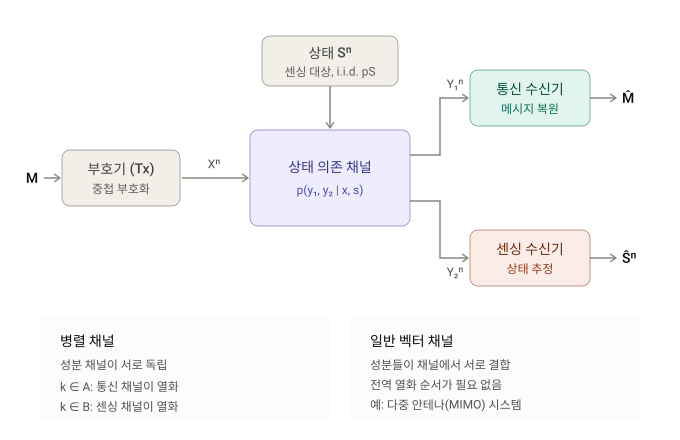

# 0. Summary

- 기본 정보 : ArXiv,2026.10.26, **[On the Fundamental Limits of Bistatic ISAC Over Vector Channels](https://arxiv.org/abs/2610.36351)**
- 연구 배경 : 통합 감지·통신(ISAC, integrated sensing and communications)은 통신 신호의 스펙트럼·파형·하드웨어를 재사용해 주변 환경을 감지하는 기술이다. 정보이론은 감지 대상을 채널의 무작위 상태 $\mathbf S$ 로, 감지 정확도를 상태 추정의 기대 왜곡으로 모델링하고, 왜곡 제약 $D$ 아래 달성 가능한 최대 통신 속도를 **용량-왜곡 함수** $C(D)$ 로 정의한다. 감지 수신기(Rx)가 송신기(Tx)와 떨어져 있는 **양상태(bistatic)** 설정에서는 감지 Rx 가 코드북은 알지만 메시지는 모르므로, 정보 신호의 무작위성이 감지에 간섭으로 작용한다. 기존의 정확한 단일 문자(single-letter) 특성화 [13, 14] 는 통신 채널과 감지 채널 사이에 **전역 열화 순서(global degradation order)** 가 있다는 가정에 의존했는데, OFDM 의 부반송파마다 열화 방향이 다르거나 다중 안테나의 잡음 공분산이 반정부호 순서를 갖지 않는 경우에는 이 가정이 성립하지 않는다.
- 제안 방법 : 두 가지 벡터 채널로 분석을 확장한다. **(i) 병렬 채널** : 각 성분 채널은 한 방향으로 열화되어 있지만 그 방향이 성분마다 달라도 되는 경우에 대해, 공통 계층을 모든 성분 채널에 걸쳐 **결합 부호화** 하는 중첩 부호화(superposition coding) 달성 기법과 Csiszár 합 항등식·성분별 분해에 기반한 역정리(converse)를 맞추어 $C(D)$ 를 단일 문자로 특성화한다(Theorem 1). 가산 가우시안 상태를 갖는 병렬 가우시안 채널에서는 제곱 오차 왜곡 아래 $C(D,P)$ 계산이 성분 간 **전력·왜곡 결합 할당** 이라는 볼록 문제로 환원되고, 전력과 왜곡 모두에서 워터필링(water-filling) 구조의 해를 얻는다. **(ii) 일반 벡터 채널** : 전역 열화 순서 없이 단일 문자 상·하한을 유도하고(Theorems 2, 3), 벡터 가우시안 채널에서는 감지 관측의 조건부 피셔 정보 행렬로 왜곡 제약을 등가 공분산 행렬 제약으로 바꾸고(Lemma 1), KKT 조건으로 **강화 채널(enhanced channel)** 을 구성하며(Lemma 3), 피셔 정보 기반 **행렬 극값 부등식(extremal inequality)** (Lemma 2) 을 결합해 가우시안 중첩 부호화의 최적성을 증명한다.
- 발견 사실 : 병렬 채널에서 결합 부호화의 속도는 성분별 분리 부호화보다 $\min\{\Delta_{\mathcal A},\Delta_{\mathcal B}\}$ 만큼 크고, 두 잉여량이 모두 양이면 엄격히 크다(Remark 3). $K=2$ 가우시안 예시(Fig. 2)에서 결합 부호화의 이득은 뚜렷하며 왜곡 제약이 완화될수록 줄어든다. 벡터 가우시안 채널에서는 $R_{\mathrm G}(D,P)\le\underline C(D,P)\le C(D,P)\le R_{\mathrm G}(D,P)$ 가 성립해 $C(D,P)=R_{\mathrm G}(D,P)$ 이며, 최적 기법에서 감지 Rx 는 공통 계층만 **부분 복호(partial decoding)** 해 상태 추정에 활용한다. $2\times2$ 수치 예시(Fig. 3)에서 원 채널과 강화 채널의 용량-왜곡 곡선은 $(D^*,C)\approx(0.8,2.00716)$ 에서 접한다.
- 핵심 기여 :
    1. **혼합 열화 병렬 채널의 정확한 $C(D)$** : 성분 채널마다 열화 방향이 달라도 되는 병렬 양상태 ISAC 채널에 대해 달성 가능성과 역정리를 맞추어 단일 문자 특성화를 얻었다. 공통 계층의 결합 부호화가 $\mathcal A$ 형 채널의 잉여 복호 능력으로 $\mathcal B$ 형 채널의 클라우드 계층 손실을 보상한다는 구조적 통찰을 제공한다.
    2. **병렬 가우시안 채널의 볼록 할당 문제와 워터필링 해** : 스칼라 가우시안 채널에서 가우시안 중첩 입력이 최적이라는 [14] 의 결과를 바탕으로 $C(D,P)$ 를 성분 간 전력·왜곡 결합 할당으로 환원하고, 라그랑주 쌍대 분해로 전력 수위 $\nu_P$ 와 왜곡 수위 $\nu_D$ 를 갖는 닫힌 형태의 해를 유도했다.
    3. **전역 열화 순서 없는 벡터 가우시안 채널의 $C(D,P)$** : 단일 보조 확률변수만 쓰는 새 상한(Theorem 3)과, 왜곡 제약을 피셔 정보로 공분산 제약으로 바꾸는 보조정리, 왜곡 제약이 포함된 채널 강화 구성, 행렬 극값 부등식을 결합해 가우시안 중첩 부호화의 최적성을 증명했다. 이는 Weingarten 등 [18] 의 MIMO 방송 채널 기법을 감지 왜곡 제약이 있는 설정으로 확장한 것이다.

# 벡터 채널을 쓰는 바이스태틱 통합 센싱·통신(ISAC) 시스템

# Abstract 쉬운 설명(Claude)

이 논문은 **하나의 전파로 통신과 주변 감지를 동시에 할 때, 둘을 어디까지 잘할 수 있는지 그 이론적 한계**를 밝힙니다.

## 배경: 전파로 통신과 감지를 함께 하기
앞으로의 무선망은 데이터를 보내는 전파로 주변 환경까지 파악하려 합니다. 기지국이 스마트폰과 통신하면서 근처 차량이나 사람의 움직임도 감지하는 식인데, 이를 통합 센싱·통신(ISAC)이라고 합니다.

다만 둘 사이에는 맞바꿈 관계가 있습니다. 감지를 더 정확하게 하려면 통신 속도를 어느 정도 포기해야 할 수 있습니다. 이 논문의 핵심 질문은 **"감지 정확도를 이만큼 원할 때, 통신 속도는 최대 얼마까지 가능한가?"**이며, 이 관계를 나타낸 것이 초록의 '용량-왜곡 함수'입니다.

## 바이스태틱: 보내는 쪽과 감지하는 쪽이 떨어져 있음
이 논문의 상황에는 세 주체가 있습니다.

- **송신기:** 전파를 보냅니다.
- **통신 수신기:** 전파에서 메시지를 읽습니다.
- **센싱 수신기:** 다른 곳에서 전파를 받아 주변 상태를 추정합니다.

센싱 수신기는 송신기가 실제로 어떤 메시지를 보냈는지 모릅니다. 원래 어떤 소리였는지 모른 채 메아리만 듣고 동굴의 모양을 짐작하는 것과 비슷합니다. 그래서 메시지 내용이 감지를 방해하는 잡음처럼 작용합니다.

## 기존 연구의 한계
기존의 정확한 결과는 대체로 **두 수신기 중 어느 쪽이 항상 더 좋은 신호를 받는다**는 전제에 기대고 있었습니다. 하지만 실제 환경에서는 주파수 대역이나 안테나 방향에 따라 유리한 쪽이 달라질 수 있습니다.

## 이 논문이 밝힌 것
1. **병렬 채널:** 여러 주파수 대역을 동시에 쓰는 경우처럼, 독립된 통로가 여러 개 있는 상황입니다. 통로마다 유리한 수신기가 달라도 달성 가능한 최대 성능을 정확한 식으로 구했습니다. 또한 전력과 감지 오차 허용치를 통로별로 어떻게 나눌지 계산하는 문제로 정리했습니다.
2. **일반 벡터 채널:** 여러 안테나를 쓰는 경우처럼, 신호들이 서로 섞이는 상황입니다. 일반적인 경우에는 성능의 상한과 하한을 구했습니다.
3. **가우시안 채널:** 잡음과 감지 대상의 변화가 무선 이론의 대표적 모델인 가우시안 분포를 따르는 경우입니다. 이때는 어느 수신기가 항상 유리하다는 전제 없이도 정확한 한계를 구했습니다.

특히 3번에서는 **신호를 층으로 나누어 겹쳐 보내는 방식(중첩 부호화)이 최적**임을 증명했습니다. 센싱 수신기는 공통 층만 해독해 감지에 활용하고, 통신 수신기는 나머지 층까지 읽어 메시지 전체를 얻습니다. 비유하자면 편지를 큰 글씨와 작은 글씨로 겹쳐 써서, 멀리 있는 사람은 큰 글씨만 읽고 가까운 사람은 전부 읽게 하는 방식입니다.

## 의의
이 결과는 실제 시스템을 설계할 때 기준이 되는 이론적 성능 한계를 제공합니다. 어떤 수신기가 더 유리한지 일정하지 않은 다중 대역·다중 안테나 환경까지 분석 범위를 넓혔다는 점이 중요합니다.

# 논문에서 작동 원리를 해석한 방법

- **결합 부호화의 이득 (Remark 3):** 공통 계층을 모든 성분 채널에 걸쳐 함께 부호화하면, 어떤 성분 채널에서 남는 센싱 수신기의 복호 능력으로 다른 성분 채널의 손실을 메울 수 있습니다. 그 이득은 min{Δ_A, Δ_B}로 표현됩니다.
- **최적 해의 구조 (III-C절):** 병렬 가우시안 채널의 최적 전력·왜곡 배분이 워터필링(water-filling) 구조를 가진다는 점을 보여, 자원이 어떤 원리로 나뉘는지 설명합니다.
- **수신기의 동작 (IV-B절):** 벡터 가우시안 채널의 최적 기법에서는 센싱 수신기가 부분 복호를 수행해 상태 추정을 돕습니다.

# 관련 개념

## 통합 감지·통신(ISAC)과 용량-왜곡 함수

이 논문의 출발점은 "통신 속도와 감지 정확도를 얼마나 맞바꿔야 하는가" 라는 질문을 정보이론적으로 정식화하는 것입니다. 감지 대상은 채널의 무작위 상태로, 감지 정확도는 상태 추정의 기대 왜곡으로 모델링됩니다.

---

### 📡 1. 단상태 vs 양상태 감지

| 구분 | 단상태(monostatic) | 양상태(bistatic) |
|---|---|---|
| 감지 Rx 의 위치 | Tx 와 같은 장소 | Tx 와 물리적으로 분리 |
| 감지 Rx 가 아는 것 | 채널 입력 $\mathbf X^n$ 전체 | 코드북만 알고 메시지는 모름 |
| 정보 신호의 역할 | 상태 추정에 완전히 활용 | 무작위성이 감지에 **간섭** 으로 작용 |
| 트레이드오프의 성격 | 입력 분포에 대한 제약만으로 결정 [3, 4] | 입력 분포와 감지 Rx 의 부분 복호가 결합 |
| 장점 | — | 전이중 자기 간섭 회피, 기하학적 다양성 [11, 12] |

가우시안 단상태 채널에서는 "감지는 결정론적 신호를, 통신은 무작위 신호를 선호한다" 는 결정론-무작위 트레이드오프로 나타납니다 [5, 6]. 양상태 설정에서는 감지 Rx 가 메시지를 복호해야만 정보 신호의 간섭을 제거할 수 있으므로 구조가 근본적으로 달라집니다.

---

### 📐 2. 시스템 모델과 $C(D)$ 의 정의 (Section II)

Tx 는 메시지 $M$ 을 길이 $n$ 의 코드워드 $\mathbf X^n$ 으로 부호화해 상태 의존 무기억 방송 채널로 보냅니다. 통신 Rx 는 $\mathbf Y_1^n$ 에서 $M$ 을 복원하고, 감지 Rx 는 $\mathbf Y_2^n$ 에서 상태열 $\mathbf S^n$ 을 추정합니다. 상태열은 $p_{\mathbf S}$ 를 따르는 i.i.d. 이고 $M$ 과 독립이며, 채널은 무기억입니다 (Eq. 1):

$$
p_{\mathbf Y_1^n\mathbf Y_2^n\mathbf S^n|\mathbf X^n}(\mathbf y_1^n,\mathbf y_2^n,\mathbf s^n|\mathbf x^n)=\prod_{t=1}^{n}p_{\mathbf S}(\mathbf s_t)\,p_{\mathbf Y_1\mathbf Y_2|\mathbf X\mathbf S}(\mathbf y_{1,t},\mathbf y_{2,t}|\mathbf x_t,\mathbf s_t).
$$

$(n,\mathcal M)$ 코드는 인코더 $f^{(n)}:\mathcal M\to\mathcal X^n$, 통신 디코더 $g_1^{(n)}:\mathcal Y_1^n\to\mathcal M$, 감지 추정기 $g_2^{(n)}:\mathcal Y_2^n\to\hat{\mathcal S}^n$ 의 세 요소로 구성됩니다. 평균 왜곡은 문자별 왜곡 함수 $d$ 로

$$
D^{(n)}:=\frac1n\sum_{t=1}^n\mathbb E\big[d(\mathbf S_t,\hat{\mathbf S}_t)\big]
$$

이고, 임의의 확률변수 $\boldsymbol\Theta$ 에 대한 **최소 조건부 기대 왜곡** 은 베이즈 추정기로 달성됩니다 (Eq. 3, 4):

$$
d^*(\mathbf S|\boldsymbol\Theta):=\min_{\hat s(\cdot)}\mathbb E\big[d(\mathbf S,\hat s(\boldsymbol\Theta))\big].
$$

속도-왜곡 쌍 $(R,D)$ 가 달성 가능하다는 것은 임의의 $\epsilon>0$ 과 충분히 큰 $n$ 에 대해 $\frac1n\log|\mathcal M|\ge R-\epsilon$, $\mathbb P\{\hat M\neq M\}\le\epsilon$, $D^{(n)}\le D+\epsilon$ 을 만족하는 코드가 존재한다는 뜻이고, 용량-왜곡 함수는 $C(D)=\sup\{R:(R,D)\text{ 달성 가능}\}$ 입니다 (Definition 1, Eq. 8).

---

### 📚 3. 선행 연구의 위치

| 연구 | 설정 | 결과 |
|---|---|---|
| Jiao et al. [13] | 통신 Rx 가 채널 상태를 안다고 가정 | $C(D)$ 의 다중 문자 특성화와 여러 단일 문자 상·하한; 열화 채널에서 상·하한 일치 |
| Chen et al. [14] | 통신 Rx 의 상태 지식 가정을 제거, 로그 손실(logarithmic loss) | 통신·감지 채널 중 하나가 다른 쪽에 대해 열화되어 있으면 단일 문자 특성화. 통신 채널이 열화되면 단상태와 같은 **분리(decoupling)** 성질, 감지 채널이 열화되면 **부분 복호 중첩 부호화** 가 최적 |
| Jiao et al. [15] | 수치 계산 | 보조 변수로 비볼록 왜곡 제약을 선형화한 확장 Arimoto–Blahut 알고리즘 |

세 연구 모두 정확한 특성화를 얻기 위해 통신 채널과 감지 채널 사이의 **전역 열화 순서** 에 의존합니다. 이 논문은 그 가정을 두 단계로 완화합니다.

---

> **💡 Key Takeaway**
> 양상태 ISAC 의 $C(D)$ 는 "감지 Rx 가 정보 신호를 얼마나 복호해야 상태 추정이 가능한가" 와 "통신 Rx 가 얼마나 많은 정보를 받을 수 있는가" 의 결합 문제입니다. 기존 단일 문자 결과는 두 채널의 전역 열화 순서가 있을 때만 성립했습니다.

## 왜 전역 열화 순서가 문제인가

전역 열화 순서는 실제 다중 반송파·다중 안테나 시스템에서 자주 깨집니다. 논문은 두 가지 구체적 상황을 들고, 각각이 고전적 방송 채널 이론의 어떤 문제에 대응하는지 지적합니다.

---

### 🌊 1. 두 가지 실제 상황

| 상황 | 왜 전역 순서가 없는가 | 고전 방송 채널의 대응물 |
|---|---|---|
| **OFDM ISAC** [16] | 통신 Rx 와 감지 Rx 가 서로 다른 위치에서 서로 다른 주파수 선택적 페이딩을 겪으므로, 부반송파마다 상대적 세기가 달라 열화 방향이 부반송파별로 다를 수 있음 | 역방향 열화 방송 채널의 곱(product of reversely degraded broadcast channels) [17] |
| **다중 안테나 ISAC** | 통신·감지 채널의 유효 잡음 공분산 행렬이 일반적으로 반정부호(PSD) 순서를 갖지 않음 | 가우시안 MIMO 방송 채널 [18] |

---

### 🔀 2. 방송 채널 결과가 바로 적용되지 않는 이유

방송 채널에서는 각 수신기가 **자기 메시지를 복호** 하는 것이 목표입니다. ISAC 에서는 감지 Rx 의 과제가 **왜곡 제약 아래 상태를 추정** 하는 것이고, 감지 왜곡은 채널 입력 분포와 감지 Rx 의 부분 복호 모두에 결합되어 있습니다. 따라서 [17, 18] 의 결과를 그대로 옮길 수 없고, 왜곡 제약을 다룰 새로운 장치가 필요합니다. 이 논문에서 그 장치는 (i) 병렬 채널의 경우 성분별로 분리된 왜곡 항 $d_k^*(S_k|X_k,Y_{2k})$ 와 $d_k^*(S_k|U_k,Y_{2k})$, (ii) 벡터 가우시안 채널의 경우 조건부 피셔 정보로 정의되는 등가 공분산 $\hat\Sigma_V$ 입니다.

---

> **💡 Key Takeaway**
> 병렬 채널은 "열화 방향이 성분마다 다른" 경우, 일반 벡터 채널은 "어느 방향으로도 열화되지 않은" 경우입니다. 두 경우 모두 방송 채널의 고전 결과가 있지만, 감지 왜곡 제약이 입력 분포와 부분 복호에 동시에 걸려 있어 직접 적용되지 않습니다.

## 병렬 채널 모델과 혼합 열화

Section III 는 $K$ 개의 독립 성분 채널로 이루어진 병렬 양상태 ISAC 시스템을 다룹니다. 핵심은 성분 채널마다 열화 방향이 달라도 된다는 점입니다.

---

### 🧱 1. 곱 구조와 가산 왜곡 (Eq. 9)

$\mathbf X=(X_1,\dots,X_K)$, $\mathbf Y_i=(Y_{i1},\dots,Y_{iK})$, $\mathbf S=(S_1,\dots,S_K)$ 에 대해 채널은

$$
p_{\mathbf Y_1\mathbf Y_2\mathbf S|\mathbf X}=\prod_{k=1}^K p_{S_k}\,p_{Y_{1k}Y_{2k}|X_kS_k}
$$

의 곱 구조를 가집니다. 서로 다른 성분 채널의 상태는 독립이고, $k$ 번째 성분의 출력은 $(X_k,S_k)$ 에만 의존합니다. 복원 알파벳은 $\hat{\mathcal S}=\hat{\mathcal S}_1\times\cdots\times\hat{\mathcal S}_K$ 이고 왜곡은 성분에 대해 가산적입니다: $d(\mathbf s,\hat{\mathbf s})=\sum_{k=1}^K d_k(s_k,\hat s_k)$.

---

### ↔️ 2. 두 종류의 성분 채널 (Eq. 10)

$[1:K]$ 를 두 집합 $\mathcal A$, $\mathcal B$ 로 분할합니다.

| 집합 | 마르코프 체인 | 의미 |
|---|---|---|
| $k\in\mathcal A$ | $X_k\leftrightarrow Y_{2k}\leftrightarrow Y_{1k}$ | 통신 채널이 감지 채널에 대해 열화 (감지 Rx 가 더 강함) |
| $k\in\mathcal B$ | $X_k\leftrightarrow Y_{1k}\leftrightarrow Y_{2k}$ | 감지 채널이 통신 채널에 대해 열화 (통신 Rx 가 더 강함) |

일반성을 잃지 않고 $\mathcal A=[1:r]$, $\mathcal B=[r+1:K]$ 로 두며, $0\le r\le K$ 이므로 어느 한쪽이 비어 있어도 됩니다.

---

### 🔁 3. 물리적 열화에서 확률적 열화로 (Remark 1)

통신 디코더는 $\mathbf Y_1^n$ 만 쓰고 평균 왜곡은 $(\mathbf S^n,\mathbf Y_2^n)$ 에만 의존하므로, $C(D)$ 는 전체 결합 분포가 아니라 두 조건부 주변 분포 $p_{\mathbf Y_1|\mathbf X}$ 와 $p_{\mathbf Y_2\mathbf S|\mathbf X}$ 를 통해서만 결정됩니다 [14]. 따라서 상한을 유도할 때 이 두 조건부 분포를 보존하는 임의의 결합 분포를 골라도 되고, (10) 의 물리적 열화(physical degradedness)는 확률적 열화(stochastic degradedness)로 완화됩니다. 이 관찰은 가우시안 채널에서 열화 방향을 유효 잡음 분산 비교만으로 정하는 근거이자, Section IV-B 의 채널 강화 논증에서 결합 분포를 자유롭게 재구성하는 근거가 됩니다.

---

> **💡 Key Takeaway**
> 병렬 모델은 성분 독립성·가산 왜곡·성분별 열화 방향의 세 가정으로 정의됩니다. $C(D)$ 가 두 조건부 주변 분포에만 의존한다는 사실 덕분에 열화는 확률적 의미로만 요구되고, 증명에서 결합 분포를 편리하게 고를 수 있습니다.

## Theorem 1: 혼합 열화 병렬 채널의 단일 문자 특성화

이 논문의 첫 번째 주결과입니다. 두 집합 $\mathcal A$, $\mathcal B$ 에 서로 다른 형태의 항이 들어가면서도 전체가 하나의 최소값으로 묶입니다.

---

### 🧮 1. 정리의 진술 (Eq. 11)

(10) 을 만족하는 병렬 양상태 ISAC 채널에 대해

$$
C(D)=\max\ \min\{R_1,R_2\}\quad\text{s.t.}\quad\sum_{k\in\mathcal A}d_k^*(S_k|X_k,Y_{2k})+\sum_{k\in\mathcal B}d_k^*(S_k|U_k,Y_{2k})\le D,
$$

여기서

$$
R_1:=\sum_{k=1}^K I(X_k;Y_{1k}),\qquad R_2:=\sum_{k\in\mathcal A}I(X_k;Y_{2k})+\sum_{k\in\mathcal B}\big[I(X_k;Y_{1k}|U_k)+I(U_k;Y_{2k})\big].
$$

최대화는 $\prod_{k\in\mathcal A}p_{X_k}\prod_{k\in\mathcal B}p_{U_kX_k}$ 꼴의 분포에 대해 이루어지고, 보조 확률변수는 $|\mathcal U_k|\le|\mathcal X_k|+1$ ($k\in\mathcal B$) 를 만족합니다.

구조를 읽으면 이렇습니다.

| 항 | 역할 |
|---|---|
| $R_1$ | 통신 Rx 가 모든 성분에서 받을 수 있는 총 정보량 |
| $R_2$ 의 $\mathcal A$ 부분 $I(X_k;Y_{2k})$ | 감지 Rx 가 $\mathcal A$ 형 성분에서 **전체 복호** 로 얻는 입력 정보 |
| $R_2$ 의 $\mathcal B$ 부분 $I(U_k;Y_{2k})$ | 감지 Rx 가 $\mathcal B$ 형 성분에서 **부분 복호** 로 얻는 클라우드 계층 정보 |
| $R_2$ 의 $\mathcal B$ 부분 $I(X_k;Y_{1k}|U_k)$ | 통신 Rx 만 받는 사설 계층 정보 |
| 왜곡 제약 | $\mathcal A$ 에서는 $X_k$ 를 알고, $\mathcal B$ 에서는 $U_k$ 만 알고 추정한 최소 왜곡의 합 |

---

### 🔂 2. 두 특수 경우 (Remark 2)

- $\mathcal B=\emptyset$ : (10a) 와 데이터 처리 부등식에 의해 $I(X_k;Y_{1k})\le I(X_k;Y_{2k})$ 이므로 최소값은 $R_1$ 에서 달성되고

$$
C(D)=\max_{\prod_k p_{X_k} }\Big\{\sum_{k=1}^K I(X_k;Y_{1k}):\sum_{k=1}^K d_k^*(S_k|X_k,Y_{2k})\le D\Big\}.
$$

통신 속도와 감지 왜곡이 입력 분포를 통해서만 결합되는 **분리 구조** 로, [14, Corollary 1] 과 일치합니다.

- $\mathcal A=\emptyset$ : (10b) 에 의해 $I(U_k;Y_{2k})\le I(U_k;Y_{1k})$ 이므로 최소값은 $R_2$ 에서 달성되고, [14, Corollary 2] 의 **중첩 부호화 구조** 가 됩니다.

---

### ➕ 3. 결합 부호화 vs 분리 부호화 (Remark 3)

성분마다 따로 부호화하는 기법(𝒜 에서는 단일 계층, 𝓑 에서는 중첩 부호화)의 속도는

$$
R_{\mathrm{sep} }=\sum_{k\in\mathcal A}I(X_k;Y_{1k})+\sum_{k\in\mathcal B}\big[I(X_k;Y_{1k}|U_k)+I(U_k;Y_{2k})\big]
$$

이고, Theorem 1 의 목적 함수는

$$
R_{\mathrm{joint} }=R_{\mathrm{sep} }+\min\{\Delta_{\mathcal A},\Delta_{\mathcal B}\},\qquad
\Delta_{\mathcal A}:=\sum_{k\in\mathcal A}\big[I(X_k;Y_{2k})-I(X_k;Y_{1k})\big],\quad
\Delta_{\mathcal B}:=\sum_{k\in\mathcal B}\big[I(U_k;Y_{1k})-I(U_k;Y_{2k})\big]
$$

로 쓸 수 있습니다. (10) 과 데이터 처리 부등식에 의해 $\Delta_{\mathcal A},\Delta_{\mathcal B}\ge0$ 이므로 $R_{\mathrm{joint} }\ge R_{\mathrm{sep} }$ 이고, 둘 다 양이면 엄격한 부등식입니다. 직관은 다음과 같습니다.

| 성분 유형 | 분리 부호화에서 생기는 비효율 |
|---|---|
| $\mathcal A$ | 감지 Rx 의 **잉여 복호 능력** $\Delta_{\mathcal A}$ 가 쓰이지 않음 |
| $\mathcal B$ | 클라우드 계층 속도가 더 약한 감지 채널에 묶여 $\Delta_{\mathcal B}$ 만큼 손실 |

공통 계층을 모든 성분에 걸쳐 결합 부호화하면 전자의 잉여가 후자의 손실을 보상합니다.

---

> **💡 Key Takeaway**
> Theorem 1 은 $\mathcal A$ 형 성분의 전체 복호 항과 $\mathcal B$ 형 성분의 부분 복호 항을 하나의 합 $R_2$ 로 묶고 $R_1$ 과 최소를 취합니다. 분리 부호화 대비 이득 $\min\{\Delta_{\mathcal A},\Delta_{\mathcal B}\}$ 는 두 유형의 열화 방향이 **상보적** 이기 때문에 생깁니다.

## 달성 가능성: 공통 계층의 결합 중첩 부호화

Section III-A 의 달성 기법은 표준 중첩 부호화 [19, Sec. 5.3] 이지만, 공통 계층이 성분 채널 전체에 걸쳐 하나의 코드워드로 생성된다는 점이 다릅니다.

---

### 🏗️ 1. 코드북 생성과 부호화

분포 $\prod_{k\in\mathcal A}p_{X_k}\prod_{k\in\mathcal B}p_{U_kX_k}$ 를 고정하고, 표기 편의상 $k\in\mathcal A$ 에 대해 $U_k:=X_k$ 로 두어 공통 계층을 $\mathbf U:=(U_1,\dots,U_K)$ 로 씁니다.

| 단계 | 내용 |
|---|---|
| 메시지 분할 | $M$ 을 독립인 공통 메시지 $M_0\in[1:2^{nR_u}]$ 와 사설 메시지 $M_1\in[1:2^{nR_v}]$ 로 나눔, $R=R_u+R_v$ |
| 공통 계층 | 각 $m_0$ 에 대해 $\mathbf u^n(m_0)$ 를 $\prod_t p_{\mathbf U}(\mathbf u_t)$, $p_{\mathbf U}=\prod_k p_{U_k}$ 로 독립 생성 |
| 사설 계층 | 각 $(m_0,m_1)$ 에 대해 $\mathbf x_{\mathcal B}^n(m_0,m_1)$ 를 $\prod_t\prod_{k\in\mathcal B}p_{X_k|U_k}(x_{k,t}|u_{k,t}(m_0))$ 로 조건부 독립 생성 |
| 송신 | $\mathcal A$ 성분에는 $\mathbf u_{\mathcal A}^n(m_0)$, $\mathcal B$ 성분에는 $\mathbf x_{\mathcal B}^n(m_0,m_1)$ |

---

### 🔎 2. 복호와 상태 추정

- **감지 Rx** : $(\mathbf u^n(\hat m_0),\mathbf y_2^n)\in\mathcal T_\epsilon^{(n)}$ 인 유일한 $\hat m_0$ 를 찾습니다. 즉 공통 계층만 복호합니다.
- **통신 Rx** : 축차 복호. 먼저 같은 방식으로 $\hat m_0$ 를 찾고, 이어서 $(\mathbf u_{\mathcal B}^n(\hat m_0),\mathbf x_{\mathcal B}^n(\hat m_0,\hat m_1),\mathbf y_{1\mathcal B}^n)\in\mathcal T_\epsilon^{(n)}$ 인 유일한 $\hat m_1$ 을 찾습니다.
- **상태 추정** : 복호된 공통 계층 코드워드를 써서 기호별로

$$
\hat S_{k,t}=\hat s_k^*\big(u_{k,t}(\hat m_0),Y_{2k,t}\big),\quad k\in[1:K],\ t\in[1:n].
$$

---

### 📉 3. 오류 확률과 왜곡 분석

표준 분석과 곱 구조에 의해 두 수신기의 복호 오류 확률은 다음 조건에서 0 으로 수렴합니다 (Eq. 12–14):

$$
R_u<\sum_{k=1}^K I(U_k;Y_{2k})-\delta(\epsilon),\qquad R_u<\sum_{k=1}^K I(U_k;Y_{1k})-\delta(\epsilon),\qquad R_v<\sum_{k\in\mathcal B}I(X_k;Y_{1k}|U_k)-\delta(\epsilon).
$$

속도가 0 인 계층은 메시지 집합이 단일 원소이므로 해당 제약이 부과되지 않습니다. $U_k\leftrightarrow X_k\leftrightarrow Y_{1k}$ 에서 $I(U_k;Y_{1k})+I(X_k;Y_{1k}|U_k)=I(X_k;Y_{1k})$ 이므로, (15) 를 만족하는 임의의 $R$ 에 대해 적절한 $R_u,R_v\ge0$ 를 고를 수 있습니다. (15) 의 우변이 바로 Theorem 1 의 $\min\{R_1,R_2\}-2\delta(\epsilon)$ 입니다.

왜곡은 사건 $\mathcal E_0:=\{\hat M_0\neq M_0\}$ 로 나눠 분석합니다. $\mathcal E_0^c$ 에서는 감지 Rx 의 추정이 공통 메시지를 아는 지니(genie) 보조 추정과 같고, 무작위 코드북 평균에서 $(U_{k,t},Y_{2k,t},S_{k,t})\sim p_{U_kY_{2k}S_k}$ 이므로 지니 보조 추정의 평균 왜곡은 $\bar D:=\sum_k d_k^*(S_k|U_k,Y_{2k})\le D$ 입니다. $d_{\max}<\infty$ 이므로

$$
\mathbb E_{\mathcal C}\big[D^{(n)}(\mathcal C)\big]\le\bar D+d_{\max}\,\mathbb E_{\mathcal C}\big[\mathbb P(\mathcal E_0|\mathcal C)\big],
$$

이고 둘째 항은 (12) 에 의해 소멸합니다. 마지막으로 $\lambda_n\to\infty$ 를 $\lambda_n\mathbb E_{\mathcal C}[P_e(\mathcal C)]\to0$ 이 되게 골라 $D^{(n)}(\mathcal C)+\lambda_nP_e(\mathcal C)$ 의 기댓값 이하를 달성하는 코드북 $\mathcal C_n$ 을 뽑으면, 통신 오류와 왜곡 조건을 동시에 만족하는 결정론적 코드북을 얻습니다.

---

> **💡 Key Takeaway**
> 감지 Rx 는 공통 계층 하나만 복호하지만, 그 공통 계층이 $\mathcal A$ 형 성분(입력 전체)과 $\mathcal B$ 형 성분(클라우드 중심)을 함께 담고 있어 두 유형의 수신 능력이 하나의 속도 제약 $R_u<\sum_k I(U_k;Y_{2k})$ 로 합산됩니다. 왜곡 분석의 핵심은 "공통 메시지만 맞히면 지니 보조 추정과 같다" 는 점입니다.

## 역정리: Csiszár 합 항등식과 성분별 분해

Section III-B 의 역정리는 두 개의 Fano 부등식에서 출발해, 열화 조건으로 결합 관측을 "강한 출력" 으로 줄이고, 다시 성분별로 분해합니다.

---

### 🔗 1. 두 Fano 바운드 (Eq. 16, 17)

첫째는 통신 Rx 만 고려한 표준 바운드입니다:

$$
nR-n\epsilon_n\le I(M;\mathbf Y_1^n)\le I(\mathbf X^n;\mathbf Y_1^n)\le\sum_{t=1}^n I(\mathbf X_t;\mathbf Y_{1,t}).
$$

둘째는 결합 관측 $\mathbf O_t:=(\mathbf Y_{1,t},\mathbf Y_{2,t})$ 와 보조 변수 $\mathbf W_t:=(\mathbf O^{t-1},\mathbf Y_{2,t+1}^n)$ 을 도입해

$$
nR-n\epsilon_n\le\sum_{t=1}^n\big[I(\mathbf X_t;\mathbf O_t|\mathbf W_t)+I(\mathbf W_t;\mathbf Y_{2,t})\big]
$$

를 얻습니다. 여기서 **Csiszár 합 항등식** 이 $I(\mathbf Y_{2,t+1}^n;\mathbf O_t|\mathbf O^{t-1})$ 의 합을 $I(\mathbf O^{t-1};\mathbf Y_{2,t}|\mathbf Y_{2,t+1}^n)$ 의 합으로 바꿔 줍니다. 시간 공유 변수 $Q\sim\mathrm{Unif}[1:n]$ 으로 단일 문자화하면 (18), (19) 가 됩니다.

---

### ⬆️ 2. 열화 조건으로 강한 출력만 남기기 (Eq. 20)

각 성분에서 더 강한 출력과 약한 출력을 각각 $\mathbf O^+:=(\mathbf Y_{2\mathcal A},\mathbf Y_{1\mathcal B})$, $\mathbf O^-:=(\mathbf Y_{1\mathcal A},\mathbf Y_{2\mathcal B})$ 로 두면, 곱 구조와 (10) 에 의해

$$
p_{\mathbf O^-|\mathbf X\mathbf O^+}=\prod_{k\in\mathcal A}p_{Y_{1k}|Y_{2k} }\prod_{k\in\mathcal B}p_{Y_{2k}|Y_{1k} }=p_{\mathbf O^-|\mathbf O^+}
$$

이므로 $(\mathbf W,\mathbf X)\leftrightarrow\mathbf O^+\leftrightarrow\mathbf O^-$ 가 성립하고 $I(\mathbf X;\mathbf O^-|\mathbf W,\mathbf O^+)=0$ 입니다. 이로부터 $\bar{\mathbf W}:=(\mathbf W,\mathbf Y_{2\mathcal A})$ 를 써서

$$
I(\mathbf X;\mathbf O|\mathbf W)+I(\mathbf W;\mathbf Y_2)\le\sum_{k\in\mathcal A}I(X_k;Y_{2k})+\underbrace{I(\mathbf X_{\mathcal B};\mathbf Y_{1\mathcal B}|\bar{\mathbf W})+I(\bar{\mathbf W};\mathbf Y_{2\mathcal B})}_{\Psi_{\mathcal B} }
$$

를 얻습니다. $\mathcal A$ 성분은 이 단계에서 이미 $I(X_k;Y_{2k})$ 로 분리됩니다.

---

### 🧩 3. $\Psi_{\mathcal B}$ 의 성분별 분해 (Eq. 21)

$k\in\mathcal B$ 에 대해 $\widetilde{\mathbf O}_k:=(Y_{1k},Y_{2k})$ 와

$$
U_k:=\big(\bar{\mathbf W},\widetilde{\mathbf O}_{\mathcal B}^{<k},\mathbf Y_{2\mathcal B}^{>k}\big)
$$

를 정의합니다. 체인 룰을 첫 항은 $k$ 증가 순서로, 둘째 항은 $k$ 감소 순서로 전개한 뒤 다시 Csiszár 합 항등식을 적용하면

$$
\Psi_{\mathcal B}\le\sum_{k\in\mathcal B}\big[I(X_k;Y_{1k}|U_k)+I(U_k;Y_{2k})\big]
$$

가 됩니다. 마지막 등식 $I(\mathbf X_{\mathcal B};\widetilde{\mathbf O}_k|U_k)=I(X_k;Y_{1k}|U_k)$ 는 곱 구조에서 나오는 $(U_k,\mathbf X^{K\setminus k})\leftrightarrow X_k\leftrightarrow(Y_{1k},Y_{2k},S_k)$ 와 $X_k\leftrightarrow Y_{1k}\leftrightarrow Y_{2k}$ 를 결합한 것입니다. (19), (20), (21) 을 합치면 (22), 즉 $R_2$ 형태의 바운드가 됩니다.

---

### 📏 4. 왜곡 제약 (Eq. 23–25)

추정 $\hat{\mathbf S}_t$ 는 $\mathbf Y_2^n$ 에만 의존하고, 조건을 추가해도 최소 조건부 기대 왜곡은 커지지 않습니다. $k\in\mathcal B$ 에 대해

$$
\mathbb E\big[d_k(S_{k,t},\hat S_{k,t})\big]\ge d_k^*(S_{k,t}|\mathbf Y_2^n)\ge d_k^*\big(S_{k,t}\big|\mathbf Y_1^{t-1},\mathbf Y_2^n,\mathbf Y_{1\mathcal B,t}^{<k}\big)=d_k^*(S_{k,t}|U_{k,t},Y_{2k,t}),
$$

마지막 등식은 두 조건 집합이 같은 확률변수로 이루어져 있기 때문입니다. $k\in\mathcal A$ 에 대해서는 $\mathbf X^n$ 까지 조건에 넣고 마르코프 체인 $S_{k,t}\leftrightarrow(X_{k,t},Y_{2k,t})\leftrightarrow(\mathbf X^n,\mathbf Y_2^n)$ 으로 $d_k^*(S_{k,t}|X_{k,t},Y_{2k,t})$ 를 얻습니다. 시간 평균을 취하면 Theorem 1 의 왜곡 제약 (11b) 가 $D+\epsilon$ 으로 나옵니다.

역정리에서 얻은 성분 입력들은 서로 상관될 수 있지만, 속도 식과 왜곡 제약이 성분별 주변 분포에만 의존하므로 곱 분포로 바꿔도 값이 변하지 않습니다.

---

### 📝 5. 로그 손실로의 확장 조건 (Remark 4)

Theorem 1 은 기호별 왜곡 (2) 에 대한 결과입니다. [14] 의 **열 단위 로그 손실** (최소값 $\frac1nH(\mathbf S^n|\mathbf Y_2^n)$) 로 바꾸면 체인 룰이 과거 상태를 조건에 넣으므로 $\mathbf S_{\mathcal B,t}$ 와 $S_k$ 를 $\mathbf O_t$, $\widetilde{\mathbf O}_k$ 에 포함해야 하고, (20), (21) 에서 이를 제거하려면 $k\in\mathcal B$ 에 대해 더 강한 마르코프 체인 $X_k\leftrightarrow Y_{1k}\leftrightarrow(Y_{2k},S_k)$ 가 필요합니다. $k\in\mathcal A$ 에는 추가 조건이 없습니다. 이 조건 아래 $C(D)$ 는 $d_k^*(S_k|\cdot)$ 를 $H(S_k|\cdot)$ 로 바꾼 Theorem 1 과 같아 [14, Corollary 2, Remark 5] 와 일치합니다.

---

> **💡 Key Takeaway**
> 역정리의 핵심 장치는 (i) 결합 관측에 대한 Fano 바운드를 Csiszár 합 항등식으로 단일 문자화하고, (ii) 열화 조건으로 약한 출력을 지워 $\mathcal A$ 항을 분리한 뒤, (iii) $\mathcal B$ 항을 성분별 보조 변수 $U_k$ 로 분해하는 세 단계입니다. 보조 변수가 과거 통신 출력까지 포함한다는 점이 왜곡 제약의 하한과 자연스럽게 맞물립니다.

## 병렬 가우시안 채널: 전력·왜곡 결합 할당 문제

Section III-C 는 가산 가우시안 상태를 갖는 병렬 가우시안 채널에서 제곱 오차 왜곡 아래 $C(D,P)$ 를 구체적인 볼록 최적화로 환원합니다.

---

### 📶 1. 채널 모델과 열화 방향의 판정 (Eq. 26–29)

$k$ 번째 성분 채널은

$$
Y_{1k}=X_k+Z_{1k},\qquad Y_{2k}=X_k+Z_{2k}+S_k,
$$

$Z_{1k}\sim\mathcal N(0,N_{1k})$, $Z_{2k}\sim\mathcal N(0,N_{2k})$, $S_k\sim\mathcal N(0,N_{Sk})$ 는 서로 독립이고 입력과도 독립입니다. 제곱 오차 왜곡에서 최소 조건부 기대 왜곡은 조건부 분산 $d_k^*(S_k|\Theta)=\mathrm{var}(S_k|\Theta)$ 이고, 전력 제약 $\frac1n\sum_t\sum_k\mathbb E[X_{k,t}^2]\le P+\epsilon$ 이 추가되어 **용량-왜곡-전력 함수** $C(D,P)$ 를 정의합니다.

Remark 1 에 의해 열화 방향은 유효 잡음 분산 비교만으로 정해집니다:

$$
\mathcal A=\{k:N_{1k}\ge N_{2k}+N_{Sk}\},\qquad\mathcal B=\{k:N_{1k}<N_{2k}+N_{Sk}\}.
$$

Theorem 1 을 가우시안 경우로 확장하면(달성은 표준 이산화 논증, 역정리는 [20] 의 약수렴 논증) (30) 을 얻고, [14, Theorem 5] 의 스칼라 가우시안 최적성 결과에 의해 입력 분포 최적화를 **가우시안 중첩 입력** 으로 제한할 수 있습니다.

---

### 🧮 2. 할당 문제 (Eq. 31)

$k\in\mathcal A$ 의 왜곡은 $\mathrm{var}(S_k|X_k,Y_{2k})=\frac{N_{2k}N_{Sk} }{N_{2k}+N_{Sk} }$ 로 고정됩니다. $k\in\mathcal B$ 는 전력 $P_k$ 와 왜곡 $d_k$ 가 주어지면 스칼라 결과로 최적 속도가 정해집니다. 따라서

$$
C(D,P)=\sup_{\{P_k,d_k\} }\ \min\{R_1,R_2\}
$$

$$
\text{s.t.}\quad\sum_{k\in\mathcal A}\frac{N_{2k}N_{Sk} }{N_{2k}+N_{Sk} }+\sum_{k\in\mathcal B}d_k\le D,\qquad
\frac{N_{2k}N_{Sk} }{N_{2k}+N_{Sk} }\le d_k\le\frac{(P_k+N_{2k})N_{Sk} }{P_k+N_{2k}+N_{Sk} },\qquad
\sum_{k=1}^K P_k\le P,\ P_k\ge0,
$$

여기서

$$
R_1=\sum_{k=1}^K\frac12\log\Big(1+\frac{P_k}{N_{1k} }\Big),
$$

$$
R_2=\sum_{k\in\mathcal A}\frac12\log\Big(1+\frac{P_k}{N_{2k}+N_{Sk} }\Big)+\sum_{k\in\mathcal B}\frac12\log\frac{P_k+N_{2k}+N_{Sk} }{N_{Sk} }+\sum_{k\in\mathcal B}\frac12\log\frac{(N_{1k}-N_{2k})N_{Sk}+(N_{2k}+N_{Sk}-N_{1k})d_k}{N_{1k}N_{Sk} }.
$$

$d_k$ 의 하한은 입력을 완전히 아는 경우, 상한은 입력을 전혀 모르는 경우(사설 정보만 실을 때)의 왜곡입니다.

---

### ⚖️ 3. 라그랑주 쌍대 분해 (Eq. 32, 33)

$R_1$, $R_2$ 는 $\{P_k,d_k\}$ 에 대해 결합 오목이고 가능 집합은 볼록이므로, 보조 변수 $\tau$ 를 도입해 $\tau\le R_1$, $\tau\le R_2$ 아래 $\tau$ 를 최대화하는 문제로 바꿉니다. $\tau$ 에 대한 정상성 조건에서 두 제약의 승수는 어떤 $\theta\in[0,1]$ 에 대해 $\theta$ 와 $1-\theta$ 이고, 전력·왜곡 제약의 승수 $\lambda,\mu\ge0$ 과 함께 라그랑지안은

$$
\mathcal L=\theta R_1+(1-\theta)R_2-\lambda\Big(\sum_k P_k-P\Big)-\mu\Big(\sum_k d_k-D\Big)
$$

입니다. Slater 조건으로 강쌍대성이 성립하고, 쌍대 함수의 최대화는 성분 채널별로 분리됩니다. 쌍대 변수 $(\theta,\lambda,\mu)$ 는 예컨대 이분법으로 구합니다. 이후 $a_k:=N_{2k}+N_{Sk}-N_{1k}$ 로 두며, $k\in\mathcal B$ 에서 양입니다.

---

> **💡 Key Takeaway**
> 가우시안 병렬 채널에서는 "어느 성분에 전력을 얼마나, 왜곡 예산을 얼마나 배정할 것인가" 가 전부입니다. $\mathcal A$ 성분의 왜곡은 입력과 무관하게 고정되고, $\mathcal B$ 성분만 왜곡 변수 $d_k$ 를 가지며, 가중치 $\theta$ 가 통신 제약과 감지 제약 중 어느 쪽이 활성인지를 나타냅니다.

## 워터필링 해: 전력과 왜곡

Section III-C1, III-C2 는 라그랑지안의 편미분으로 닫힌 형태의 해를 유도합니다. 전력과 왜곡에 각각 수위(water level)가 있습니다.

---

### 💧 1. 최적 전력 할당 (Eq. 34, 35)

$$
\frac{\partial\mathcal L}{\partial P_k}=\frac{1}{2\ln2}\bigg(\frac{\theta}{P_k+N_{1k} }+\frac{1-\theta}{P_k+N_{2k}+N_{Sk} }\bigg)-\lambda
$$

를 0 으로 놓고 $P_k\ge0$ 과 결합하면

$$
P_k^*=\bigg[\frac{\nu_P-N_{1k}-N_{2k}-N_{Sk}+\sqrt{\Delta_k} }{2}\bigg]^+,
$$

여기서 $\nu_P:=\frac{1}{2\lambda\ln2}$ 는 전력 수위이고 $\Delta_k:=\big(\nu_P-(1-2\theta)a_k\big)^2+4\theta(1-\theta)a_k^2$ 입니다. $\theta=1$ 이면 $N_{1k}$ 에 대한, $\theta=0$ 이면 $N_{2k}+N_{Sk}$ 에 대한 고전적 워터필링으로 환원됩니다. 중간 $\theta$ 는 두 유효 잡음 수준을 가중 혼합한 수위를 줍니다.

---

### 🎯 2. 최적 왜곡 할당 (Eq. 36–38)

$$
\frac{\partial\mathcal L}{\partial d_k}=\begin{cases}-\mu,&k\in\mathcal A,\\[4pt]\dfrac{(1-\theta)a_k}{2\ln2\,\big[(N_{1k}-N_{2k})N_{Sk}+a_kd_k\big]}-\mu,&k\in\mathcal B,\end{cases}
$$

이므로 $\mathcal A$ 에서는 $d_k^*$ 가 하한에 붙고, $\mathcal B$ 에서는

$$
d_k^*=\Pi_k\bigg((1-\theta)\nu_D-\frac{(N_{1k}-N_{2k})N_{Sk} }{a_k}\bigg),
$$

$\nu_D:=\frac{1}{2\mu\ln2}$ 는 왜곡 수위, $\Pi_k(\cdot)$ 는 (31c) 구간으로의 사영입니다.

| 경우 | 해석 |
|---|---|
| $k\in\mathcal A$ | 감지 Rx 가 입력을 전부 복호하므로 왜곡은 항상 최소값 $\frac{N_{2k}N_{Sk} }{N_{2k}+N_{Sk} }$ |
| $k\in\mathcal B$, 내부점 | 왜곡 수위 $\nu_D$ 에서 성분별 상수를 뺀 값. 왜곡 예산이 많을수록 사설 계층 비중 증가 |
| $k\in\mathcal B$, 상한 활성 | 성분이 **사설 정보만** 운반. 가중 속도가 $\theta$ 와 무관하게 $\frac12\log(1+\frac{P_k}{N_{1k} })$ 가 되고, $P_k^*$ 는 (35) 대신 3차 방정식 $\frac{1}{P_k+N_{1k} }=\frac{1}{\nu_P}+\frac{1}{\nu_D}\cdot\frac{N_{Sk}^2}{(P_k+N_{2k}+N_{Sk})^2}$ 으로 결정 |

---

### 📊 3. 수치 예 (Fig. 2)

$K=2$ 에서 두 성분이 각각 $\mathcal B$ 와 $\mathcal A$ 에 속하는 설정으로 Theorem 1 의 결합 부호화와 Remark 3 의 분리 부호화를 비교합니다.

| 파라미터 | 값 |
|---|---|
| $(N_{11},N_{12})$ | $(0.1,\ 5.0)$ |
| $(N_{21},N_{22})$ | $(1.0,\ 0.5)$ |
| $(N_{S1},N_{S2})$ | $(1.0,\ 0.5)$ |
| $P$ | 4 |

성분 1 은 $N_{11}=0.1<N_{21}+N_{S1}=2.0$ 이므로 $\mathcal B$, 성분 2 는 $N_{12}=5.0\ge N_{22}+N_{S2}=1.0$ 이므로 $\mathcal A$ 입니다. 논문은 결합 부호화가 뚜렷한 성능 이득을 보이며, 왜곡 제약이 완화될수록 두 기법의 격차가 점차 줄어든다고 보고합니다. 구체적인 곡선 값은 그림으로만 제시됩니다.

---

> **💡 Key Takeaway**
> 전력 수위 $\nu_P$ 와 왜곡 수위 $\nu_D$ 라는 두 개의 워터필링이 동시에 돌아갑니다. $\mathcal B$ 성분에서 왜곡 상한이 활성화되면 그 성분은 클라우드 계층을 아예 싣지 않는 "순수 통신 성분" 이 되고, 전력 할당 식도 3차 방정식으로 바뀝니다.

## 일반 벡터 채널의 단일 문자 상·하한

Section IV 는 곱 구조도, 어느 방향의 열화 순서도 요구하지 않는 일반 벡터 채널을 다룹니다. 유한 알파벳에서는 상·하한만 얻고, 가우시안에서는 하한이 타이트함을 보입니다.

---

### ⬇️ 1. 하한 (Theorem 2, Eq. 39)

$$
\underline C(D):=\max_{p_{\mathbf U\mathbf X} }\ \min\big\{I(\mathbf X;\mathbf Y_1),\ I(\mathbf X;\mathbf Y_1|\mathbf U)+I(\mathbf U;\mathbf Y_2)\big\}\quad\text{s.t.}\quad d^*(\mathbf S|\mathbf U,\mathbf Y_2)\le D,
$$

결합 분포는 $p_{\mathbf U\mathbf X}\,p_{\mathbf Y_1\mathbf Y_2\mathbf S|\mathbf X}$ 로 인수분해되고 $|\mathcal U|\le|\mathcal X|+1$ 입니다. 통신 Rx 가 상태를 추가로 관측하는 [13, Theorem 3] 과 로그 손실 아래의 [14, Theorem 1] 을 일반화한 것으로, 증명은 같은 중첩 부호화 논증이라 생략됩니다.

---

### ⬆️ 2. 상한 (Theorem 3, Eq. 40)

$$
\overline C(D):=\max_{p_{\mathbf U\mathbf X} }\ \min\big\{I(\mathbf X;\mathbf Y_1),\ I(\mathbf U;\mathbf Y_2)+I(\mathbf X;\mathbf Y_1,\mathbf Y_2|\mathbf U)\big\}\quad\text{s.t.}\quad d^*(\mathbf S|\mathbf U,\mathbf Y_2)\le D.
$$

하한과의 차이는 둘째 항의 $I(\mathbf X;\mathbf Y_1|\mathbf U)$ 가 $I(\mathbf X;\mathbf Y_1,\mathbf Y_2|\mathbf U)$ 로 바뀐 것뿐입니다. 즉 사설 계층을 **두 수신기의 결합 관측** 으로 복호할 수 있다고 가정한 완화입니다. 감지 채널이 통신 채널에 대해 열화되어 있으면 이 항이 $I(\mathbf X;\mathbf Y_1|\mathbf U)$ 와 같아져 상·하한이 일치합니다.

증명(Appendix A)은 $I(M;\mathbf Y_1^n)\le I(\mathbf X^n;\mathbf Y_2^n)+I(\mathbf X^n;\mathbf Y_1^n|\mathbf Y_2^n)$ 으로 나누고, 보조 변수 $\mathbf U_t:=(\mathbf Y_2^{t-1},\mathbf Y_{2,t+1}^n)$ 을 써서 각 항을 단일 문자화합니다. 왜곡 제약은 $\mathbf Y_2^n=(\mathbf U_t,\mathbf Y_{2,t})$ 라는 사실에서 바로 $d^*(\mathbf S|\mathbf U,\mathbf Y_2)$ 가 됩니다.

---

### 🔑 3. 보조 변수가 $\mathbf Y_2^n$ 만으로 구성된다는 점 (Remark 5, 6)

[13, 14] 의 상한은 보조 변수에 통신 Rx 의 과거 출력도 포함되지만, Theorem 3 의 $\mathbf U$ 는 **감지 Rx 출력만으로** 구성됩니다. 이 성질이 Section IV-B 의 채널 강화 논증을 가능하게 합니다.

Remark 6 의 논리는 이렇습니다.

1. (46) 의 항들 중 $I(\mathbf X;\mathbf Y_1,\mathbf Y_2|\mathbf U)$ 만 $\mathbf X$ 가 주어졌을 때 $\mathbf Y_1$ 과 $\mathbf Y_2$ 의 **결합(coupling)** 에 의존하고, 나머지 항과 제약은 $p_{\mathbf U\mathbf X}$, $p_{\mathbf Y_1|\mathbf X}$, $p_{\mathbf Y_2\mathbf S|\mathbf X}$ 에만 의존합니다.
2. Remark 1 에 의해 두 조건부 주변 분포를 보존하는 재결합(recoupling)은 $C(D,P)$ 를 바꾸지 않으므로 Theorem 3 은 모든 허용 결합에 적용됩니다.
3. 고정된 코드에 대해 $\mathbf U=(Q,\mathbf Y_2^{Q-1},\mathbf Y_{2,Q+1}^n)$ 과 $\mathbf X=\mathbf X_Q$ 의 결합 법칙은 $p_{\mathbf Y_2|\mathbf X}$ 를 통해서만 채널에 의존하므로 재결합 아래 불변입니다.
4. 따라서 (46) 의 $p_{\mathbf U\mathbf X}$ 에 대한 상한 **안쪽** 에서 허용 결합에 대한 하한(infimum)을 취할 수 있고, 결합을 $p_{\mathbf U\mathbf X}$ 에 따라 고를 수 있습니다.

이 "결합 분포를 $p_{\mathbf U\mathbf X}$ 마다 따로 고르는" 자유가 $C(D,P)\le R_{\mathrm G}(D,P)$ 증명에서 Lemma 3 의 강화 채널을 쓰는 근거입니다.

---

> **💡 Key Takeaway**
> 상·하한의 차이는 사설 계층 항에 $\mathbf Y_2$ 를 추가로 조건화하느냐뿐입니다. Theorem 3 의 보조 변수가 감지 출력만으로 구성되기 때문에, 통신 출력을 "더 좋은 가상 출력" 으로 바꿔 끼우는 채널 강화가 보조 변수를 건드리지 않고 가능합니다.

## 벡터 가우시안 채널: 가우시안 중첩 부호화의 최적성

Section IV-B 는 두 번째 주결과입니다. 전역 열화 순서 없이 $C(D,P)$ 를 정확히 특성화합니다.

---

### 📶 1. 채널 모델 (Eq. 41–43)

$$
\mathbf Y_1=\mathbf X+\mathbf Z_1,\qquad\mathbf Y_2=\mathbf X+\mathbf Z_2+\mathbf S,
$$

$\mathbf X,\mathbf Y_1,\mathbf Y_2,\mathbf S\in\mathbb R^K$, $\mathbf Z_1\sim\mathcal N(\mathbf 0,\Sigma_1)$, $\mathbf Z_2\sim\mathcal N(\mathbf 0,\Sigma_2)$, $\mathbf S\sim\mathcal N(\mathbf 0,\Sigma_s)$ 는 서로 독립이고 입력과 독립이며 $\Sigma_1,\Sigma_2,\Sigma_s\succ\mathbf 0$ 입니다. 전력 제약은 $\operatorname{tr}(\Sigma_X)\le P$, $\Sigma_X:=\mathbb E[\mathbf X\mathbf X^\top]$ 입니다. 제곱 오차 왜곡에서 $d^*(\mathbf S|\boldsymbol\Theta)=\operatorname{tr}\operatorname{Cov}(\mathbf S|\boldsymbol\Theta)$ 입니다.

| 조건 | 해석 |
|---|---|
| $\Sigma_1,\Sigma_2,\Sigma_s$ 모두 대각 | Section III-C 의 병렬 가우시안 채널로 환원 |
| $\Sigma_1\succeq\Sigma_2+\Sigma_s$ | 통신 채널이 감지 채널에 대해 열화 |
| $\Sigma_1\preceq\Sigma_2+\Sigma_s$ | 감지 채널이 통신 채널에 대해 열화 |
| **이 절** | 어느 PSD 순서도 요구하지 않음 |

Theorems 2, 3 을 가우시안으로 확장해 $\underline C(D,P)\le C(D,P)\le\overline C(D,P)$ (Eq. 44–46) 를 얻습니다.

---

### 🧮 2. 하한: 가우시안 중첩 입력의 속도 (Eq. 47–51)

$\mathbf X=\mathbf U+\mathbf V$, $\mathbf U\sim\mathcal N(\mathbf 0,\Sigma_U)$, $\mathbf V\sim\mathcal N(\mathbf 0,\Sigma_V)$ 를 독립으로 두면 $\Sigma_X=\Sigma_U+\Sigma_V$ 입니다. $\Sigma_g:=\Sigma_2+\Sigma_s$, $\mathbf G:=\mathbf Z_2+\mathbf S$ 로 두어 $\mathbf Y_2=\mathbf X+\mathbf G$ 로 씁니다. 가우시안 미분 엔트로피 공식에서

$$
I(\mathbf X;\mathbf Y_1)=\frac12\log\frac{|\Sigma_U+\Sigma_V+\Sigma_1|}{|\Sigma_1|},\qquad
I(\mathbf X;\mathbf Y_1|\mathbf U)+I(\mathbf U;\mathbf Y_2)=\frac12\log\frac{|\Sigma_V+\Sigma_1|}{|\Sigma_1|}+\frac12\log\frac{|\Sigma_U+\Sigma_V+\Sigma_g|}{|\Sigma_V+\Sigma_g|}.
$$

왜곡은 $\mathbf U$ 가 $(\mathbf V,\mathbf G,\mathbf S)$ 와 독립이고 $\mathbf Y_2-\mathbf U=\mathbf V+\mathbf G$ 이므로

$$
d^*(\mathbf S|\mathbf U,\mathbf Y_2)=\operatorname{tr}\big[\Sigma_s-\Sigma_s(\Sigma_V+\Sigma_g)^{-1}\Sigma_s\big]=\operatorname{tr}\Sigma_e(\Sigma_V),\qquad\Sigma_e(A):=\Sigma_s-\Sigma_s(A+\Sigma_g)^{-1}\Sigma_s.
$$

따라서 $C(D,P)\ge\underline C(D,P)\ge R_{\mathrm G}(D,P)$ 이고,

$$
R_{\mathrm G}(D,P):=\max_{\Sigma_U,\Sigma_V\succeq\mathbf 0}\ \min\bigg\{\frac12\log\frac{|\Sigma_U+\Sigma_V+\Sigma_1|}{|\Sigma_1|},\ \frac12\log\frac{|\Sigma_V+\Sigma_1|}{|\Sigma_1|}+\frac12\log\frac{|\Sigma_U+\Sigma_V+\Sigma_g|}{|\Sigma_V+\Sigma_g|}\bigg\}
$$

$$
\text{s.t.}\quad\operatorname{tr}\Sigma_e(\Sigma_V)\le D,\qquad\operatorname{tr}(\Sigma_U+\Sigma_V)\le P.
$$

왜곡 제약은 **사설 계층 공분산 $\Sigma_V$ 에만** 걸립니다. 감지 Rx 는 $\mathbf U$ 를 복호해 제거하고 $\mathbf V+\mathbf G$ 를 잡음으로 보기 때문입니다.

---

### 🧰 3. 상한 증명을 위한 세 보조정리

| 보조정리 | 내용 | 역할 |
|---|---|---|
| **Lemma 1** (피셔 정보를 통한 왜곡) | $J_{\mathbf u}:=J(\mathbf Y_2|\mathbf U=\mathbf u)$, $\bar J:=\mathbb E_{\mathbf U}[J_{\mathbf U}]$, 등가 공분산 $\hat\Sigma_V:=\bar J^{-1}-\Sigma_g$ 에 대해 (i) $\mathbf 0\preceq\hat\Sigma_V\preceq\Sigma_X$, (ii) $d^*(\mathbf S|\mathbf U,\mathbf Y_2)=\operatorname{tr}\Sigma_e(\hat\Sigma_V)$ | 임의의 $p_{\mathbf U\mathbf X}$ 의 왜곡을 "마치 가우시안 사설 계층 공분산이 $\hat\Sigma_V$ 인 것처럼" 표현 |
| **Lemma 2** (극값 부등식) | $\tilde{\mathbf Y}_1:=\mathbf X+\tilde{\mathbf Z}_1$, $\tilde{\mathbf Z}_1\sim\mathcal N(\mathbf 0,\tilde\Sigma_1)$, $\mathbf 0\prec\tilde\Sigma_1\preceq\Sigma_g$ 일 때 임의의 $p_{\mathbf U\mathbf X}$ 에 대해 $h(\tilde{\mathbf Y}_1|\mathbf U)-h(\mathbf Y_2|\mathbf U)\le\frac12\log\frac{|\hat\Sigma_V+\tilde\Sigma_1|}{|\hat\Sigma_V+\Sigma_g|}$ | 조건부 엔트로피 차를 같은 $\hat\Sigma_V$ 로 상한. [21, 22, 23] 계열 |
| **Lemma 3** (강화 채널 구성) | $\mathcal V_\delta:=\{\Sigma_V:\mathbf 0\preceq\Sigma_V\preceq\Sigma_X+\delta\mathbf I,\ \Sigma_V\preceq\hat\Sigma_V+\delta\mathbf I\}$ 위에서 $f(\Sigma_V):=\log|\Sigma_V+\Sigma_1|-\log|\Sigma_V+\Sigma_g|$ 를 최대화하는 $\Sigma_V^*$ 와 제약 $\Sigma_V\succeq\mathbf 0$ 의 승수 $L_0$ 에 대해 $\tilde\Sigma_1:=(\Sigma_1^{-1}+L_0)^{-1}$ 로 두면 (i) $\tilde\Sigma_1\preceq\Sigma_1$, $\tilde\Sigma_1\preceq\Sigma_g$, (ii) $\frac{|\Sigma_V^*+\tilde\Sigma_1|}{|\tilde\Sigma_1|}=\frac{|\Sigma_V^*+\Sigma_1|}{|\Sigma_1|}$, (iii) $\tilde f(\Sigma_V):=\log|\Sigma_V+\tilde\Sigma_1|-\log|\Sigma_V+\Sigma_g|$ 는 PSD 원뿔에서 오목이고 $\Sigma_V^*$ 가 $\mathcal V_\delta$ 위 $\tilde f$ 의 최대점 | 두 출력이 모두 열화 버전이 되는 가상의 더 좋은 통신 채널을 만들되, 최적점에서의 속도는 보존 |

Lemma 3 은 Weingarten 등 [18] 의 채널 강화 기법을 감지 왜곡 제약이 있는 설정으로 확장한 것입니다. 가능 집합 $\mathcal V_\delta$ 의 제약 $\Sigma_V\preceq\hat\Sigma_V+\delta\mathbf I$ 가 Lemma 1 의 왜곡 특성화에서 옵니다. $\delta>0$ 은 Slater 조건을 보장하기 위한 완화이며 마지막에 $0$ 으로 보냅니다.

---

> **💡 Key Takeaway**
> 하한은 가우시안 중첩 입력을 대입한 것이고, 왜곡 제약이 사설 계층 공분산 $\Sigma_V$ 에만 걸립니다. 상한 증명의 세 보조정리는 각각 "임의 입력의 왜곡을 등가 공분산 $\hat\Sigma_V$ 로 표현", "엔트로피 차를 $\hat\Sigma_V$ 로 상한", "속도를 보존하는 강화 채널 구성" 을 담당합니다.

## 상한 증명의 구조: 채널 강화와 수치 예

Section IV-B2 는 세 보조정리를 결합해 $C(D,P)\le R_{\mathrm G}(D,P)$ 를 보입니다.

---

### 🏗️ 1. 강화 채널의 결합 (Eq. 53–55)

(46b), (46c) 를 만족하는 임의의 $p_{\mathbf U\mathbf X}$ 와 $\delta>0$ 을 고정합니다. Remark 6 에 의해 결합 분포를 이 분포에 맞춰 고를 수 있으므로, Lemma 3 의 $\tilde\Sigma_1$ 로 강화 출력

$$
\tilde{\mathbf Y}_1=\mathbf X+\tilde{\mathbf Z}_1,\quad\tilde{\mathbf Z}_1\sim\mathcal N(\mathbf 0,\tilde\Sigma_1)
$$

을 만들고, $\mathbf Y_1=\tilde{\mathbf Y}_1+\mathbf W_1$, $\mathbf W_1\sim\mathcal N(\mathbf 0,\Sigma_1-\tilde\Sigma_1)$ 과 $\mathbf Y_2=\tilde{\mathbf Y}_1+\mathbf W_2$, $\mathbf W_2\sim\mathcal N(\mathbf 0,\Sigma_g-\tilde\Sigma_1)$ 로 두 원래 출력을 **강화 출력의 열화 버전** 으로 구성합니다. $\tilde{\mathbf Z}_1+\mathbf W_1\sim\mathcal N(\mathbf 0,\Sigma_1)$, $\tilde{\mathbf Z}_1+\mathbf W_2\sim\mathcal N(\mathbf 0,\Sigma_g)$ 이므로 $p_{\mathbf Y_1|\mathbf X}$ 와 $p_{\mathbf Y_2\mathbf S|\mathbf X}$ 가 보존되고, 마르코프 체인 $(\mathbf U,\mathbf X)\leftrightarrow\tilde{\mathbf Y}_1\leftrightarrow(\mathbf Y_1,\mathbf Y_2)$ 가 구성에 의해 성립합니다.

---

### 🔗 2. 두 항의 바운드 (Eq. 56, 57)

둘째 항은

$$
I(\mathbf X;\mathbf Y_1,\mathbf Y_2|\mathbf U)+I(\mathbf U;\mathbf Y_2)\le I(\mathbf X;\tilde{\mathbf Y}_1|\mathbf U)+I(\mathbf U;\mathbf Y_2)=h(\tilde{\mathbf Y}_1|\mathbf U)-h(\mathbf Y_2|\mathbf U)-h(\tilde{\mathbf Z}_1)+h(\mathbf Y_2)
$$

로 시작합니다. 첫 부등식은 $(\mathbf U,\mathbf X)\leftrightarrow(\tilde{\mathbf Y}_1,\mathbf Y_2)\leftrightarrow\mathbf Y_1$, 등식은 $(\mathbf U,\mathbf X)\leftrightarrow\tilde{\mathbf Y}_1\leftrightarrow\mathbf Y_2$ 에서 $I(\mathbf X;\mathbf Y_2|\mathbf U,\tilde{\mathbf Y}_1)=0$ 이 되기 때문입니다. 여기에 Lemma 2 와 최대 엔트로피 $h(\mathbf Y_2)\le\frac12\log((2\pi e)^K|\Sigma_X+\Sigma_g|)$ 를 적용하면

$$
\le\frac12\tilde f(\hat\Sigma_V)-\frac12\log|\tilde\Sigma_1|+\frac12\log|\Sigma_X+\Sigma_g|
\le\frac12\tilde f(\Sigma_V^*)-\frac12\log|\tilde\Sigma_1|+\frac12\log|\Sigma_X+\delta\mathbf I+\Sigma_g|,
$$

둘째 부등식은 $\hat\Sigma_V\in\mathcal V_\delta$ (Lemma 1(i)) 와 Lemma 3(iii) 에서 옵니다. 마지막으로 Lemma 3(ii) 와 $\Sigma_U^*:=\Sigma_X+\delta\mathbf I-\Sigma_V^*$ 를 쓰면

$$
=\frac12\log\frac{|\Sigma_V^*+\Sigma_1|}{|\Sigma_1|}+\frac12\log\frac{|\Sigma_U^*+\Sigma_V^*+\Sigma_g|}{|\Sigma_V^*+\Sigma_g|}.
$$

첫째 항은 최대 엔트로피와 $\Sigma_X\preceq\Sigma_U^*+\Sigma_V^*$ 에서 $I(\mathbf X;\mathbf Y_1)\le\frac12\log\frac{|\Sigma_U^*+\Sigma_V^*+\Sigma_1|}{|\Sigma_1|}$ 입니다. 두 우변은 정확히 (51a) 의 두 항을 $(\Sigma_U^*,\Sigma_V^*)$ 에서 평가한 것입니다.

---

### ✅ 3. 제약의 근사 만족과 극한 (Eq. 58, 59)

| 제약 | $(\Sigma_U^*,\Sigma_V^*)$ 에서의 값 |
|---|---|
| 전력 | $\operatorname{tr}(\Sigma_U^*+\Sigma_V^*)=\operatorname{tr}(\Sigma_X)+K\delta\le P+K\delta$ |
| 왜곡 | $\operatorname{tr}\Sigma_e(\Sigma_V^*)\le\operatorname{tr}\Sigma_e(\hat\Sigma_V)+\kappa\delta\le D+\kappa\delta$, $\kappa:=\|\Sigma_g^{-1}\|_2^2\operatorname{tr}(\Sigma_s^2)$ |

왜곡 바운드는 $\Sigma_e(\cdot)$ 의 PSD 단조성, $\Sigma_V^*\preceq\hat\Sigma_V+\delta\mathbf I$, 역행렬 항등식 $\hat\Sigma_g^{-1}-(\hat\Sigma_g+\delta\mathbf I)^{-1}\preceq\delta\hat\Sigma_g^{-2}$, 그리고 대각합 부등식에서 나옵니다. 따라서 $(\Sigma_U^*,\Sigma_V^*)$ 는 제약 $(D+\kappa\delta,P+K\delta)$ 아래 (51) 의 가능해이고, Remark 6 의 강화된 역정리와 함께 $C(D,P)\le R_{\mathrm G}(D+\kappa\delta,P+K\delta)$ 입니다. (51) 의 가능 집합이 콤팩트하고 목적·제약 함수가 연속이므로 $\delta\to0^+$ 에서 $C(D,P)\le R_{\mathrm G}(D,P)$ 이고, 하한과 합쳐

$$
R_{\mathrm G}(D,P)\le\underline C(D,P)\le C(D,P)\le R_{\mathrm G}(D,P)
$$

즉 $C(D,P)=R_{\mathrm G}(D,P)$ 입니다.

---

### 📊 4. $2\times2$ 수치 예 (Fig. 3)

$P=5$ 이고

$$
\Sigma_1=\begin{pmatrix}0.378152&-0.519787\\-0.519787&1.916903\end{pmatrix},\quad
\Sigma_2=\begin{pmatrix}0.379263&0.150000\\0.150000&1.519805\end{pmatrix},\quad
\Sigma_s=\begin{pmatrix}1.788596&0.200000\\0.200000&0.424292\end{pmatrix}.
$$

이 경우 $\Sigma_1$ 과 $\Sigma_g=\Sigma_2+\Sigma_s$ 는 동시 직교 대각화되지 않고 PSD 순서도 없습니다. 왜곡 제약 $D^*=0.8$ 에서 Lemma 3 의 구성은

$$
L_0\approx\begin{pmatrix}0.986512&-0.454823\\-0.454823&0.209692\end{pmatrix},\qquad
\tilde\Sigma_1\approx\begin{pmatrix}0.210647&-0.139235\\-0.139235&1.052334\end{pmatrix}
$$

를 주고, $\tilde\Sigma_1\preceq\Sigma_1$, $\tilde\Sigma_1\preceq\Sigma_g$ 가 확인됩니다. (51) 에서 $\Sigma_1$ 을 $\tilde\Sigma_1$ 로 바꾼 강화 채널의 용량 $\widetilde C(D,P)$ 는 모든 가능한 $D$ 에서 $C(D,P)$ 이상이며, 두 곡선은 $(D^*,C(D^*,P))\approx(0.8,\ 2.00716)$ 에서 **접하고** 그 양쪽 근방에서는 강화 채널의 용량이 원 채널을 초과합니다. 이는 강화 구성이 "주어진 $D^*$ 에서만 속도를 보존하는" Lemma 3(ii) 의 성질과 일치합니다.

---

> **💡 Key Takeaway**
> 증명은 임의 입력에 대해 (i) 왜곡을 $\hat\Sigma_V$ 로 표현하고, (ii) $\hat\Sigma_V$ 에서의 속도를 Lemma 3 의 최적점 $\Sigma_V^*$ 에서의 속도로 올려 묶은 뒤, (iii) 그 점이 가우시안 중첩 문제 (51) 의 (근사) 가능해임을 보이는 구조입니다. 강화 채널은 왜곡 제약마다 다르게 구성되며, 수치 예에서 그 접점이 $D^*=0.8$ 에 나타납니다.

## 보조정리 증명의 핵심 아이디어

Appendix B–D 의 증명은 피셔 정보와 행렬 볼록성의 고전 도구를 조합합니다. 전체를 옮기지 않고 어떤 도구가 어디에 쓰이는지만 정리합니다.

---

### 🔬 1. Lemma 1: 피셔 정보 부등식과 전체 공분산 법칙 (Appendix B)

**(i)** 의 사슬은

$$
\Sigma_g^{-1}\succeq\bar J\succeq\mathbb E_{\mathbf U}\big[(\Sigma_{\mathbf X|\mathbf U}+\Sigma_g)^{-1}\big]\succeq\big(\mathbb E_{\mathbf U}[\Sigma_{\mathbf X|\mathbf U}]+\Sigma_g\big)^{-1}\succeq(\Sigma_X+\Sigma_g)^{-1}
$$

입니다. 각 단계는 피셔 정보 부등식 [24] ($J(\mathbf X+\mathbf G|\mathbf u)\preceq J(\mathbf G)=\Sigma_g^{-1}$), Cramér–Rao 형 부등식 [25], 역행렬의 연산자 볼록성 [26] 과 Jensen, 역행렬의 순서 반전입니다. 역행렬을 취하면 $\mathbf 0\preceq\hat\Sigma_V\preceq\Sigma_X$ 입니다.

**(ii)** 는 $\mathbf U=\mathbf u$ 가 주어졌을 때 $\mathbf Y_2=\mathbf S+(\mathbf X+\mathbf Z_2)$ 에서 점수 함수가

$$
\nabla_{\mathbf y_2}\ln p_{\mathbf Y_2|\mathbf U}(\mathbf y_2|\mathbf u)=-\Sigma_s^{-1}\mathbb E[\mathbf S|\mathbf Y_2=\mathbf y_2,\mathbf U=\mathbf u]
$$

임을 보이고, 피셔 정보의 정의에서 $\Sigma_sJ_{\mathbf u}\Sigma_s=\mathbb E[\mathbb E[\mathbf S|\mathbf Y_2,\mathbf u]\mathbb E[\mathbf S|\mathbf Y_2,\mathbf u]^\top|\mathbf u]$ 를 얻은 뒤, 전체 공분산 법칙 $\Sigma_s=\operatorname{Cov}(\mathbf S|\mathbf Y_2,\mathbf u)+\mathbb E[\cdots]$ 와 결합해

$$
\operatorname{Cov}(\mathbf S|\mathbf U,\mathbf Y_2)=\Sigma_s-\Sigma_s\bar J\Sigma_s=\Sigma_e(\hat\Sigma_V)
$$

를 얻습니다. 즉 **조건부 MMSE 공분산은 평균 피셔 정보의 함수** 입니다.

---

### 📐 2. Lemma 2: 보간 경로와 de Bruijn 항등식 (Appendix C)

$\Delta:=\Sigma_g-\tilde\Sigma_1\succeq\mathbf 0$ 과 $\Omega_t:=\tilde\Sigma_1+t\Delta$, $\mathbf Y(t):=\mathbf X+\mathbf N(t)$, $\mathbf N(t)\sim\mathcal N(\mathbf 0,\Omega_t)$ 로 $\tilde{\mathbf Y}_1$ ($t=0$) 에서 $\mathbf Y_2$ ($t=1$) 로 가는 경로를 만듭니다. 피셔 정보 부등식으로 $J_{\mathbf u}(t)\succeq(J_{\mathbf u}(1)^{-1}-\Gamma_t)^{-1}$, $\Gamma_t:=(1-t)\Delta$ 를 얻고, 사상 $\varphi_t(A):=(A^{-1}-\Gamma_t)^{-1}$ 의 연산자 볼록성(항등식 (73) 과 [26])과 연산자 Jensen 으로

$$
\bar J(t)\succeq\varphi_t(\bar J)=(\hat\Sigma_V+\Omega_t)^{-1}
$$

를 얻습니다. 다변량 de Bruijn 항등식 [27] 으로

$$
\frac{\mathrm d}{\mathrm dt}h(\mathbf Y(t)|\mathbf U)=\frac{1}{2\ln2}\operatorname{tr}(\bar J(t)\Delta)\ge\frac{1}{2\ln2}\operatorname{tr}\big((\hat\Sigma_V+\Omega_t)^{-1}\Delta\big)=\frac12\frac{\mathrm d}{\mathrm dt}\log|\hat\Sigma_V+\Omega_t|
$$

이고 $[0,1]$ 에서 적분하면 (52) 가 됩니다. [21, Sec. III-B] 의 접근을 따르며 [22, 23] 의 극값 부등식 계열에 속합니다.

---

### ⚙️ 3. Lemma 3: KKT 조건과 최악 가산 잡음 정리 (Appendix D)

$\mathcal V_\delta$ 는 콤팩트, $f$ 는 연속이므로 최적해가 존재하고, $\Sigma_V=\frac\delta2\mathbf I$ 가 엄격 가능점이므로 KKT 조건이 필요조건입니다. 승수 $L_0,L_X,L_V\succeq\mathbf 0$ 에 대해 정상성 (78) 과 상보 여유 (79)–(81) 이 성립합니다.

| 성질 | 핵심 단계 |
|---|---|
| (i) $\tilde\Sigma_1\preceq\Sigma_1$ | $\tilde\Sigma_1^{-1}=\Sigma_1^{-1}+L_0\succeq\Sigma_1^{-1}$ 과 역행렬 순서 반전 |
| (i) $\tilde\Sigma_1\preceq\Sigma_g$ | $L_0\Sigma_V^*=\mathbf 0$ 을 써서 $(\Sigma_V^*+\tilde\Sigma_1)^{-1}=(\Sigma_V^*+\Sigma_1)^{-1}+L_0$ (Eq. 83) 을 보이고, (78) 에 대입해 $(\Sigma_V^*+\tilde\Sigma_1)^{-1}=(\Sigma_V^*+\Sigma_g)^{-1}+L_X+L_V\succeq(\Sigma_V^*+\Sigma_g)^{-1}$ |
| (ii) 속도 보존 | $\frac{|\Sigma_V^*+\tilde\Sigma_1|}{|\tilde\Sigma_1|}=|\mathbf I+(\Sigma_1^{-1}+L_0)\Sigma_V^*|=|\mathbf I+\Sigma_1^{-1}\Sigma_V^*|$, 역시 $L_0\Sigma_V^*=\mathbf 0$ |
| (iii) $\tilde f$ 의 오목성 | $\tilde f(\Sigma_V)=-g(\Sigma_V+\tilde\Sigma_1)$, $g(\Sigma_N):=\log|\Sigma_N+\Delta|-\log|\Sigma_N|$ 의 볼록성을 **최악 가산 잡음 정리** [28] 로 증명: $\mathbf B\sim\mathcal N(\mathbf 0,\Delta)$ 와 베르누이 $T$ 로 섞은 잡음 $\mathbf N$ 에 대해 $g(\Sigma_{N,\lambda})\le2I(\mathbf B;\mathbf B+\mathbf N)\le2I(\mathbf B;\mathbf B+\mathbf N|T)=\lambda g(\Sigma_{N,1})+(1-\lambda)g(\Sigma_{N,2})$ |
| (iii) $\Sigma_V^*$ 의 최적성 | $\tilde f$ 의 기울기가 $\frac{1}{\ln2}(L_X+L_V)$ 이고, 오목성의 1차 조건과 상보 여유로 $\tilde f(\Sigma_V)\le\tilde f(\Sigma_V^*)$ |

핵심은 승수 $L_0$ 가 "원 채널의 최적점에서 활성인 $\Sigma_V\succeq\mathbf 0$ 제약" 을 흡수해 통신 잡음을 $\tilde\Sigma_1$ 로 줄여 주되, $L_0\Sigma_V^*=\mathbf 0$ 덕분에 최적점의 속도는 그대로라는 점입니다.

---

> **💡 Key Takeaway**
> 세 보조정리는 각각 피셔 정보 부등식 + 전체 공분산 법칙, 보간 경로 + de Bruijn 항등식, KKT + 최악 가산 잡음 정리로 증명됩니다. 모두 [18, 21–28] 의 고전 도구이지만, 왜곡 제약에서 유도된 등가 공분산 $\hat\Sigma_V$ 를 축으로 연결한 것이 이 논문의 조합입니다.

## 한계와 열린 질문

논문에는 별도의 한계 절이 없습니다. 본문의 가정과 증명 범위에서 읽히는 제약을 정리하되, 논문이 명시한 것과 제 해석을 구분합니다.

---

### ⚠️ 1. 논문이 명시한 범위

- **병렬 채널** 의 Theorem 1 은 성분 독립성, 가산 왜곡, 성분별 열화 방향의 세 가정 아래 성립합니다. 열화는 확률적 의미로 완화되지만(Remark 1), 성분 안에서는 여전히 한 방향의 열화가 필요합니다.
- **일반 벡터 채널** 의 유한 알파벳 결과는 상·하한(Theorems 2, 3)이며 일반적으로 일치하지 않습니다. 정확한 특성화는 가산 가우시안 상태를 갖는 벡터 가우시안 채널에 한정됩니다.
- Theorem 1 은 기호별 왜곡에 대한 것이고, 열 단위 로그 손실로 옮기려면 $\mathcal B$ 성분에 더 강한 마르코프 조건이 필요합니다(Remark 4).
- 가우시안 결과는 $\Sigma_1,\Sigma_2,\Sigma_s\succ\mathbf 0$ 을 가정하고, 왜곡은 제곱 오차입니다.

---

### 🔍 2. 수치와 계산에 관한 관찰

- Fig. 2 와 Fig. 3 은 각각 $K=2$ 의 단일 설정이며, 곡선의 수치는 그림으로만 제시됩니다. 본문에 적힌 수치는 Fig. 3 의 접점 $(0.8,\ 2.00716)$ 과 $L_0$, $\tilde\Sigma_1$ 의 근사값뿐입니다.
- 병렬 가우시안 채널에는 쌍대 변수 이분법과 워터필링이라는 계산 절차가 주어지지만, 벡터 가우시안 채널의 $R_{\mathrm G}(D,P)$ 는 $\Sigma_U,\Sigma_V$ 에 대한 최적화로 정의될 뿐 그 계산 알고리즘은 논문의 범위 밖입니다. 이 점은 제 읽기입니다.
- Remark 3 의 이득 $\min\{\Delta_{\mathcal A},\Delta_{\mathcal B}\}$ 는 고정된 곱 분포에서의 비교입니다. 두 기법이 각자 최적화한 분포에서의 격차는 Fig. 2 로만 보여집니다.

---

### ❓ 3. 열린 질문 (제 읽기)

- 유한 알파벳 벡터 채널에서 상·하한의 격차를 닫거나, 격차가 엄격히 양인 예를 제시하는 문제.
- 전역 열화 순서가 없는 가우시안 채널에서 로그 손실 또는 다른 왜곡 측도로 확장하는 문제. 제곱 오차에서 Lemma 1 이 MMSE 와 피셔 정보를 잇는 것이 핵심이었는데, 다른 측도에서는 대응물이 분명하지 않습니다.
- 시변 또는 상관된 상태(i.i.d. 가 아닌 $\mathbf S^n$), 통신 Rx 의 부분 상태 지식, 다중 사용자 설정으로의 확장.
- Fig. 3 이 보여 주는 "왜곡 제약마다 다른 강화 채널" 을 실제 설계(예: 프리코더 설계)로 옮길 때의 해석.

---

> **💡 Key Takeaway**
> 이 논문은 두 벡터 설정에서 정확한 $C(D)$ 또는 $C(D,P)$ 를 얻었지만, 유한 알파벳 일반 벡터 채널은 상·하한으로 남고, 벡터 가우시안 결과는 가산 가우시안 상태·제곱 오차·양정부호 공분산 가정에 묶여 있습니다. 수치 결과는 두 개의 $K=2$ 예시에 그칩니다.
