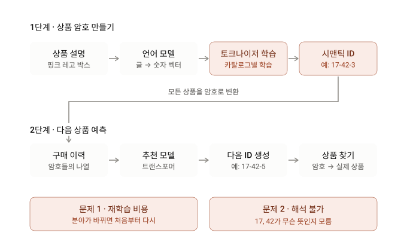
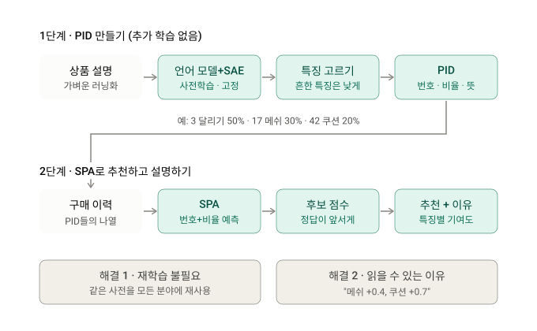

# 0. Summary

- 기본 정보 : ArXiv,2026.10.27, **[The Vocabulary Is Already Here: Adapting Pretrained Interpretable Features for Generative Recommendation](https://arxiv.org/abs/2610.36763)**
- 연구 배경 : 생성 추천(generative recommendation, GR)은 언어 모델의 토큰 생성 패러다임을 따라, 다음 아이템을 그 **시맨틱 ID(semantic ID, SID)** 로 예측한다. 기존 방법은 사전학습 언어 모델(PLM)의 아이템 표현 위에 별도의 이산 어휘(vocabulary)를 **추가 학습으로 적합**해 SID를 만드는데, 이는 추가 최적화 비용이 들고 어휘의 의미 범위가 적합에 쓴 도메인에 묶이며, 토큰 자체가 읽을 수 있는 의미를 갖지 않는 경우가 많다. 저자들은 "어휘 구축에 공짜 점심(free lunch)이 있는가"를 묻고, 기계론적 해석가능성 연구가 이미 공개한 **사전학습 희소 오토인코더(pretrained SAE, P-SAE)** 의 피처 사전이 그 답이 될 수 있다고 본다.
- 제안 방법 : **API**(Adapting the Pretrained Interpretable vocabulary) 프레임워크. (1) **PID(Pretrained Interpretable ID)** 구축: 고정된 PLM–P-SAE 쌍이 아이템 설명문에서 만든 희소 활성을 아이템 수준 강도 $a_{ij}$ 로 집계하고, 강한 활성은 우대하되 카탈로그 전체에 흔한 피처는 할인하는 우선순위 $\pi_{ij}=\log(1+a_{ij})\log(1/\rho_j)$ 로 $K$ 개 피처 인덱스를 고르며, 상대 활성 강도 벡터 $\mathbf{q}_i$ 와 사전학습 의미 주석 $\mathbf{m}_i$ 를 함께 보존한다. (2) **SPA(Semantic Prediction Adapter)**: 이력 아이템을 후보 풀의 피처–강도 쌍으로 인코딩하고, 다음 아이템의 피처 인덱스 열과 상대 강도를 함께 예측하며, 시퀀스 로그 우도와 제곱 Hellinger 거리 기반 강도 일치를 합친 점수 $s_\theta(u,i)$ 위에 **선호 정렬 손실**을 두어 목표 아이템이 경쟁 아이템을 이기도록 학습한다. (3) **검색 설명**: 두 후보의 점수 차이를 피처별 기여 $\phi_{u,i}(j)$ 의 합으로 분해하고 각 피처의 의미 주석과 짝지어 "왜 이 아이템을 더 선호했는가"를 보여 준다.
- 발견 사실 : GPT-2-small과 24,576개 라벨 피처를 가진 P-SAE를 **고정**한 채, Amazon Beauty·Sports·Toys에서 (1) API는 전체 프레임워크 비교(Table 1)의 12개 데이터셋–지표 중 9개에서 최고 성능을 냈고 Toys에서는 4개 지표 모두 1위였다. (2) 직접 PID만으로는 학습 토크나이저를 항상 이기지 못하지만(Beauty T5-PR $K=4$ Recall@5 0.0278 vs OPQ 0.0290), SPA를 더하면 6개 AR 설정 전부와 18개 PR 설정 중 16개에서 Recall@5가 올랐으며, T5-AR에서는 가장 강한 학습 토크나이저 기준선을 Recall@5 기준 2.5%–4.2% 앞섰다. (3) $K=4$ 에서 우선순위 선택은 평균 충돌률을 80.76%(native)에서 17.09%로 줄였고, 피처–활성 프로파일을 아이템 간에 뒤섞으면 충돌률은 그대로인데 Overlap@20이 0.2% 아래로 떨어져 "낮은 충돌률이 곧 내용 보존은 아님"을 보였다. (4) 선호 정렬은 Recall@10을 13.3%/45.9%/9.4% 올렸고, 그 위에 강도 모델링을 더하면 NDCG@10이 4.0%–6.0% 추가 상승했다. (5) 세 토큰화 과제 기준 누적 시간은 GPT-2 인코딩 한 번 대비 API 3.78×, RVQ 407.69×, UTGRec 674.99×였다. (6) Sports 피처 $f_{4260}$ 은 사냥·사격 어휘 규칙과 98.7% 일치(7.91× lift)했고, 이력 활성을 +0.50 이동시키면 exposure@10이 대조 대비 1.365%p 올랐다.
- 핵심 기여 :
    1. **어휘 학습 없는 생성 추천** : 추천 데이터로 어휘를 새로 적합하는 대신, 공개된 P-SAE 피처 사전을 공유 어휘로 **그대로 재사용**하는 API 프레임워크를 제안해, 기계론적 해석가능성 자원을 실제 배포 과제에 쓰는 경로를 열었다.
    2. **PID와 분리가능성 보장** : 우선순위 기반 피처 선택과 상대 강도 보존으로 압축 토큰 예산에서도 아이템 구별을 유지하는 PID를 설계하고, 같은 토큰 열을 공유하는 아이템 수의 상한(Proposition 4.1)과 SPA의 순위 마진(Proposition 4.2)을 이론적으로 특성화했다.
    3. **아이템 수준 감독과 설명 가능한 검색** : 피처 인덱스·강도 공동 예측, Hellinger 기반 점수, 선호 정렬 손실로 이루어진 SPA를 개발하고, 점수 차이를 피처 기여와 의미 주석으로 분해해 검색 결정 자체를 설명했으며, 세 벤치마크·두 백본·두 디코딩 방식에서 경쟁력 있는 성능과 도메인 간 어휘 재사용을 실험으로 입증했다.

# Abstract 쉬운 설명(Claude)

쉽게 말하면 이 논문은 **"추천 시스템이 상품을 부를 이름표를 새로 만들지 말고, 이미 있는 이름표를 가져다 쓰자"**는 이야기입니다.

## 배경: 추천 AI는 상품을 '단어'로 부른다

요즘 추천 AI 중에는 ChatGPT 같은 언어 모델처럼 작동하는 것이 있습니다. 이를 *생성형 추천*이라고 합니다. 언어 모델이 다음 단어를 맞히듯, 사용자가 지금까지 산 물건들을 보고 다음에 살 물건을 맞힙니다.

그러려면 상품 하나하나를 AI가 다룰 수 있는 짧은 암호로 바꿔야 합니다. 예를 들어 "운동화 A = 17-42-3" 같은 식입니다. 이 암호를 *시맨틱 ID*라고 합니다.

## 기존 방식의 문제

지금까지는 쇼핑몰마다 이 암호 체계를 새로 학습시켜 만들었습니다. 그래서 두 가지 문제가 있었습니다.

- **비용이 듭니다.** 쇼핑몰이나 분야가 바뀔 때마다 암호 체계를 다시 학습해야 합니다.
- **암호가 무슨 뜻인지 알 수 없습니다.** "17"이 무엇을 의미하는지 사람이 읽어낼 수 없습니다.

## 핵심 아이디어: "어휘는 이미 여기 있다"

AI 해석 연구 분야에는 *희소 오토인코더(SAE)*라는 도구가 있습니다. 언어 모델의 머릿속을 들여다보고, 그 안의 개념들을 하나씩 번호를 붙여 정리해 둔 일종의 **개념 사전**입니다. 각 번호에는 사람이 읽을 수 있는 설명이 이미 달려 있습니다. 예를 들면 3번은 "달리기", 17번은 "메쉬 소재", 42번은 "쿠션" 같은 식입니다.

저자들의 생각은 간단합니다. 상품 설명을 이 사전에 넣으면 "이 운동화는 3번, 17번, 42번 개념이 강하게 나타난다"는 결과가 나옵니다. 그 번호들을 그대로 상품 암호로 쓰면 됩니다. 새로 학습할 필요도 없고, 각 번호의 뜻도 바로 알 수 있습니다.

## 그런데 풀어야 할 문제 두 가지

**① 비슷한 상품끼리 구별이 안 될 수 있다**
러닝화 두 켤레는 둘 다 "달리기·메쉬·쿠션"으로 나올 수 있습니다. 암호가 같으면 AI가 둘을 구별하지 못합니다.

**② 추천 이유까지 설명하고 싶다**
"이 상품에 이런 특징이 있다"를 넘어서 "왜 B가 아니라 A를 추천했는가"까지 설명하고 싶습니다.

## 해결책: API 프레임워크

**PID (상품 이름표 만들기)**
- 흔한 특징은 낮게 치고, 그 상품만의 특징을 우선 골라 암호에 넣습니다. 신발 매장에서 "신발"이라는 특징은 구별에 도움이 안 되기 때문입니다.
- 각 특징이 얼마나 강한지도 함께 기록합니다. 예를 들어 "달리기 50%, 메쉬 30%, 쿠션 20%"처럼요. 그러면 암호가 같은 두 상품도 비율로 구별할 수 있습니다.

**SPA (추천 학습하기)**
- 사용자의 구매 이력을 보고, 다음 상품의 **특징 번호**와 **특징별 비율**을 함께 예측합니다.
- 정답 상품이 비슷한 다른 후보들보다 높은 점수를 받도록 훈련합니다.

**설명 기능**
최종 점수를 특징별로 나눠 보여줍니다. 예를 들어 "운동화를 양말보다 추천한 이유: '메쉬'에서 +0.4, '쿠션'에서 +0.7"처럼 근거를 제시합니다.

## 결과

실험 결과, 암호 체계를 따로 학습하지 않았는데도 기존 방법들과 비슷하거나 더 나은 추천 성능을 보였습니다. 짧은 암호로도 상품들을 잘 구별했고, 추천 이유를 사람이 읽을 수 있는 말로 설명할 수 있었습니다.

## 한 줄 요약

AI 해석 연구에서 이미 만들어 둔 **뜻이 달린 개념 사전**을 추천 시스템의 상품 이름표로 재활용했습니다. 그 결과 학습 비용은 줄이고, 추천 이유는 설명할 수 있게 되었습니다.

# 기존 생성형 추천(Generative Recommendation, GR) 작동 방식 시각화

# 논문의 GR 작동 방식 시각화

## 특징 선택 방법



# 관련 개념

## 생성 추천과 아이템 토큰화

**생성 추천(generative recommendation, GR)** 은 사용자의 순차 상호작용 이력 $\mathcal{H}_u=(i_1,\ldots,i_T)$ 가 주어졌을 때 다음 아이템 $i^+\in\mathcal{I}$ 를 **이산 토큰 열을 생성**하는 방식으로 예측합니다. 아이템 식별자가 예측 공간의 일부가 되므로, 아이템을 토큰 열로 바꾸는 **아이템 토큰화(item tokenization)** 가 아이템 표현과 모델 감독 사이의 접점이 됩니다.

---

### 🔤 1. 시맨틱 ID와 토크나이저

각 아이템 $i$ 에는 텍스트 설명 $x_i$ 가 붙어 있습니다. PLM(GPT-2, T5 등)이 $x_i$ 를 연속 은닉 표현 $h_i$ 로 인코딩하면, 토크나이저 $\tau$ 가 이를 공유 집합 $\mathcal{V}$(어휘)에서 뽑은 짧은 이산 토큰 열, 즉 **시맨틱 ID(SID)** 로 바꿉니다.

$$\tau:\mathcal{I}\rightarrow\mathcal{V}^{K},\qquad c_{i}=\tau(i)=(c_{i,1},\ldots,c_{i,K})$$

여기서 $K$ 는 길이, $c_{i,r}\in\mathcal{V}$ 는 위치 $r$ 의 토큰입니다. 어휘는 토큰에 어떤 정보가 남는지와 추천 학습에 쓰이는 토큰 수준 감독을 동시에 결정합니다.

---

### 🔁 2. 두 가지 디코딩 방식

| 방식 | 동작 | 대표 구현 |
|---|---|---|
| 자기회귀(AR) | 앞 토큰에 조건부로 토큰을 순차 생성 | TIGER (Rajput et al., 2023) |
| 병렬(PR) | 한 번의 디코딩 단계에서 여러 토큰을 동시에 예측 | RPG (Hou et al., 2025) |

이 논문은 두 방식 모두에서 제안 방법을 평가합니다. AR은 카탈로그 트라이(trie) 위에서 빔 폭 50의 제약 빔 탐색을, PR은 전체 카탈로그에 대한 정확한 점수 계산을 씁니다.

---

### 🧱 3. 기존 토큰화의 세 가지 한계

| 계열 | 예 | 방식 |
|---|---|---|
| 언어 기반 | P5, IDGenRec | 텍스트-투-텍스트, 학습된 텍스트 식별자 |
| 구조적 식별자 | TIGER, SEATER | PLM 표현의 잔차 양자화, 균형 트리 + 대조 학습 |
| 협업 신호 결합 | LC-Rec, ETEGRec | 협업 의미를 색인에 통합, 토크나이저와 추천 모델 교대 최적화 |
| 공유 어휘 | UTGRec, UniTok | 다중 도메인 사전학습, 공유·특화 전문가 결합 |

저자들이 지적하는 공통 문제는 세 가지입니다. (1) 어휘를 **추천 데이터에 추가로 적합**해야 하므로 최적화 비용이 든다. (2) 학습된 어휘의 **의미 범위가 적합 데이터에 의존**한다. (3) 추천 데이터에 맞춘 어휘의 토큰은 **읽을 수 있는 의미를 갖지 않는 경우가 많다**(Fang et al., 2025). 그래서 "어휘 구축에 공짜 점심이 있는가"라는 질문이 나옵니다.

> **💡 Key Takeaway**
> 생성 추천의 성능과 설명 가능성은 상당 부분 **어휘가 무엇인가**에 달려 있습니다. 기존 방법은 어휘를 매번 새로 배우고, 그 어휘는 도메인에 묶이며 읽기 어렵습니다. 이 논문의 출발점은 이 세 문제를 한꺼번에 피할 어휘가 이미 존재한다는 관찰입니다.

## 사전학습 희소 오토인코더: 어휘는 이미 있다

**희소 오토인코더(sparse autoencoder, SAE)** 는 언어 모델 활성을 사전(dictionary) 피처들의 희소 조합으로 분해해, 밀집 표현 안의 해석 가능한 구조를 드러냅니다(Bricken et al., 2023; Huben et al., 2024). 이후 연구는 사전을 키우고(Templeton et al., 2024; Gao et al., 2025), 희소성 제약 아래 재구성을 개선하며(JumpReLU, Rajamanoharan et al., 2024), Gemma Scope처럼 **사전학습 SAE를 공개**해 재사용할 수 있게 했습니다(Lieberum et al., 2024).

---

### 🧮 1. P-SAE의 정의

짝이 되는 PLM의 은닉 표현 $\mathbf{h}$ 가 주어지면, 인코더 $E$ 가 비음수 활성 벡터 $\mathbf{z}=E(\mathbf{h})$ 를 만들고 재구성은

$$\hat{\mathbf{h} }=\mathbf{D}\mathbf{z}+\mathbf{b}_{\mathrm{dec} }$$

입니다. $\mathbf{D}=[\mathbf{d}_1,\ldots,\mathbf{d}_m]$ 은 디코더 사전, $\mathbf{b}_{\mathrm{dec} }$ 는 디코더 편향입니다. 각 열 $\mathbf{d}_j$ 는 인덱스 $j$ 로 식별되는 피처이고, 활성 $z_j$ 는 그 피처가 $\mathbf{h}$ 에서 얼마나 강하게 표현되는지를 나타냅니다. 여기에 사전학습 의미 주석 $m_j$(예: "red")가 사람이 읽을 수 있는 설명을 붙입니다.

---

### 💡 2. 피처 인덱스를 어휘로

아이템마다 P-SAE는 PLM 표현을 희소 활성 벡터로 인코딩합니다. 0이 아닌 좌표가 **표현된 피처**를, 그 값이 **강도**를 나타냅니다. 빨간 티셔츠라면 "red" 피처가 "blue" 피처보다 강하게 켜질 것입니다. 따라서 피처 인덱스 자체를 SID 토큰으로 쓰면, 추천용 어휘 학습 없이 **활성 강도와 의미 주석이 딸린 어휘**를 얻습니다. 이것이 제목의 "어휘는 이미 여기 있다(The Vocabulary Is Already Here)"입니다.

---

### ⚠️ 3. 두 가지 도전

| 도전 | 내용 |
|---|---|
| 추천 적응 | 비슷한 아이템은 **지배적 피처를 공유**하고 활성 강도와 덜 활성화된 피처에서만 다릅니다(Figure 1(d)). 가장 강한 피처 인덱스만으로 아이템을 표현하면 이 구별이 사라지고, 공유 인덱스만 예측해서는 목표 아이템이 유사 후보를 이긴다는 보장이 없습니다. |
| 검색 설명 | 피처가 아이템 의미를 검사 가능하게 만들더라도, 이 해석가능성을 **검색 결정**까지 확장해 "왜 이 아이템을 저 아이템보다 선호했는가"를 피처 기여로 추적해야 합니다. |

관련 연구로 SAERec(Xia et al., 2026)이 SAE 유래 의도 사전 정보를 시퀀스 모델링에 썼지만, 생성 검색의 피처 수준 설명은 다루지 않았습니다. 이 논문은 사전학습 지식 재사용을 연속 표현에서 **어휘 단위**로 확장합니다.

> **💡 Key Takeaway**
> 공개된 P-SAE의 피처 인덱스는 (i) 추가 학습이 필요 없고, (ii) 적합 도메인에 묶이지 않으며, (iii) 의미 주석이 딸린 어휘입니다. 문제는 이 어휘가 **재구성용**으로 학습되었다는 점이며, 추천 감독에 맞게 적응시키고 검색 설명으로 이어 주는 것이 API의 역할입니다.

## PID 구축: 우선순위 선택과 상대 강도 보존

API의 첫 단계는 **PID(Pretrained Interpretable ID)** 구축입니다. 고정된 PLM–SAE 쌍이 아이템 설명문 $x_i$ 의 토큰 $t$ 마다 희소 활성 $\mathbf{z}_i^{(t)}$ 를 만들면, 이를 아이템 수준 강도로 집계합니다.

---

### 📐 1. 아이템 수준 활성 강도 (Eq. 3)

$$a_{ij}=\frac{\|\mathbf{d}_{j}\|_{2} }{|\mathcal{T}_{i}|}\sum_{t\in\mathcal{T}_{i} }z_{i,j}^{(t)}$$

$\mathcal{T}_i$ 는 특수 토큰을 제외한 $x_i$ 의 토큰 위치입니다. 디코더 열 노름 $\|\mathbf{d}_j\|_2$ 로 스케일링해 피처 간 활성 크기를 비교 가능하게 만듭니다. $a_{ij}$ 는 아이템 $i$ 가 피처 $j$ 를 얼마나 강하게 표현하는지를 뜻합니다.

---

### 🎯 2. 우선순위 선택 (Eq. 4)

활성 강도만으로 피처를 고르면 서로 다른 아이템에 같은 토큰이 붙습니다. 한 도메인 안에서 **공유 지배 피처**가 토큰 예산을 차지해, 개별 아이템을 구별해 주는 덜 활성화된 피처를 밀어내기 때문입니다. 저자들은 양의 활성 강도 상위 $M$ 개로 후보 풀 $\mathcal{C}_i$ 를 만든 뒤, 각 후보에 다음 우선순위를 매깁니다.

$$\pi_{ij}=\log(1+a_{ij})\,\log\frac{1}{\rho_{j} }$$

$\rho_j$ 는 학습 가시 아이템들의 후보 풀에서 피처 $j$ 가 나타난 빈도로 추정한 **평활화된 유행도(prevalence)** 이며, 부록 A.2에 따르면 $\rho_j=(n_j+1)/(N_{\rm tr}+1)$ 입니다. 유행도가 낮으면 약한 활성을 보상하므로, 덜 활성화된 속성이 공유 지배 피처와 경쟁할 수 있습니다. 우선순위 상위 $K$ 개를 고르고, 그 인덱스를 **활성 강도 내림차순**으로 정렬한 열 $c_i=(c_{i,1},\ldots,c_{i,K})$ 가 PID의 토큰 성분입니다.

| 요소 | 값 (구현) |
|---|---|
| 후보 풀 크기 | 아이템당 상위 256개 양의 피처 추출, 선택 후보 32개 유지 |
| 토큰 예산 $K$ | $\{4, 8, 16\}$ |
| 정렬 | SPA는 활성 내림차순, 동점은 인덱스 순; 직접 PID-PR은 학습 빈도 순 |
| 접미사 | 비의미 접미사 $\nu_i$ 로 공유 지지집합 구분, $\tilde c_i=(c_i,\nu_i)$; 강도 프로파일·충돌 통계에서는 제외 |

---

### 📊 3. 상대 활성 강도 (Eq. 5–6)

우선순위 선택이 공유 지배 피처로 인한 충돌을 줄여도, 압축 토큰 예산에서는 의미상 비슷한 아이템이 같은 토큰 열을 갖는 일이 남습니다. 저자들은 선택된 피처들의 **상대 활성 강도**가 그래도 서로 다르다는 점에 주목해, 토큰 열에 정렬된 벡터 $\mathbf{q}_i=(q_{i,1},\ldots,q_{i,K})$ 를 보존합니다.

$$q_{i,r}=\frac{\log(1+a_{i,c_{i,r} })}{\sum_{k=1}^{K}\log(1+a_{i,c_{i,k} })}$$

여기에 각 피처 인덱스의 사전학습 의미 주석 $\mathbf{m}_i=(m_{c_{i,1} },\ldots,m_{c_{i,K} })$ 를 붙여 PID가 완성됩니다.

$$\mathrm{PID}_{i}=\bigl(c_{i},\mathbf{q}_{i},\mathbf{m}_{i}\bigr)$$

> **💡 Key Takeaway**
> PID는 세 가지를 한 번에 담습니다. **어떤 피처**(인덱스 열, 유행도로 할인한 우선순위 선택), **얼마나 강하게**(정규화된 로그 강도 벡터), **무슨 뜻**(의미 주석). 토큰 열이 같아도 강도 벡터가 다르면 아이템을 구별할 수 있다는 것이 다음 명제의 내용입니다.

## Proposition 4.1: PID의 아이템 분리가능성

같은 토큰 열을 공유하는 아이템 집단 안에서, 상대 강도까지 완전히 같은 PID를 갖는 아이템이 몇 개까지 있을 수 있는지를 재구성 오차와 강도 합의 변동으로 상한합니다.

---

### 📜 1. 명제 (Eq. 7)

같은 토큰 열을 공유하는 아이템 집단에서, 평균 PLM 표현 간 최소 쌍별 $\ell_2$ 거리를 $\Delta$ 라 하겠습니다. $\Delta>2\epsilon$ 이면 같은 PID를 공유하는 아이템 수의 최댓값 $n_{\max}$ 는

$$n_{\max}\leq 1+\left\lfloor\frac{\delta}{\Delta-2\epsilon}\right\rfloor$$

를 만족합니다. $\epsilon$ 은 선택된 피처만으로 재구성했을 때의 오차 상한이고, $\delta$ 는 집단 내 아이템들의 $\sum_{r=1}^{K}a_{i,c_{i,r} }$ 범위의 상한입니다. 특히 $\Delta>2\epsilon+\delta$ 이면 토큰 열이 같아도 강도가 아이템을 구별합니다.

---

### 🔍 2. 증명의 핵심 (부록 B.1)

| 단계 | 내용 |
|---|---|
| 선택 피처 재구성 | $\tilde{\mathbf{h} }_i=\mathbf{b}_{\mathrm{dec} }+\sum_{r=1}^{K}\mathbf{u}_{c_r}a_{i,c_r}$, $\mathbf{u}_j=\mathbf{d}_j/\|\mathbf{d}_j\|_2$ (Eq. 16). 가정에 따라 $\|\bar{\mathbf{h} }_i-\tilde{\mathbf{h} }_i\|_2\le\epsilon$ |
| 같은 PID의 의미 | $\mathbf{q}_i=\mathbf{q}_{i'}$ 이면 Eq. 5에 의해 어떤 $\alpha>0$ 에 대해 모든 $r$ 에서 $\log(1+a_{i,c_r})=\alpha\log(1+a_{i',c_r})$. 로그가 단조증가이므로 차이 $a_{i,c_r}-a_{i',c_r}$ 는 모두 같은 부호 |
| 거리 연쇄 | $\Delta\le\|\bar{\mathbf{h} }_i-\bar{\mathbf{h} }_{i'}\|_2\le 2\epsilon+\|\tilde{\mathbf{h} }_i-\tilde{\mathbf{h} }_{i'}\|_2\le 2\epsilon+\sum_r\lvert a_{i,c_r}-a_{i',c_r}\rvert = 2\epsilon+\lvert\omega_i-\omega_{i'}\rvert$ (Eq. 17) |
| 간격 합산 | 강도 합을 정렬하면 인접 간격이 각각 $\Delta-2\epsilon$ 이상이므로 $(n_{\max}-1)(\Delta-2\epsilon)\le\delta$ (Eq. 18) |

같은 부호라는 사실 덕분에 절댓값의 합이 합의 절댓값과 같아져 $\lvert\omega_i-\omega_{i'}\rvert$ 로 묶이는 것이 핵심입니다.

> **💡 Key Takeaway**
> 충돌 상한은 **재구성 오차가 작을수록, 아이템 표현이 서로 멀수록, 집단 내 강도 합의 퍼짐이 작을수록** 1에 가까워집니다. 즉 P-SAE가 선택된 소수 피처로 아이템을 잘 재구성한다면, 상대 강도만으로도 토큰 열 충돌을 해소할 수 있다는 보장입니다.

## SPA: 이력 인코딩과 PID 예측

PID가 상대 강도를 보존하더라도, 인덱스만 예측해서는 강도가 명시적으로 모델링되지 않습니다. **SPA(Semantic Prediction Adapter)** 는 피처 인덱스와 활성 강도를 이력 인코딩에 함께 넣고, 다음 아이템의 토큰 열과 상대 강도를 함께 예측합니다.

---

### 🧩 1. 후보 풀 기반 이력 인코딩 (Eq. 8)

PID 구축은 $K$ 개 피처만 고르지만, 제외된 피처도 사용자 선호의 증거가 될 수 있습니다. 그래서 SPA는 이력 아이템을 $c_i$ 가 선택된 **후보 풀 $\mathcal{C}_i$ 전체**와 그 강도로 표현합니다: $\mathcal{E}_i=\{(j,a_{ij}):j\in\mathcal{C}_i\}$. 피처 인코더 $\Psi_\theta$ 는 학습 가능한 피처 인덱스 임베딩과 활성 강도 인코딩을 결합해 아이템당 고정 개수의 토큰으로 집계하고, 추천 트랜스포머 $F_\theta$ 가 이를 상호작용 순서대로 처리합니다.

$$\mathbf{H}_{u}=F_{\theta}\!\left(\Psi_{\theta}(\mathcal{E}_{i_{1} }),\ldots,\Psi_{\theta}(\mathcal{E}_{i_{T} })\right)$$

| 구현 세부 (부록 A.2) | 내용 |
|---|---|
| 강도 표준화 | $\log(1+a_{ij})$ 를 피처별 학습 평균 $\mu_j$·표준편차 $\sigma_j$ 로 표준화. 16개 전역 의사 관측으로 평활, 표준편차 하한 0.05 |
| 게인/시프트 | $[-2,2]$ 로 클리핑한 값이 8개의 학습된 게인/시프트 임베딩을 보간해 피처 임베딩을 GELU 앞에서 변조 |
| 앵커 | 우선순위로 선택한 앵커 4개에 투영된 상위 32개 문맥 평균과 위치 임베딩을 더하고, 다섯 번째 앵커가 접미사를 인코딩 |
| 출력 | 레이어 정규화 후 **아이템당 이력 토큰 5개** (출력 $K$ 와 무관) |

---

### 🎯 2. 목표 PID 예측

이력 표현 $\mathbf{H}_u$ 로부터 SPA는 다음 아이템의 피처 인덱스 열에 대한 조건부 분포 $p_\theta(c\mid\mathbf{H}_u)$ 를 모델링하고, 동시에 강도 벡터 $\hat{\mathbf{q} }_u$ 를 예측합니다. $\hat q_{u,r}$ 는 활성 순위 위치 $r$ 에서의 $q_{i^+,r}$ 추정값이며 $\hat q_{u,r}\ge 0$, $\sum_{r=1}^K\hat q_{u,r}=1$ 입니다. 의미 주석은 예측된 인덱스 $j$ 로 $m_j$ 를 찾아 붙입니다. 피처 인덱스 열은 AR로도 PR로도 생성할 수 있습니다. 남는 문제는 **다음 아이템을 경쟁 카탈로그 아이템보다 어떻게 선호하게 만드는가**입니다.

> **💡 Key Takeaway**
> SPA는 입력에서는 선택된 $K$ 개가 아니라 후보 풀 전체(강도 포함)를 보고, 출력에서는 인덱스 열과 함께 **강도 분포**를 예측합니다. 강도가 예측 대상이 되어야 다음 절의 점수와 순위 마진이 성립합니다.

## SPA: 아이템 수준 감독과 Proposition 4.2

관측된 다음 아이템의 PID로 아이템 수준 감독을 구성합니다. 시퀀스 우도와 강도 일치를 하나의 점수로 합쳐 PID 예측과 후보 순위를 함께 감독합니다.

---

### 🧮 1. 아이템 점수 (Eq. 9–10)

아이템 $i$ 의 피처 인덱스 열 로그 우도를 $\ell_u(i)=\log p_\theta(c_i\mid\mathbf{H}_u)$ 라 하면, 점수는

$$s_{\theta}(u,i)=\ell_{u}(i)-\beta D_{\mathrm{H} }(\hat{\mathbf{q} }_{u},\mathbf{q}_{i})$$

입니다. $\beta\ge 0$ 은 강도 벌점의 세기이고, $D_{\mathrm{H} }$ 는 활성 순위 위치별로 예측 강도와 후보 강도를 비교하는 **제곱 Hellinger 거리**입니다.

$$D_{\mathrm{H} }(\hat{\mathbf{q} }_{u},\mathbf{q}_{i})=1-\sum_{r=1}^{K}\sqrt{\hat{q}_{u,r}q_{i,r} }$$

정규화된 벡터이므로 값은 $[0,1]$ 에 있고, 상대 강도가 정확히 일치할 때만 0입니다.

---

### ⚖️ 2. 선호 정렬 손실 (Eq. 11–12)

$-s_\theta(u,i^+)$ 를 최소화하면 목표 아이템의 인덱스 열과 강도가 감독되지만, 목표 PID에 더 잘 맞아도 경쟁 아이템 점수가 더 높을 수 있습니다. 그래서 $i^+$ 를 포함하는 후보 집합 $\mathcal{J}_u\subseteq\mathcal{I}$ 위에 선호 정렬 손실을 둡니다.

$$\mathcal{L}_{\mathrm{pref} }(u,i^{+})=\log\sum_{n\in\mathcal{J}_{u} }\exp\big(s_{\theta}(u,n)-s_{\theta}(u,i^{+})\big)$$

$$\mathcal{L}=\mathbb{E}_{(u,i^{+})}\big[-s_{\theta}(u,i^{+})+\lambda\mathcal{L}_{\mathrm{pref} }(u,i^{+})\big]$$

| 구현 (부록 A.3) | PR | AR |
|---|---|---|
| 선호 손실 | 전체 카탈로그 점수에 온도 1 소프트맥스 후 양성 아이템 교차 엔트로피 | 양성 1개 + 균일 추출 음성 4개를 각자의 접두사로 점수화 (정확한 전체 카탈로그 교차 엔트로피 아님) |
| $(\lambda,\beta)$ | 전체 SPA $(1,8)$ | T5-AR: Beauty $(0.25,2)$, Sports/Toys $(1,8)$ |
| 추론 | 전체 카탈로그 정확 점수 | 전체 토큰 어휘로 정규화 후 불법 트라이 간선 마스킹, 완전 리프에서 강도 적용 |

검색 시에도 같은 점수 $s_\theta(u,i)$ 로 아이템을 순위화합니다.

---

### 📜 3. Proposition 4.2: 순위 마진 (Eq. 13)

목표 $i^+$ 와 같은 피처 인덱스 열을 공유하는 경쟁 아이템 $i^-$ 에 대해, 강도 분리를 $\Delta_q=D_{\mathrm{H} }(\mathbf{q}_{i^+},\mathbf{q}_{i^-})>0$, SPA의 예측 오차를 $\varepsilon_u=D_{\mathrm{H} }(\hat{\mathbf{q} }_u,\mathbf{q}_{i^+})$ 라 하면 $\beta>0$ 일 때

$$s_{\theta}(u,i^{+})-s_{\theta}(u,i^{-})\geq\beta\big(\Delta_{q}-2\sqrt{\Delta_{q}\varepsilon_{u} }\big)$$

이고, 특히 $\varepsilon_u<\Delta_q/4$ 이면 SPA는 $i^+$ 를 $i^-$ 위에 놓습니다.

**증명 아이디어 (부록 B.2)**: $\mathbf{x}=\sqrt{\hat{\mathbf{q} }_u}$, $\mathbf{y}=\sqrt{\mathbf{q}_{i^+} }$, $\mathbf{z}=\sqrt{\mathbf{q}_{i^-} }$ 로 두면 모두 단위 벡터이고 $\Delta_q=\tfrac12\|\mathbf{y}-\mathbf{z}\|_2^2$, $\varepsilon_u=\tfrac12\|\mathbf{x}-\mathbf{y}\|_2^2$ 입니다(Eq. 19). 두 강도 벌점의 차는 $\mathbf{x}^\top(\mathbf{y}-\mathbf{z})$ 이고(Eq. 20), $\mathbf{x}=\mathbf{y}+(\mathbf{x}-\mathbf{y})$ 로 쓴 뒤 Cauchy–Schwarz를 적용하면 $\ge\Delta_q-\|\mathbf{x}-\mathbf{y}\|_2\|\mathbf{y}-\mathbf{z}\|_2=\Delta_q-2\sqrt{\Delta_q\varepsilon_u}$ 입니다(Eq. 21). 일반 후보 쌍에서는 $\ell_u(i^+)-\ell_u(i^-)$ 항이 더해지며(Eq. 22), 토큰 열이 같으면 우도가 같아 Eq. 13으로 줄어듭니다.

> **💡 Key Takeaway**
> 점수는 "인덱스 열이 얼마나 그럴듯한가"와 "강도 분포가 얼마나 맞는가"의 합이고, 선호 정렬은 그 점수로 **목표가 카탈로그 경쟁자를 이기도록** 밀어 줍니다. Proposition 4.2는 강도 예측 오차가 두 아이템의 강도 분리의 1/4보다 작기만 하면, 토큰 열이 같은 경쟁자를 반드시 이긴다는 보장입니다.

## 검색 설명: 점수 차이의 피처 분해

SPA가 한 후보를 다른 후보보다 선호하는 이유를 설명하기 위해, 두 후보의 마진을 개별 해석 가능 피처의 기여로 분해하고 의미 주석과 짝짓습니다.

---

### 📐 1. 피처 기여 (Eq. 14)

시퀀스 로그 우도를 위치별로 $\ell_u(i)=\sum_{r=1}^K\ell_{u,r}(i)$ 로 분해합니다. $\ell_{u,r}(i)$ 는 SPA가 위치 $r$ 에서 피처 인덱스 $c_{i,r}$ 에 준 로그 확률입니다. 같은 위치의 강도 일치 항을 더하면 피처 기여가 됩니다.

$$\phi_{u,i}(c_{i,r})=\ell_{u,r}(i)+\beta\sqrt{\hat{q}_{u,r}q_{i,r} }$$

$c_i$ 에 없는 피처 $j$ 에는 $\phi_{u,i}(j)=0$ 을 둡니다.

---

### ⚖️ 2. 후보 순위 설명 (Eq. 15)

후보 $i$ 와 $i'$ 의 점수 차이는

$$s_{\theta}(u,i)-s_{\theta}(u,i^{\prime})=\sum_{j}\left(\phi_{u,i}(j)-\phi_{u,i^{\prime} }(j)\right)$$

로 분해되며, 양수 항은 $i$ 를, 음수 항은 $i'$ 를 지지합니다. 각 항을 사전학습 의미 주석 $m_j$ 와 짝지어 어떤 피처가 어느 후보를 얼마나 지지하는지 보여 줍니다. Eq. 9에서 $-\beta D_{\mathrm{H} }=-\beta+\beta\sum_r\sqrt{\hat q_{u,r}q_{i,r} }$ 이므로 상수 $-\beta$ 는 두 후보 사이에서 상쇄되고, 위치별 $\beta\sqrt{\hat q_{u,r}q_{i,r} }$ 만 기여로 남습니다.

> **💡 Key Takeaway**
> API의 설명은 사후 근사가 아니라 **점수 자체의 정확한 분해**입니다. 점수가 위치별 로그 확률과 위치별 강도 일치의 합이기 때문에, 두 후보의 차이를 피처 단위로 남김없이 나눌 수 있고, 각 피처에는 P-SAE가 이미 가진 의미 주석이 붙습니다.

## 실험 설정

다섯 개의 연구 질문으로 평가합니다. **RQ1** 디코딩 전략 전반에서 API의 추천 성능, **RQ2** PID의 아이템 구별·내용 보존, **RQ3** 어떤 감독 신호가 검색을 개선하는가, **RQ4** 사전학습 어휘 재사용의 효과, **RQ5** 피처 의미의 가독성과 표적 피처 스티어링.

---

### 🗂️ 1. 데이터셋 (Table 6)

| 데이터셋 | 사용자 | 아이템 | 상호작용 | 학습 아이템 |
|---|---|---|---|---|
| Beauty | 22,363 | 12,101 | 198,502 | 12,068 |
| Sports | 35,598 | 18,357 | 296,337 | 18,284 |
| Toys | 19,412 | 11,924 | 167,597 | 11,876 |

선행 연구(Geng et al., 2022; Ju et al., 2025)의 전처리·분할·평가 프로토콜을 유지합니다. 아이템 설명은 제목·브랜드·카테고리·가격을 이어 붙이고 128 토큰으로 자릅니다. 사용자당 검증·테스트 목표 1개, 최대 20개 선행 상호작용을 이력으로 씁니다.

---

### ⚙️ 2. 사전학습 자원과 백본

| 항목 | 설정 |
|---|---|
| PLM / SAE | GPT-2-small + Bloom's SAE (SAELens `gpt2-small-res-jb`, hook `blocks.8.hook_resid_pre`), 라벨 피처 24,576개, 둘 다 고정 |
| 피처 추출 | 아이템당 상위 256개 양의 피처, 후보 32개 유지, $K\in\{4,8,16\}$ |
| 추천 백본 | T5 스타일·GPT-2 스타일, 무작위 초기화 |
| 최적화 | Adam, 학습률 $10^{-3}$, 가중치 감쇠 $10^{-4}$, $\lambda_{\mathrm{pref} }=0.1$, $\beta=8$ |
| 체크포인트 | 검증 Recall@5 기준 선택 |

| 백본 (Table 7) | T5 AR/PR | GPT-2 PR | GPT-2 AR |
|---|---|---|---|
| 레이어 (E/D) | 4/4 | 0/4 | 0/4 |
| 폭 / 헤드 | 128/6 | 448/8 | 128/8 |
| 헤드당 K/V | 64 | 56 | 16 |
| FFN 폭 | 1,024/1,024 | 1,792 | 1,024 |
| 활성 함수 | ReLU | SiLU | GELU |
| 드롭아웃 | 0.15 | 0.15 | 0.15 |

본문 5.1절은 $\lambda_{\mathrm{pref} }=0.1$ 을, 부록 A.3은 전체 PR-SPA에 $(\lambda,\beta)=(1,8)$ 을 적습니다. 두 값이 다르므로 그대로 둡니다. 학습 레시피는 시드 45, 16 마이크로배치 그래디언트 누적, 워밍업·스케줄 없음, 1,600 마이크로배치마다 전체 검증, 10회 미개선 시 조기 종료, 최대 10 에폭·320,000 스텝입니다.

---

### 📏 3. 평가 지표

| 지표 | 정의 |
|---|---|
| Recall@k, NDCG@k | 전체 테스트 분할, 샘플링 음성 없이 전체 카탈로그. 목표 순위 $r_u$ 에 대해 $\mathbf{1}[r_u\le k]$ 와 $\mathbf{1}[r_u\le k]/\log_2(r_u+1)$ 의 사용자 평균, $k\in\{5,10\}$ |
| 충돌률 | 선택된 피처 집합(접미사·강도 제외, 비순서 지지집합)을 다른 아이템과 공유하는 아이템의 비율 |
| Overlap@20 | 표현 기반 top-20 이웃과 참조(제목 TF-IDF 코사인 또는 평균 풀링 PLM 잔차) top-20 이웃의 평균 교집합 비율. 도메인당 고정 질의 2,000개 |
| exposure@10 | 상위 10개 추천 중 PID에 표적 피처가 포함된 비율 (스티어링용) |

$$\operatorname{Overlap}@20=\frac{1}{20|Q|}\sum_{i\in Q}|\mathcal{N}_{i}\cap\mathcal{N}_{i}^{\rm ref}|$$

---

### 🆚 4. 비교 대상

| 수준 | 방법 |
|---|---|
| 아이템 토큰화 (Table 2) | Random, OPQ, RVQ, RQ-VAE, RKMeans, HiD-VAE, Native P-SAE(최강 피처 선택), R-SAE(아이템 임베딩에서 학습한 희소 사전), 무작위 양성 피처 선택(대조) |
| 추천 프레임워크 (Table 1) | GRU4Rec, Bert4Rec, TIGER, LC-Rec, RPG, UTGRec, Ghost, DIGR, TDPM |

잔차 토크나이저는 카탈로그 전체 내용에 시드 42, 배치 2,048로 적합합니다(RVQ: Adagrad $10^{-3}$, 커밋먼트 0.25, 3,000 업데이트; RKMeans: SGD 0.5, 30 업데이트; RQ-VAE: 768–768–256–128–64 인코더와 대칭 디코더). OPQ는 $K$ 개 서브양자화기, 각 256 센트로이드, 25회 반복입니다.

> **💡 Key Takeaway**
> 실험의 요점은 **PLM과 SAE를 전혀 학습하지 않은 채** 추천 백본만 무작위 초기화에서 학습한다는 것입니다. 학습 토크나이저 기준선들은 모두 카탈로그에 별도 적합을 거치므로, 비교는 "공짜 어휘"가 "적합한 어휘"에 얼마나 근접하는가를 묻습니다.

## RQ1: 추천 성능

### 🏆 1. 전체 프레임워크 비교 (Table 1)

| 방법 | Beauty R@5 | R@10 | N@5 | N@10 | Sports R@5 | R@10 | N@5 | N@10 | Toys R@5 | R@10 | N@5 | N@10 |
|---|---|---|---|---|---|---|---|---|---|---|---|---|
| GRU4Rec | 0.0433 | 0.0646 | 0.0304 | 0.0372 | 0.0222 | 0.0371 | 0.0141 | 0.0189 | 0.0384 | 0.0543 | 0.0272 | 0.0324 |
| Bert4Rec | 0.0281 | 0.0434 | 0.0184 | 0.0233 | 0.0129 | 0.0224 | 0.0079 | 0.0110 | 0.0201 | 0.0313 | 0.0133 | 0.0168 |
| Tiger (2023) | **0.0464** | 0.0662 | 0.0305 | 0.0369 | 0.0237 | 0.0341 | 0.0156 | 0.0189 | 0.0402 | 0.0584 | 0.0263 | 0.0322 |
| LCRec (2024) | 0.0228 | 0.0362 | 0.0159 | 0.0197 | 0.0082 | 0.0133 | 0.0073 | 0.0089 | 0.0174 | 0.0285 | 0.0119 | 0.0157 |
| RPG (2025) | 0.0322 | 0.0502 | 0.0210 | 0.0269 | 0.0176 | 0.0266 | 0.0124 | 0.0153 | 0.0306 | 0.0477 | 0.0192 | 0.0247 |
| UTGRec (2026) | 0.0193 | 0.0330 | 0.0122 | 0.0167 | 0.0126 | 0.0219 | 0.0080 | 0.0109 | 0.0177 | 0.0304 | 0.0107 | 0.0147 |
| Ghost (2026) | 0.0388 | 0.0590 | 0.0257 | 0.0322 | 0.0260 | **0.0422** | 0.0171 | 0.0223 | 0.0333 | 0.0543 | 0.021 | 0.0277 |
| DIGR (2026) | 0.0431 | 0.0605 | **0.0307** | 0.0362 | 0.0186 | 0.0291 | 0.0129 | 0.0161 | 0.0396 | 0.0571 | 0.0268 | 0.0319 |
| TDPM (2026) | 0.0418 | 0.0655 | 0.0279 | 0.0355 | 0.0216 | 0.0321 | 0.0140 | 0.0173 | 0.0398 | 0.0591 | 0.0259 | 0.0322 |
| **API (Ours)** | 0.0457 | **0.0694** | 0.0305 | **0.0389** | **0.0271** | 0.0411 | **0.0188** | **0.0239** | **0.0414** | **0.0616** | **0.0291** | **0.0353** |

API는 12개 데이터셋–지표 중 **9개에서 최고**이고 Toys에서는 4개 지표 모두 1위입니다. Beauty Recall@5(Tiger 0.0464)·NDCG@5(DIGR 0.0307, API는 Tiger와 0.0305로 동점)와 Sports Recall@10(Ghost 0.0422)에서는 2위입니다. Table 1의 API 수치는 Table 2의 GPT-2 AR "+ SPA" 행과 같습니다.

---

### 📊 2. 토큰화 비교, T5 백본 (Table 2)

| 디코딩 | 토큰화 | Beauty R@5 | R@10 | N@5 | N@10 | Sports R@5 | R@10 | N@5 | N@10 | Toys R@5 | R@10 | N@5 | N@10 |
|---|---|---|---|---|---|---|---|---|---|---|---|---|---|
| AR | Random | 0.0310 | 0.0454 | 0.0216 | 0.0262 | 0.0082 | 0.0111 | 0.0051 | 0.0060 | 0.0188 | 0.0250 | 0.0140 | 0.0161 |
| AR | RVQ | 0.0464 | 0.0662 | 0.0305 | 0.0369 | 0.0237 | 0.0341 | 0.0156 | 0.0189 | 0.0402 | 0.0584 | 0.0263 | 0.0322 |
| AR | RQVAE | 0.0402 | 0.0602 | 0.0269 | 0.0334 | 0.0215 | 0.0310 | 0.0139 | 0.0170 | 0.0344 | 0.0492 | 0.0240 | 0.0290 |
| AR | RKMeans | 0.0441 | 0.0667 | 0.0305 | 0.0378 | 0.0217 | 0.0330 | 0.0145 | 0.0181 | 0.0384 | 0.0564 | 0.0256 | 0.0314 |
| AR | HiD-VAE | 0.0419 | 0.0644 | 0.0283 | 0.0355 | 0.0215 | 0.0328 | 0.0138 | 0.0175 | 0.0388 | 0.0595 | 0.0257 | 0.0324 |
| AR | PID | 0.0435 | 0.0630 | 0.0299 | 0.0361 | 0.0210 | 0.0346 | 0.0135 | 0.0178 | 0.0401 | 0.0585 | 0.0269 | 0.0328 |
| AR | **PID + SPA** | **0.0476** | **0.0701** | **0.0323** | **0.0396** | **0.0243** | **0.0372** | **0.0157** | **0.0198** | **0.0419** | **0.0607** | **0.0287** | **0.0347** |
| PR | OPQ ($K$=4) | 0.0290 | 0.0466 | 0.0196 | 0.0256 | 0.0057 | 0.0105 | 0.0034 | 0.0049 | 0.0248 | 0.0373 | 0.0160 | 0.0200 |
| PR | OPQ ($K$=8) | 0.0368 | 0.0543 | 0.0247 | 0.0303 | 0.0080 | 0.0134 | 0.0052 | 0.0070 | 0.0320 | 0.0485 | 0.0210 | 0.0263 |
| PR | OPQ ($K$=16) | 0.0312 | 0.0484 | 0.0203 | 0.0259 | 0.0114 | 0.0199 | 0.0076 | 0.0102 | 0.0278 | 0.0424 | 0.0171 | 0.0218 |
| PR | PID ($K$=4) | 0.0278 | 0.0402 | 0.0194 | 0.0234 | 0.0049 | 0.0087 | 0.0029 | 0.0041 | 0.0294 | 0.0488 | 0.0182 | 0.0245 |
| PR | PID ($K$=8) | 0.0370 | 0.0541 | 0.0262 | 0.0316 | 0.0094 | 0.0158 | 0.0062 | 0.0083 | 0.0332 | 0.0547 | 0.0207 | 0.0276 |
| PR | PID ($K$=16) | 0.0340 | 0.0523 | 0.0225 | 0.0284 | 0.0132 | 0.0194 | 0.0086 | 0.0106 | 0.0348 | 0.0509 | 0.0209 | 0.0262 |
| PR | **PID + SPA ($K$=4)** | 0.0388 | 0.0572 | 0.0264 | 0.0323 | 0.0168 | 0.0267 | 0.0111 | 0.0142 | 0.0352 | 0.0517 | **0.0242** | **0.0295** |
| PR | **PID + SPA ($K$=8)** | **0.0401** | **0.0627** | **0.0274** | **0.0346** | **0.0192** | **0.0289** | **0.0126** | **0.0157** | **0.0354** | **0.0517** | 0.0229 | 0.0282 |
| PR | **PID + SPA ($K$=16)** | 0.0394 | 0.0575 | 0.0271 | 0.0329 | 0.0162 | 0.0241 | 0.0106 | 0.0131 | 0.0319 | 0.0462 | 0.0210 | 0.0256 |

---

### 📊 3. 토큰화 비교, GPT-2 백본 (Table 2)

| 디코딩 | 토큰화 | Beauty R@5 | R@10 | N@5 | N@10 | Sports R@5 | R@10 | N@5 | N@10 | Toys R@5 | R@10 | N@5 | N@10 |
|---|---|---|---|---|---|---|---|---|---|---|---|---|---|
| AR | Random | 0.0292 | 0.0401 | 0.0207 | 0.0247 | 0.0070 | 0.0122 | 0.0039 | 0.0056 | 0.0133 | 0.0176 | 0.0094 | 0.0108 |
| AR | RVQ | 0.0394 | 0.0594 | 0.0255 | 0.0320 | 0.0197 | 0.0331 | 0.0126 | 0.0169 | 0.0327 | 0.0536 | 0.0206 | 0.0274 |
| AR | RQVAE | 0.0362 | 0.0542 | 0.0242 | 0.0301 | 0.0166 | 0.0271 | 0.0103 | 0.0137 | 0.0296 | 0.0439 | 0.0192 | 0.0238 |
| AR | RKMeans | 0.0423 | 0.0640 | 0.0278 | 0.0348 | 0.0182 | 0.0294 | 0.0110 | 0.0145 | 0.0313 | 0.0508 | 0.0195 | 0.0258 |
| AR | HiD-VAE | 0.0398 | 0.0607 | 0.0261 | 0.0329 | 0.0223 | 0.0360 | 0.0141 | 0.0185 | 0.0335 | 0.0567 | 0.0211 | 0.0286 |
| AR | PID | 0.0420 | 0.0663 | 0.0282 | 0.0361 | 0.0190 | 0.0292 | 0.0126 | 0.0159 | 0.0380 | 0.0529 | 0.0265 | 0.0313 |
| AR | **PID + SPA** | **0.0457** | **0.0694** | **0.0305** | **0.0389** | **0.0271** | **0.0411** | **0.0188** | **0.0239** | **0.0414** | **0.0616** | **0.0291** | **0.0353** |
| PR | OPQ ($K$=4) | 0.0292 | 0.0457 | 0.0197 | 0.0250 | 0.0100 | 0.0175 | 0.0065 | 0.0089 | 0.0267 | 0.0449 | 0.0164 | 0.0222 |
| PR | OPQ ($K$=8) | 0.0374 | 0.0549 | 0.0248 | 0.0305 | 0.0161 | 0.0241 | 0.0109 | 0.0135 | 0.0274 | 0.0441 | 0.0165 | 0.0219 |
| PR | OPQ ($K$=16) | 0.0322 | 0.0502 | 0.0210 | 0.0269 | 0.0176 | 0.0266 | 0.0124 | 0.0153 | 0.0306 | 0.0477 | 0.0192 | 0.0247 |
| PR | PID ($K$=4) | 0.0267 | 0.0393 | 0.0193 | 0.0234 | 0.0153 | 0.0234 | 0.0101 | 0.0127 | 0.0330 | 0.0483 | 0.0230 | 0.0279 |
| PR | PID ($K$=8) | 0.0379 | 0.0540 | 0.0270 | 0.0322 | 0.0162 | 0.0309 | 0.0118 | 0.0167 | 0.0307 | 0.0447 | 0.0214 | 0.0259 |
| PR | PID ($K$=16) | 0.0336 | 0.0525 | 0.0228 | 0.0288 | 0.0179 | 0.0281 | 0.0121 | 0.0156 | 0.0267 | 0.0383 | 0.0189 | 0.0226 |
| PR | **PID + SPA ($K$=4)** | **0.0411** | **0.0618** | **0.0277** | **0.0343** | **0.0195** | **0.0300** | **0.0129** | **0.0163** | **0.0393** | **0.0559** | **0.0281** | **0.0334** |
| PR | **PID + SPA ($K$=8)** | 0.0395 | 0.0573 | 0.0274 | 0.0331 | 0.0186 | 0.0294 | 0.0120 | 0.0154 | 0.0384 | 0.0531 | 0.0271 | 0.0318 |
| PR | **PID + SPA ($K$=16)** | 0.0398 | 0.0573 | 0.0277 | 0.0333 | 0.0161 | 0.0253 | 0.0104 | 0.0133 | 0.0377 | 0.0515 | 0.0262 | 0.0306 |

---

### 🔍 4. 읽기

| 관찰 | 근거 |
|---|---|
| 직접 PID는 학습 토크나이저를 항상 이기지 못함 | Beauty T5-PR $K=4$: PID 0.0278 vs OPQ 0.0290 (Recall@5) |
| SPA가 직접 PID를 거의 항상 개선 | 6개 AR 설정 전부, 18개 PR 설정 중 16개에서 Recall@5 상승. 두 예외는 모두 $K=16$ (T5-PR Toys 0.0348→0.0319, GPT-2-PR Sports 0.0179→0.0161) |
| T5-AR에서 최강 학습 토크나이저 대비 | Recall@5 2.5%–4.2% 상회 (Beauty 0.0476 vs RVQ 0.0464, Sports 0.0243 vs 0.0237, Toys 0.0419 vs 0.0402) |
| 식별자가 길다고 좋아지지 않음 | 백본–데이터셋 쌍마다 API-PR 최고 Recall@5는 $K=4$ 또는 $K=8$ 에서 달성 (T5는 모두 $K=8$, GPT-2는 모두 $K=4$) |

> **💡 Key Takeaway**
> 공짜 어휘를 **그대로** 쓰면 적합한 어휘와 비슷하거나 약간 밀리지만, 강도 예측과 선호 정렬(SPA)을 더하면 두 백본·두 디코딩·세 데이터셋에서 거의 일관되게 앞섭니다. 즉 재사용의 성패는 어휘 자체보다 **어휘 위의 감독 설계**에 달려 있습니다.

## RQ2: PID 품질, 충돌과 내용 보존

같은 상위 32개 후보 풀 안에서 피처 선택 정책을 바꿔 가며 선택된 피처 집합의 충돌을 잽니다.

---

### 📉 1. 토큰 예산별 충돌률 (Table 3, %)

| 데이터셋 | 선택 | $K$=4 | $K$=8 | $K$=16 | $K$=24 | $K$=32 |
|---|---|---|---|---|---|---|
| Beauty | Native SAE | 77.37 | 42.72 | 11.11 | 2.86 | 1.23 |
| Beauty | Random ID | 2.50 | 0.00 | 0.00 | 0.00 | 1.23 |
| Beauty | PID | 15.16 | 3.33 | 1.26 | 1.19 | 1.23 |
| Sports | Native SAE | 79.96 | 51.77 | 19.98 | 6.30 | 3.44 |
| Sports | Random ID | 3.67 | 0.00 | 0.00 | 0.00 | 3.44 |
| Sports | PID | 21.48 | 7.71 | 3.43 | 3.20 | 3.44 |
| Toys | Native SAE | 84.95 | 57.59 | 17.96 | 4.68 | 1.49 |
| Toys | Random ID | 2.59 | 0.00 | 0.00 | 0.00 | 1.49 |
| Toys | PID | 14.64 | 4.54 | 1.51 | 1.49 | 1.49 |

$K=4$ 에서 PID는 세 데이터셋 평균 충돌률을 native 80.76%에서 **17.09%** 로 낮춥니다. $K=32$ 에서는 후보 풀 전체를 쓰므로 세 정책이 일치합니다. 무작위 선택은 충돌이 더 적지만, 본문이 "Figure 55"라고 적은 그림(Figure 5로 보입니다)에 따르면 $K=4$·$K=8$ 에서 내용 정렬이 크게 떨어집니다. 이 예산에서 PID는 Beauty와 Sports에서 제목 기반·PLM 기반 참조 모두에 대해 비교 방법 중 가장 높은 Overlap@20을 기록합니다.

---

### 🔀 2. 충돌 보존 순열 검사 (Table 4, %)

충돌률과 내용 보존을 분리하기 위해, 아이템 내용은 고정한 채 **피처–활성 프로파일 전체를 아이템 간에 뒤섞습니다**. 충돌 다중도는 그대로 유지됩니다.

| 데이터셋 | 충돌률 | 인덱스만·제목 원본 | 순열 | 인덱스만·PLM 원본 | 순열 | 인덱스+활성·제목 원본 | 순열 | 인덱스+활성·PLM 원본 | 순열 |
|---|---|---|---|---|---|---|---|---|---|
| Beauty | 3.33 | 24.15 | 0.19 | 33.02 | 0.16 | 25.54 | 0.17 | 34.05 | 0.14 |
| Sports | 7.71 | 24.83 | 0.12 | 37.01 | 0.16 | 26.21 | 0.11 | 39.61 | 0.15 |
| Toys | 4.54 | 25.90 | 0.12 | 38.81 | 0.12 | 27.47 | 0.15 | 43.22 | 0.14 |

충돌률은 변하지 않는데 Overlap@20은 두 참조 모두에서 **0.2% 아래**로 떨어집니다. 낮은 충돌률만으로는 내용 보존을 말할 수 없다는 뜻입니다.

---

### 📐 3. 활성 인지 이웃

선택된 피처 인덱스를 $K=8$ 로 고정했을 때, 활성 가중 코사인 이웃은 인덱스만 쓰는 Jaccard 이웃보다 PLM 기반 Overlap@20에서 세 벤치마크 각각 **1.03%, 2.60%, 4.41%** 높습니다. Table 4의 "인덱스+활성" 열이 "인덱스만" 열보다 일관되게 높은 것과 같은 방향입니다. 활성 인지 이웃은 디코더 노름으로 재조정한 원시 희소 활성의 코사인을 쓰며, SPA의 정규화 로그 강도와는 다릅니다.

> **💡 Key Takeaway**
> RQ2는 두 가지를 분리해 보여 줍니다. 우선순위 선택은 **같은 고정 사전 안에서** 충돌을 5분의 1로 줄이고, 순열 검사는 그 낮은 충돌이 **내용과 결합되어 있을 때만** 의미가 있음을 보입니다. 무작위 선택이 충돌은 더 적지만 내용 정렬이 무너지는 것이 반례입니다.

## RQ3: SPA 감독 신호 ablation

T5-PR, $K=8$ 에서 SPA 구조·활성 인지 이력 인코딩·피처 인덱스 목표·출력 순서를 고정하고 감독만 바꿉니다. 네 설정은 $(\lambda,\beta)=(0,0),(0,8),(1,0),(1,8)$ 입니다.

---

### 📊 1. 결과 (Table 5)

| 감독 | Beauty R@10 | N@10 | Sports R@10 | N@10 | Toys R@10 | N@10 |
|---|---|---|---|---|---|---|
| Index-only | 0.05080 | 0.02959 | 0.01980 | 0.01104 | 0.04523 | 0.02518 |
| + Strength | 0.04905 | 0.02833 | 0.01893 | 0.01055 | 0.04533 | 0.02447 |
| + Preference | 0.05755 | 0.03312 | 0.02888 | 0.01509 | 0.04950 | 0.02656 |
| Full SPA | **0.06265** | **0.03456** | **0.02891** | **0.01569** | **0.05172** | **0.02816** |

---

### 🔍 2. 읽기

| 관찰 | 수치 |
|---|---|
| 선호 정렬은 일관되게 검색을 개선 | Recall@10 +13.3% / +45.9% / +9.4% (Beauty / Sports / Toys) |
| 강도만 더하면 오히려 하락 | NDCG@10이 세 데이터셋 모두에서 Index-only보다 낮음 |
| 선호 정렬 위의 강도 모델링은 추가 이득 | NDCG@10 +4.0%–6.0% |
| 전체 SPA가 전 구간 최고 | Recall@10·NDCG@10 모두 |

저자들은 강도 증거가 **아이템 수준 선호 정렬과 결합될 때** 효과적이라고 해석합니다. Proposition 4.2의 마진은 강도 예측 오차 $\varepsilon_u$ 가 작아야 양수가 되는데, 선호 정렬 없이는 강도 예측이 경쟁 후보와의 관계 속에서 학습되지 않는다는 것과 맞물립니다.

> **💡 Key Takeaway**
> 카탈로그에 근거한 감독(선호 정렬)이 가장 일관된 이득을 주고, 강도 예측은 **그 위에서만** 순위를 더 개선합니다. 강도 항은 단독 목적이 아니라 아이템 경쟁을 세분하는 보조 증거입니다.

## RQ4: 도메인 간 어휘 재사용과 비용

학습 토크나이저를 Beauty 또는 Toys에 적합한 뒤 고정하고 세 목표 카탈로그 전체에 적용합니다. PID는 고정된 P-SAE 사전을 유지하고 IDF(유행도)만 목표 학습 아이템 내용으로 추정합니다. 모든 추천 모델은 목표 도메인 상호작용으로 학습합니다.

---

### 🌐 1. 교차 도메인 결과 (Figure 3·7)

| 관찰 | 내용 |
|---|---|
| 학습 토크나이저의 전이 비용 | Beauty·Toys에서 여러 학습 토크나이저가 다른 도메인에 적합되면 충돌이 늘고 Recall@5가 떨어짐 |
| PID | 재적합 없이 비교적 낮은 충돌률과 경쟁력 있는 Recall@5 유지. 두 소스 구성 모두에서 Toys·Sports 1위, Beauty는 R-SAE가 앞섬 |
| native top-$K$ | 같은 사전을 쓰면서도 PID보다 훨씬 많은 충돌 (카탈로그별 선택의 중요성) |
| Sports 소스 (Figure 7) | 세 목표 카탈로그 모두에서 PID가 native보다 충돌이 훨씬 적음. RQ-VAE는 이 비교에서 더 낮은 충돌률 |

재사용 진단은 의미 토큰 4개와 목표당 같은 10,000개 아이템 부분집합을 씁니다. R-SAE는 4,096 피처·3,000 업데이트, RQ-VAE는 3,000 업데이트, RVQ/R-KMeans는 32단계 인코더(단계당 100 업데이트)의 앞 4단계입니다. 비교는 비트율이 아니라 토큰 수를 맞춥니다.

---

### 📉 2. 압축 예산의 충돌 (Figure 8)

$K\in\{4,8,16\}$ 에서 피처 선택과 양자화를 비교하면, $K=4$ 에서 PID는 충돌 영향 아이템 비율을 native 약 80%에서 **14.64%–21.48%** 로 낮추고, 예산이 커질수록 격차가 좁아집니다. 무작위 양성 선택과 RQ-VAE는 종종 충돌이 더 적지만, 본문의 내용 정렬 결과와 함께 보면 낮은 충돌률만으로는 의미 표현을 평가할 수 없습니다.

---

### ⏱️ 3. 토큰화 비용 (Figure 6(b))

단일 과제 시간을 동일 작업량의 세 토큰화 과제로 외삽하고, UTGRec 사전학습은 한 번만, 적합·처리는 과제마다 셉니다. 사전학습 PLM과 P-SAE를 이미 있는 자원으로 취급하면, GPT-2 인코딩 한 과제 대비 누적 시간은

| 방법 | 상대 누적 시간 |
|---|---|
| API | 3.78× |
| RVQ | 407.69× |
| UTGRec | 674.99× |

입니다. API는 추가 어휘 적합 비용을 피하면서 과제별 피처 추출·인코딩만 남깁니다.

> **💡 Key Takeaway**
> 고정 사전 + 목표 카탈로그 유행도만으로 세 도메인을 모두 덮을 수 있고, 어휘를 다시 배우지 않으므로 과제 수가 늘수록 비용 차이가 벌어집니다. 다만 Beauty에서는 아이템 임베딩으로 학습한 R-SAE가 더 나았고, 충돌률만 보면 RQ-VAE가 더 낮은 경우도 있습니다.

## RQ5: 검색 설명과 피처 스티어링

### 🏷️ 1. 읽을 수 있는 피처 의미 (Figure 4)

Sports 피처 $f_{4260}$ 의 외부 설명(Neuronpedia의 자동 생성 설명, 모델 입력에는 쓰지 않음)은 탄약과 무기를 가리킵니다. $K=4$ PID에 이 피처가 들어 있는 학습 아이템 78개 중 **77개(98.7%)** 가 사냥·사격 어휘 규칙(hunt, rifle, gun, pistol, shotgun, holster, ammo, ammunition, scope 등 대소문자 무시 전체 단어 일치)에 맞고, 학습 카탈로그 내 규칙 유행도 대비 **7.91× lift** 입니다. 최고 활성 제목들도 훈련용 탄약을 설명합니다.

| 추가 예 (부록 D) | 제목 일치율 ($K$=4) | lift |
|---|---|---|
| Beauty $f_{14730}$ (브러시) | 92.4% | 18.31× |
| Toys $f_{13542}$ (LEGO) | 99.6% | 13.77× |

---

### 🧾 2. 추적 가능한 순위 증거 (Figure 6(a))

Toys 사례에서 LEGO 브릭 박스가 Bruder 건설 액세서리를 **+0.2897** 마진으로 앞섭니다. 이 중 **+0.2993** 이 토큰 우도, **−0.0096** 이 강도 일치에서 옵니다. PID 위치 1에서는 LEGO 관련 $f_{13542}$ 와 $f_{13209}$ 의 대비가 LEGO 아이템을 지지하고, 위치 2는 반대로 작용합니다. 점수 차이가 위치별·피처별로 남김없이 나뉘므로 어느 위치가 결정을 밀고 당겼는지 읽을 수 있습니다.

---

### 🎛️ 3. 활성 스티어링 (부록 C.2)

모델 파라미터와 후보 PID는 고정한 채 **이력 활성만 편집**해 피처 의존적 검색 반응을 조사합니다.

| 항목 | 설정 |
|---|---|
| 모델 | T5-PR 전체 SPA ($K=8$) 고정 |
| 편집 | 도메인당 사전 지정 피처 6개, 용량 $d\in\{0,\pm0.25,\pm0.50\}$. 기존 양의 이력 활성을 표준화 로그 좌표에서 $d$ 만큼 이동, 양의 활성 하한으로 아래를 막고 $[-2,2]$ 로 클리핑 후 재인코딩. 지지집합·앵커·접미사·후보 PID는 고정 |
| 대상 사용자 | 표적 피처가 이력 2개 이상에 있고 앵커가 양방향으로 반응하는 사용자 |
| 대조 | 이력 빈도·앵커·활성 통계가 맞는 결정적 대조 피처 3개, 질의별 스케일링으로 클리핑 후 섭동 노름을 맞춤 |
| 용량 선택 | 전체 분할과 매칭 코호트 모두에서 Recall@10 98% 이상 유지하도록 검증으로 선택 |
| 신뢰구간 | 500회 쌍 사용자 부트스트랩의 95% 백분위 구간, 36개 피처–방향 비교에 대한 보정 없음 |

Sports $f_{4260}$ 에 $d=+0.50$ 을 주면 332명의 테스트 사용자에서 exposure@10이 매칭 대조 편집 대비 **+1.365%p** (구간 $[0.652, 2.189]$) 오릅니다. 저자들은 반응이 피처와 용량에 따라 달라진다고 요약합니다(Figure 4 오른쪽, 3회 실행 min–max 밴드).

> **💡 Key Takeaway**
> P-SAE 피처의 의미 주석은 아이템 제목과 높은 비율로 일치하고(98.7%, 92.4%, 99.6%), 점수 분해는 두 후보의 차이를 위치·피처 단위로 정확히 나누며, 이력 활성 편집은 추천 노출을 국소적으로 바꿉니다. 세 결과가 합쳐져 "어휘의 해석가능성이 검색 결정까지 이어진다"는 RQ5의 답이 됩니다.

## 한계와 범위

이 논문에는 별도의 한계 절이 없습니다. 결론은 "더 범용적인 해석 가능 어휘를 학습하고 추천에서 그 잠재력을 온전히 실현하는 것"을 향후 과제로 남깁니다. 아래는 본문에서 확인되는 범위와 주의점입니다.

---

### 📜 1. 본문이 명시하는 범위

| 항목 | 내용 |
|---|---|
| 어휘 출처 | GPT-2-small 8번 블록 잔차 입력에 대한 단일 공개 SAE(24,576 피처) 하나. 다른 PLM·레이어·SAE 계열은 실험하지 않음 |
| 데이터 | Amazon Beauty·Sports·Toys 세 도메인 |
| AR 선호 손실 | 양성 1 + 음성 4의 다섯 아이템 목적으로, 정확한 전체 카탈로그 교차 엔트로피가 아님 |
| 동일 데이터 프로토콜 | 파라미터 수나 조기 종료까지의 노출량이 같다는 뜻은 아님 (부록 A.3) |
| 충돌률 정의 | 강도와 접미사를 제외한 지지집합 모호성을 재며, 완전한 PID의 동일성을 재지 않음 |
| 재사용 비교 | 토큰 수를 맞추고 비트율은 맞추지 않음 |
| 스티어링 | 36개 비교에 대해 다중 비교 보정 없음, 명목 95% 구간 |
| LLM 사용 | 기준선 재현·문법·증명 검토에 LLM을 보조로 사용했다고 명시 |

---

### 🔍 2. 표를 대조하면 보이는 점

| 항목 | 내용 |
|---|---|
| $\lambda$ 값 | 5.1절은 $\lambda_{\mathrm{pref} }=0.1$, 부록 A.3은 전체 PR-SPA $(\lambda,\beta)=(1,8)$ 로 서로 다름 |
| Table 1 = Table 2 | Table 1의 API 행은 Table 2의 GPT-2 AR "+ SPA" 행과 동일. 전체 프레임워크 비교는 GPT-2 AR 구성 하나를 대표로 씀 |
| AR의 $K$ | Table 2의 AR 행에는 $K$ 가 없음. 부록 A.3에 따르면 GPT-2 잔차 AR 자산은 의미 인덱스 4개 + 접미사 1개 |
| 그림 번호 | 본문의 "Figure 55"는 Figure 5의 오기로 보임 |
| 1위 수 | Table 1에서 Beauty NDCG@5는 API 0.0305 = Tiger 0.0305 < DIGR 0.0307이므로 2위. 본문의 "9개 중 최고"는 이 동점 2위를 제외한 수 |
| 충돌률 vs 내용 | 무작위 선택과 RQ-VAE가 PID보다 충돌이 적은 경우가 있어, PID의 우위는 충돌률 단독이 아니라 충돌률과 Overlap@20의 **결합**에서 성립 |

> **💡 Key Takeaway**
> 이 논문의 주장은 "P-SAE 어휘가 최고"가 아니라 "추가 학습 없이도 **적합한 어휘에 필적**하며, 그 위에 감독(SPA)을 올리면 앞서고, 의미 주석과 점수 분해로 검색을 설명할 수 있다"입니다. 단일 SAE·단일 PLM·세 도메인이라는 범위와, 본문과 부록의 하이퍼파라미터 불일치를 염두에 두고 읽어야 합니다.
