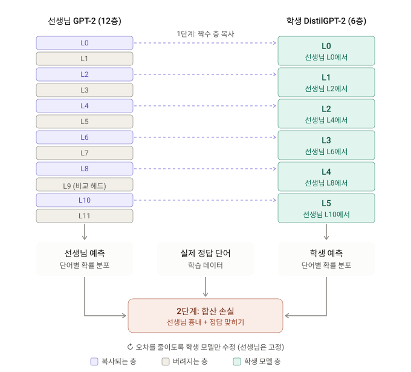
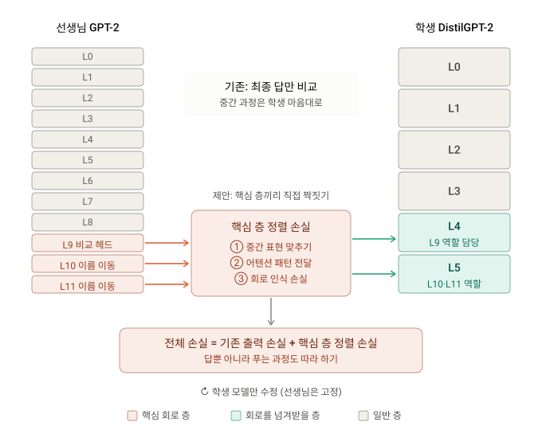

# 0. Summary

- 기본 정보 : ArXiv,2026.10.27, **[What Survives Distillation? A Mechanistic Interpretability Study of GPT-2 and DistilGPT-2](https://arxiv.org/abs/2610.37157)**
- 연구 배경 : 지식 증류(knowledge distillation)는 큰 교사 모델의 소프트 타깃으로 작은 학생 모델을 학습시켜 퍼플렉시티 같은 집계 지표를 보존하면서 모델을 압축한다. 그러나 깊이를 절반으로 줄이는 증류가 모델이 학습한 정밀한 알고리즘, 즉 회로(circuit)에 어떤 영향을 주는지는 거의 규명되지 않았다. GPT-2의 잘 알려진 두 회로인 간접 목적어 식별(Indirect Object Identification, IOI) 회로와 크다 비교(Greater-Than, GT) 회로는 모두 9–11층의 특화된 어텐션 헤드에 의존하는데, 6층짜리 학생 DistilGPT-2에는 그 층이 구조적으로 존재하지 않는다. 그렇다면 학생의 내부 표현은 교사와 비슷하게 남는가(RQ1), 그리고 상위 층 부품 없이도 회로가 보존되는가, 보존된다면 어떻게 보상하는가(RQ2)가 질문이다.
- 제안 방법 : GPT-2(12층)와 DistilGPT-2(6층)를 TinyStories 검증 집합 1,000개 샘플 위에서 비교한다. RQ1에는 편향 보정 선형 CKA, 로짓 렌즈(logit lens), 어텐션 패턴 분해, 고정 참조 기저로서의 사전 학습 GPT-2 SAE 피처 통계를 쓰고, 층 대응은 같은 인덱스(same-index) 방식과 비례(proportional) 방식 두 가지를 둔다. RQ2에는 IOI·GT 과제 각 1,000개 clean/corrupted 프롬프트에 활성 패칭(activation patching), 경로 패칭(path patching), 직접 로짓 귀속(direct logit attribution, DLA), 그리고 교사의 핵심 헤드와 학생 헤드의 어텐션 패턴을 발견 집합(500)·평가 집합(500)으로 대조하는 헤드 매칭을 적용한다.
- 발견 사실 : (1) 비례 대응에서 초기 층 CKA는 0.9998, 후기 층은 0.790이고, 같은 인덱스 대응의 5층 CKA 0.314가 비례 대응에서 0.790으로 회복되므로 학생은 교사의 표현 궤적을 "잘라낸" 것이 아니라 "압축"했다. (2) IOI 회로는 완전히 붕괴한다. 정확도 94.8% → 35.2%, 평균 로짓 차이 $2.942 \to -0.467$ 로 부호가 뒤집히고, 이름 이동(name-mover) 기능 보존율은 모든 매칭에서 0%이다. (3) GT 회로는 살아남는다. 정확도 94.0% → 87.3%, GT 확률 질량 0.855 → 0.750으로 교사 성능의 87.7%를 회복하며, 교사 9층 비교 헤드 L9H1이 학생 4층 L4H1로 재매핑되어 어텐션 패턴 Pearson 상관 평균 0.945(중앙값 0.981)를 보인다. (4) 퍼플렉시티는 TinyStories 11.54 → 17.55(+52.1%), WikiText-2 33.02 → 49.33(+49.4%)로 두 회로 사이의 차이를 전혀 드러내지 않는다.
- 핵심 기여 :
    1. **깊이 증류 모델의 회로 수준 비교 분석** : 교사–학생 쌍을 표현 유사도(CKA, 로짓 렌즈, 어텐션, SAE)와 인과 개입(활성·경로 패칭, DLA)의 두 축으로 체계적으로 비교해 구조적 절단의 기계론적 결과를 정량화했다.
    2. **다단계 회로의 붕괴 입증** : IOI처럼 S-억제 → 이름 이동으로 이어지는 다단계 파이프라인은 후기 층 부품이 제거되면 살아남지 못하며, 그 실패가 단순 성능 저하가 아니라 **부호 반전**이라는 점을 보였다.
    3. **회로의 능동적 재매핑 발견** : GT 회로의 비교 헤드가 학생의 가용 상위 층(4층)으로 이동해 기능을 유지함을 보이고, 이를 "회로 압축 가능성(compressibility)이 생존을 결정한다"는 압축-붕괴 이분법으로 정리했다. 집계 지표만으로는 회로 무결성을 진단할 수 없다는 함의를 제시한다.

# Abstract 쉬운 설명(Claude)

**한 줄 요약:** 큰 AI를 작게 줄이면 시험 점수는 그럭저럭 유지되지만, 머릿속 사고 과정 중 어떤 건 그대로 살아남고 어떤 건 통째로 사라진다는 연구입니다.

---

**1. 배경: AI를 작게 줄이는 기술**

GPT-2 같은 언어 모델은 크고 무거워서 돌리는 데 비용이 많이 듭니다. 그래서 큰 모델(선생님)의 답을 작은 모델(학생)이 따라 하도록 가르치는데, 이걸 **'지식 증류'**라고 합니다.

이 연구의 학생 모델 DistilGPT-2는 선생님 GPT-2보다 층 수가 절반입니다. 12층짜리 건물을 6층으로 줄인 셈이죠.

**2. 연구 질문: 겉은 괜찮아 보여도 속도 괜찮을까?**

작아진 모델도 문장은 꽤 자연스럽게 만들어 냅니다. 하지만 선생님이 쓰던 **'생각하는 방법'까지 제대로 배웠는지**는 따로 확인해야 합니다. 연구진은 AI 내부를 뜯어보는 기법들(일종의 뇌 스캔)로 두 가지 능력을 살펴봤습니다.

**① 누구에게 줬는지 알아맞히기 (IOI)**
> "철수와 영희가 가게에 갔다. 철수가 사탕을 ___에게 줬다."

정답은 '영희'입니다. 이걸 맞히려면 '두 사람 중 주는 사람이 아닌 쪽을 고른다'는 여러 단계의 추론이 필요합니다. 선생님 모델은 이 일을 주로 **위층(9~11층)**에서 처리합니다.

**② 숫자 크기 비교 (GT)**
> "전쟁은 1732년부터 17__년까지 계속됐다."

빈칸에는 32보다 큰 숫자가 와야 합니다. 이 비교 작업도 선생님은 **9층 근처**에서 합니다.

문제는 학생 모델에는 **9층이 아예 없다**는 점입니다.

**3. 결과: 하나는 붕괴, 하나는 생존**

| | 선생님 | 학생 | 결과 |
|---|---|---|---|
| 이름 맞히기 | 94.8% | 35.2% | 😵 완전 붕괴 |
| 숫자 비교 | 94.0% | 87.3% | 😊 거의 유지 |

- **이름 맞히기**는 반반 찍는 것(50%)보다도 못했습니다. 그냥 헷갈린 수준이 아니라 **거꾸로, 일관되게 틀렸습니다.** 주는 사람인 '철수'를 답으로 고르는 경향이 있었죠. 이 일을 담당하던 위층 부품이 없어지자 추론이 중간에 끊긴 것입니다.
- **숫자 비교**는 학생이 똑똑하게 대처했습니다. 선생님이 9층에서 하던 비교 작업을 **자기 4층으로 옮겨서** 거의 똑같은 방식으로 처리했습니다. 내부 작동 패턴의 유사도가 0.945(1이 완전 일치)였습니다.

**4. 왜 이런 차이가 났을까?**

이사에 비유하면 이해가 쉽습니다.

- **숫자 비교**는 짐이 단출해서 작은 집(6층)에도 다 들어갔습니다. 위치만 바뀌었을 뿐 기능은 그대로입니다.
- **이름 맞히기**는 여러 단계가 길게 이어진 복잡한 작업이라 작은 집에 다 들어가지 못했습니다. 핵심 단계가 빠지니 전체가 작동하지 않은 것이죠.

즉 **작은 공간에 압축해 넣을 수 있는 능력은 살아남고, 그렇지 않은 능력은 사라진다**는 것이 핵심 결론입니다.

**5. 왜 중요할까?**

학생 모델은 겉으로는 문장을 잘 만들어서, 일반적인 성적표(전체 점수)만 보면 특정 능력이 망가진 걸 알아채기 어렵습니다. 그래서 연구진은 AI를 작게 만들 때 **평균 점수만 보지 말고 중요한 사고 과정이 제대로 남았는지 직접 확인해야 한다**고 강조합니다.

# 기존 지식 증류 방식

# 제안 방식

논문은 이 방식을 실제로 구현하거나 실험하지 않았습니다. 결론과 부록 A.1에서 앞으로 시도해 볼 방향으로 제안했을 뿐이며, 아래 그림은 그 제안 내용을 정리한 개념도입니다.

핵심은 최종 답만 비교하던 기존 방식에, 중요한 회로가 있는 층끼리 직접 맞추는 손실을 더하는 것입니다.

**제안된 세 가지 도구**

① **중간 표현 맞추기**: 선생님 9층과 학생 4층이 같은 문장을 읽었을 때 내부 상태가 비슷해지도록 학습시킵니다.

② **어텐션 패턴 전달**: 선생님의 핵심 헤드가 문장의 어느 단어에 주목하는지를 학생도 똑같이 따라 하게 합니다. 숫자 비교 회로에서는 학생이 이걸 우연히 해냈는데(r = 0.945), 이를 의도적으로 강제하자는 발상입니다.

③ **회로 인식 손실**: 이름 이동 헤드처럼 이미 밝혀진 회로 부품의 기능 자체가 보존되도록 따로 점수를 매깁니다.

**기대 효과와 한계**

연구진은 이 방식이 이름 맞히기(IOI)처럼 지금은 무너지는 깊은 회로도 살려낼 수 있을 것으로 기대합니다. 다만 아직 검증되지 않은 가설입니다. 무엇보다 단계가 많은 회로를 6층 안에 다 담을 수 있는지가 미지수인데, 연구진도 이를 가장 중요한 후속 과제로 꼽았습니다.

그림에 그린 L9→L4, L10·L11→L5 짝짓기는 이해를 돕기 위한 예시입니다. 논문이 이렇게 구체적으로 짝을 정한 것은 아닙니다.

# 관련 개념

## 지식 증류와 깊이 절반화: GPT-2와 DistilGPT-2

**지식 증류(knowledge distillation)** 는 큰 교사(teacher) 모델이 내는 소프트 타깃(확률 분포)을 작은 학생(student) 모델이 흉내 내도록 학습시키는 압축 기법입니다(Hinton et al., 2015). 학생은 교사의 일반화 능력을 모방하면서 더 작은 구조를 유지합니다. 증류는 검증 퍼플렉시티 같은 집계 지표를 잘 보존하는 경우가 많지만, 심한 구조적 절단이 모델이 배운 **정밀한 알고리즘**에 어떤 영향을 주는지는 열려 있는 문제입니다.

---

### 🏗️ 1. 두 모델의 구조

| 항목 | GPT-2 (교사) | DistilGPT-2 (학생) |
|---|---|---|
| 층 수 | 12 | 6 |
| 임베딩 차원 | 768 | 768 (동일) |
| 어텐션 헤드 | 12 | 12 |
| 파라미터 | 약 117M (본문) / 124M (Table 2) | 약 82M |
| 초기화 | 사전 학습 | 교사의 **한 층 걸러 한 층**에서 초기화 |
| 학습 목적 | 언어 모델링 | 언어 모델링 + 소프트 라벨 증류 목적의 결합 |

학생은 임베딩 차원을 그대로 두고 깊이만 절반으로 줄였습니다(Sanh et al., 2019). 본문은 GPT-2 파라미터를 "~117M"으로, Table 2는 "124M"으로 적고 있어 표기가 일치하지 않습니다.

---

### ⚠️ 2. 왜 깊이 절반화가 문제인가

GPT-2에서 잘 문서화된 고차 추론 행동 다수는 **후기 층 상호작용**에 결정적으로 의존합니다. IOI 회로(Wang et al., 2022)와 GT 회로(Hanna et al., 2023)는 모두 9–11층의 고도로 특화된 어텐션 헤드에 크게 기댑니다. 학생이 6층뿐이므로 이 부품들은 **직접적인 구조적 대응물이 없습니다.** IOI 회로의 6–11층 헤드와 GT 회로의 9–11층 헤드가 모두 여기에 해당합니다.

---

### 🔗 3. 관련 연구의 위치

| 갈래 | 내용 |
|---|---|
| GPT-2 회로 분석 | IOI 회로(이전 토큰·S-억제·유도·이름 이동 헤드의 다단계 파이프라인, 0–11층), GT 회로(연도 인코딩 헤드 → 9–11층 비교 헤드). 활성 패칭(Meng et al., 2022)·경로 패칭(Goldowsky-Dill et al., 2023)이 헤드·경로 수준의 인과 책임을 확립하고, DLA(Elhage et al., 2022)가 비개입적 분해를 보완 |
| 압축과 해석가능성 | 압축이 회로 무결성을 훼손하고 피처 표현을 바꿀 수 있음(Lindner et al., 2023; Bereska & Gavves, 2024). 다만 기존 연구는 주로 가지치기·양자화에 집중. SAE 분석은 표준 지표에 보이지 않는 표현 변화를 드러냄(Malik et al., 2025; Ayonrinde et al., 2024) |
| 증류의 기계론 | Wu et al. (2024), Haskins & Adams (2025), Baek & Tegmark (2025)가 증류의 단순성 편향, 구성요소 재조직, 고유 피처 방향을 보고 |

> **💡 Key Takeaway**
> DistilGPT-2는 교사의 한 층 걸러 한 층으로 초기화된 6층 모델이라, 교사의 9–11층에 사는 회로 부품은 학생에 **자리 자체가 없습니다.** 이 논문은 그 상황에서 표현과 회로가 어떻게 되는지를 묻습니다.

## 두 연구 질문과 두 회로

이 논문은 두 질문을 세웁니다.

* **RQ1** : 깊이 절반화 후 DistilGPT-2의 내부 표현은 GPT-2와 비슷하게 남는가?
* **RQ2** : 증류는 고차 추론을 담당하는 계산 회로를 보존하는가? 보존한다면 학생은 필수 상위 층 부품의 부재를 어떻게 보상하는가?

---

### 🧩 1. 왜 회로 보존이 중요한가

과제 성능이 유지되면 회로 보존이 중요하지 않다고 볼 수도 있습니다. 저자들은 두 가지 이유로 반박합니다.

1. IOI·GT 회로는 어떤 언어 모델에서도 **가장 인과적으로 검증된 하위 그래프**입니다. 독립 연구들에서 활성 패칭·경로 패칭·DLA의 수렴 증거로 확립됐으므로, 임의의 상관적 하위 그래프가 아니라 확인된 계산 메커니즘입니다.
2. 더 중요하게, 이 논문의 IOI 결과는 성능 저하가 아니라 **부호 반전**입니다. DistilGPT-2는 평균 로짓 차이 $-0.467$ 을 내는데, 이는 모델이 불확실한 것이 아니라 **능동적으로 잘못 이끌린다**는 뜻입니다. 이 실패 양상은 집계 지표에는 전혀 보이지 않으며, 바로 그것이 회로 수준 분석의 동기입니다.

---

### 📋 2. IOI 회로 헤드의 가용성 (Table 1)

IOI 회로의 24개 헤드를 기능 분류별로 나누고, 학생(0–5층)에 존재하는지 정리한 표입니다.

| 분류 | GPT-2 헤드 | DistilGPT-2에서 가용 |
|---|---|---|
| 이전 토큰(previous token) | (0,1), (2,2), (4,11) | 3개 모두 |
| 중복 토큰(duplicate token) | (0,10), (3,0) | 2개 모두 |
| 유도(induction) | (5,1), (5,5), (6,9), (7,2), (7,10) | 5개 중 2개 |
| S-억제(S-inhibition) | (7,3), (7,9), (8,6), (8,10) | 없음 |
| 이름 이동(name mover) | (9,6), (9,9), (10,0), (10,6), (11,2) | 없음 |
| 음성 이름 이동(neg. name mover) | (10,7), (11,10) | 없음 |
| 백업 이름 이동(backup name mover) | (9,0), (9,1), (10,2), (10,10), (11,9) | 없음 |

24개 중 **19개(모두 6–11층)** 가 학생에 구조적으로 없습니다. 분석은 0–5층의 7개 헤드와, 양 끝점이 0–5층 안에 있는 3개의 헤드 간 경로로 제한됩니다.

---

### 🔢 3. GT 회로 헤드의 가용성

GT 회로의 6개 헤드 중 학생에 존재하는 것은 **연도 인코딩 헤드 $\{(0,1), (1,5)\}$ 둘뿐**입니다. 9–11층의 비교(comparison) 헤드와 출력 계산 헤드는 모두 없습니다. 0–5층 안에 양 끝점을 둔 헤드 간 경로가 없으므로 GT에는 경로 패칭을 적용할 수 없습니다.

> **💡 Key Takeaway**
> 두 회로 모두 학생에는 "앞부분"만 남아 있습니다. IOI는 24개 중 7개, GT는 6개 중 2개입니다. 그래서 질문은 "남은 앞부분만으로 과제가 되는가, 아니면 학생이 없는 뒷부분을 다른 곳에 다시 만들었는가"가 됩니다.

## 표현 유사도 측정: CKA와 두 가지 층 대응

RQ1의 첫 도구는 **편향 보정 선형 CKA(debiased linear CKA)** 입니다(Kornblith et al., 2019). 직교 변환과 등방 스케일링에 불변인 표현 비교 지표입니다.

---

### 📐 1. CKA의 정의 (Eq. 1)

$H_X = \widehat{\mathrm{HSIC} }(XX^\top, XX^\top)$, $H_Y = \widehat{\mathrm{HSIC} }(YY^\top, YY^\top)$, $H_{XY} = \widehat{\mathrm{HSIC} }(XX^\top, YY^\top)$ 라 할 때

$$\mathrm{CKA}(X, Y) = \frac{H_{XY} }{\sqrt{H_X H_Y} }$$

입니다. $\widehat{\mathrm{HSIC} }$ 는 비편향 Hilbert–Schmidt 독립 기준 추정량(Song et al., 2012)이며, 분산 항은 $10^{-16}$ 으로 클램프합니다.

---

### 🧮 2. 활성의 풀링 (Eq. 2)

잔차 스트림 활성은 패딩이 아닌 위치에 대해 평균 풀링합니다.

$$\mathbf{h}_\ell^{(i)} = \frac{\sum_{t=1}^{T_i} \mathbf{m}_t \odot \mathbf{h}_{\ell,t}^{(i)} }{\sum_{t=1}^{T_i} \mathbf{m}_t}$$

여기서 $\mathbf{m}_t$ 는 패딩 마스크입니다. 이렇게 샘플당 하나의 벡터를 얻어 $X_\ell, Y_\ell \in \mathbb{R}^{n \times 768}$ 을 float64로 만듭니다.

---

### 🔀 3. 두 가지 층 대응 방식

학생과 교사의 어느 층을 짝지을지가 결과를 좌우합니다.

| 방식 | 규칙 | 짝 |
|---|---|---|
| 같은 인덱스(same-index) | 각 모델의 층 $\ell$ 끼리, $\ell \in \{0, 3, 5\}$ | (G0/D0), (G3/D3), (G5/D5) |
| 비례(proportional) | 학생 층 $d$ 를 교사 층 $g = \lfloor d \cdot 11/5 \rceil$ 에 | (G0/D0), (G2/D1), (G4/D2), (G7/D3), (G9/D4), (G11/D5) |

같은 인덱스 방식은 "학생의 5층이 교사의 5층과 같은가"를, 비례 방식은 "학생의 5층이 교사의 11층과 같은가"를 묻습니다. 둘의 차이 자체가 학생이 교사를 **잘라냈는지, 압축했는지**를 알려 줍니다.

---

### 🧪 4. 공통 실험 설정

| 항목 | 값 |
|---|---|
| 데이터 | TinyStories 검증 집합(Li & Eldan, 2023), $n = 1{,}000$ |
| 길이 필터 | $[64, 256]$ 토큰 |
| 도구 | TransformerLens(Nanda & Bloom, 2022) |
| 하드웨어 | NVIDIA L4 GPU 1장 |
| 시드 | $\{42, 123, 7\}$ (CKA 표는 시드 평균) |

> **💡 Key Takeaway**
> CKA 값 하나보다 **두 대응 방식의 차이**가 핵심 정보입니다. 같은 인덱스에서 낮고 비례에서 높다면, 학생의 후기 층은 교사의 같은 번호 층이 아니라 교사의 최종 층을 닮은 것입니다.

## 로짓 렌즈, 어텐션 패턴, SAE 참조 기저

RQ1의 나머지 세 도구입니다.

---

### 🔭 1. 튜닝된 로짓 렌즈 (Eq. 3)

중간 은닉 상태를 최종 레이어 노름과 언임베딩 행렬로 투영해 그 층에서 다음 토큰을 얼마나 맞히는지 봅니다(nostalgebraist, 2020; Belrose et al., 2023).

$$\hat{p}_{\ell,t}^{(i)} = \mathrm{softmax}\!\left(W_U \, \mathrm{LN}_f\!\left(\mathbf{h}_{\ell,t}^{(i)}\right)\right)$$

각 층의 다음 토큰 예측 정확도 $\mathrm{Acc}_\ell$ 과 **상대 정확도** $r_\ell = \mathrm{Acc}_\ell^{\text{distil} } / \mathrm{Acc}_\ell^{\text{GPT-2} }$ 를 두 대응 방식 모두에서 계산합니다. $r_\ell > 1$ 이면 짝지어진 층에서 학생이 교사보다 "더 일찍 답을 안다"는 뜻입니다.

---

### 👀 2. 어텐션 패턴의 세 지표군

TransformerLens 훅으로 헤드별 어텐션 패턴을 추출해 세 가지를 잽니다.

| 지표군 | 내용 | 목적 |
|---|---|---|
| Shannon 엔트로피 $H_{l,h}$, top-$k$ 어텐션 질량 | 헤드가 얼마나 집중/분산되는지 | 헤드 붕괴(collapse) 정량화 |
| 평균 BOS·이전 토큰·EOS 가중치 | 구조적 헤드 유형 특성화(Elhage et al., 2021) | 헤드 역할 분류 |
| 샘플별 코사인 유사도, 엔트로피 변화 | 짝지어진 층 쌍에서 평탄화한 $T \times T$ 어텐션 행렬 간 코사인, $\Delta H_{l,h} = H_{d,h}^{\mathrm{distil} } - H_{l,h}^{\mathrm{GPT2} }$ | 교차 모델 헤드 대응 |

---

### 🧱 3. SAE를 고정 참조 기저로 쓰기

사전 학습된 GPT-2 SAE(gpt2-small-res-jb; Conmy et al., 2023; Bloom et al., 2024)를 **두 모델 모두의** 짝지어진 층 활성에 적용합니다. 학생용 SAE를 따로 학습하지 않고 교사의 피처 사전을 고정 기준으로 삼아, 학생의 표현이 교사와 **같은 희소 피처 부분공간**에 놓이는지를 시험합니다. 네 지표를 계산합니다.

| 지표 | 정의 |
|---|---|
| 활성화율 $r_f$ | 피처 $f$ 가 켜지는 비율 |
| L0 희소성 $\bar{L}_0$ 와 변화 $\Delta L_0$ | 토큰당 활성 피처 수와 그 차이 |
| 피처 생존(feature survival) | 피처별 교사–학생 활성의 Pearson 상관(표준편차 $10^{-8}$ 미만 제외) |
| 크기 드리프트 $\delta_f$ | $\bar{z}_f^{\mathrm{distil} } / (\bar{z}_f^{\mathrm{GPT2} } + \varepsilon)$ |

모든 SAE 통계는 64개 활성 벡터 미니배치에 대한 **단일 스트리밍 패스**로 계산해, 전체 희소 피처 행렬 $Z \in \mathbb{R}^{N_{\text{tok} } \times d_{\text{SAE} } }$ 를 메모리에 올리지 않습니다. Pearson 상관은 $z_f$, $z_f^2$, $z_f^{\text{GPT-2} } \cdot z_f^{\text{distil} }$ 의 누적합으로 온라인 계산하고, 활성은 디스크에 저장한 뒤 SAE를 배치 단위로만 GPU에 올립니다(Appendix A.2).

> **💡 Key Takeaway**
> 교사 SAE를 학생에 그대로 쓰는 설계는 "학생 피처가 교사 피처 공간에 있는가"를 직접 묻는 대신, **학생에만 있는 피처는 보지 못하는** 맹점을 갖습니다. 저자들도 이를 한계로 명시합니다.

## 회로 분석 방법: 패칭, DLA, 헤드 매칭

RQ2는 두 과제에서 인과 개입으로 답합니다.

---

### 🧪 1. IOI 과제와 지표

프롬프트는 "[Name1] and [Name2] went to the [place]. [Name] gave a [object] to" 형태로, 15개 구문 템플릿에서 clean 1,000개와 corrupted(ABC) 1,000개를 만듭니다. 주 지표는 **로짓 차이**

$$\Delta(x) = \ell_{\mathrm{IO} }(x, t^*) - \ell_{\mathrm{S} }(x, t^*)$$

로, 예측 위치 $t^*$ 에서 간접 목적어(IO) 로짓에서 주어(S) 로짓을 뺀 값입니다. 양수면 올바른 이름을 선호합니다.

---

### 🔢 2. GT 과제와 지표

프롬프트는 "The [noun] lasted from the year [XX][YY] to the year [XX]" 형태이며 clean·corrupted 각 1,000개입니다. 주 지표는 **GT 확률 질량**

$$\mathrm{GTProb}(x, t^*) = \sum_{yy > YY} p(\texttt{yy} \mid x, t^*)$$

로, 시작 연도의 끝 두 자리 $YY$ 보다 큰 모든 두 자리 토큰에 모델이 주는 확률의 합입니다. 패칭 점수는 잡음 천장으로 정규화합니다.

$$\hat{s}_{l,h} = \frac{s_{l,h} }{\mathrm{GTProb}_{\mathrm{clean} } - \mathrm{GTProb}_{\mathrm{corrupt} } }$$

---

### 🔧 3. 활성 패칭과 경로 패칭

| 기법 | 절차 | 적용 |
|---|---|---|
| 활성 패칭 | corrupted 실행에서 특정 헤드의 출력을 clean 실행의 활성으로 치환하고 지표 회복량을 잼(Meng et al., 2022; Wang et al., 2022) | IOI 7개 헤드, GT 2개 헤드 |
| 경로 패칭 | clean–corrupt 차이를 수신 헤드의 잔차 스트림에 주입(Goldowsky-Dill et al., 2023) | IOI 3개 경로(양 끝점이 0–5층), GT 불가 |

유의성은 쌍체 $t$ 검정과 Wilcoxon 검정(Bonferroni 보정)으로, 효과 크기는 Cohen's $d$ 로 보고합니다.

---

### 📊 4. 직접 로짓 귀속 (DLA)

잔차 스트림은 각 헤드와 MLP의 가산적 기여의 누적합이므로, 각 구성요소의 출력 $\mathbf{v}^{l,h}$ 를 최종 레이어 노름과 언임베딩으로 투영해 지표에 대한 기여를 직접 읽을 수 있습니다.

* IOI : $\delta^{l,h}_{\mathrm{IOI} } = (\mathbf{W}_U \mathrm{LN}_f(\mathbf{v}^{l,h}))_{\mathrm{IO} } - (\mathbf{W}_U \mathrm{LN}_f(\mathbf{v}^{l,h}))_{\mathrm{S} }$
* GT : $\delta^{l,h}_{\mathrm{GT} } = \sum_{yy > YY} \mathrm{softmax}(\mathbf{W}_U \mathrm{LN}_f(v^{l,h}))_{yy}$

캐시된 헤드 출력에 대해 단일 einsum으로 계산합니다.

---

### 🔍 5. 헤드 매칭: 발견 집합과 평가 집합

교사의 핵심 헤드 역할을 학생의 어떤 헤드가 맡았는지 찾는 절차입니다.

1. 학생의 구성요소를 DLA 기준 상위 20개로 추립니다.
2. 교사 핵심 헤드(IOI는 이름 이동 헤드 5개, GT는 비교 헤드 (9,1))의 어텐션 패턴과 학생 후보의 어텐션 패턴 사이에 CKA와 Pearson 상관을 **발견 집합(500 프롬프트)** 에서 계산합니다.
3. **평가 집합(500 프롬프트)** 에서 확인합니다.

IOI에는 추가로 **이름 이동 점수(name-mover score)**

$$\mathrm{NM}(l,h) = \mathbb{E}\!\left[\sum_{i \in \mathrm{IO} } \alpha^{l,h}_{t^*,i} - \sum_{j \in \mathrm{S} } \alpha^{l,h}_{t^*,j}\right]$$

를 둡니다. 예측 위치에서 IO 토큰에 주는 어텐션에서 S 토큰에 주는 어텐션을 뺀 것으로, IO 선택적 어텐션을 정량화합니다. 어텐션 패턴이 비슷하다는 것과 **IO를 골라 본다**는 것은 다르므로 이 점수가 필요합니다.

> **💡 Key Takeaway**
> 회로 분석은 세 층위로 이뤄집니다. DLA는 "어느 부품이 답에 기여하는가", 패칭은 "그 부품이 인과적으로 필요한가", 헤드 매칭은 "교사의 부품 역할을 학생의 어느 부품이 넘겨받았는가"입니다. 세 번째가 이 논문의 차별점입니다.

## 결과 1: 퍼플렉시티는 회로 붕괴를 보여주지 않는다

먼저 집계 지표를 확인합니다.

---

### 📋 1. 퍼플렉시티 (Table 2)

| 모델 | 층 | 파라미터 | PPL (TinyStories) | PPL (WikiText-2) |
|---|---|---|---|---|
| GPT-2 | 12 | 124M | 11.54 | 33.02 |
| DistilGPT-2 | 6 | 82M | 17.55 (+52.1%) | 49.33 (+49.4%) |

---

### 🔍 2. 읽기

퍼플렉시티 격차($\Delta = 6.01$ TinyStories, $\Delta = 16.31$ WikiText-2)는 절대값으로는 상당하지만, 기계론적 실패를 가리키지는 않습니다. 학생은 **퍼플렉시티가 52% 높으면서도 GT 회로 성능의 87.7%를 유지**하고, **IOI 회로를 완전히 잃고도 유창한 텍스트를 생성**합니다. 같은 퍼플렉시티 수치 아래에서 한 회로는 살고 한 회로는 죽었으므로, 퍼플렉시티는 회로 무결성의 진단 지표로 불충분합니다.

> **💡 Key Takeaway**
> 두 회로의 운명이 정반대인데 퍼플렉시티는 한 숫자입니다. 이 논문의 중심 주장은 이 표 하나로 요약됩니다.

## 결과 2: CKA, 잘라내기가 아니라 압축

---

### 📊 1. 깊이 분위별 CKA·코사인 (Table 7, 시드 {42, 123, 7} 평균)

| 대응 | 깊이 | CKA | 코사인 | CKA 범위 | 코사인 범위 |
|---|---|---|---|---|---|
| 비례 | 초기 | 0.9998 | 0.9977 | – | – |
| | 중간 | 0.9668 | 0.9749 | – | – |
| | 후기 | 0.7903 | 0.9690 | – | – |
| | 전체 | $0.921 \pm 0.109$ | $0.977 \pm 0.019$ | [0.662, 1.000] | [0.939, 0.999] |
| 같은 인덱스 | 초기 | 0.9998 | 0.9977 | – | – |
| | 중간 | 0.9082 | 0.9304 | – | – |
| | 후기 | 0.3138 | 0.3851 | – | – |
| | 전체 | $0.752 \pm 0.298$ | $0.784 \pm 0.310$ | [0.165, 1.000] | [0.057, 0.998] |

---

### 🔍 2. 읽기

* **비례 대응** : 유사도가 깊이에 따라 단조 감소합니다. 초기 층은 거의 완벽히 정렬되고(CKA 0.9998), 중간 층은 강한 유사도를 유지하며(0.967), 후기 층은 0.790으로 떨어집니다.
* **같은 인덱스 대응** : 후기 층 열화가 심합니다(5층에서 CKA 0.314, 코사인 0.385).
* **두 방식의 대조** : 5층의 같은 인덱스 붕괴(0.314)가 비례 대응에서 0.790으로 상당히 회복됩니다. 즉 학생의 마지막 층은 교사의 5층보다 교사의 11층에 더 가깝습니다. 학생은 교사의 표현 궤적을 **더 적은 단계로 압축**한 것이지 중간에서 **잘라낸** 것이 아닙니다.

초기 층이 거의 동일한 것은 한 층 걸러 한 층 초기화와 일치합니다. 코사인 유사도는 전 구간에서 CKA와 같은 방향을 보입니다.

> **💡 Key Takeaway**
> 같은 인덱스 0.314 → 비례 0.790. 이 한 쌍의 숫자가 "학생은 교사의 6층짜리 앞부분이 아니라, 12층 전체를 6단계로 접은 것"이라는 결론을 줍니다.

## 결과 3: 로짓 렌즈와 어텐션 패턴

---

### 📋 1. 로짓 렌즈 상대 정확도 (Table 3, 비례 대응)

| 쌍 | GPT-2 $\ell$ | Distil $\ell$ | $\Delta$Acc | $r_\ell$ |
|---|---|---|---|---|
| D0/G0 | 0 | 0 | $-0.005$ | 1.13 |
| D1/G2 | 2 | 1 | $-0.039$ | 2.10 |
| D2/G4 | 4 | 2 | $-0.021$ | 1.32 |
| D3/G6 | 6 | 3 | $-0.030$ | 1.28 |
| D4/G8 | 8 | 4 | $-0.068$ | 1.35 |
| D5/G11 | 11 | 5 | $+0.006$ | 0.97 |

비례 대응에서 학생은 **마지막 쌍을 제외한 모든 층**에서 짝지어진 교사 층보다 높은 상대 정확도를 보이며, $r$ 은 0.97(D5/G11)에서 2.10(D1/G2)까지입니다. 같은 인덱스 대응에서는 그림이 뒤집혀 학생이 모든 층에서 뒤지고, 4층에서 $r$ 이 3.95까지 벌어집니다. 이는 교사의 상위 층이 얼마나 많은 표현 작업을 하는지를 반영합니다.

Table 3의 쌍 열은 D3/G6, D4/G8로 적혀 있으나 §4.1의 비례 규칙 $g = \lfloor d \cdot 11/5 \rceil$ 은 (G7/D3), (G9/D4)를 줍니다. 본문은 이 차이를 설명하지 않으며, Table 9의 SAE 쌍도 G1/D0, G6/D3로 §4.1의 규칙과 다릅니다.

---

### 📊 2. 어텐션 패턴 요약 (Table 8, 1,000 샘플)

| 지표 | GPT-2 | DistilGPT-2 |
|---|---|---|
| 평균 엔트로피 (bits) | 2.001 | 2.094 |
| 유효 지지 (토큰) | 11.19 | 12.14 |
| 평균 top-1 질량 | 0.507 | 0.493 |

| 교차 모델 헤드 유사도 | 비례 대응 | 같은 인덱스 대응 |
|---|---|---|
| 평균 코사인 유사도 | $0.894 \pm 0.086$ [0.610, 0.993] | $0.631 \pm 0.255$ [0.038, 0.981] |
| 평균 $\Delta H$ (bits) | $-0.007 \pm 0.621$ | $-0.059 \pm 1.103$ |

---

### 🔍 3. 읽기

* 두 모델의 엔트로피 프로파일은 대체로 비슷하고, 학생 헤드가 교사보다 **아주 약간 더 분산**되어 있습니다(2.094 vs 2.001 bits).
* **이전 토큰 어텐션이 1층에서 갈라집니다.** 학생 약 0.36 vs 교사 약 0.24로, 학생이 국소 토큰 복사를 초기 층에 **앞당겨 싣는다**는 것을 시사합니다.
* 비례 대응의 헤드별 코사인 유사도 0.894는 같은 인덱스의 0.631보다 훨씬 높습니다. 같은 인덱스 쌍은 처음 몇 층을 지나면 잘 맞지 않는다는 CKA 결과와 일치합니다.

> **💡 Key Takeaway**
> 로짓 렌즈의 $r > 1$ 과 이전 토큰 어텐션의 1층 집중은 같은 이야기를 합니다. 학생은 교사가 여러 층에 걸쳐 하던 일을 **더 앞쪽 층에서** 해치웁니다.

## 결과 4: SAE 피처 생존

---

### 📋 1. 층 쌍별 SAE 요약 (Table 9)

| 대응 | 쌍 | 코사인 유사도 | 피처 생존 | $\Delta L_0$ |
|---|---|---|---|---|
| 같은 인덱스 | L0 | 0.989 | 0.339 | $-2{,}379$ |
| | L3 | 0.887 | 0.169 | $-1{,}493$ |
| | L5 | 0.655 | 0.086 | $-7{,}178$ |
| 비례 | G1/D0 | 0.184 | 0.000 | $-132$ |
| | G6/D3 | 0.927 | 0.527 | $-68$ |
| | G11/D5 | 0.927 | 0.529 | $-601$ |

---

### 🔍 2. 읽기

* **같은 인덱스** : 피처 생존과 코사인 유사도가 깊이에 따라 급격히 떨어집니다. 5층에서 생존 0.086이고, 재구성 오차는 교사의 **34.9배**입니다.
* **비례** : 초기 쌍(G1/D0)은 생존이 거의 0(본문 0.0002)입니다. 저자들은 이를 대응 방식의 인공물이 아니라 **그 특정 층 쌍 안에서의 피처 발산**으로 해석합니다. 중간·후기 쌍은 생존 약 0.53, 코사인 0.927로 회복되고, 크기 드리프트는 $\delta \approx 0.51$–$0.55$ 입니다.

크기 드리프트 0.5 안팎은 살아남은 피처도 학생에서 **절반 정도의 크기로** 켜진다는 뜻입니다. $\Delta L_0$ 가 모두 음수이므로 학생은 교사 SAE 기준으로 토큰당 더 적은 피처를 켭니다.

> **💡 Key Takeaway**
> 교사의 피처 사전으로 본 학생은 중간·후기에서 절반 정도의 피처만 보존하고, 그것도 절반 크기로 씁니다. 다만 이 수치는 **학생 고유 피처를 셀 수 없는** 측정이라는 점을 함께 읽어야 합니다.

## 결과 5: IOI 회로의 완전한 붕괴

---

### 📉 1. 과제 성능과 부호 반전

| 모델 | 평균 로짓 차이 | 정확도 |
|---|---|---|
| GPT-2 | $2.942 \pm 1.797$ | 94.8% |
| DistilGPT-2 | $-0.467 \pm 1.335$ | 35.2% |

학생의 35.2%는 두 이름 선택의 우연 수준 50%보다 **낮습니다**(단측 이항 검정, $n = 1{,}000$, $p < 0.001$). 즉 학생은 찍는 것이 아니라 **체계적으로 틀립니다.** 음의 로짓 차이는 모델이 간접 목적어 대신 주어 이름을 능동적으로 선호한다는 뜻이며, 성능 격차가 아니라 부호 반전입니다. 저자들은 검증하지 않은 한 가지 설명으로 **반복 이름 휴리스틱**을 제시합니다. IOI 프롬프트에서 주어는 두 번, 간접 목적어는 한 번 나오므로, 자주 본 이름을 선호하는 모델은 정확히 이 부호를 냅니다.

---

### 📊 2. DLA와 활성 패칭

* **DLA** : 어떤 구성요소도 의미 있는 양의 귀속을 내지 않습니다. 학생의 최대 층 기여는 0.0168로 교사의 9층 2.74보다 약 **160배** 작고, 모든 IOI 회로 분류가 거의 0을 기록합니다(Figure 3).
* **활성 패칭** : 가용 7개 헤드(이전 토큰 3, 중복 토큰 2, 유도 2)를 패칭해도 회복은 무시할 수준입니다. 유도 헤드는 작은 효과를 보이지만(Cohen's $d = 0.298$, $p < 0.001$), 핵심인 **이전 토큰 → 유도 경로는 유의하지 않습니다**($d = 0.031$, $p = 0.329$).

---

### 🔍 3. 이름 이동 헤드 매칭 (Table 4)

| GPT-2 | Distil | 발견 CKA | 평가 CKA | 발견 $r$ | 평가 $r$ | NM 보존율 |
|---|---|---|---|---|---|---|
| L9H6 | L0H1 | 0.4659 | 0.4592 | $-0.1535$ | $-0.1514$ | 0.0% |
| L9H9 | L0H1 | 0.3209 | 0.3261 | $-0.1391$ | $-0.1378$ | 0.0% |
| L10H0 | L1H6 | 0.5077 | 0.5150 | 0.4597 | 0.4417 | $-14.6$% |
| L10H6 | L1H6 | 0.3629 | 0.3926 | 0.6507 | 0.6484 | $-21.3$% |
| L11H2 | L1H6 | 0.2073 | 0.1784 | 0.7802 | 0.7781 | nan |

학생 후보의 CKA는 0.18–0.52이고, 어텐션 패턴 상관은 9층 헤드에 대해 약하게 음($r \approx -0.15$)에서 10·11층 헤드에 대해 강하게 양($r \approx 0.44$–$0.78$)까지 분포합니다. 그러나 **어떤 매칭 헤드도 IO 선택적 어텐션을 재현하지 못합니다.** 이름 이동 점수 보존율은 모든 매칭에서 최대 0%이며 일부는 음수입니다. 패턴 유사도만으로는 이름 이동 기능이 재매핑됐다고 볼 수 없습니다. 발견 집합과 평가 집합의 값이 거의 같아 매칭 결과 자체는 안정적입니다.

> **💡 Key Takeaway**
> L11H2와 L1H6의 어텐션 상관이 0.78이라도 이름 이동 점수는 0%입니다. "비슷한 곳을 본다"와 "맞는 이름을 골라 본다"는 다르며, 후자가 없으면 IOI 파이프라인은 완성되지 않습니다. 유도 헤드까지는 살아 있지만 그 뒤가 없습니다.

## 결과 6: GT 회로의 생존과 4층으로의 재매핑

---

### 📈 1. 과제 성능

| 모델 | 정확도 | GT 확률 질량 |
|---|---|---|
| GPT-2 | 94.0% | 0.855 |
| DistilGPT-2 | 87.3% | 0.750 |

학생은 교사 성능의 **87.7%** 를 회복합니다.

---

### 🔄 2. DLA가 보여주는 회로 이동

| 모델 | DLA 최대 기여 위치 |
|---|---|
| GPT-2 | 9층 (L9H1, L9MLP, L10MLP) |
| DistilGPT-2 | 4층 (L4MLP, L4H1, L5MLP) |

교사의 9층 비교 헤드 L9H1에 대응하는 학생 헤드는 **L4H1**이며, 전체 어텐션 패턴의 Pearson 상관은 평균 $r = 0.945 \pm 0.079$, 중앙값 0.981입니다. 학생은 교사의 비교 메커니즘을 자기 얕은 스택의 **기능적으로 유사한 위치**에 심어 두었습니다.

---

### 📋 3. YY 토큰 어텐션 (Table 5, 대표 5예)

| 연도 | YY | GPT-2 L9H1 | Distil L4H1 |
|---|---|---|---|
| 1102 | 02 | 0.099 | 0.156 |
| 1503 | 03 | 0.239 | 0.175 |
| 1804 | 04 | 0.870 | 0.871 |
| 1505 | 05 | 0.085 | 0.233 |
| 1006 | 06 | 0.082 | 0.091 |

| 통계 ($n = 1{,}000$) | 값 |
|---|---|
| 평균 Pearson $r$ (전체 어텐션 패턴) | $0.945 \pm 0.079$ |
| 중앙값 Pearson $r$ | 0.981 |
| $r > 0.8$ 비율 | 93.6% |

두 헤드는 5개 예시 모두에서 YY 토큰에 일관되게 주의를 줍니다(검출률 100%). 전체 패턴 상관 0.945는 학생의 L4H1이 교사의 L9H1을 집계 통계가 아니라 **개별 어텐션 가중치 수준에서** 복제한다는 것을 확인합니다.

---

### 🧪 4. 헤드 수준 활성 패칭 (Table 6, 잡음 천장 0.547)

| 헤드 | 분류 | 원점수 GPT-2 | 원점수 Distil | 정규화 GPT-2 | 정규화 Distil | 유의 |
|---|---|---|---|---|---|---|
| L0H1 | 연도 인코딩 | 0.332 | 0.283 | 0.606 | 0.517 | ✓ |
| L1H5 | 연도 인코딩 | 0.305 | 0.255 | 0.557 | 0.465 | ✓ |
| 전체 (Cohen's $d$) | | | | $d = 0.681$, $p < 0.0001$ | | ✓ |

두 연도 인코딩 헤드는 학생에서도 강하고 유의한 인과 기여를 보이며(정규화 0.517, 0.465), 교사(0.606, 0.557)와 견줄 만합니다. 효과 크기는 큽니다($d = 0.681$). 초기 단계 GT 계산이 학생에서 인과적으로 보존됩니다. 0–5층 안에 양 끝점을 둔 헤드 간 경로가 없어 경로 패칭은 수행하지 않았습니다.

> **💡 Key Takeaway**
> IOI와 달리 GT는 "앞부분(연도 인코딩)이 살아 있고 + 뒷부분(비교 헤드)이 4층에 다시 생겼다"는 두 증거가 모두 있습니다. 다만 둘 사이의 인과 경로는 검증되지 않았고, 저자들도 이를 한계로 적습니다.

## 압축-붕괴 이분법과 한계

---

### ⚖️ 1. RQ1의 세 가지 일관된 패턴

| 패턴 | 증거 |
|---|---|
| 초기 층은 거의 동일, 후기 층은 발산 | 첫 층 쌍의 CKA·헤드 코사인 모두 1.0 근처(한 층 걸러 초기화와 일치). 같은 인덱스 CKA는 5층에서 0.314, SAE 생존 0.086, 재구성 오차 34.9배 |
| 학생은 잘라내지 않고 압축한다 | 같은 인덱스 5층 붕괴가 비례 대응에서 회복. 로짓 렌즈 상대 정확도가 마지막 층 빼고 모두 1 초과. 기능적 SAE 생존이 중간·후기 쌍에서 약 0.53으로 회복 |
| 로짓 렌즈도 같은 추세 | 같은 인덱스로 짝지은 표현은 깊이가 깊어질수록 다음 토큰 예측력이 뚜렷이 떨어짐 |

---

### 🧩 2. RQ2의 답: 압축 가능성이 생존을 결정한다

**증류는 핵심 계산이 학생의 가용 깊이 안에 들어가는 회로는 보존하고, 파이프라인이 그 너머로 뻗는 회로는 파괴합니다.**

| | IOI | GT |
|---|---|---|
| 결과 | 완전 붕괴 | 능동적 재매핑으로 생존 |
| 성능 | 94.8% → 35.2%, 로짓 차이 부호 반전 | 94.0% → 87.3%, 87.7% 회복 |
| DLA | 양의 귀속 없음(최대 0.0168 vs 2.74) | 최대 기여가 9층에서 4층으로 이동 |
| 패칭 | 가용 헤드 패칭 회복 무시 수준, PT→IND 경로 비유의 | 연도 인코딩 헤드 유의($d = 0.681$) |
| 헤드 매칭 | CKA 중간, 일부 상관 높음, 그러나 NM 보존 0% | L4H1 ↔ L9H1 $r = 0.945$ |
| 해석 | 유도 헤드는 작게 살아 있으나 하류 이름 이동 헤드가 없어 파이프라인이 완성되지 않음 | 비교 헤드가 학생의 가용 상위 층에 다시 생김 |

이 이분법은 **회로 압축 가능성(circuit compressibility)** 설명과 일치합니다. 결과는 우아한 열화(graceful degradation)가 아니라 **구조적 불완전(structural incompleteness)** 입니다. 압축 가능성을 일반 원리로 확인하려면 중간 깊이 회로를 추가 모델 쌍에서 시험해야 하며, 저자들은 이를 가장 중요한 후속 과제로 꼽습니다.

---

### 📜 3. 저자가 밝힌 한계

| 한계 | 내용 |
|---|---|
| 범위 | 두 회로, 한 교사–학생 쌍. 다른 회로·증류 방법·모델 계열로 일반화되는지는 열려 있음 |
| IOI 널 결과 | 학생이 **대안 메커니즘**으로 과제의 잔여 버전을 푸는 가능성은 배제 못 함. 인과 스크러빙(Chan et al., 2022)이나 자동 회로 발견(Conmy et al., 2023)으로 탐색 가능 |
| SAE 참조 기저 | 사전 학습 GPT-2 SAE를 고정 기준으로 쓰면 **학생 전용 피처**에 체계적 맹점이 생김. 학생 전용 SAE 학습이 해결책 |
| GT 생존의 불완전 검증 | 핵심 헤드 매칭(L4H1 ↔ L9H1) 너머의 전체 회로, 즉 연도 인코딩 헤드 $\{(0,1), (1,5)\}$ 에서 비교를 거쳐 출력 계산까지의 인과 경로를 활성·경로 패칭으로 검증해야 함 |

Appendix A.1은 증류 과정 자체에 개입하지 않았다는 점도 짚습니다. 중간 층 매칭, 어텐션 전이, 회로 인식 증류 손실 같은 대안 목적이 깊이 축소 중 회로 무결성을 보존할 수 있는지는 열린 질문이며, GT 결과는 표준 증류도 학생 깊이와 구조적으로 호환되는 회로를 **우연히** 보존할 수 있음을 시사하므로, 표적화된 목적이면 IOI 같은 더 깊은 회로로 확장할 수 있을지 모릅니다.

---

### 🔍 4. 읽을 때 유의할 점

* **표기 불일치** : GPT-2 파라미터가 본문 ~117M, Table 2 124M으로 다르고, 비례 대응 쌍이 §4.1(G7/D3, G9/D4)과 Table 3(G6/D3, G8/D4), Table 9(G1/D0, G6/D3)에서 서로 다릅니다.
* **GT 생존의 증거 수준** : 재매핑 주장의 핵심 증거는 **어텐션 패턴 상관**과 DLA 위치 이동입니다. L4H1을 패칭했을 때의 인과 효과는 보고되지 않았습니다(패칭은 연도 인코딩 헤드 2개에만 수행).
* **단일 데이터셋** : 표현 분석은 TinyStories 1,000 샘플입니다. 퍼플렉시티만 WikiText-2에서도 보고됩니다.
* **결론의 실천적 함의** : 저자들은 실무자가 회로 무결성을 직접 평가하고, 기능적으로 중요한 층에서 중간 표현을 정렬하는 증류 목적을 쓸 것을 권합니다.

> **💡 Key Takeaway**
> 이 논문의 견고한 부분은 "같은 퍼플렉시티 아래에서 한 회로는 부호 반전으로 죽고 한 회로는 다른 층으로 옮겨 산다"는 대조입니다. GT 재매핑은 어텐션 상관과 DLA 위치로 뒷받침되지만 L4H1 자체의 인과 검증은 없으므로, "생존"은 "재매핑 후보 발견"으로 읽는 것이 안전합니다.
