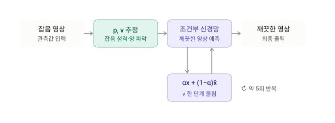

# 0. Summary

- 기본 정보 : ArXiv,2026.10.27, **[The Noise Plane: A Diffusion Bridge Across Exponent and Dispersion](https://arxiv.org/abs/2610.37576)**
- 연구 배경 : 확산 기반 잡음 제거(diffusion denoising)는 대부분 가우시안 섭동을 가정하지만, 실제 센서 잡음은 신호 의존적(signal-dependent)이고 그 통계 법칙이 센서마다 다르다. 광자 계수(photon counting)는 Poisson형 변동을, 코히런트 영상(SAR)은 곱셈형 스페클(Gamma)을 만든다. 따라서 "잡음 수준" 하나로는 열화를 기술할 수 없고, 분산이 강도에 어떻게 의존하는지(variance–intensity relation)까지 지정해야 한다. 기존 비가우시안 확산(Xie et al.), 룩 수(number of looks)로 궤적을 색인하는 Gamma Bridge 등은 특정 잡음 법칙이나 이산적 족(family)만 다뤘다.
- 제안 방법 : **$p$-Bridge** 는 Tweedie 족의 멱 분산 함수 $V(\mu)=\mu^{p}$ 를 이용해 Gaussian($p=0$), Poisson($p=1$), 복합 Poisson–Gamma($1<p<2$), Gamma($p=2$) 를 하나의 **측정 색인(measurement-indexed) 확산 브리지** 로 통합한다. 지수 $p$ 는 잡음 법칙을, 누적 측정량 $\nu$(노출·선량·룩 수)는 잡음 수준을 정하며, 둘이 "잡음 평면(noise plane)"을 이룬다. 같은 장면의 독립 측정을 더하면 분포가 같은 족에 남는다는 닫힘성(Eq. 5)으로 중첩 결합(superposition coupling)을 만들고, 그 조건부 평균에서 $p$ 와 무관한 혼합 계수 $\alpha_{t}=\nu(t)/\nu(t-1)$ 를 갖는 공통 역방향 갱신(Eq. 8)을 유도한다. 단위 편차(unit deviance)를 복원 손실로 써서 네트워크가 조건부 평균을 예측하게 하고(Theorem 3), 중간 지수에서는 잠재 복합 Poisson–Gamma 구성으로 희석(thinning) 샘플링을 한다. 지수 임베딩으로 조건화된 단일 네트워크가 $p\in[1,2]$ 전체를 담당하며, 추론 시에는 잡음 영상에서 $(\hat{p},\hat{\nu})$ 를 직접 추정한다.
- 발견 사실 : 고정 지수 모델은 지수가 맞지 않으면 크게 손해를 본다. 심한 잡음에서 Gamma 학습 모델을 Poisson 데이터에 쓰면 PSNR 이 4.40 dB 떨어지고 역방향 불일치는 약 3.3 dB 손해다. 고정 모델 중 최악 사례 PSNR 을 최대화하는 지수는 심함·보통에서 $p=1.5$, 약함에서 $p=1.75$ 로 단일 최적은 없다. 추정 지수를 쓰는 조건부 네트워크는 최선 고정 모델보다 0.921/1.525/1.099 dB 높고, 오라클이 고른 5개 전문가 모델(envelope)과의 최소 PSNR 차이는 최대 0.006 dB 다. 합성 영상에서는 9개 설정 중 PSNR 8개·SSIM 9개에서 외부 기준선을 앞서고, FMD 에서는 평균 SSIM 1위(0.912)·PSNR 2위(31.76 dB), 실제 SAR 에서는 평균 $\mathcal{M}/\mathrm{RIS}$ 19.4/35.3 으로 1위다. 지수 추정 오차가 0.25 이내면 조건화 이득의 대부분이 유지되며 실제 추정 최악 오차는 0.0914 다.
- 핵심 기여 :
    1. **Tweedie 잡음을 위한 통합 측정 색인 브리지** : 지수 $p$(분산–강도 관계)와 누적 측정량 $\nu$(잡음 수준)의 역할을 분리하고, 시작·종료 측정 수준을 모두 지정할 수 있는 확률 브리지를 세웠다.
    2. **공통 역방향 평균과 편차 목적, 잠재 희석** : 측정 중첩에서 $p$ 와 무관한 혼합 계수를 갖는 역방향 평균 갱신을 유도하고, 그 갱신이 요구하는 조건부 평균을 단위 편차 손실로 학습하며, 복합 Poisson–Gamma 구성으로 중간 지수의 측정 전이를 샘플링했다.
    3. **지수 조건화 단일 네트워크** : 지수마다 따로 학습하지 않는 단일 모델이 관측에서 추정한 지수로 동작하며, 오라클 선택 전문가 5개 집합과 동등한 교차 지수 강건성을 보였다.

# Abstract 쉬운 설명(Claude)

**1. 어떤 문제를 푸는가?**

사진을 찍으면 화면에 자글자글한 "잡음(노이즈)"이 생깁니다. 이 논문은 그 잡음을 지우는 AI 기술을 다룹니다.

그런데 잡음은 장비마다 성격이 다릅니다.

- **일반 카메라**에서는 밝기와 상관없이 비슷한 크기의 잡음이 고르게 낍니다. 이것을 가우시안 잡음이라고 합니다.
- **현미경**은 빛 알갱이(광자)를 하나씩 세는 방식이라, 어두운 곳일수록 잡음이 상대적으로 심합니다. 이것을 푸아송 잡음이라고 합니다.
- **위성 레이더(SAR)**에서는 밝은 곳은 밝은 만큼, 어두운 곳은 어두운 만큼 잡음이 곱해지듯 생깁니다. 이것을 감마 잡음이라고 합니다.

기존 AI는 대부분 첫 번째 종류만 가정하거나, 종류별로 모델을 따로 만들어야 했습니다.

**2. 핵심 아이디어: 잡음을 두 개의 숫자로 표현하기**

연구진은 모든 잡음을 두 개의 숫자로 나타냈습니다.

- **p (잡음의 성격):** 밝기에 따라 잡음이 얼마나 변하는지를 나타냅니다. p=0이면 일반 카메라형, p=1이면 현미경형, p=2이면 레이더형이고, 그 사이 값도 가능합니다.
- **ν (잡음의 양):** 측정을 얼마나 많이 했는지를 나타냅니다. 클수록 잡음이 적습니다.

마치 지도에서 위도와 경도로 위치를 찍듯이, 이 두 숫자로 어떤 잡음이든 "잡음 지도" 위의 한 점으로 표시할 수 있습니다. 논문에서는 이를 "잡음 평면"이라고 부릅니다.

**3. 잡음 제거 = 측정을 더 쌓는 것**

어두운 방에서 사진을 한 장만 찍으면 자글자글하지만, 같은 장면을 100장 찍어 평균을 내면 깨끗해집니다. 이 논문은 잡음 제거를 바로 이 과정으로 봅니다. "실제로는 한 장만 찍었지만, 사진을 계속 더 찍어서 겹쳤다면 어떻게 보였을까?"를 AI가 한 단계씩 추측해 나가는 방식입니다.

그래서 "지금 수준에서 시작해 이 정도 깨끗함까지만 가자"처럼 출발점과 도착점을 정할 수 있습니다.

**4. AI 하나로 모든 잡음을 처리**

가장 실용적인 장점입니다. 사진을 넣으면 먼저 "이 잡음은 p가 대략 1.3이네" 하고 스스로 추정합니다. 그다음 그 값에 맞춰 하나의 AI가 알아서 방식을 바꿔 잡음을 지웁니다.

비유하자면 카메라용, 현미경용, 레이더용 청소기를 따로 사지 않아도 되는 셈입니다. 바닥 재질을 스스로 알아보고 모드를 바꾸는 청소기 한 대로 해결하는 거죠.

**5. 결과는?**

- 잡음 종류를 잘못 맞춘 AI는 성능이 크게 떨어졌습니다.
- 이 방법은 잡음 종류를 스스로 추정하고도, 종류별 전문 AI 5개 중 정답을 골라 쓴 경우와 거의 같은 성능을 냈습니다.
- 일반 사진, 현미경 세포 사진, 위성 레이더 영상 모두에서 기존 방법과 비슷하거나 더 좋았습니다.

**한 줄 요약:** 장비마다 다른 잡음을 "성격(p)과 양(ν)" 두 숫자로 정리하고, AI 하나가 잡음의 성격을 알아본 뒤 맞춤형으로 지워주는 기술입니다.

# 제안 방법 시각화

# 관련 개념

## 신호 의존 잡음과 "잡음 평면"이라는 문제 설정

영상 잡음 제거는 획득 과정에서 오염된 측정으로부터 장면 정보를 복원하는 문제입니다. 고전 방법은 관측 모델과 희소성·비국소 유사성 기반 사전(prior)을 결합했고, 플러그 앤 플레이 방법은 학습된 디노이저를 모델 기반 최적화에 넣었습니다. 어느 쪽이든 **깨끗한 영상에 대한 사전** 과 **관측에 대한 통계적 기술** 두 가지가 필요합니다. 문제는 물리적 영상 장치마다 관측 통계가 크게 다르다는 점입니다.

---

### 📷 1. 센서마다 다른 잡음 법칙

| 획득 방식 | 잡음 특성 | 대응 Tweedie 지수 |
|---|---|---|
| 카메라·형광 현미경의 광자 계수 | 신호 의존 변동(shot noise) | $p=1$ (Poisson) |
| 코히런트 영상(SAR) | 곱셈형 스페클 | $p=2$ (Gamma) |
| 증폭 이득이 있는 검출기 | 과잉 잡음(excess noise) | $1<p<2$ (복합 Poisson–Gamma) |
| 읽기 잡음이 지배적인 경우 | 신호 무관 가산 잡음 | $p=0$ (Gaussian) |

이 때문에 "잡음 수준" 하나로는 서로 다른 영상 체제의 열화를 기술할 수 없습니다. 논문은 분산이 강도에 어떻게 의존하는지를 나타내는 **지수 $p$** 와 잡음의 세기를 나타내는 **누적 측정량 $\nu$** 를 두 좌표로 삼아, 이를 **잡음 평면(noise plane)** 이라고 부릅니다. $p$ 는 잡음 법칙의 변화(Figure 1)를, $\nu$ 는 측정 궤적 위의 이동(Figure 2)을 구분합니다.

---

### 🧭 2. 기존 접근과의 위치

| 계열 | 대표 | 한계 |
|---|---|---|
| 분산 안정화 변환(VST) | Anscombe, 로그 변환, Noise2VST | 관측을 변환할 뿐, 디노이징 궤적에서 분포가 어떻게 진화해야 하는지는 지정하지 않음 |
| 물리 기반 잡음 모델 | 다크 프레임 보정 등 | 다른 센서로 옮기려면 해당 잡음 모델과 보정 절차가 따로 필요 |
| 복원 브리지 | I2SB, RDBM, E-Bridge, System-Embedded Bridge | 가산 가우시안 측정 모델 중심 |
| 사전 적응 | DDRM, DPS, IRBridge | DPS 는 Poisson 우도를 쓰지만 가우시안 확산 사전을 유지 |
| 비가우시안 확산 | Xie et al.(Gaussian/Gamma/Poisson), Learning to Jump, Star-Shaped DDPM | 특정 법칙 또는 이산적 족 |
| 측정 색인 브리지 | Gamma Bridge (룩 수 색인) | $p=2$ 만 다룸 |

$p$-Bridge 는 Gamma Bridge 의 측정 색인 정식화를 **Gaussian 점과 Poisson–Gamma 연속체** 로 확장하고, 공통 중첩 구성과 단일 지수 조건화 네트워크를 씁니다. 잡음 추정 측면에서는 추정된 $p$ 가 브리지의 측정 법칙을, 추정된 $\nu$ 가 시작 잡음 수준을 정하며, $\nu$ 의 스케일이 $p$ 에 의존하므로 두 파라미터를 함께 적합합니다.

---

> **💡 Key Takeaway**
> 잡음은 "얼마나 센가"($\nu$)만이 아니라 "강도에 따라 어떻게 커지는가"($p$)로 기술해야 하며, 이 두 좌표가 이루는 잡음 평면 위에서 디노이징 궤적을 정의하는 것이 이 논문의 출발점입니다.

## 지수 분산 모델과 Tweedie 족

브리지의 수학적 토대는 Jørgensen 의 **지수 분산 모델(exponential dispersion model, EDM)** 입니다.

---

### 🧮 1. 가법형 EDM 과 모멘트

누적 신호 $Z$ 가 가법형 EDM $Z\sim\mathrm{ED}^{*}(\theta,\nu)$ 를 따른다고 쓰면 밀도는

$$
f_{Z}(z;\theta,\nu)=c^{*}(z;\nu)\exp\{\theta z-\nu\kappa(\theta)\}
\tag{1}
$$

입니다. $\theta$ 는 자연 파라미터, $\kappa$ 는 누율 함수(cumulant function), $c^{*}$ 는 $\theta$ 와 무관한 비음 인자입니다. 밀도는 적절한 지배 측도에 대해 정의되므로 연속·이산·혼합 분포를 모두 포괄합니다. 정규화 조건에서 $\nu\kappa(\theta)$ 가 로그 정규화 상수가 되고, 그 도함수가 모멘트를 줍니다.

$$
\mathbb{E}[Z]=\nu\kappa'(\theta),\qquad \operatorname{Var}(Z)=\nu\kappa''(\theta)
\tag{2}
$$

측정 강도는 $x=Z/\nu$ 이며, 평균 사상 $\tau$ 와 분산 함수 $V$ 는

$$
\mu=\tau(\theta)=\kappa'(\theta),\qquad V(\mu)=\kappa''\big(\tau^{-1}(\mu)\big)
\tag{3}
$$

로 정의됩니다. 따라서 강도의 평균은 $\mu$, 분산은 $V(\mu)/\nu$ 입니다. 고정된 족에서는 $\tau$ 도 $V$ 도 $\nu$ 에 의존하지 않으므로 **측정 색인을 바꾸면 평균은 그대로 두고 잡음 수준만 바뀝니다.** $\tau'(\theta)=\kappa''(\theta)>0$ 이므로 $\tau$ 는 평균 영역 $\Omega$ 로의 가역 사상이고, 그 역은 일반화 선형 모델의 정준 연결(canonical link)입니다.

---

### 📐 2. Tweedie 멱 분산 족 (Table S1)

Tweedie 모델은 $V(\mu)=\mu^{p}$ 를 가집니다. 논문이 지원하는 네 분기의 함수는 다음과 같습니다. 여기서 $b=(1-p)\theta>0$ ($1<p<2$)이며, 자연 파라미터는 $p=0,1$ 에서 $\mathbb{R}$ 전체, $1<p\le 2$ 에서 음수입니다.

| | Gaussian | Poisson | Poisson–Gamma | Gamma |
|---|---|---|---|---|
| $p$ | $0$ | $1$ | $(1,2)$ | $2$ |
| $\kappa(\theta)$ | $\sigma^{2}\theta^{2}/2$ | $e^{\theta}$ | $b^{(2-p)/(1-p)}/(2-p)$ | $-\log(-\theta)$ |
| $\tau(\theta)$ | $\sigma^{2}\theta$ | $e^{\theta}$ | $b^{1/(1-p)}$ | $-1/\theta$ |
| $V(\mu)$ | $\sigma^{2}$ | $\mu$ | $\mu^{p}$ | $\mu^{2}$ |
| $\tau^{-1}(\mu)$ | $\mu/\sigma^{2}$ | $\log\mu$ | $\mu^{1-p}/(1-p)$ | $-1/\mu$ |

Gaussian 분기에서는 고정 분산 스케일 $\sigma^{2}$ 를 허용하며 $\sigma^{2}=1$ 로 두면 $V(\mu)=\mu^{0}$ 가 됩니다. 물리적 측정량 $a$ 가 분산 $\phi V(\mu)/a$ 를 주면 $\nu=a/\phi$ 로 두어 $V(\mu)/\nu$ 를 회복하므로, **보정(calibration)이 물리 측정량에서 색인으로의 변환을 정합니다.**

---

### 🔢 3. 허용 지수 범위 (S6-A)

Tweedie EDM 은 $p\notin(0,1)$ 에서 존재합니다. 흔히 쓰는 지수 변환 $\alpha_{\mathrm{s} }=(p-2)/(p-1)$ 에서 복합 Poisson–Gamma 범위의 $-\alpha_{\mathrm{s} }=(2-p)/(p-1)$ 는 양의 점프 형상 모수입니다. $p>2$ 의 양의 지지 모델(예: $p=3$ 의 역가우시안)도 존재하지만 이 프레임워크의 범위 밖입니다. 논문은 $\{0\}\cup[1,2]$ 를 다룹니다.

---

> **💡 Key Takeaway**
> $Z\sim\mathrm{ED}^{*}(\theta,\nu)$ 에서 강도 $x=Z/\nu$ 의 평균은 $\mu$, 분산은 $\mu^{p}/\nu$ 입니다. $p$ 는 족을 고르고 $\nu$ 는 잡음 수준만 조절하는 구조가 브리지 전체의 핵심 성질입니다.

## 측정 색인 브리지의 정식화

---

### 🧩 1. 관측 모델과 닫힘성

깨끗한 영상을 $x_{\star}$, 색인 $\nu>0$ 에서의 강도 측정을 $x_{\nu}$ 라고 하면 가정은

$$
\mathbb{E}[x_{\nu}\mid x_{\star}]=x_{\star},\qquad \operatorname{Var}(x_{\nu}\mid x_{\star})=\frac{V(x_{\star})}{\nu}
\tag{4}
$$

입니다. 추가 분산 스케일은 $\nu$ 에 흡수됩니다. 브리지는 측정을 결합하는 규칙이 필요합니다. 같은 장면의 두 독립 측정을 $\nu_{1},\nu_{2}$ 로 가중 평균하면 색인 $\nu_{1}+\nu_{2}$ 에서 같은 족에 남아야 합니다. 누적 신호 $Z_{\nu}=\nu x_{\nu}$ 로 쓰면 독립인 $Z_{1}\sim\mathrm{ED}^{*}(\theta,\nu_{1})$, $Z_{2}\sim\mathrm{ED}^{*}(\theta,\nu_{2})$ 에 대해

$$
Z_{1}+Z_{2}\sim\mathrm{ED}^{*}(\theta,\nu_{1}+\nu_{2})
\tag{5}
$$

입니다. Poisson 중첩과 공통 비율의 Gamma 가법이 여기에 포함됩니다. 증명은 누율 생성 함수 $K_{Z}(s)=\nu[\kappa(\theta+s)-\kappa(\theta)]$ 의 가법성에서 바로 나옵니다(S2-A). **자연 파라미터가 다르면 닫힘성이 보장되지 않습니다.**

---

### 📉 2. 감소 스케줄 위의 주변 분포

측정 분포를 감소 스케줄 $\nu(0)=\nu_{\mathrm{max} }>\cdots>\nu(T-1)=\nu_{\mathrm{obs} }$ 위에 배치합니다.

$$
Z_{t}\mid x_{\star}\sim\mathrm{ED}^{*}(\theta_{\star},\nu(t)),\qquad x_{t}=\frac{Z_{t} }{\nu(t)}
\tag{6}
$$

여기서 $\theta_{\star}=\tau^{-1}(x_{\star})$ 입니다. 마지막 주변 분포는 $\nu_{\mathrm{obs} }$ 에서의 관측 모델과 일치하고, 유한한 초기 상태 $x_{0}$ 는 **여전히 잡음을 포함** 합니다. 깨끗한 영상은 $\nu\to\infty$ 에서 조건부 평균제곱 의미로 접근합니다.

$$
\mathbb{E}[(x_{\nu}-x_{\star})^{2}\mid x_{\star}]=\frac{V(x_{\star})}{\nu}\longrightarrow 0\quad(\nu\to\infty)
$$

색인 $\nu$ 는 잡음 진폭이 아니라 **누적 측정량** 을 뜻합니다. 색인이 클수록 덜 잡음 낀 측정이므로, 순방향 과정은 $\nu$ 를 줄이고 디노이징은 $\nu$ 를 늘립니다.

---

### 📋 3. 가정 A1–A5 (S1-B)

| 가정 | 내용 | 역할 |
|---|---|---|
| A1 | 가법 족이 무한 분해 가능하고 모든 $\nu\in(0,\infty)$ 에서 정의됨 | 임의의 양의 측정 증분 허용. 시행 횟수로 모수화된 이항 모델은 정수 색인만 허용하므로 실수 스케줄을 지원하지 못함 |
| A2 | 평균 사상 $\tau=\kappa'$ 가 $\operatorname{int}\Theta$ 에서 $\Omega$ 로의 전단사 | $\theta_{\star}=\tau^{-1}(x_{\star})$ 가 유일하게 존재 |
| A3 | 스케줄이 강감소: $0<\nu_{\mathrm{obs} }<\cdots<\nu_{\mathrm{max} }<\infty$ | 모든 역방향 스텝의 증분 $\Delta_{t}=\nu(t-1)-\nu(t)>0$ |
| A4 | $x_{\star}$ 조건부로 초기 상태와 모든 증분이 상호 독립이며 $\theta_{\star}$ 를 공유 | 중첩에 필요한 독립성. 브리지 상태들끼리의 독립을 주장하는 것은 아님 |
| A5 | 모든 분포 항등식은 픽셀 단위 | 분산은 개별 픽셀 강도에 대한 것 |

---

> **💡 Key Takeaway**
> 브리지는 "같은 장면의 독립 측정을 더하면 같은 족에 남는다"는 닫힘성(Eq. 5) 하나로 세워지며, 주변 분포만으로는 시간에 걸친 결합 분포가 유일하게 정해지지 않으므로 다음 절의 결합(coupling)이 필요합니다.

## 중첩 결합과 $p$ 에 무관한 역방향 평균

---

### 🔁 1. Theorem 1 (중첩 결합)

역방향 스텝은 $\nu(t)$ 에서 더 큰 $\nu(t-1)$ 로 이동합니다. 부족한 양 $\Delta_{t}=\nu(t-1)-\nu(t)>0$ 은 독립 측정 증분으로 공급할 수 있습니다.

**Theorem 1.** $t=1,\ldots,T-1$ 에 대해 $Y_{t\to t-1}\sim\mathrm{ED}^{*}(\theta_{\star},\Delta_{t})$ 가 $Z_{t}$ 와 독립이면 $Z_{t}+Y_{t\to t-1}\sim\mathrm{ED}^{*}(\theta_{\star},\nu(t-1))$ 이다. 즉,

$$
x_{t-1}=\alpha_{t}x_{t}+\frac{Y_{t\to t-1} }{\nu(t-1)},\qquad \alpha_{t}=\frac{\nu(t)}{\nu(t-1)}
\tag{7}
$$

확률적 역방향은 **독립 측정 증분을 더하는 것** 입니다. $p=2$ 에서는 Gamma Bridge 갱신을, $p=1$ 에서는 대응하는 Poisson 구성을 회복합니다. $x_{\star}$ 를 네트워크 예측 $\hat{x}_{\star}$ 로 바꾸면 플러그인 확률 전이가, 증분을 그 조건부 평균으로 바꾸면 결정론적 갱신이 됩니다.

---

### 🎯 2. Theorem 2 (역방향 평균의 $p$-독립성)

**Theorem 2.** $(x_{t},\hat{x}_{\star})$, $\hat{x}_{\star}\in\Omega$ 가 주어지고 $Y_{t\to t-1}\mid(x_{t},\hat{x}_{\star})\sim\mathrm{ED}^{*}(\tau^{-1}(\hat{x}_{\star}),\Delta_{t})$ 를 뽑으면

$$
\mathbb{E}[x_{t-1}\mid x_{t},\hat{x}_{\star}]=\alpha_{t}x_{t}+(1-\alpha_{t})\hat{x}_{\star}
\tag{8}
$$

이며 계수 $\alpha_{t}$ 는 측정 스케줄에만 의존하고 $p$ 에는 의존하지 않는다.

증명은 Eq. 2 의 1차 모멘트에서 $\mathbb{E}[Y_{t\to t-1}\mid x_{t},\hat{x}_{\star}]=\Delta_{t}\kappa'(\hat{\theta}_{\star})=\Delta_{t}\hat{x}_{\star}$ 를 얻고, Eq. 7 의 조건부 기대를 취해 $\Delta_{t}/\nu(t-1)=1-\alpha_{t}$ 를 쓰면 끝납니다(S2-C). 증분 분포와 네트워크 예측은 $p$ 에 의존할 수 있지만 **혼합 계수는 그렇지 않습니다.** 오라클 예측 $\hat{x}_{\star}=x_{\star}$ 과 올바른 관측 모델 초기화에서 독립 증분은 중첩 결합의 결합 법칙을 재현합니다.

---

### ⚖️ 3. 확률 샘플러와 결정론 샘플러의 차이 (S2-E)

| 성질 | 확률적 갱신(Eq. 7) | 결정론적 갱신(Eq. 8) |
|---|---|---|
| 오라클 평균 보존 | 예 | 예 (귀납으로 스케줄 전체에서 $\mathbb{E}[x_{t-1}]=x_{\star}$) |
| 브리지 주변 분포 보존 | 예 (Theorem 1) | 아니오 |
| 브리지 입력의 조건부 분산 | $V(x_{\star})/\nu(t-1)$ | $\alpha_{t}^{2}V(x_{\star})/\nu(t)=\alpha_{t}V(x_{\star})/\nu(t-1)$, 목표보다 작음 |
| 결합 궤적 | 역시간 Markov. $q(z_{T-1},\dots,z_{0}\mid x_{\star})=q(z_{T-1}\mid x_{\star})\prod_{t}q(z_{t-1}\mid z_{t},x_{\star})$ (S3) | 역방향 평균만 따름 |

따라서 **물리적 측정 주변 분포와 오라클 분포 정확성은 확률 구성에 적용** 되고, 결정론 샘플러는 그 역방향 평균을 따릅니다. 고정 관측 $Z_{T-1}=z_{\mathrm{obs} }$ 에서는 같은 전이가 그 관측에 조건부인 궤적을 생성합니다.

---

### 🧮 4. 측정 가중 강도 평균 (S2-D)

$x_{i}\sim\mathrm{ED}(\mu,1/w_{i})$ 가 독립이고 가중치 $w_{i}>0$ 이면

$$
\frac{\sum_{i}w_{i}x_{i} }{\sum_{i}w_{i} }\sim\mathrm{ED}\!\left(\mu,\ \frac{1}{\sum_{i}w_{i} }\right)
\tag{S2}
$$

입니다. 가중 평균이 평균 $\mu$, 색인 $\sum_{i}w_{i}$ 로 같은 족에 남는다는 뜻이며, 노출·선량·룩 수가 센서 모델과 보정이 가정을 만족할 때 색인 역할을 할 수 있습니다.

---

> **💡 Key Takeaway**
> 역방향 평균 $\alpha_{t}x_{t}+(1-\alpha_{t})\hat{x}_{\star}$ 의 혼합 계수는 측정 스케줄만으로 정해지므로, 잡음 법칙 $p$ 가 달라져도 갱신 식은 공유되고 네트워크 예측만 $p$ 에 맞게 적응하면 됩니다.

## 단위 편차와 평균 최적 복원

---

### 📏 1. Bregman 표현 (Eq. 9)

$y,\mu\in\Omega$ 에 대해 단위 편차(unit deviance)는 켤레 함수 $\psi=\kappa^{*}$ 가 생성하는 Bregman 발산의 두 배입니다.

$$
d(y,\mu)=2B_{\psi}(y,\mu)
\tag{9}
$$

켤레성에서 $\psi(\mu)=\mu\,\tau^{-1}(\mu)-\kappa(\tau^{-1}(\mu))$, $\psi'(\mu)=\tau^{-1}(\mu)=\theta$ 이고(S4), $\tilde{\theta}=\tau^{-1}(y)$ 로 전개하면

$$
B_{\psi}(y,\mu)=y(\tilde{\theta}-\theta)-\kappa(\tilde{\theta})+\kappa(\theta)=\tfrac{1}{2}d(y,\mu)
$$

가 됩니다. 이 표현이 **잡음 모델에 걸쳐 공유되는 복원 목적** 을 줍니다.

---

### 🎯 2. Theorem 3 (평균 최적 복원)

**Theorem 3.** $Y$ 가 $d$ 의 영역에 값을 갖고 $\mathbb{E}[|Y|]<\infty$, $m=\mathbb{E}[Y]\in\Omega$, $\mathbb{E}[d(Y,m)]<\infty$ 이면

$$
\arg\min_{\mu\in\Omega}\mathbb{E}[d(Y,\mu)]=m
$$

이 유일하다. 깨끗한 영상에 조건부로 적용하면 최적 복원은 $\mathbb{E}[x_{\star}\mid x_{t},x_{\mathrm{obs} }]$ 이다.

증명의 핵심은 $\psi''(\mu)=1/V(\mu)$ 로부터 $\partial_{\mu}B_{\psi}(y,\mu)=-(y-\mu)/V(\mu)$ 를 얻는 것과, 미분·기대의 교환 없이도 성립하는 분해

$$
\mathbb{E}[d(Y,\mu)]=\mathbb{E}[d(Y,m)]+d(m,\mu)
\tag{S6}
$$

입니다. 교차항은 $Y-m$ 에 선형이라 기대가 0 이고, $\psi$ 의 강볼록성으로 $d(m,\mu)$ 는 $\mu=m$ 에서 유일 최소입니다. 유계 범위 $\mathcal{X}=[\epsilon,1]$, $\epsilon>0$ 는 이 조건을 만족합니다. 이 결과가 **복원 항을 Eq. 8 의 역방향 갱신이 요구하는 조건부 평균과 정렬** 시킵니다.

---

### 🧮 3. Tweedie 편차의 공통 기울기와 닫힌 형태

멱 분산 족에서 편차의 기울기는

$$
\partial_{\mu}d_{p}(y,\mu)=-\frac{2(y-\mu)}{\mu^{p} }
\tag{10}
$$

이며, $d_{p}(y,y)=0$ 으로 적분 상수를 정하면 $p\notin\{0,1,2\}$ 에서

$$
d_{p}(y,\mu)=2\left[\frac{y^{2-p} }{(1-p)(2-p)}-\frac{y\,\mu^{1-p} }{1-p}+\frac{\mu^{2-p} }{2-p}\right]
\tag{S7}
$$

이고, 특수 지수에서는 다음과 같습니다(S8).

| $p$ | $d_{p}(y,\mu)$ | 이름 |
|---|---|---|
| 0 | $(y-\mu)^{2}$ | 제곱 오차 |
| 1 | $2[y\log(y/\mu)-(y-\mu)]$ | Poisson 편차 |
| 2 | $2[y/\mu-\log(y/\mu)-1]$ | Itakura–Saito 발산의 두 배 |

Poisson 과 Gamma 는 $p\to1$, $p\to2$ 극한에서 멱항이 로그로 바뀌어 나옵니다.

---

> **💡 Key Takeaway**
> 단위 편차는 Bregman 발산이므로 기대 편차의 유일 최소점은 조건부 평균입니다. 그래서 하나의 손실 형태 $d_{p}$ 가 모든 지수에서 역방향 갱신에 필요한 $\mathbb{E}[x_{\star}\mid x_{t},x_{\mathrm{obs} }]$ 를 학습 목표로 만듭니다.

## 지수별 희석 커널과 잠재 복합 Poisson–Gamma 구성

학습 결합과 측정 수준 초기화에는 누적 측정의 일부를 **제거하는 하향 전이(thinning)** 가 필요합니다.

---

### 🔽 1. 희석 커널의 $\theta_{\star}$-독립성 (Eq. 11)

중첩 결합 아래에서 하향 전이의 밀도 또는 질량은

$$
q(z_{t}\mid z_{t-1};\theta_{\star})=\frac{c^{*}(z_{t};\nu(t))\,c^{*}(z_{t-1}-z_{t};\Delta_{t})}{c^{*}(z_{t-1};\nu(t-1))}
\tag{11}
$$

입니다. $(Z_{t},Z_{t-1}-Z_{t})$ 는 A4 에 의해 같은 $\theta_{\star}$ 의 독립 변수이므로 결합 밀도는 Eq. 1 두 개의 곱이고, 지수 인자 $e^{\theta_{\star}z_{t-1}-\nu(t-1)\kappa(\theta_{\star})}$ 는 조건부 합 $z_{t-1}$ 에만 의존해 **약분됩니다.** 충분 통계량 $Z_{t-1}$ 에 조건부로 두면 모든 지원 지수에서 $\theta_{\star}$ 가 사라집니다. 복합 법칙에서는 Eq. 11 이 양 끝점의 원자(atom)와 연속 성분을 모두 포함합니다.

---

### 📋 2. Table I: 지수별 브리지 상태와 희석 커널

$z:=z_{t-1}$, $\alpha_{t}=\nu(t)/\nu(t-1)$, $\Delta_{t}=\nu(t-1)-\nu(t)$, $\xi\sim\mathcal{N}(0,1)$ 입니다.

| $p$ | $x_{\nu}$ | 색인 | $c^{*}(z;\nu)$ | $q(z_{t}\mid z)$ |
|---|---|---|---|---|
| 0 | $x_{\star}+\sigma\xi/\sqrt{\nu}$ | 프레임 수 | $\propto e^{-z^{2}/(2\nu\sigma^{2})}$ | $\mathcal{N}(\alpha_{t}z,\sigma^{2}\alpha_{t}\Delta_{t})$ |
| 1 | $\mathrm{Pois}(\nu x_{\star})/\nu$ | 노출 | $\nu^{z}/z!$ | $\mathrm{Binomial}(z,\alpha_{t})$ |
| $(1,2)$ | $Z_{\nu}/\nu$ | 노출 | 급수 | Binom. → Beta (잠재 2단계) |
| 2 | $\Gamma(\nu,\nu/x_{\star})$ | 룩 수 | $z^{\nu-1}/\Gamma(\nu)$ | $z_{t}/z\sim\mathrm{Beta}(\nu(t),\Delta_{t})$ |

유도 요점(S4-B):
- **Gaussian**: 분자가 $z_{t}$ 의 가우시안이며 정밀도 $\nu(t-1)/(\sigma^{2}\nu(t)\Delta_{t})$, 선형 계수 $z_{t-1}/(\Delta_{t}\sigma^{2})$ 에서 평균 $\alpha_{t}z_{t-1}$, 분산 $\sigma^{2}\alpha_{t}\Delta_{t}$ 를 얻습니다.
- **Poisson**: $c^{*}(z;\nu)=\nu^{z}/z!$ 를 넣으면 $\binom{z_{t-1} }{z_{t} }\alpha_{t}^{z_{t} }(1-\alpha_{t})^{z_{t-1}-z_{t} }$, 즉 각 계수를 확률 $\alpha_{t}$ 로 독립 보존하는 이항 희석입니다.
- **Gamma**: $u=z_{t}/z_{t-1}$ 로 치환하면 $z_{t-1}$ 의 거듭제곱이 $\nu(t)+\Delta_{t}-\nu(t-1)=0$ 으로 모두 소거되어 $U\sim\mathrm{Beta}(\nu(t),\Delta_{t})$ 가 합과 독립으로 나옵니다(Lukacs 의 Beta–Gamma 항등식).

---

### 🧬 3. Proposition 4: 중간 지수의 잠재 희석 (Eq. 12)

$1<p<2$ 에서는 $Z_{\nu}=\sum_{i=1}^{N_{\nu} }J_{i}$, $N_{\nu}\sim\mathrm{Pois}(\lambda\nu)$, 점프 $J_{i}\sim\Gamma(\alpha,\beta)$(형상–척도)로 두고

$$
\lambda=\frac{\mu^{2-p} }{2-p},\qquad \alpha=\frac{2-p}{p-1},\qquad \beta=(p-1)\mu^{p-1}
\tag{12}
$$

로 놓으면 $\mathbb{E}[Z_{\nu}]=\nu\mu$, $\operatorname{Var}(Z_{\nu})=\nu\mu^{p}$ 입니다. $N_{t-1}=n$, $Z_{t-1}=z$ 에 조건부로

1. 계수 희석: $N_{t}=n_{1}\sim\mathrm{Binomial}(n,\alpha_{t})$
2. 진폭 분할: $0<n_{1}<n$ 이면 $Z_{t}/z\sim\mathrm{Beta}(n_{1}\alpha,(n-n_{1})\alpha)$
3. 경계: $n_{1}=0$ 이면 $Z_{t}=0$, $n_{1}=n>0$ 이면 $Z_{t}=z$, $n=0$ 이면 비율을 만들지 않음

두 층 모두 $N$ 에 조건부로 정확하며, 척도 $\beta$ 는 양쪽에서 소거됩니다. 경계 사례는 형상 0 인 Beta 를 평가하지 않고 혼합 커널의 원자를 재현합니다. 형상 $\alpha=(2-p)/(p-1)$ 는 Eq. S11 의 변환 지수의 음수와 같습니다.

---

### 🔎 4. 실제 관측의 잠재 계수 추론 (S4-D)

시뮬레이터는 계수를 보존할 수 있지만 **실제 관측은 합 $Z$ 만 제공** 하므로 계수를 사후 분포에서 뽑아야 합니다. 단위 분산, $z>0$ 에서

$$
\Pr[N_{\nu}=n\mid Z_{\nu}=z]\propto\frac{A^{n} }{n!\,\Gamma(n\alpha)},\qquad A=\frac{\nu\,z^{\alpha} }{(2-p)(p-1)^{\alpha} }
\tag{S9}
$$

이며 $n\ge1$, $z=0$ 이면 $n=0$ 입니다. 평균 $\mu$ 는 $\lambda\propto\mu^{2-p}$ 와 $\beta\propto\mu^{p-1}$ 에서 $\alpha(p-1)=2-p$ 로 소거되어 **가중치가 미지의 평균과 무관** 합니다. 구현은 $n_{\max}=64$ 로 잘라 정규화하고 역누적확률로 샘플링하며, 생략된 사후 질량 $\epsilon_{\mathrm{tail} }(z)$ 가 잘린 분포의 전변동 오차와 같습니다. 합성 심각도 전이 실험은 시뮬레이터가 보존한 계수를 쓰므로 **추론된 계수로의 전이는 아직 평가되지 않았습니다.**

---

### ⚡ 5. 과잉 잡음 인자와의 관계 (Eq. 13)

Gamma 분포 이득 $G\sim\Gamma(k,\beta)$ 의 과잉 잡음 인자는 $F^{2}=\mathbb{E}[G^{2}]/\mathbb{E}[G]^{2}=1+1/k$ 입니다. 이득 형상을 점프 형상과 동일시하면 $k=(2-p)/(p-1)$ 에서

$$
p=2-\frac{1}{F^{2} }
\tag{13}
$$

가 나오며, $F^{2}\to1^{+}$ 에서 $p\to1^{+}$, $F^{2}\to\infty$ 에서 $p\to2^{-}$ 인 $(1,2)$ 로의 전단사입니다. 단, 이는 점프 척도가 평균에 의존하는 Tweedie 모수화 안에서만 성립합니다. 이득 파라미터를 고정하고 사건율 $\lambda$ 만 바꾸면 $\operatorname{Var}(Z)/\mathbb{E}[Z]=(\alpha+1)\beta$ 로 선형 분산 법칙은 되지만 분포는 복합 Poisson 에 머물러 Tweedie $p=1$ 의 스케일된 Poisson 과 다릅니다. 따라서 센서에 지수를 부여하려면 FMD·SAR 실험처럼 **분산–강도 보정이 필요** 합니다.

---

> **💡 Key Takeaway**
> 희석 커널은 조건부 합에만 의존해 깨끗한 신호 파라미터가 소거되고, $p=0,1,2$ 에서는 Gaussian·이항·Beta 로 닫히며, 중간 지수는 계수의 이항 희석과 진폭의 Beta 분할이라는 2단계 잠재 구성으로 복합 밀도를 평가하지 않고 샘플링합니다.

## 출력 파라미터화, 측정 보정, Gaussian 특수 사례

---

### 📐 1. 변동 계수와 출력 맵 (Eq. 14)

양의 깨끗한 강도에서 조건부 변동 계수는

$$
\mathrm{CV}(x_{t}\mid x_{\star})=\frac{x_{\star}^{\,p/2-1} }{\sqrt{\nu(t)} }
\tag{14}
$$

입니다. $p=2$ 에서는 강도와 무관하고 $p<2$ 에서는 어두운 영역으로 갈수록 커집니다. 이것이 **$p=2$ 에서의 잔차 앵커링(residual anchoring)** 과 **$1\le p<2$ 에서의 직접 로그 강도 예측** 을 동기화합니다. $p\ge1$ 에서는 지수 출력 맵으로 양의 평균을 강제하고, Gaussian 분기는 항등 맵을 씁니다.

세 영역을 구분합니다: 평균 영역 $\Omega$(양의 Tweedie 분기에서 $(0,\infty)$, 상한 없음), 정규화된 깨끗한 영상 범위 $\mathcal{X}=[\epsilon,1]$, 관측 지지. 샘플러는 예측 $\hat{x}_{\star}$ 만 $\mathcal{X}$ 로 클리핑하고 샘플 상태는 클리핑하지 않습니다. 복합 관측은 0 이거나 깨끗한 범위를 넘을 수 있습니다.

---

### 🔧 2. 복사 이득과 색인 추정 (Eq. 15)

균질 패치에서 $\hat{\nu}=V(\bar{x})/\hat{\sigma}^{2}$ 로 정의하면 복사 재스케일 $x\mapsto cx$, $c>0$ 에서 $\bar{x}\mapsto c\bar{x}$, $\hat{\sigma}^{2}\mapsto c^{2}\hat{\sigma}^{2}$ 이므로

$$
\hat{\nu}\longmapsto c^{p-2}\hat{\nu}
\tag{15}
$$

입니다. **$p=2$ 에서만 추정 색인이 곱셈 이득에 불변** 이며, 다른 지수에서는 지정된 강도 스케일에 상대적으로 보고해야 합니다. 이것이 강도 스케일 보정과 $(p,\nu)$ 의 결합 추정을 요구합니다.

---

### 🔔 3. Gaussian 분기와 EDM 과의 차이 (Eq. 16, S6-B)

$p=0$ 에서 $V(\mu)=\sigma^{2}$, $\sigma_{t}^{2}=\sigma^{2}/\nu(t)$ 로 쓰면

$$
x_{t}=x_{\star}+\sigma_{t}\xi,\qquad \xi\sim\mathcal{N}(0,I)
\tag{16}
$$

이며 이는 VE-SDE / EDM 의 잡음 파라미터화와 같은 주변 분포입니다. 그러나 결정론 갱신은 다릅니다. $\alpha_{t}=\sigma_{t-1}^{2}/\sigma_{t}^{2}$ 이므로

| 갱신 | 식 | 현재 상태 계수 |
|---|---|---|
| $p$-Bridge (Eq. 8) | $x_{t-1}=\hat{x}_{\star}+\dfrac{\sigma_{t-1}^{2} }{\sigma_{t}^{2} }(x_{t}-\hat{x}_{\star})$ | 분산비 |
| EDM 확률 흐름 ODE Euler | $x_{t-1}=\hat{x}_{\star}+\dfrac{\sigma_{t-1} }{\sigma_{t} }(x_{t}-\hat{x}_{\star})$ | 표준편차비 |

예컨대 $\sigma=2\to1$ 스텝에서 변위의 1/4 을 유지하는 것과 1/2 을 유지하는 것의 차이입니다. 단위 분산 관례는 제곱 오차 편차를 주고, $\sigma^{2}$ 를 유지하면 $\sigma^{-2}$ 배가 됩니다. 조건부 네트워크는 $p\in[1,2]$ 를 담당하고 $p=0$ 은 별도 분기로 평가합니다.

독립 Gaussian 읽기 잡음을 더하면 일반적으로 단일 지수 족을 벗어나며, 노출당 고정 읽기 분산은 정규화 강도에 $\sigma_{\mathrm{r} }^{2}/\nu^{2}$ 로 기여해 Eq. 4 의 $1/\nu$ 스케일링과 다릅니다. 이 설정으로의 확장은 호환되는 독립 증분을 갖는 누적 잡음 모델이 필요합니다. 실제 데이터에서는 적합된 지수가 보정 범위에서의 분산–강도 관계를 요약합니다.

---

> **💡 Key Takeaway**
> 상대 잡음은 $p<2$ 에서 어두운 곳에 집중되므로 출력 파라미터화가 지수별로 달라지고, 색인 추정은 $p=2$ 외에는 이득에 민감하므로 $(p,\nu)$ 를 함께 보정해야 합니다. Gaussian 점에서도 역방향 계수가 EDM 과 달라 이 브리지는 기존 확산의 단순 재서술이 아닙니다.

## 학습 목적: 편차 복원, 모멘트, 일관성

전체 손실은 $\mathcal{L}=\lambda_{\mathrm{rec} }\mathcal{L}_{\mathrm{rec} }+\lambda_{\mathrm{mom} }\mathcal{L}_{\mathrm{mom} }+\lambda_{\mathrm{cons} }\mathcal{L}_{\mathrm{cons} }$ 이며 가중치는 $(10,1,5)$ 로 고정합니다.

---

### 🎯 1. 복원 항과 상수 스케줄 가중 (Eq. 17)

$$
\mathcal{L}_{\mathrm{rec} }=\mathbb{E}\big[w\,d_{p}(x_{\star},\hat{x}_{\star}(x_{t};t,x_{\mathrm{obs} }))\big],\qquad w=\mathbb{E}_{t}[\nu(t)/\nu_{\mathrm{obs} }]
\tag{17}
$$

우도비 스케일은 $\nu(t)$ 에 비례하는 시간 의존 가중을 주지만, 논문은 정규화 가중 $\nu(t)/\nu_{\mathrm{obs} }$ 를 **학습 스텝에 대한 평균으로 대체** 합니다. 평균 가중과 점별 복원 최적점은 유지하면서 가중을 스텝에 균등 배분하는 선택이며, 스텝을 $\{t_{\min},\ldots,T-1\}$ 에서 균등 샘플링하므로 $w=\frac{1}{T-t_{\min} }\sum_{t}\nu(t)/\nu_{\mathrm{obs} }$ 로 계산됩니다. 조건부 모델은 추가로 지수 의존 가중 $\mu_{\mathrm{ref} }^{\,2-p}$ 를 곱합니다.

---

### 📊 2. 모멘트 항 (Eq. 18–19)

Pearson 잔차

$$
\varepsilon=\frac{x_{\mathrm{obs} }-\hat{x}_{\star} }{\sqrt{V(\hat{x}_{\star})/\nu_{\mathrm{obs} } } }
\tag{19}
$$

에 대해

$$
\mathcal{L}_{\mathrm{mom} }=(\bar{\varepsilon})^{2}+\big(\widehat{\operatorname{Var} }(\varepsilon)-1\big)^{2}
\tag{18}
$$

입니다. 오라클 예측에서 잔차는 평균 0·분산 1 이고 고차 모멘트는 잡음 모델에 의존합니다($p=1$ 에서 왜도 $(\nu_{\mathrm{obs} }x_{\star})^{-1/2}$). $p=2$ 에서는 스페클 비율 분산 제약으로, $p=1$ 에서는 예측 Poisson 분산으로 표준화된 계수 잔차로 환원됩니다. 공간 의존성은 풀링 추정의 신뢰도에 영향을 주며, 학습된 예측에서는 이 항이 잔차 통계를 정규화하고 복원 최적점을 이동시킬 수 있습니다.

---

### 🔁 3. 일관성(궤적) 항 (Eq. 20)

$$
\mathcal{L}_{\mathrm{cons} }=\mathbb{E}\big[\nu(t')\,d_{p}(x_{\star},\hat{x}_{\star}(x_{t'};t',x_{\mathrm{obs} }))\big],\qquad
x_{t'}=\tilde{\alpha}x_{t}+(1-\tilde{\alpha})\operatorname{sg}(\hat{x}_{\star}),\quad \tilde{\alpha}=\nu(t)/\nu(t'),\ t'<t
\tag{20}
$$

한 번의 결정론 갱신으로 생성한 상태에서 네트워크를 평가하며, stop-gradient 가 생성 예측을 통한 미분을 막습니다. S7 은 왜 이 항이 필요한지 설명합니다. 네트워크가 순방향 상태에서 점별 최적($\nabla_{\theta}\mathcal{L}_{\mathrm{rec} }=0$)이라도

$$
\nabla_{\theta}\mathcal{L}_{\mathrm{cons} }=\mathbb{E}\!\left[-\frac{2\,\nu(t')\,(x_{\star}-\hat{x}_{\star}(x_{t'}))}{V(\hat{x}_{\star}(x_{t'}))}\nabla_{\theta}\hat{x}_{\star}(x_{t'})\right]
\tag{S12}
$$

는 생성 상태의 결합 분포가 순방향 학습 분포와 다를 수 있으므로 0 이 아닐 수 있습니다. 즉 **복원 항과 일관성 항은 같은 목표를 다른 상태 분포에서 평가** 하며, 일관성 항이 이 분포 이동을 다룹니다.

---

> **💡 Key Takeaway**
> 복원 항은 조건부 평균을, 모멘트 항은 잔차의 1·2차 통계를, 일관성 항은 샘플러가 실제로 방문하는 상태에서의 예측을 맞춥니다. 제거 실험에서 상수 가중(−0.345 dB)과 일관성 항(−0.210 dB)이 가장 큰 차이를 냅니다.

## 실험 설정

---

### 🧪 1. 데이터·모델·학습

| 항목 | 설정 |
|---|---|
| 학습 데이터 | BSDS500 + DIV2K 깨끗한 자연 영상 1,100장, $256\times256$ 크롭, 강도를 오프셋으로 $\mathcal{X}=[0.05,1]$ 에 매핑 |
| 합성 평가 | held-out 크롭 64개, $p_{\mathrm{data} }\in\{1,1.25,1.5,1.75,2\}$, 심각도 $\eta\in\{0.25,0.5,1\}$(약함·보통·심함), 오염 시드 3개 평균. 외부 방법 비교는 $p_{\mathrm{data} }\in\{1,1.5,2\}$ |
| 실제 데이터 | FMD 형광 현미경 12개 구성으로 잡음 보정, 복원 비교는 3개 구성(필드 19개로 20,000 스텝 미세조정, 1개 held-out). SAR 은 miniSAR, FARAD-X, TerraSAR-X |
| 네트워크 | 시간 임베딩 UNet, 고정 지수 15.19M, 지수 조건화 15.28M 파라미터 |
| 학습 | 50,000 스텝, 전역 배치 24, 워밍업 1,000, 코사인 감쇠 $10^{-4}\to10^{-7}$, 손실 가중 $(10,1,5)$ |
| 조건부 모델 | 마이크로배치마다 $p\sim\mathrm{Unif}\{1,1.05,\ldots,2\}$, 21개 브리지 구성을 캐시, 옵티마이저 스텝당 12개 마이크로배치 누적 |
| 추론 | 결정론 샘플링, NFE = 5 |
| 지표 | PSNR/SSIM(합성, FMD 프레임 평균 기준), SAR 은 비율 영상 지표 $\mathcal{M}$·$\mathrm{RIS}$(낮을수록 좋음), 보충에서 어두운 영역 log-RMSE |

---

### ⚖️ 2. 잡음 보정 (Eq. 21)

서로 다른 잡음 모델을 비교하기 위해 기준 강도에서 상대 잡음을 맞춥니다. $\mu_{\mathrm{ref} }=0.464864$(오프셋 학습 풀의 평균 강도)에서 잡음 수준 $\eta$ 를 잡음 표준편차 대 기준 강도의 비로 정의하면 필요한 측정 색인은

$$
\nu_{\mathrm{obs} }(p)=\eta^{-2}\mu_{\mathrm{ref} }^{\,p-2}
\tag{21}
$$

입니다. 기준점을 벗어나면 $p<2$ 에서는 어두운 영역으로 갈수록 상대 잡음이 커지고 $p=2$ 에서는 일정합니다(Figure 4 는 강도 바닥에 닿은 픽셀 비율과 최대/최소 상대 잡음 비를 보여줍니다).

---

### 🔄 3. 심각도 전이

심한 잡음($\eta=1$)에서 학습한 모델을 재학습 없이 보통·약함 잡음에도 평가합니다. 덜 잡음 낀 입력은 학습 범위 안의 대응 측정 색인에서 샘플링을 시작합니다. 전이 시에는 **조건 입력만** 학습 색인 $\nu_{\mathrm{obs} }$ 로 희석하고 초기화에 쓰는 관측은 그대로 둡니다. $1<p<2$ 의 합성 평가는 이 희석에 시뮬레이터 보존 잠재 계수를 씁니다.

---

### 🛠️ 4. 기준선 구성 (S10-E)

I2SB 와 ResShift 는 같은 UNet 과 학습 풀을 쓰고, ResShift 는 픽셀 공간에서 확률 샘플링 5 스텝입니다. DDRM 은 깨끗한 풀로 학습한 무조건 DDPM 사전을 쓰며 합성 데이터에서는 실제 픽셀별 분산으로 스칼라 잡음 수준을 계산합니다. Noise2VST 는 테스트 영상마다 2,000 회 반복으로 변환을 적합하고 고정 사전학습 디노이저를 씁니다(NFE=1 은 최종 디노이징 패스). EAMamba 는 $128\times128$ 학습 크롭, 평가는 $256\times256$ 입니다.

---

> **💡 Key Takeaway**
> 지수가 다른 잡음을 공정하게 비교하려면 기준 강도에서 상대 잡음을 맞추는 보정(Eq. 21)이 필요하며, 모든 $p$-Bridge 결과는 결정론 샘플링 5회 평가로 보고됩니다.

## 지수 축 위의 거동: 불일치 비용, minimax 지수, 조건부 네트워크

---

### 📉 1. 지수 불일치의 비용 (Figure 5)

각 열이 $p_{\mathrm{data} }$ 를 고정하고 행이 $p_{\mathrm{model} }$ 을 바꾸는 $5\times5$ 격자에서, **일치 모델이 모든 열·모든 잡음 수준에서 최고 PSNR** 입니다.

| 불일치 | 심한 잡음에서의 PSNR 손실 |
|---|---|
| Gamma 학습($p_{\mathrm{model} }=2$) → Poisson 데이터($p_{\mathrm{data} }=1$) | 4.40 dB (세 잡음 수준 중 최대) |
| Poisson 학습 → Gamma 데이터 | 약 3.3 dB |
| $p\in\{1,1.5,2\}$ 부분 격자의 불일치 쌍 평균 | 2.00 dB |

두 방향의 손해가 같지 않고, 0.25 만 떨어진 인접 지수 사이에서도 차이가 관측됩니다.

---

### 🛡️ 2. minimax 지수와 Table II

잡음 지수를 모를 때 고정 모델을 테스트 지수에 걸친 **최소 PSNR** 로 평가합니다.

| 심각도 | $p=1$ | 1.25 | 1.5 | 1.75 | 2 | 조건부 told $p_{\mathrm{data} }$ | 조건부 blind $\hat{p}$ | $\Delta$ | envelope |
|---|---|---|---|---|---|---|---|---|---|
| 심함 | 18.997 | 20.150 | **21.339** | 20.036 | 18.007 | 22.260 | **22.260** | +0.921 | 22.254 |
| 보통 | 20.921 | 21.899 | **23.112** | 22.903 | 21.747 | 24.635 | **24.637** | +1.525 | 24.631 |
| 약함 | 24.142 | 25.052 | 26.022 | **26.336** | 25.551 | 27.436 | **27.435** | +1.099 | 27.431 |

(최소 PSNR, dB. 시드 3개 평균, NFE=5. $\Delta$ 는 blind 모델의 최선 고정 모델 대비 이득, envelope 는 오라클이 고른 전문가 집합.)

- 심함·보통에서는 $p=1.5$ 가, 약함에서는 $p=1.75$ 가 최악 사례 PSNR 을 최대화합니다. **내부 지수가 가장 강건하지만 모든 수준에서 최적인 단일 지수는 없습니다.**
- S8-B 에 따르면 평균 불일치 손실은 평가 격자에 의존합니다($3\times3$ 에서 2.000 dB, $5\times5$ 에서 1.256 dB). 그래서 Table II 는 격자에 덜 민감한 최소 PSNR 을 공통 기준으로 씁니다.

---

### 🧠 3. $p$-조건부 네트워크

시간 임베딩 옆에 지수 임베딩을 두고 학습 시 $p$ 를 $\{1,1.05,\ldots,2\}$ 에서 균등 샘플링합니다.

| 비교 | 심함 | 보통 | 약함 |
|---|---|---|---|
| 추정 지수 사용 시 고정 $p=1.5$ 대비 이득 | +0.921 | +1.525 | +1.413 |
| 각 심각도 최선 고정 모델 대비 이득 | +0.921 | +1.525 | +1.099 |
| 오라클 전문가 5개 envelope 의 최소 PSNR | 22.254 | 24.631 | 27.431 |
| 조건부(추정 지수) 최소 PSNR | 22.260 | 24.637 | 27.435 |
| 참 지수 대비 추정 지수 차이 | 0.000 | +0.002 | −0.001 |

약함에서 이득이 작은 것은 $p=1.75$ 기준선이 더 강하기 때문입니다. 전문가 집합과의 최소 PSNR 차이는 **최대 0.006 dB** 이고, 추정 지수와 참 지수의 차이는 사실상 없습니다. 데이터 지수를 고정하고 조건 지수만 바꾸면 일치 지수가 다섯 데이터 지수·모든 잡음 수준에서 최고 PSNR 이므로 네트워크가 지수 입력을 실제로 사용함이 확인됩니다.

---

> **💡 Key Takeaway**
> 고정 지수 모델은 불일치에 최대 4.4 dB 를 잃고 단일 minimax 지수도 없지만, 지수 조건화 단일 네트워크는 추정 지수만으로 오라클 전문가 5개와 0.006 dB 이내로 같은 최악 사례 성능을 냅니다.

## 비교 결과: 합성 영상, FMD, 실제 SAR

---

### 🖼️ 1. 합성 영상 (Table III)

PSNR(dB)/SSIM, 시드 3개 평균. 열은 (심각도, $p_{\mathrm{data} }$) 입니다.

| 방법 | params(M) | NFE | 심함 $p{=}1$ | 1.5 | 2 | 보통 $p{=}1$ | 1.5 | 2 | 약함 $p{=}1$ | 1.5 | 2 |
|---|---|---|---|---|---|---|---|---|---|---|---|
| BM3D | — | 1 | 18.63/.493 | 17.59/.479 | 16.87/.467 | 23.19/.632 | 22.70/.622 | 22.08/.609 | 26.58/.763 | 26.21/.747 | 25.63/.724 |
| VST + BM3D | — | 1 | 21.21/.485 | 20.12/.434 | 19.86/.462 | 23.87/.634 | 23.77/.638 | 23.62/.641 | 26.89/.778 | 26.76/.778 | 26.59/.776 |
| Noise2VST | 32.64 | 1 | 21.99/.543 | 21.53/.521 | 21.05/.499 | 24.71/.691 | 24.56/.689 | 24.40/.685 | **27.66**/.812 | 27.55/.812 | 27.38/.811 |
| $p$-Bridge, $p{=}0$ | 15.19 | 5 | 18.67/.407 | 17.51/.374 | 16.97/.357 | 21.39/.541 | 20.04/.503 | 19.13/.480 | 24.85/.701 | 23.52/.666 | 22.42/.642 |
| NAFNet | 29.16 | 1 | 22.30/.572 | 22.23/.575 | 22.16/.576 | 24.64/.692 | 24.57/.693 | 24.48/.695 | 27.50/.810 | 27.41/.811 | 27.28/.811 |
| Restormer | 26.11 | 1 | 22.17/.570 | 22.09/.570 | 22.02/.573 | 24.55/.688 | 24.47/.689 | 24.37/.691 | 27.43/.806 | 27.35/.808 | 27.22/.808 |
| EAMamba | 25.32 | 1 | 22.28/.574 | 22.21/.576 | 22.13/.578 | 24.66/.695 | 24.59/.697 | 24.50/.698 | 27.50/.811 | 27.44/.813 | 27.31/.813 |
| DDRM | 15.11 | 5 | 20.36/.445 | 19.54/.401 | 18.74/.371 | 22.25/.542 | 21.36/.492 | 20.52/.448 | 23.40/.627 | 23.31/.620 | 23.13/.605 |
| I2SB | 15.11 | 5 | 21.61/.455 | 21.58/.461 | 21.51/.465 | 23.95/.608 | 23.94/.612 | 23.85/.612 | 27.07/.774 | 27.10/.781 | 26.99/.781 |
| ResShift | 15.11 | 5 | 21.68/.544 | 21.60/.545 | 21.51/.546 | 24.05/.667 | 23.99/.669 | 23.90/.670 | 26.77/.789 | 26.73/.791 | 26.63/.791 |
| FBI-Denoiser | 2.49 | 1 | 17.44/.238 | 16.42/.210 | 12.96/.110 | 22.74/.509 | 20.19/.350 | 15.23/.165 | 18.85/.240 | 15.94/.178 | 12.97/.103 |
| VIRNet | 10.53 | 1 | 22.32/.570 | 22.26/.572 | 22.18/.574 | 24.72/.695 | 24.66/.697 | 24.58/.700 | 27.55/.812 | 27.48/.814 | 27.36/.814 |
| $p$-Bridge, 고정 $p{=}1.5$ | 15.19 | 5 | 21.35/.465 | 22.34/.580 | 21.34/.516 | 23.83/.611 | 24.73/.704 | 23.11/.627 | 26.99/.771 | 27.58/.819 | 26.02/.763 |
| $p$-Bridge, 조건부 blind $\hat{p}$ | 15.28 | 5 | **22.39/.577** | **22.33/.579** | **22.26/.582** | **24.79/.700** | **24.73/.703** | **24.64/.704** | 27.64/**.816** | **27.57/.818** | **27.44/.819** |

- 조건부 $p$-Bridge 는 외부 기준선 대비 9개 설정 중 **PSNR 8개, SSIM 9개** 에서 최고입니다. Noise2VST 만 약함·$p=1$ 에서 PSNR 0.02 dB 앞섭니다.
- VIRNet 대비 개선은 0.06–0.09 dB 로 작지만 일관됩니다.
- 지수에 따른 변동이 작습니다. 심함에서 $p_{\mathrm{data} }=1\to2$ 로 갈 때 PSNR 이 0.13 dB 떨어지는 반면 Noise2VST 는 0.94 dB 떨어집니다.
- 고정 $p=1.5$ 모델은 일치 열(1.5)에서는 조건부와 비슷하거나 약간 높지만 불일치 열에서 1 dB 안팎 손해를 봅니다. Gaussian 분기($p=0$)는 신호 의존 잡음에서 크게 뒤집니다.

---

### 🔬 2. 형광 현미경 FMD (Table IV)

PSNR/SSIM, held-out 필드, 시드 3개. ∗는 미세조정 없음, †DDRM 은 영상별 실현된 잡음 수준 사용.

| 방법 | CF-FISH | CF-MICE | TP-MICE | 평균 |
|---|---|---|---|---|
| BM3D∗ | 27.01/.826 | 33.18/.942 | 31.63/.886 | 30.61/.885 |
| VST + BM3D∗ | 25.73/.809 | 33.62/.946 | 31.55/.889 | 30.30/.881 |
| Noise2VST∗ | 28.58/.879 | 34.02/.949 | 32.14/.895 | 31.58/.908 |
| $p$-Bridge, $p_{\mathrm{model} }{=}0$∗ | 24.68/.811 | 31.18/.932 | 30.45/.887 | 28.77/.877 |
| NAFNet | 28.23/.878 | 34.06/.951 | 32.61/.898 | 31.63/.909 |
| Restormer | 28.00/.873 | 34.19/.951 | 32.39/.898 | 31.52/.908 |
| EAMamba | 28.00/.874 | 34.13/.951 | 32.51/.898 | 31.55/.908 |
| DDRM† | 22.67/.539 | 24.98/.546 | 24.88/.399 | 24.18/.495 |
| I2SB | 28.25/.867 | 34.03/.948 | 31.19/.880 | 31.15/.898 |
| ResShift | 27.98/.871 | 33.28/.946 | 31.70/.893 | 30.99/.903 |
| FBI-Denoiser | 21.67/.624 | 32.10/.888 | 30.57/.844 | 28.12/.785 |
| VIRNet | **28.70**/.883 | **34.24**/.952 | 32.55/.899 | **31.83**/.911 |
| $p$-Bridge, $p_{\mathrm{model} }{=}1.5$∗ | 27.47/.868 | 33.47/.944 | 31.70/.891 | 30.88/.901 |
| $p$-Bridge, 조건부 | 28.59/**.885** | 34.01/.952 | **32.68**/.899 | 31.76/**.912** |

조건부 $p$-Bridge 는 **평균 SSIM 1위(0.912), 평균 PSNR 2위(31.76 dB vs VIRNet 31.83)** 입니다. CF-FISH·CF-MICE 에서 VIRNet 에 0.11·0.23 dB 뒤지지만 TP-MICE 에서 0.13 dB 앞서고, SSIM 은 CF-FISH 1위·나머지 둘은 VIRNet 과 공동 1위입니다. I2SB 대비 평균 PSNR 0.61 dB 높습니다. 잡음 파라미터는 학습 필드의 프레임 스택에서 보정합니다.

---

### 🛰️ 3. 실제 SAR (Table V)

$\mathcal{M}/\mathrm{RIS}$, 센서당 8개 윈도, 낮을수록 좋음.

| 방법 | miniSAR | FARAD-X | TerraSAR-X | 평균 |
|---|---|---|---|---|
| BM3D | 32.5/55.1 | 41.0/78.1 | 49.2/109.5 | 40.9/80.9 |
| VST + BM3D | 34.7/46.4 | 35.8/64.2 | 45.4/77.9 | 38.6/62.8 |
| Noise2VST | 25.5/37.9 | 30.5/50.3 | 39.6/77.5 | 31.9/55.2 |
| $p$-Bridge, $p_{\mathrm{model} }{=}0$ | 36.3/63.8 | 39.9/73.6 | 46.7/100.9 | 40.9/79.4 |
| NAFNet | 12.0/17.4 | **21.8/34.7** | 32.2/60.8 | 22.0/37.7 |
| Restormer | 29.9/48.2 | 41.3/78.0 | 47.4/103.3 | 39.5/76.5 |
| EAMamba | 25.4/39.6 | 31.5/53.6 | 43.4/88.9 | 33.4/60.7 |
| DDRM | 20.9/30.8 | 25.2/38.4 | 34.2/58.8 | 26.7/42.7 |
| I2SB | 12.7/18.5 | 30.0/50.1 | 34.3/65.6 | 25.7/44.7 |
| ResShift | 23.8/37.1 | 35.4/62.6 | 42.7/88.1 | 33.9/62.6 |
| FBI-Denoiser | 37.2/65.0 | 43.0/81.4 | 45.5/93.9 | 41.9/80.1 |
| VIRNet | 18.2/28.0 | 29.8/50.3 | 38.6/75.5 | 28.8/51.3 |
| $p$-Bridge, $p_{\mathrm{model} }{=}1.5$ | 33.3/56.4 | 43.2/83.8 | 49.6/111.7 | 42.0/84.0 |
| $p$-Bridge, 조건부 | **7.3/14.2** | 22.4/37.4 | **28.6/54.4** | **19.4/35.3** |

조건부 $p$-Bridge 가 평균 19.4/35.3 으로 1위이고 NAFNet(22.0/37.7)이 뒤따릅니다. miniSAR·TerraSAR-X 에서 양 지표 1위, FARAD-X 에서는 NAFNet 이 0.6·2.7 낮아 2위입니다. 주목할 점은 **고정 $p=1.5$ 모델이 SAR 에서 매우 나쁘다(42.0/84.0)** 는 것으로, 스페클은 $p\approx2$ 이므로 지수 불일치의 실제 사례입니다.

---

> **💡 Key Takeaway**
> 합성에서는 거의 전 설정 1위, FMD 에서는 SSIM 1위·PSNR 근소 2위, SAR 에서는 비율 지표 1위입니다. 특히 SAR 에서 고정 $p=1.5$ 와 조건부의 격차는 잡음 법칙을 맞추는 것이 잡음 수준을 맞추는 것만큼 중요함을 보여줍니다.

## 제거 실험과 샘플링 예산

---

### 🧪 1. 구성 요소 제거 (Table VI)

심한 잡음, NFE=5, 참 지수 사용. 최소 PSNR 은 테스트 데이터 지수에 걸친 최소.

| 구성 요소 | 전체 모델 | 제거 | 최소 PSNR | $\Delta$ |
|---|---|---|---|---|
| 전체 조건부 모델 | | | 22.260 | – |
| 복원 가중 | $\mathbb{E}_{t}[\nu(t)/\nu_{\mathrm{obs} }]$ | $\nu(t)/\nu_{\mathrm{obs} }$ | 21.916 | −0.345 |
| 지수 의존 가중 | $\mu_{\mathrm{ref} }^{\,2-p}$ | 1 | 22.248 | −0.012 |
| 모멘트 정규화 | $\lambda_{\mathrm{mom} }=1$ | 0 | 22.251 | −0.010 |
| 일관성 정규화 | $\lambda_{\mathrm{cons} }=5$ | 0 | 22.051 | −0.210 |
| 색인 스케줄 | 기하 | 선형 | 21.992 | −0.268 |
| 역방향 갱신 | $\alpha_{t}x_{t}+(1-\alpha_{t})\hat{x}_{\star}$ | $\max(\hat{x}_{\star},0)$ | 22.075 | −0.186 |
| 출력 범위 투영 | 활성 | 비활성 | 22.260 | −0.000 |

학습 측 변형은 같은 데이터·예산으로 재학습하고 추론 측 변형은 전체 모델 체크포인트를 재사용합니다.

- **가중과 스케줄**: 측정 의존 가중은 평균 가중이 같아도 더 깨끗한 상태에 큰 가중을 주고, 선형 스케줄은 같은 색인 범위에서 잡음 낀 관측 근처에 학습 스텝을 덜 배분합니다. 두 결과는 고정 학습 예산에서 **잡음 낀 상태를 강조하는 상수 가중·기하 간격** 을 지지합니다.
- **정규화와 역방향 갱신**: NFE=5 에서 일관성 제거 −0.210, 직접 예측 대체 −0.186 dB 이며, **NFE=25 에서는 각각 −0.452, −1.654 dB 로 커집니다.** NFE=1 에서는 역방향 갱신이 적용되지 않아 두 샘플러가 동일하고 일관성 제거의 영향도 0.004 dB 뿐입니다. 모멘트 정규화와 지수 의존 가중은 0.010·0.012 dB 로 작습니다.
- **출력 범위 투영**: 일치 지수에서는 NFE 1/5/25 모두 최대 0.001 dB 차이지만, 조건 지수가 데이터 지수보다 낮을 때(Gamma $p_{\mathrm{data} }=2$, 조건 $p=1$) 투영 제거는 0.223/0.168/0.139 dB 를 잃습니다. 불일치 상황에서의 보조 장치입니다.

---

### ⏱️ 2. 함수 평가 횟수 (Table S2)

심한 잡음, 고정 지수 모델.

| 지표 | NFE=1 | NFE=5 | NFE=25 |
|---|---|---|---|
| 대각(일치) 평균 PSNR | 22.326 | **22.330** | 22.225 |
| $p=1.5$ 의 데이터 지수에 걸친 최악 PSNR | 20.739 | 21.339 | **21.594** |
| 평균 비대각 페널티 | +1.601 | +1.256 | **+0.924** |
| 대각 어두운 영역 log-RMSE | 0.2841 | **0.2831** | 0.2854 |
| 대각 잔차 분산 | 0.926 | 0.949 | 0.968 |

일치 지수에서는 평가 횟수를 늘려도 PSNR 이 오르지 않지만, **불일치 상황에서는 추가 평가가 도움** 이 됩니다(1→25 에서 $p=1.5$ 최악 PSNR +0.855 dB, 불일치 페널티 1.601→0.924 dB). 조건부 모델을 NFE $\in\{1,3,5,8,10,15,25\}$ 로 평가하면 3 에서 최고이고 1/5/25 는 그보다 0.021/0.006/0.092 dB 낮습니다. 투영 변경은 최대 0.002 dB 차이입니다. 논문은 최적과 0.006 dB 차이인 NFE=5 를 공통 예산으로 유지합니다.

---

> **💡 Key Takeaway**
> 가장 중요한 설계 선택은 상수 복원 가중과 기하 스케줄, 그리고 일관성 항과 혼합형 역방향 갱신이며, 뒤의 둘은 샘플링 스텝이 길어질수록 더 중요해집니다.

## 잡음 파라미터 추정과 지수 오차 강건성

---

### 🎚️ 1. 지수 추정 오차 허용치 (Table VII)

조건 지수가 $|\hat{p}-p_{\mathrm{data} }|\le\delta$ 를 만족하는 최악 사례에서 고정 $p=1.5$ 대비 PSNR 이득(dB).

| 심각도 | $\delta=0$ | $\delta=0.25$ | $\delta=0.5$ | $\delta=\infty$ |
|---|---|---|---|---|
| 심함 | +0.922 | +0.830 | +0.107 | −1.707 |
| 보통 | +1.523 | +1.311 | +0.184 | −1.863 |
| 약함 | +1.414 | +1.233 | +0.177 | −1.796 |

$\delta=0.25$ 에서 이득은 0.830–1.311 dB 로 정확 조건화보다 0.09–0.21 dB 만 낮고, $\delta=0.5$ 에서도 양수(0.107–0.184)이며, 제약이 없으면 고정 기준선보다 1.707–1.863 dB 나빠집니다. Figure 10 에 따르면 **지수 과대추정은 어두운 영역에, 과소추정은 밝은 영역에** 초과 오차를 집중시키고, 실제 추정기 오차는 $\delta=0.25$ 안에 있습니다.

---

### 📐 2. 단일 영상 잡음 파라미터 추정 (Algorithm S1)

$\operatorname{Var}(x_{\mathrm{obs} }\mid\mu)=\mu^{p}/\nu$ 의 로그를 취하면 기울기 $p$, 절편 $-\log\nu$ 의 선형 관계가 됩니다. 추가 학습 없이 잡음 영상에서 직접 적합합니다.

| 단계 | 내용 |
|---|---|
| 입력 | 잡음 강도 영상 $x$; $h=15$, $B=10$, $\rho=0.3$ |
| 잔차 | 교차 차분 $r_{i,j}=\tfrac{1}{2}(x_{i,j}-x_{i+1,j}-x_{i,j+1}+x_{i+1,j+1})$ (국소 아핀 신호 제거, 독립 픽셀 잡음에서 분산이 네 픽셀 평균 잡음 분산과 같음) |
| 국소 평균 | $h\times h$ 박스 필터 |
| 비닝 | 국소 평균으로 $B$ 개 구간, 각 구간에서 가장 평탄한 비율 $\rho$ 만 보존 |
| 회귀 | $\{(\log m_{b},\log v_{b})\}$ 에 Theil–Sen 로 $(\hat{p},a)$, $\hat{\nu}=\exp(-a)$ |

다섯 지수·세 수준·세 시드의 평가 격자에서 $p$ 의 최악 절대 오차는 **0.0914** 로 위의 0.25 목표 아래이며, $\nu$ 의 중앙 상대 오차는 2.8–4.1% 입니다. 약한 잡음은 고정 지수에서 $\nu$ 가 심한 잡음의 16배라 잡음 신호가 약해 추정이 더 어렵습니다. 회귀는 $\hat{p}$ 를 $[1,2]$ 로 제한하지 않는데, 45개 구성 중 5개에서 최대 0.032 만큼 벗어났고(모두 $p_{\mathrm{data} }=1$ 또는 2), 조건부 모델 범위에 맞춰 클리핑합니다. Table II 의 blind 결과는 이 클리핑 추정을 씁니다.

추정기 설정 민감도(S9-B): 윈도 $\{9,15,25\}$, 구간 수 $\{6,10,16\}$, 보존 비율 $\{0.1,0.3,0.5\}$ 에 걸쳐 최대 절대 지수 오차는 0.067–0.089, 상수 강도 타일에서는 $|\hat{p}-p|\le0.0066$ 이고 $\nu$ 는 유효숫자 세 자리까지 복원됩니다.

---

### 🛰️ 3. 실제 데이터 보정

- **FMD**: 12개 구성의 분산–평균 관계(Figure 11)를 적합하면 검출기 클래스·구성마다 기울기가 달라 **단일 고정 지수가 아닌 구성별 보정** 이 지지됩니다(Figure 12). Figure 13–14 는 적합된 $(p,\nu)$ 로 시뮬레이션한 프레임의 잡음 표준편차 비와 왜도가 실제와 얼마나 맞는지를 후보 지수를 바꿔가며 확인합니다.
- **SAR** (Table S3): Sandia miniSAR/FARAD 복소 데이터와 ESA TerraSAR-X 16비트 MGD-SE 진폭을 선형 강도로 변환했습니다. 국소 ENL 백분위 구간에 따른 $\hat{p}$ 중앙값은 다음과 같습니다.

| 센서 | 공칭 $L$ | all | 5–95 | 10–95 | 25–95 | 40–95 | 분산 함의 $L$ |
|---|---|---|---|---|---|---|---|
| miniSAR | 1.00 | 2.150 | 2.042 | 2.014 | 2.005 | 2.002 | 1.06 |
| FARAD-X | 1.00 | 2.103 | 2.071 | 2.058 | 2.030 | 2.013 | 0.92 |
| TerraSAR-X | 1.16 | 2.106 | 2.067 | 2.044 | 2.014 | 2.005 | 1.37 |

40–95 백분위에서 적합 기울기는 2.002–2.016 으로 Gamma 분기의 이차 분산 법칙에 가깝습니다(본문은 "2.002–2.016" 이라 쓰지만 표의 해당 열 최대값은 2.013 입니다).

---

> **💡 Key Takeaway**
> 조건화의 이득은 지수 오차 0.25 까지 대부분 유지되고, 추가 학습 없는 Theil–Sen 기반 추정기의 최악 오차는 0.09 라 그 안에 들어옵니다. 실제 센서는 Figure 11–12 와 Table S3 처럼 구성별로 다른 지수를 가지므로 추정이 선택이 아니라 필수입니다.

## 한계와 범위

논문이 명시한 범위와 아직 검증되지 않은 부분을 정리합니다.

---

### ⚠️ 1. 저자가 밝힌 제약

| 항목 | 내용 |
|---|---|
| 지수 범위 | $\{0\}\cup[1,2]$ 만 지원. $p>2$(역가우시안 등)는 범위 밖이며 조건부 네트워크는 $[1,2]$ 만 담당하고 $p=0$ 은 별도 분기 |
| 읽기 잡음 | 독립 Gaussian 읽기 잡음을 더하면 단일 지수 족을 벗어나고 분산 스케일링도 $1/\nu$ 가 아니라 $\sigma_{\mathrm{r} }^{2}/\nu^{2}$. 확장에는 호환 독립 증분을 갖는 누적 잡음 모델이 필요 |
| 중간 지수의 실제 관측 | 잠재 계수 사후 샘플링은 $n_{\max}=64$ 절단으로 근사이며, 심각도 전이 실험은 시뮬레이터 보존 계수를 사용. 추론 계수로의 전이는 미평가 |
| 결정론 샘플러 | 오라클 평균은 보존하지만 브리지 주변 분포는 보존하지 않음(분산이 $\alpha_{t}$ 배 작음). 분포 정확성은 확률 구성에만 적용 |
| 색인 보정 | $p\ne2$ 에서 추정 색인이 복사 이득에 $c^{p-2}$ 로 변하므로 강도 스케일 보정 필요 |
| 지수 추정 | 회귀가 $[1,2]$ 를 보장하지 않아 클리핑. 약한 잡음에서 추정이 더 어려움 |
| 샘플링 예산 | 일치 지수에서는 NFE 증가가 PSNR 을 올리지 않으며, 일관성 항과 혼합 갱신의 중요성이 NFE 에 의존 |

---

### 🔍 2. 결과 해석 시 유의점

- FMD 평균 PSNR 은 VIRNet 에 0.07 dB 뒤지며, 구성별로 순위가 바뀝니다. SSIM 우위가 주 근거입니다.
- SAR 은 깨끗한 기준이 없어 비율 영상 지표와 시각 비교로만 평가됩니다. FARAD-X 에서는 NAFNet 이 더 낮습니다.
- Table II 의 envelope 비교는 "오라클이 고른 전문가"라는 상한과의 비교이지, 조건부 모델이 각 일치 열에서 전문가를 능가한다는 뜻은 아닙니다(Table III 의 일치 열에서 고정 $p=1.5$ 가 조건부와 같거나 약간 높음).
- 본문 "2.002–2.016" 과 Table S3 40–95 열의 최대값 2.013 이 어긋납니다. 어느 쪽이 맞는지는 본문으로 확인할 수 없어 그대로 둡니다.

---

> **💡 Key Takeaway**
> $p$-Bridge 의 이론적 보장(주변 분포 보존, 조건부 평균 최적성, $p$-독립 혼합 계수)은 확률 구성과 Tweedie 가정 안에서 성립하며, 읽기 잡음·$p>2$·실제 관측의 중간 지수 희석은 아직 열려 있는 범위입니다.
